# SAMTokEdit v2 分析：代码复核、退化原因与 mask token 的使用情况

- **范围**：Qwen-Image-2.1 v2（E5、B0 两个模型）的代码、编辑效果、DiT 对 mask token 的使用情况。分析完成于 2026-10-11，本文档 2026-10-13 从原复核文档整理而来。
- **写法**：每一节先写证据来源（读代码、看 case、评测结果、对照实验、可解释性实验、原理分析），再写由证据得出的结论。
- **产物位置**（下文简称 `REVIEW/`）：`/mnt/bn/strategy-mllm-train/user/tanyue/experiments2/SAMTokEdit/qwen21_v2/eval/protocol_v2_001/review_v2_20261011/`
  - 脚本 `REVIEW/scripts/`，数值结果 `REVIEW/results/`，生成图像 `REVIEW/outputs/`，judge 记录 `REVIEW/judge/`，图 `REVIEW/figures/`（文档里引用的图同时放在仓库 `docs/assets/v2_review/`）。
  - 各目录的说明、运行环境和复跑方法见 `REVIEW/README.md`；逐节的完整索引见第 7 节。
- **分析对象的权重**：
  - E5：`/mnt/bn/strategy-mllm-train/user/tanyue/experiments2/SAMTokEdit/qwen21_v2/runs/qwen21_v2_4n_S2_bias_clause_001/stage2/adapter/`
  - B0：`/mnt/bn/strategy-mllm-train/user/tanyue/experiments2/SAMTokEdit/qwen21_v2/runs/qwen21_v2_4n_A2_s2_b0_001/stage2/adapter/`
  - Stage 1 定位 LoRA（两者共用）：`/mnt/bn/strategy-mllm-train/user/tanyue/experiments2/SAMTokEdit/qwen21_v2/runs/qwen21_v2_4n_A_s1_b0_001/stage1/adapter/`
- **评测数据**：`/mnt/bn/strategy-mllm-train/user/tanyue/experiments2/SAMTokEdit/qwen21_v2/eval/protocol_v2_001/`（`cases.jsonl`、`compiled.jsonl`；dev 183 例、test 532 例）。数据侧的说明见 [04_SAMTokEdit_Qwen21_数据工作.md](04_SAMTokEdit_Qwen21_数据工作.md)。
- **代码版本**：分析用的代码与 v2 分支 commit `7a0a16f` 到 `676b5e0` 的 `src/`、`third_party/diffsynth` 逐文件一致。分析过程没有修改仓库和数据。
- **与其他文档的关系**：更早的 v1 分析、v2 计划和 v2 阶段分析在 `docs/archive/v2/`（原 07、08 号文档）；本文是对 v2 的独立复核，其中 2.7 节列出了对旧文档结论的修正。由此得出的 v3 方案和进展在文档 03。

---

## 0. 结论一览

1. **代码没有导致"不 work"的 bug**（§1）。有三处不是 bug 但会拖累结果或误导结论：推理时偏置用的是 codec 解码区域而不是用户 mask；E6 欠训练；judge 有系统性漏判。
2. **训练后不如原版，是四个原因叠加**（§2），外加数据里的语义缺陷：
   - 换 TE 让新增物体变小（−21%）；
   - 模型学会了整图缩小重取景（不融合时 17–22% 的输出出现）；
   - 模型学会了"软补丁"；
   - 小部件超出 latent 分辨率，也不在训练分布里。

   训练真正带来、而原版没有的能力只有 remove。
3. **不训练的原版，只要把区域以结构方式给它，就已经很强**（§3）：
   - 原版 TE + 原版 DiT + E5 同款区域偏置：attribute 1.00、add 0.82、画质 3.84，全面高于 E5（0.78 / 0.72 / 3.45），只输在 remove。
   - 再加"区域内禁止从源图复制"，remove 能从 0.37 升到 0.63。
4. **核心发现：v2 的 DiT 生成时不按 mask token 选区域**（§4.2）。注意这是 v2 的结论，不是"DiT 学不会"：v1 的 DiT 在 remove 上能按 token 选实例，v2 改用原始 SAMTok TE 后失去了这个能力。各版本的对照见本节末尾的汇总表。
   - 同图同句只换 token：不给外部区域时，E5 的输出几乎不随 token 变化。成对跟随 0.06；单个 token 选对的比例 0.50，等于掷硬币。
   - 训练时完全没有区域偏置的 B0 也只有 0.20；给 codec 区域时是 0.75。
   - 也就是说，现在的区域控制全部来自"codec 解码出像素区域 → 注意力偏置"这条外部通路。
5. **token 里能读出"是哪个实例"，读不出"精确范围"**（§4.1、§4.3）。
   - 用简单读出头，约 75% 的反事实对能选对实例。
   - 但区域 IoU 最多 0.50，小部件约 0.2；codec 是 0.83–0.87。
   - DiT 自己的层对读取没有帮助：第 12 层的状态比它的输入还差 0.04。专门给文本通路训 LoRA 去读，也只多 0.01。
6. **区域不准会直接伤害编辑**（§4.4）。用自读区域代替 codec 区域，成功率掉 0.19–0.29，主要掉在区域外保持；小、中、大区域都会掉。
7. **原理层面**（§5）：
   - TE 用原始 SAMTok TE、只训 DiT 时，只在编辑对上做 FM 教不会 token 的含义：信号弱、有捷径、区域边界脏（B0 0.20）。v1 同样只用编辑对，但同时训练了 TE，remove 上学会了按 token 选实例，代价是普通文本条件被改坏。
   - 把 mask 当作输入（偏置、融合），模型就没有动力去读 token。
8. **这些结论引出的优化方向**：保持"编辑区域编码成 mask token、放进 prompt 注入 DiT"不变，把 mask 只用作训练监督，让模型学会 token 的含义。方案、实验计划和进展记在 [03_SAMTokEdit_Qwen21_v3优化计划与进度.md](03_SAMTokEdit_Qwen21_v3优化计划与进度.md)。

**各版本的 DiT 能不能按 mask token 编辑（汇总，2026-10-15 补充）**

口径：只给 token，不解码区域、不加偏置、不融合；同一张图、同一句指令，只把 token 换成另一个实例，看编辑是否跟着换（成对跟随：两个 token 都改到各自实例的比例；随机水平约 0.25，完全不随 token 变化时约 0）。

| 版本 | 结论 | 证据（成对跟随） | 来源 |
|---|---|---|---|
| 原版 DiT + SAMTok TE（不训练） | **不能** | remove 0.00（18 对）；remove 探针 0.06（120 对）；指认 0.29（343 对，接近随机） | 文档 archive/v2/07 §3.5；本文档 03 §5.3 |
| v1 final（Stage 1 训练 TE + Stage 2 训练 DiT） | **部分能：remove 能，add 和部件属性只有约六成** | remove 1.00（18 对）、add 0.64（22 对）、部件改色 0.58（24 对） | 文档 archive/v2/07 §3.5 |
| v2 E5（TE 用原始 SAMTok TE，训练时带 codec 区域偏置） | **不能**；区域控制全部来自外部偏置 | 不给区域 0.06（等于随机）；给 codec 区域 0.75 | 文档 02 §4.2 |
| v2 B0（原始 SAMTok TE，训练时无偏置） | **基本不能** | 0.20 | 文档 02 §4.2 |
| v3 E-A1（指认任务） | 部分能，只在实例级 | 指认 0.53 | 文档 03 §5.1 |
| v3 E-A2（指认 + 注意力路由 + 干扰实例项 + 码本注入） | **实例级能**；小区域还不能；编辑质量差 | 指认 0.74；remove 探针 0.76，与 E5 加 codec 区域的 0.75 持平 | 文档 03 §5.3 |

补充说明：
- **v1 的能力来自训练过的 TE，走的是间接通路**（证据见 archive/v2/07 §3.3、§3.6）：
  - **通路是什么。** TE 是因果语言模型，每个位置只能看到它之前的 token，所以 mask token 的信息只能流向它后面的位置。这些位置是每条指令都一样的模板 token：`… this region ⟨M⟩ . <|im_end|> <|im_start|> assistant`。DiT 把整串 TE 隐状态都当作条件，所以位置既可以从 ⟨M⟩ 本身读，也可以从后面的模板 token 读。
  - **读取探针**（线性回归预测区域中心）。在 ⟨M⟩ 位置上 R² 约 0.89 / 0.86，span 前一个 token 只有 0.07 / 0.17。句末 `.` 位置上，Stage 1 训练前是 0.65，训练后是 0.92：Stage 1 让 TE 把位置主动写进了模板 token。
  - **注意力屏蔽**（v1 最终模型，所有层、所有去噪步，18 对 remove 反事实）。只屏蔽目标图像 token 对 4 个 mask token 的注意力，仍然 18/18 跟随；连同其后所有 token 一起屏蔽，跟随变成 0。DiT 实际是从模板 token 读位置的。
  - **由此解释的四件事。**
    1. **v1 的副作用。** 模板 token 承载整条指令的全局语义，往里写位置就要改动普通文本条件。DiT 看到的条件余弦相似度降到 0.786，严格成功率从 0.63 降到 0.27，区域外漂移从 6% 升到 34%。
    2. **v1 的注意力损失无效。** 它监督的是"图像 token 看 ⟨M⟩"这条模型没在用的通路，于是被压到接近 0。
    3. **v2 失去了这个能力。** v2 改用原始 SAMTok TE，没有 Stage 1 把位置写进模板 token；只训 DiT 又没学会直接读 ⟨M⟩。
    4. **多目标时会混淆。** 几个区域的位置都会写进同一组句末 token，分不清哪个位置配哪条指令。
  - **v3 的做法正相反。** TE 不训练；码本向量加在 ⟨M⟩ 自己的位置上；注意力路由损失要求图像 token 直接看 ⟨M⟩。位置留在 token 自己的位置上，不改动普通文本条件，多个 token 也能各自对应各自的区域。
- **v2 失去了这个能力。** 为了消除 Stage 1 的副作用，v2 按 archive/v2/07 的 P0-2 方案把 DiT 的条件改成原始 SAMTok TE（不加 Stage 1 LoRA）。原始 TE 起点的跟随是 0（上表第一行），只训 DiT 的 FM 没能把这条通路重新建起来（B0 0.20），训练时给偏置更是让模型完全不读 token（E5 0.06）。
- **v1 与 v2、v3 的数字不是在同一批对上测的。** v1 用 18–24 对 CompBench、MIRAGE 评测 case，40 步；v2、v3 用 120 对（remove 探针）或 343 对（指认）训练数据中的同图实例对，20 步。v1 的样本量很小，没有置信区间，也没有在同一批 120 对上复测；结论可以说方向，不能直接比大小。

---

## 术语与评测口径

| 名称 | 含义 |
|---|---|
| 原版（stock） | Qwen-Image-2.1，原版 TE + 原版 DiT |
| E5 | v2 Stage 2 LoRA，训练和推理都用 bias_clause 偏置（β=1，ε=0.05）。run `qwen21_v2_4n_S2_bias_clause_001` |
| B0 | v2 Stage 2 LoRA，不做区域绑定（1000 次更新，lr 1e-4，batch 128）。run `qwen21_v2_4n_A2_s2_b0_001` |
| v1 | 上一版，训练里有 token 读取损失。run `qwen21_full_4n_formal_003*` |
| codec | SAMTok 的 VQ-SAM2 编解码器。"codec 区域" = token 解码出的 mask |
| ref / noref | 指令里带 / 不带物体名，例如 "the left fountain ⟨M⟩" 对 "this region ⟨M⟩" |
| 融合 | 每步用加噪后的源图 latent 覆盖区域外 |
| judge | Qwen3.8-27B，pair_v2 协议。E / P / Q = 编辑完成度 / 区域外保持 / 画质（0–4）；成功率 = strict 严格成功 |
| 成对跟随 | 反事实对（同一张图、同一句指令、两个实例各一个 token）中，两个 token 都改到了各自实例的比例。输出不随 token 变化时约为 0 |

- 评测集：dev 183 例，其中 mask 类 122 例（remove 81、attribute 32、其他 9），add 61 例（用框 token）。
- 生成设置：40 步，CFG 1，seed 0。
- 统计方式：所有对比都在**同一次 judge 运行**里逐例配对，方括号是配对 bootstrap 的 95% 区间。

---

---

## 1. 代码检验：没有导致"不 work"的 bug

**证据来源：**
- 逐文件读代码。
- 把 vendored DiffSynth 与上游固定 commit `7686e54d` 逐行 diff。
- 在副本上跑全部单测。
- 对关键路径做数值核对，脚本有 `REVIEW/scripts/tok_check.py`、`te_weight_diff.py`。

| 检查项 | 结果 |
|---|---|
| vendored DiT / pipeline / attention 与上游 7686e54d 的差异 | DiT 只多了 `score_mod` 透传和 `region_binding` 钩子；pipeline 只多了 latent 融合和 token id 返回；attention 只多了 LSE 返回。计算路径没有改动 |
| Stage 2 loss | timestep 均匀抽样，`x_t=(1-σ)x0+σε`，目标 `ε-x0`，MSE 乘官方 training weight，`set_timesteps(1000, training=True)`。与官方 `FlowMatchSFTLoss` 完全一致 |
| TE 条件 | 取 final RMSNorm 之前的 hidden（与官方 wrapper 相同）；rotary `inv_freq` 实测保持 fp32；VAE encode 取均值 |
| tokenizer | 普通 prompt 和 box prompt 下，SAMTok tokenizer 与原版 processor 逐 token 相同，`drop_idx` 都是 14。mask span 只有在 SAMTok tokenizer 下才是 4 个原子 token，所以 pass-2 必须用它，代码这样做是对的 |
| 区域偏置 | TE 位置到 DiT 联合序列位置的映射（每个图像 pad 展开成 4 个 latent）正确；首步 FlexAttention 的 `score_mod` 与 KV 缓存解码步的加性 mask 语义一致；只偏置目标 query，不破坏前缀缓存 |
| latent 融合 | 每步后用 σ_{t+1} 加噪的源 latent（同一份初始噪声），末步 σ=0，正确 |
| 评测坐标 | benchmark 的 box/point 是像素坐标（已核对 box 约等于 mask 外接框），代码用 `relative_box` 转成 0–1000，正确 |
| Stage 1 NTP | label 移位、空 think 前缀、无 system 的 SAMTok 模板，正确 |
| 单测 / 复算 | 52 项单测全部通过；复算 E5 的训练采样调度，unique 行数 126,811，与 run 记录一致 |

**不是 bug，但会拖累结果或误导结论的三处：**

1. **推理时的偏置区域来自 codec 解码，而不是用户 mask（文档里的 D8）。**
   - 小部件解码很不准：dev 中面积 <0.5% 的区域，codec 往返 IoU 只有 0.66。`mirage_096#r1`（鸟喙）IoU 0.13，解码结果是鸟右侧一大块水花，见图 4 第 1 行。
   - 把它换成真实 mask，attribute 只 +0.06（不显著），所以这不是 E5 attribute 失败的主因（§2.4）。
   - 产物：`REVIEW/results/round1_data/decode_dev.json`、`decoded/`；脚本 `REVIEW/scripts/decode_dev.py`。
2. **E6（region_embed）欠训练。** 零初始化的上投影范数在 4 个 checkpoint 上线性增长（0.37 → 0.52 → 0.65 → 0.75），到第 1000 步还在涨。所以"E6 无效"只能说明 1k 步内没起效。
3. **judge 有系统性漏判。**
   - 整图缩小重取景常常仍给 P4（图 2）。
   - 鸟喙已经变黄，却判 E0（图 4）。
   - 新增物体大小几乎不影响 E 分（§2.1）。
   - 所以本文在 judge 之外，固定报告整图漂移率、新增物体框内面积、编辑区锐度比三项像素指标。

---

## 2. 为什么训练后反而不如原版

**总的原理。** Stage 2 是在成对数据上用 FM 做行为克隆。
- 在画质、几何保持、物体尺度、属性执行上，原版都**强于**这批训练目标图——目标图来自更弱的编辑器加自动流水线。
- loss 约 97% 来自非编辑区。
- 训练中没有任何约束让模型留在原版的分布附近。

结果是模型把数据的系统性缺陷当成"编辑的一部分"学了进去，再叠加 pass-2 换 TE 带来的条件偏移。训练只在一件事上是"数据比原版强"：按区域把指定实例删掉。

### 2.1 换 TE：训练开始前就已经存在的 add 退化

**权重对比（读模型）。** SAMTok TE 和原 TE（与 Qwen3-VL-8B-Instruct 逐权重相同）相比，LM 层每层相对差 3–4%，越深越大；视觉 merger 和 patch embed 完全相同。

**A/B 实验一：无结构。** 同一个 DiT、同一条代码路径、同一个 seed、同一句纯文本指令，只换 TE 权重，61 个 add 例：
- 框内被改动的面积 0.215 → 0.169，**−21%**（区间 −11% 到 −33%），66% 的例子变小。
- 例如 "large brown cow"、"large elephant" 被画成了小的（图 1）。
- judge 的 E 分 3.34 对 3.26，不显著——judge 对物体大小不敏感，所以文档里"换 TE 几乎无损"的结论被掩盖了。

**训练没有补回来。**
- E5 原指令 + 融合的框内改动是 0.160，原版 + 融合是 0.250。
- 在双方都判 E4 的 42 例里，69% 是 E5 画得更小。

**A/B 实验二：有结构。** 同一个未训练的 DiT、同一句指令、同一个区域偏置，只换 TE 权重：

| | 原版 TE + 偏置 | SAMTok TE + 偏置 | 差 |
|---|---:|---:|---:|
| 全部成功率 | 0.67 | 0.54 | **−0.14** [−0.20, −0.08] |
| remove | 0.42（E 1.84） | 0.20（E 0.81） | −0.22 [−0.32, −0.12] |
| add | 0.82 | 0.70 | −0.11 [−0.21, −0.02]；框内面积再次 −22% |
| attribute | 1.00 | 0.97 | 不显著 |

**结论：** SAMTok TE 对原版 DiT 是实打实的条件偏移，被削弱的恰好是 remove 和 add 的指令执行。v2 训练有相当一部分容量花在补这个洞上。

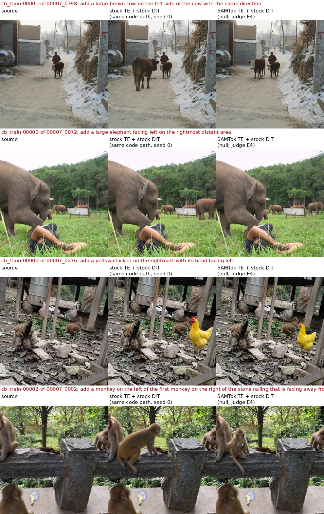

**图 1**　换 TE 之后新增物体变小。列依次是：源图、原版 TE + 原版 DiT（同一条代码路径，seed 0）、SAMTok TE + 原版 DiT（judge 仍给 E4）。

- 产物：图像 `REVIEW/outputs/exp1/plain/`（原版 TE）与 `.../protocol_v2_001/dev_diag/null_plain/text_plain/`（SAMTok TE，你原有的诊断输出）；有结构的 A/B 图像在 `REVIEW/outputs/exp5/mask+bias/`。
- judge：`REVIEW/judge/run1/`、`REVIEW/judge/run5_samtokte/`；成绩汇总 `REVIEW/results/round1_data/score_run5_samtokte.txt`。
- 像素指标：`REVIEW/results/round1_data/add_metrics.json`。
- 脚本：`REVIEW/scripts/te_weight_diff.py`、`exp_stock_bias.py --te samtok`、`add_metrics.py`、`pixel_new.py`。

### 2.2 模型学会了"整图缩小重取景"

**证据（像素几何测量）。** 对不融合的输出，用 SIFT + RANSAC 在区域外的特征点上拟合相似变换。|scale−1| > 1% 或平移 > 8px（按 768 计）记为漂移。

| 方法 | 漂移率：全部 / add / remove / attribute |
|---|---|
| 原版（纯文本 / 两图 mask） | 0% / 0% / 0% / 0% |
| SAMTok TE + 未训练 DiT（纯指令） | 0% |
| B0 原指令 | 20% / 24% / 9% / 35% |
| E5 原指令 | 17% / 7% / 11% / 48% |
| E5 noref | 19% / 12% / 8% / 53% |
| B0 / E5 纯指令，**不含任何区域 token** | 20% / 18% |

**方向与训练数据一致。**
- 漂移输出的尺度中位数约 0.97，最小 0.87，表现为内容整体缩小、边缘外扩。
- 训练对里 ScaleEdit 的错位样本（清洗判定 fix_register），源图到目标图的尺度中位数是 **0.929**，其中 92% 是缩小；CrispEdit、RefEdit、Derived 保留下来的样本是 1.000。
- 不含区域 token 的纯指令也会漂移，说明这是 DiT 的通用行为退化，不是区域条件引起的。

**judge 基本不扣分。** `mirage_081` 两例整图缩小到 0.87，仍给 P4（图 2）。这正是文档里"不融合时、像素校验后 0.73 → 0.56"的主要来源，也是融合显得"必不可少"的原因：融合只是把漂移盖住了。

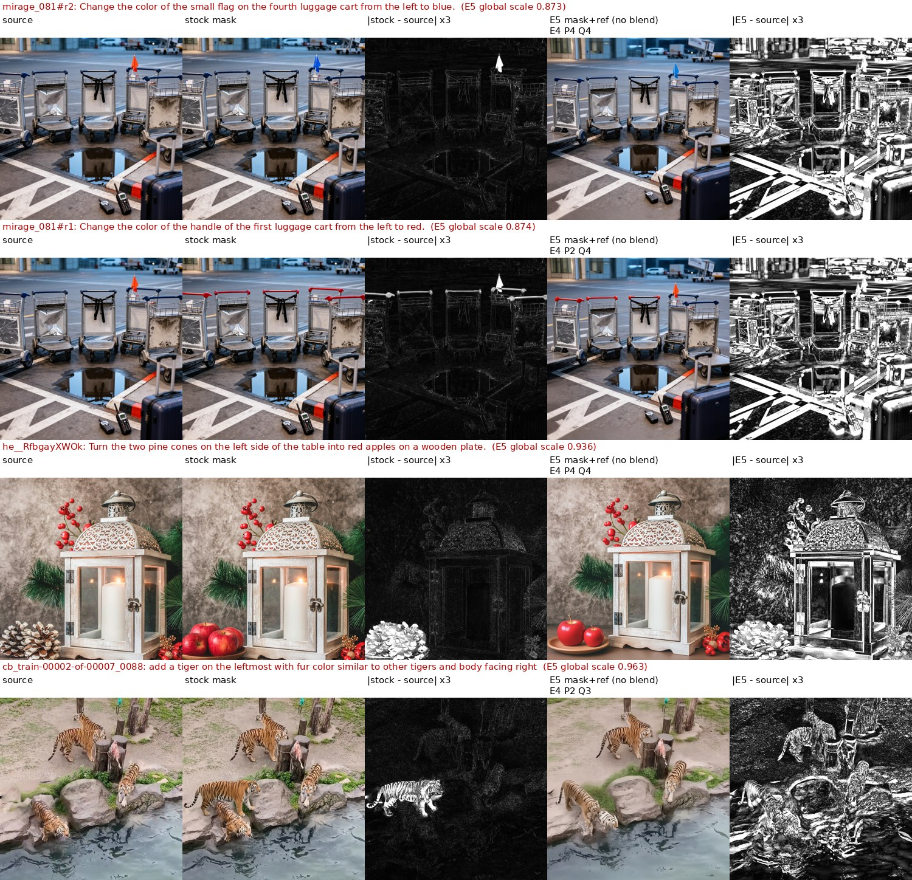

**图 2**　E5 不融合时的整图缩小重取景。每行依次是：源图、原版两图 mask、|原版 − 源图|×3、E5 mask+ref（不融合，附 judge 分）、|E5 − 源图|×3。原版只有区域内亮，E5 整图都亮，judge 仍给 P4。

- 产物：`REVIEW/results/round1_data/geo_drift.json`、`pixel_new.json`。
- 脚本：`REVIEW/scripts/geo_drift.py`（输出）、`train_geo.py`（训练对）。

### 2.3 模型学会了"软补丁"：画质 Q、补丁感、模糊

**证据（训练目标的锐度统计）。** 用 |Laplacian| 均值衡量锐度，在同一对内比较：

| 来源 / 清洗判定 | 原始目标 / 源图（远离区域处） | 清洗后：编辑区 / 周围环 | 源图自身：编辑区 / 周围环 |
|---|---:|---:|---:|
| CrispEdit 配准后贴回 | 0.85 | **0.62** | 1.11 |
| CrispEdit 直接贴回 | 0.82 | **0.70** | 1.28 |
| ScaleEdit 配准后贴回 | 0.68 | **0.66** | 1.02 |
| ScaleEdit 原样保留 | 0.95 | 0.88 | 0.91 |
| Derived / RefEdit | 1.00–1.13 | 0.96–2.14 | 0.84–1.97 |

- CrispEdit 和 ScaleEdit 的目标图整体就比源图软。清洗把区域外贴回成源图之后，编辑区只剩周围锐度的 0.62–0.70。
- 也就是说，**清洗后的数据把"锐利背景 + 软补丁"变成了显式监督**，当前的清洗修不掉，反而让它更显式。CrispEdit 和 ScaleEdit 的贴回样本占清洗后主四类的 35%（23,002 / 66,684）；算上 RefEdit 和 Derived，贴回样本共 26,682 对（40%）。
- 模型输出也是这样：在双方都成功的例子上，E5 生成区相对周围的锐度低于原版 + 融合——remove 的填补处 0.97 对 1.06，新增物体 1.14 对 1.36，**约 70% 的配对例子里 E5 更软**。judge 给 Q 扣分时，"补丁感 / 接缝"、"模糊"这类理由出现的频率是原版的 2–3 倍。

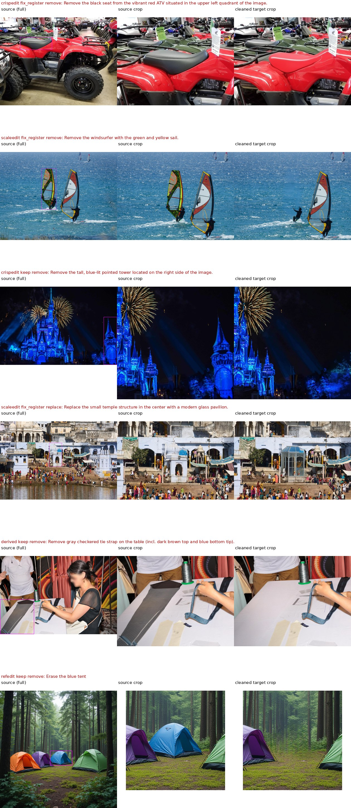

**图 3**　训练对抽样：源图全图、源图局部、清洗后目标局部。
- 前两行同时是 §2.5 的语义缺陷例子：CrispEdit"删除座椅"实际是把座椅涂成了车壳色；ScaleEdit"删除帆板手"只删了帆，人还在。
- 第 3、4 行是编辑区明显变软的例子。

- 产物：`REVIEW/results/round1_data/sharp_train.json`、`sharp_out.json`。
- 脚本：`REVIEW/scripts/sharp_train.py`、`sharp_out.py`、`vis_train_sharp.py`、`train_res.py`。

### 2.4 细粒度部件：分辨率和分布双重超界

**证据：面积分布。**
- 清洗后的训练集里，attribute 区域面积中位数是 6.3%，<0.5% 的只占 10%。
- dev 的 attribute 面积中位数是 0.49%，53% 小于 0.5%。
- 在 1024² 画布上，0.3% 的部件只有 2–3 个 latent token，它在 FM 里的梯度份额也只有 0.3%。

**证据：放大编辑实验。** 把区域外接框放大 3.5 倍裁出来、缩放到 1MP 编辑、羽化贴回（只用于外接框长边 < 短边 30% 的小区域）：
- E5 在小区域子集（21 例）上的 attribute 从 0.81 升到 **1.00**（+0.19 [+0.05, +0.38]）。
- remove +0.10（不显著）。
- add −0.09（不显著；放大后丢了上下文，add 不适合放大）。

**证据：真实 mask 绑定。** 把绑定区域从 codec 解码换成真实 mask，attribute 只 +0.06 [−0.06, +0.19]。

**结论：** 主因是尺度，而不是绑定区域不准。

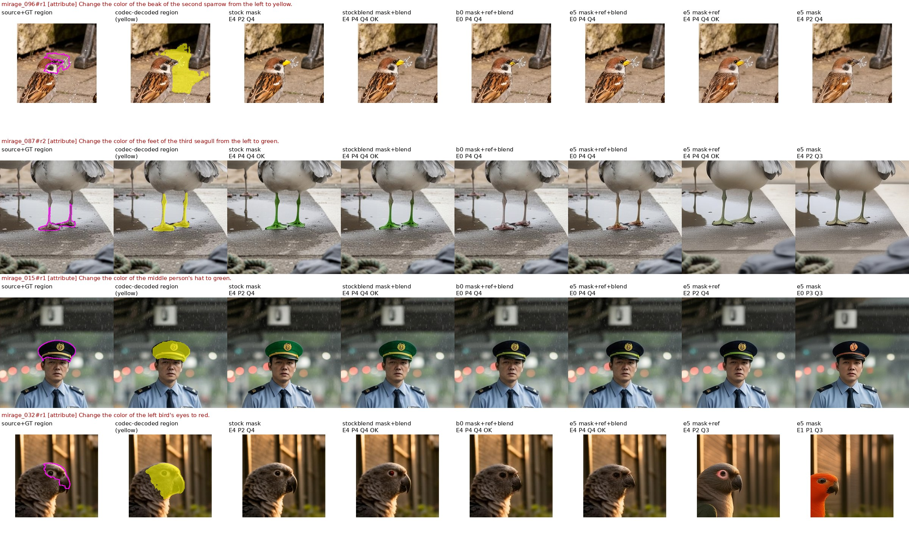

**图 4**　MIRAGE 部件级 attribute。列依次是：源图 + 真实区域、codec 解码区域（黄）、原版两图、原版 + 融合、B0、E5 + 融合、E5 mask+ref、E5 noref。
- 第 1 行鸟喙的 codec 解码是一大块水花（D8）；喙已经变黄，judge 却判 E0。
- 第 2、3 行 E5 没有改（E0），原版 + 融合改对了。
- 第 4 行 E5 noref 把整只鸟改成了橙色。

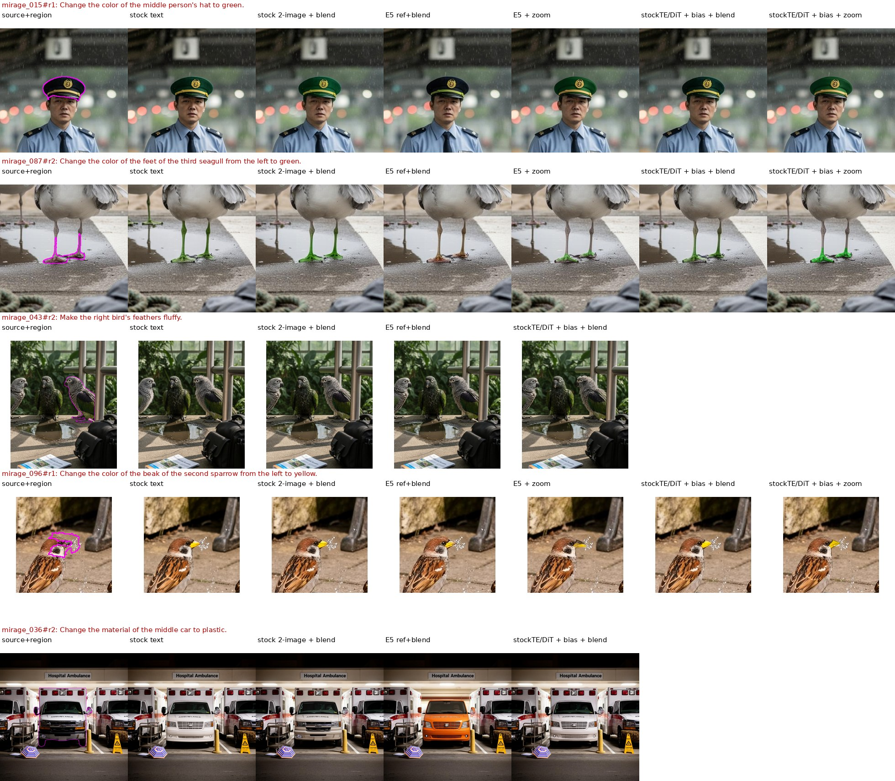

**图 5**　放大编辑。列依次是：源图 + 区域、原版纯文本、原版两图 + 融合、E5 ref + 融合、E5 + 放大、原版 + 偏置 + 融合、原版 + 偏置 + 放大。
- 帽子、海鸥脚两例，E5 放大后都成功了。
- 最后一行"把中间那辆车的材质改成塑料"：E5 把救护车换成了一辆橙色面包车（§2.5）。

- 产物：图像 `REVIEW/outputs/exp2/`（zoom、gtbind）、`REVIEW/outputs/exp1/zoom+bias+blend/`；judge `REVIEW/judge/run1/`；汇总 `REVIEW/results/round1_data/score_new.txt`。
- 脚本：`REVIEW/scripts/exp_e5_variants.py`、`exp_stock_bias.py`、`zoom_cases.py`、`attr_cases.py`。

### 2.5 数据里的语义缺陷被模型模仿

证据来自看 case：
- 训练对里，"删除座椅"实际被涂成车壳色，"删除帆板手"只删了帆（图 3 前两行）。对应模型的"涂色剪影代替删除"和"只删一半"。
- "把中间那辆车的材质改成塑料"：B0 和 E5 都把救护车换成了橙色面包车，原版不会（图 5 最后一行）。训练让 material 类编辑退化成了 replace。

### 2.6 训练把 DiT 改在了哪里：FM 误差分区与 LoRA 改动

**证据一：可解释性实验 exp3。** 取 174 个 E5/B0 训练调度从未抽到的训练对，按清洗判定分组；固定噪声，t 取 250 / 500 / 750，在同为 SAMTok TE 条件下比较原版 DiT、B0、E5 的误差：

| 训练对类别 | 区内 MSE 变化 | 区外远处 MSE 变化 | LoRA 速度场改动：区外 / 区内 |
|---|---:|---:|---:|
| 对齐（keep） | −15% | **−37%** | 0.99 |
| 几何错位（配准修复） | −11% | −22% | 1.47 |
| 区外重绘（drop_C） | −9% | −21% | 1.48 |

- loss 的下降主要发生在编辑区之外：
  - 对齐样本上，是"更准地复制源图"；
  - 错位和重绘样本上，是"更准地预测漂移和重绘"。这些样本训练时从未见过，说明模型学到的是可以泛化的漂移模式。
- LoRA 对速度场的改动，区外和区内一样大；在错位和重绘输入上，区外反而大 50%。
- B0 和 E5 几乎一致：偏置只改变"读哪段指令"，不约束 LoRA 改哪里。

**证据二：LoRA 权重改动幅度。** ‖ΔW‖/‖W‖：
- B0 和 E5 全局都只有 0.73–0.74%。
- 最后 3 个 block 最大（1.2–1.3%），第 0 个 block 次之（0.9–1.1%）。
- 按模块类型看，to_k 和 gate_layer 最大（约 1.0–1.2%）。
- 改动量很小，却足以学出整图漂移。

产物：
- `REVIEW/results/exp3_fm_decomp/rank*.json`、`analysis.txt`，脚本 `REVIEW/scripts/exp_loss_decomp.py`、`analyze_exp3.py`；
- `REVIEW/results/round1_data/lora_delta.txt`，脚本 `REVIEW/scripts/lora_delta.py`。

### 2.7 对已有文档结论的修正

- **"换 TE 几乎无损 / TE 不是瓶颈"**：对 add 不成立（§2.1），只是被 judge 对尺寸不敏感掩盖了。
- **"根因在 Stage 2 数据错位"**：方向对，但不完整。软补丁（§2.3）清洗修不掉；而且即使数据完美，"用 FM 去拟合比原版弱的外部编辑器的输出"本身就是向下蒸馏。
- **"E5 attribute 失败"**：一部分是 judge 误判（鸟喙），一部分是尺度问题（放大就能解决），一部分是语义退化（材质被当成换物体）。
- **"E6 无效"**：是欠训练（§1）。
- **"E5 的区域敏感性 +1.7 个百分点"（文档 08）**：文档 02 第 13 节已经注明，这包含了偏置本身的直接作用。§4.2 把偏置去掉之后，E5 对 token 的跟随就是零。

---

## 3. 不训练的结构化原版能做到什么

### 3.1 原版 + 区域偏置（exp1）

**做法：**
- 用原始指令（与原版纯文本完全相同），不插 mask token。
- 把用户区域做成与 E5 完全相同的 clause 偏置（add 用 mask 的外接框）。
- 可选同款 latent 融合。
- DiT 和 TE 都是原版权重。

所有设置在同一次 judge 里评。

| 方法 | 训练 | add（61） | remove（81） | attribute（32） | 全部成功率 | Q |
|---|---|---:|---:|---:|---:|---:|
| 原版纯文本 | 无 | 0.75 | 0.48 | 0.78 | 0.64 | 3.77 |
| 原版两图定位 + 融合 | 无 | 0.89 | 0.38 | 1.00 | 0.68 | 3.73 |
| **原版 + 区域偏置** | 无 | **0.82** | 0.41 | **1.00** | 0.67 | **3.84** |
| 原版 + 区域偏置 + 融合 | 无 | 0.75 | 0.37 | 1.00 | 0.63 | 3.77 |
| E5 原指令 | Stage 1 + 2 | 0.72 | **0.72** | 0.78 | 0.72 | 3.45 |
| E5 原指令 + 融合 | Stage 1 + 2 | 0.74 | 0.70 | 0.78 | 0.73 | 3.45 |

**配对差（原版 + 偏置 − E5 原指令）：**
- add +0.10 [−0.03, +0.23]；
- attribute +0.22 [+0.09, +0.38]；
- remove −0.31 [−0.44, −0.17]；
- Q +0.38。

**像素指标：** 原版 + 偏置的整图漂移是 0%（E5 是 17%）；新增物体框内面积 0.225（E5 是 0.203，E5 + 融合是 0.160）。

**含义：** 区域信息只要以结构方式给出，未训练的原版就能直接用好——attribute 32 例全对，包括 MIRAGE 的小部件。原版唯一真实的缺口是"删不掉"：区域内的目标 token 会从同位置的源图 token 把物体复制回来（图 6）。

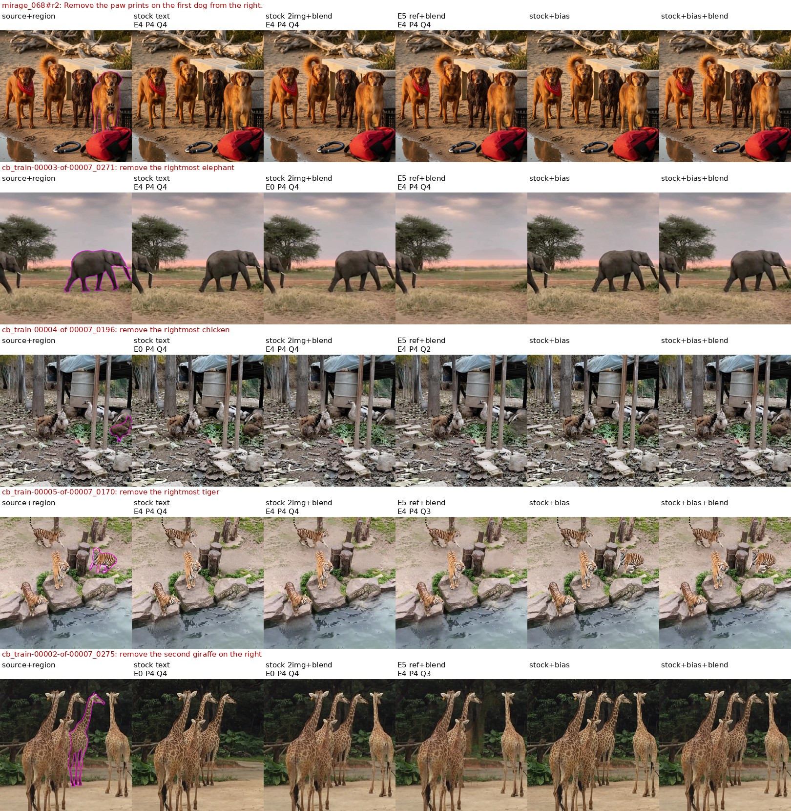

**图 6**　remove：原版 + 偏置删不掉（第 5、6 列），E5 能删（第 4 列）。

### 3.2 不训练也能删：给 remove 加"区域内禁止从源图复制"（exp4）

**做法：** 对 remove 单元，区域内的目标 query 与区域内的源图 key 之间加 −8·m_t(q)·m_s(k) 的 logit。实现方式与 E5 相同（首步 score_mod，KV 解码时加性 mask）。效果上相当于把这一块变成 inpainting。

| remove（81 例，同一次 judge） | 成功率 | E | Q |
|---|---:|---:|---:|
| 原版纯文本 | 0.49 | 2.06 | 3.85 |
| 原版 + 偏置 + 融合 | 0.37 | 1.54 | 3.89 |
| 原版 + 偏置 + 禁止复制 | 0.57 | 2.62 | 3.63 |
| **原版 + 偏置 + 禁止复制 + 融合** | **0.63** | 2.80 | 3.52 |
| E5 原指令 + 融合 | 0.73 | 3.38 | 3.41 |

- 加禁止复制、再加融合之后，比原版 + 偏置 + 融合高 +0.26 [+0.14, +0.38]；比 E5 低 −0.10 [−0.22, +0.02]，不显著。
- **剩下的失败几乎都是同一种**：原物体看不到之后，原版在区域里重新画了一个同类实例（兔子、斑马、鸡被换了姿态重画，图 7）。也就是说，原版缺的是"remove = 填背景"的先验，这才是真正需要训练的东西。
- 反过来，也有 10 例是 E5 删不掉、禁止复制删掉了（比如熊崽）。
- 如果按类型路由（add：偏置不融合；attribute/replace：偏置；remove：偏置 + 禁止复制 + 融合），**完全不训练**的整体成功率约 0.77，同一 judge 下 E5 是 0.72–0.73。这个数混合了两次 judge 运行，只作量级参考。

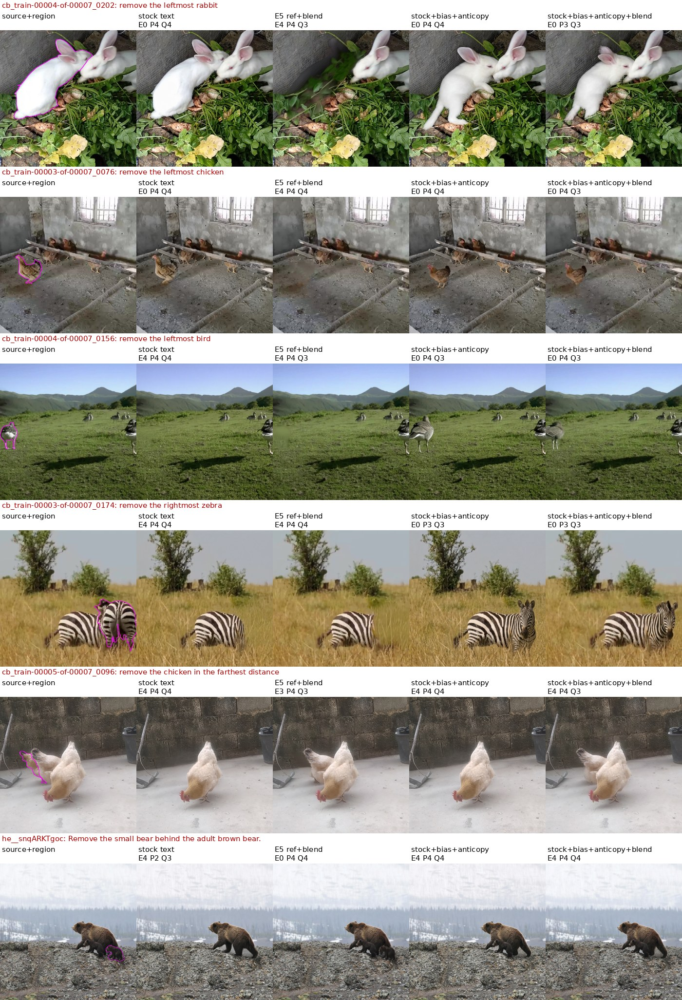

**图 7**　禁止复制的 remove。列依次是：源图 + 区域、原版纯文本、E5 + 融合、原版 + 偏置 + 禁止复制、再加融合。前 4 行是"重画同类"，后两行删成功。

产物：
- 图像 `REVIEW/outputs/exp1/`（plain、mask+bias、mask+bias+blend、zoom+bias+blend）、`REVIEW/outputs/exp4/`；
- judge `REVIEW/judge/run1/`、`REVIEW/judge/run4_anticopy/`；
- 汇总 `REVIEW/results/round1_data/score_new.txt`、`score4.txt`、`tables.txt`；
- 脚本 `REVIEW/scripts/exp_stock_bias.py`、`exp_anticopy.py`、`build_manifest*.py`、`score_new.py`、`score4.py`、`sheet.py`。

---

## 4. DiT 到底有没有用 mask token：可解释性与可行性实验

### 4.1 注意力读取探针（D2）

**做法（可解释性）：**
- 60 个 dev mask 例，CPU 上用 512² 画布，对应 32×32 的 latent 网格。
- 在 DiT 前缀里取 ⟨M⟩ 最后一个 token 对源图 token 的注意力，与区域对比，计算 AUC 和 top-k IoU（k 取区域大小）。
- 对照 token 取 span 前面的一个词。

| 模型 | AUC：最好层 / 10–20 层平均 | 对照 token | top-k IoU：noref | top-k IoU：ref | ref 时对照 token |
|---|---:|---:|---:|---:|---:|
| 原版 | 0.915 / 0.907 | 0.709 | 0.21 | 0.26 | 0.27 |
| B0 | 0.915 / 0.885 | 0.775 | — | — | — |
| E5 | 0.914 / 0.885 | 0.759 | — | — | — |
| v1（有读取损失） | **0.981 / 0.974** | 0.753 | **0.49** | 0.54 | 0.31 |
| codec 解码（同一网格） | — | — | 0.83 | — | — |

**结论：**
1. mask token 能大致注意到自己的区域（AUC 约 0.91），但形状很粗（IoU 0.21，codec 是 0.83）。
2. 只用编辑对训练的 B0 和 E5 **没有提升**读取，甚至略降；有读取损失的 v1 明显提升（IoU 0.21 → 0.49）。**直接监督注意力是有效的**，这是文档 03 第 3 节（注意力路由监督）的依据之一。
3. ref 指令下，span 前面那个物体名单词的读取（0.27）和 mask token 一样好。也就是说带物体名时，**定位主要是短语在做**，mask token 贡献很少。

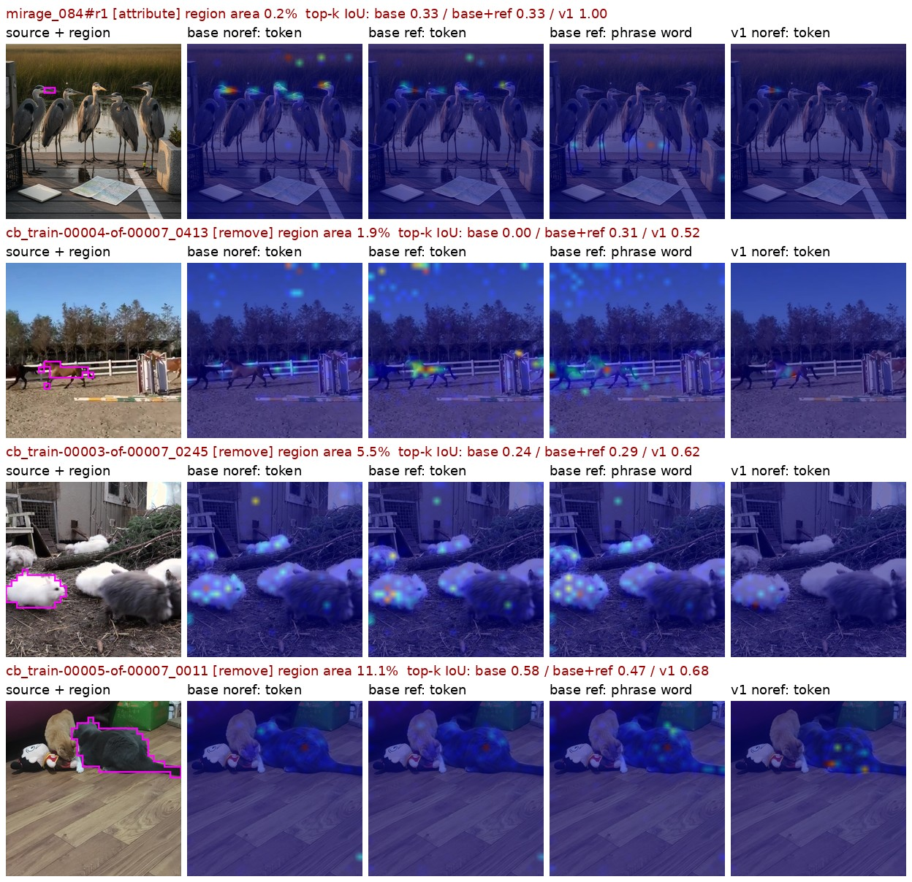

**图 8**　mask token 的注意力读取热图。列依次是：源图 + 区域、原版 noref、原版 ref、原版 ref 时 span 前的物体名单词、v1 noref。原版的读取分散在多个同类实例上；v1 更集中。

产物：`REVIEW/results/d2_read_probe/*.jsonl`、`summary.txt`；脚本 `REVIEW/scripts/read_probe.py`、`d2_summary.py`。

### 4.2 反事实换 token（F2c，加 B0 对照）

**做法：**
- 从训练数据中取 120 个"同一张源图上有两个不同实例 token"的反事实对（定义在 `REVIEW/results/f2c/f2c_pairs.json`，总共 343 对）。
- 指令固定为 "Remove the object in this region ⟨M⟩."，只把 ⟨M⟩ 换成 A 或 B，20 步生成。
- 比较 A、B 各自区域内相对源图的改动，看模型改的是不是 token 指的那个实例。

| 设置 | 成对跟随 | 单 token 选对 | 选择性（区域改动差） |
|---|---:|---:|---:|
| E5 + codec 区域 | **0.75** [0.68, 0.83] | 0.88 | 42.3 |
| E5 + 冻结读出头的区域（§4.3 F1） | 0.33 [0.25, 0.42] | 0.66 | 18.0 |
| E5 不给区域 | **0.06** [0.02, 0.11] | 0.50 | −0.1（等于 0） |
| B0（训练时无区域偏置）不给区域 | 0.20 [0.13, 0.28] | 0.59 | 9.1 |

- 配对差：B0 − E5 不给区域 = +0.14 [+0.07, +0.23]；B0 − E5 + codec = −0.55 [−0.65, −0.45]；E5 不给区域 − E5 + codec = −0.69 [−0.78, −0.60]。
- 最小可检测差 0.12–0.15，观察到的差都远大于它。

**结论：**
1. **E5 生成时完全不读 token**：换 token 输出不变，单个 token 选对 0.50 就是掷硬币。它的区域控制全部来自外部偏置。
2. B0 训练时只能靠 token 定位，也只学到了很弱的跟随（0.20）。而 B0 带 token 的训练样本里，一半不带物体名，13% 是同图多实例（§5.1）。**在原始 SAMTok TE 上只训 DiT，仅靠编辑对的 FM 学不会 token 的含义。**（v1 训练了 TE，remove 上能跟随，见 §0 汇总表。）
3. 训练时有偏置，反而让模型更不读 token（E5 0.06 < B0 0.20）：**mask 作为输入是一条捷径**。
4. 在 E5 训练中完全没见过的子集只有 9 对，不能单独下结论；在读取层面（§4.3，30 对没见过的）结论方向一致。

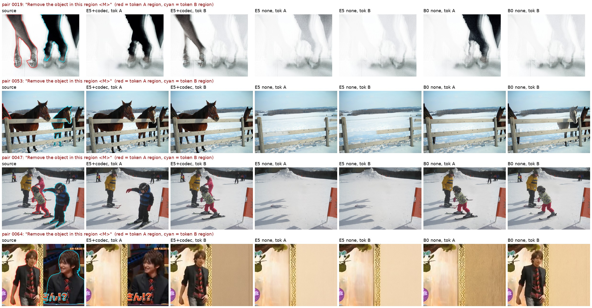

**图 9**　同图同句，只换 token（红 = token A 的区域，青 = token B 的区域）。列依次是：源图、E5 + codec（A / B）、E5 不给区域（A / B）、B0 不给区域（A / B）。E5 不给区域时，A 和 B 的输出几乎一样，经常把所有同类都删掉（马、孩子），或者整片糊掉；B0 偶尔能删对一个。

产物：
- 图像 `REVIEW/outputs/f2c/{codec,head,none,masks}/`、`REVIEW/outputs/f2c_b0/none/`；
- 汇总 `REVIEW/results/f2c/analysis.txt`；
- 脚本 `REVIEW/scripts/f2c_counterfactual.py`、`f2c_b0.py`、`f2c_compare.py`、`f2c_analyze.py`。

### 4.3 token 里有多少区域信息，DiT 能不能学会读（F1 → F3 → F5）

**做法：** 训练"读出头"，从 token 的表示加源图特征预测 token 指的区域。

- 目标：codec 解码，也就是 token 的定义。
- 训练：stage-2 数据中非 add、单 span 的样本，按源图哈希切分出训练和预留。
- 评测：1000 个源图不重叠的预留样本（对 codec，精度 ±0.017）、dev 122 × {ref, noref}（对用户真值）、337 个反事实对（读取层面能否选对实例）。

| 实验 | 读法 | 训练样本 | 预留 IoU | 小部件 <0.5% | dev-ref | dev-noref | 选对实例（337 对） |
|---|---|---:|---:|---:|---:|---:|---:|
| — | 注意力直接读（免训练） | — | 0.24 | — | 0.23 | 0.19 | — |
| F1 | 冻结 E5，第 12 层双线性读出头 | 8k | 0.41 | 0.13 | 0.37 | 0.31 | — |
| F3 | 冻结 E5，双线性读出头 | 16k | 0.47 | 0.19 | 0.46 | 0.36 | 0.62 |
| F3 | 冻结 E5，MLP 读出头 | 16k | 0.48 | 0.15 | 0.45 | 0.38 | 0.64 |
| F3 | **文本 token 上的 LoRA（第 0–12 层）+ MLP 读出头** | 16k | 0.49 | 0.19 | 0.48 | 0.44 | 0.66 |
| F5 | DiT 第 12 层的 token 状态 | 12k | 0.46 | 0.21 | 0.44 | 0.34 | 0.61 |
| F5 | **TE 输出（DiT 的输入）** | 12k | **0.50** | 0.24 | 0.47 | 0.43 | **0.75** |
| F5 | **SAMTok 码本向量** | 12k | 0.45 | 0.17 | **0.49** | **0.49** | 0.72 |
| F5 | TE 输出 × TE 自己的视觉 token | 12k | 0.36 | 0.14 | 0.36 | 0.32 | 0.77 |
| — | codec 解码（对真值） | — | — | dev 0.70 | 0.87 | 0.87 | — |

**关键配对差：**
- F3 中 LoRA − 冻结 MLP 读出头 = +0.012 [−0.000, +0.024]（预留），dev-noref +0.053 [+0.005, +0.100]。为保证公平，两边每个样本都做了 3 次读出头更新。
- F5 中 TE 输出 − DiT 第 12 层 = +0.040 [+0.027, +0.054]；不带物体名时，码本向量 − DiT 第 12 层 = +0.150 [+0.100, +0.201]。
- 学习曲线：样本每翻一倍约 +0.04–0.05，还在涨（图 10）。按这个速度粗推，要到 0.75 需要 50 万到 100 万样本，而且前提是不提前饱和。

**结论：**
1. token 里确实有"指的是哪个实例"的信息：简单读出头约 75% 能选对，没见过的子集 0.80。
2. 但"精确范围"读不出来：最好 0.50，小部件约 0.2；codec 靠的是 SAM2 的解码器和高分辨率特征。
3. DiT 自己的层对读取没有帮助：第 12 层不如它的输入。只训文本通路去读，也只多 0.01。读取需要专门的、作用在整个网络输出上的监督（文档 03 第 3 节），而不是指望编辑损失顺带学会。
4. 码本向量在不带物体名时比 TE 表示更好用（+0.06 对 TE、+0.15 对 DiT），两者互补：TE 带语义，码本带几何。

**注意：** 这些都是"探针"——固定某一层加轻量读出头，或只训练前 13 层的文本通路。它们测的是窄通路能读出多少，**不是**整个网络在输出端被监督时能做到的上限。

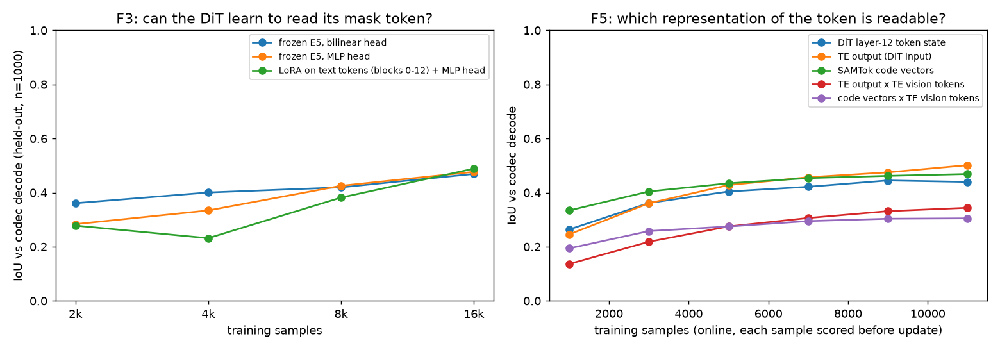

**图 10**　左：F3 预留集的学习曲线（对 codec 解码）。右：F5 的在线曲线（每个样本在用于更新之前先评测，相当于逐步预留）。

产物：
- F1：`REVIEW/results/f1/`（`eval.json`、`eval_summary.txt`、`heads_8000.pt`），脚本 `REVIEW/scripts/f1_deref.py`、`f1_eval.py`、`f1_pick.py`、`deref_common.py`。
- F3：`REVIEW/results/f3/`（`eval.json`、`analysis.txt`、`online_rank*.json`、`snap_16000.pt` 即 LoRA + 读出头），脚本 `REVIEW/scripts/f3_common.py`、`f3_train.py`、`f3_eval.py`、`f3_analyze.py`。
- F5：`REVIEW/results/f5/`（`eval.json`、`analysis.txt`、`heads.pt`），脚本 `REVIEW/scripts/f5_probe.py`、`f5_analyze.py`。

### 4.4 区域精度对编辑的影响（F2b）

**做法：**
- E5 的权重、token、prompt 都不变，只替换偏置所用的区域：codec 解码、F1 读出头、注意力读取，或者不给。
- dev 122 个 mask 例，40 步，不融合。
- 所有设置加原版纯文本，放在同一次 judge 里评（854 条）。

| 区域来源 | 成功率 | E | P | Q |
|---|---:|---:|---:|---:|
| codec，ref | 0.69 | 3.63 | 3.48 | 3.51 |
| 冻结读出头，ref | 0.50 | 3.55 | 3.01 | 3.36 |
| codec，noref | 0.62 | 3.44 | 3.22 | 3.39 |
| 冻结读出头，noref | 0.34 | 2.78 | 2.36 | 3.30 |
| 注意力读取，noref | 0.28 | 3.01 | 2.20 | 3.12 |
| 不给区域，noref | 0.16 | 3.05 | 1.84 | 3.11 |
| 原版纯文本 | 0.57 | 2.69 | 3.75 | 3.88 |

**配对差：**
- 读出头 ref − codec ref：成功率 −0.19 [−0.29, −0.09]，P −0.48。
- 读出头 noref − codec noref：成功率 −0.29 [−0.39, −0.19]，P −0.86。
- 不给区域 − codec（noref）：成功率 −0.47，P −1.39。

**按区域面积分层**（读出头 − codec，ref）：小 <0.5%（22 例）−0.18，中（61 例）−0.20，大 ≥5%（39 例）−0.18。

**结论：**
- 区域范围不准，就会改到不该改的地方，P 大幅下降。而且不分大小，大区域一样受影响。
- 带物体名同时有助于读取和编辑：codec 0.69 对 0.62，读出头 0.50 对 0.34。
- 不给区域时，E5（0.16）远低于原版纯文本（0.57），说明 E5 已经完全依赖外部区域。

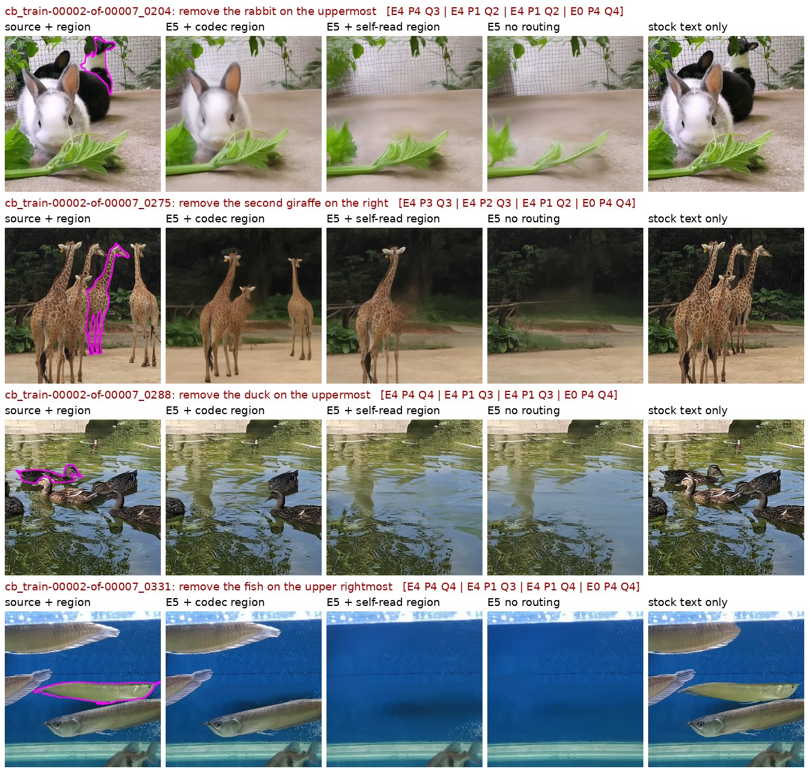

**图 11**　同一个 E5，不同区域来源。列依次是：源图 + 区域、codec 区域、自读区域、不给区域、原版纯文本（行首方括号是 judge 的 E/P/Q）。自读区域和不给区域时，经常把同类全删、背景重画（P1）。

产物：
- 图像 `REVIEW/outputs/f2b/<设置>/`；judge `REVIEW/judge/f2b/`；
- 汇总 `REVIEW/results/f2b/judge_scores.txt`、`by_area.txt`；
- 脚本 `REVIEW/scripts/f2b_generate.py`、`f2_common.py`、`f2b_manifest.py`、`f2b_score.py`、`f2b_by_area.py`。

### 4.5 弃用的代理指标（F2a），以及对我此前说法的更正

**F2a 做法：** 在 992 个预留训练对上，比较不同区域来源时 E5 的单步 FM 误差（t = 250 / 500 / 750）。

| 区域来源 | 区内误差（相对 codec） | 远处误差（相对 codec） |
|---|---:|---:|
| 读出头 | +2.0% | +1.4% |
| 不给区域 | +0.8% | +2.7% |

**问题：** 完全不给区域，区内误差也只多 0.8%，但生成成功率会掉 0.47。这个指标太钝，**不用于任何结论**。

**我此前说法的更正：**
1. 我曾根据 F2a 说"大区域自读约等于 codec"，这是错的。生成层面，大区域同样掉 0.18。
2. F1 的 0.41 是只训了 8k 样本时的欠训练值。补到 12k–16k 之后是 0.47–0.50，结论方向不变。

产物：`REVIEW/results/f2a/f2a.json`、`summary.txt`；脚本 `REVIEW/scripts/f2a_fmproxy.py`、`f2a_summary.py`。

### 4.6 样本量与统计功效

最小可检测效应（MDE）按每个实验实际的逐例方差计算，显著性 α=0.05、检出概率 80%。

| 实验 | 样本 | 精度 / MDE | 能证明 | 不能证明 |
|---|---|---|---|---|
| 读取（F1/F3/F5） | 预留 1000、dev 122×2、反事实对 337 | IoU ±0.018 / ±0.045 / ±0.05 | 各读法之间、读法与 codec 之间的差异 | 真正的解码器结构、更大规模下的上限 |
| F2b 生成 + judge | 122 例，配对 | 成功率 MDE 0.14 | −0.19 到 −0.47 这些差异 | 按类型、按面积分层只能看方向；±0.05 级的"不退化"需要 dev+test 715 例（MDE 约 0.06）加多 seed |
| F2c 反事实对 | 120 对，每设置 240 张图 | MDE 0.12–0.15 | codec 0.75 对 0.06 | 没见过的子集只有 9 对 |
| §2–§3 各表 | dev 183，单 seed | 单比例 ±0.08–0.09 | 已标显著的差 | 整体约 0.77 那一项（混了两次 judge） |

产物：`REVIEW/results/power/power.txt`；脚本 `REVIEW/scripts/power.py`。

---

## 5. 原理层面的分析

### 5.1 为什么只用编辑对做 FM，教不会 token 的含义

适用范围：TE 冻结为原始 SAMTok TE、只训 DiT 的设置（v2 的 B0、E5）。v1 同时训练 TE，在 remove 上学会了跟随，但走的是 TE 改写模板 token 的间接通路，并且改坏了普通文本条件（§0 汇总表）。

1. **信号弱。** FM 误差约 97% 来自区域外；小部件只有几个 latent token，梯度份额更小（§2.4、§2.6）。
2. **有捷径。**
   - 带物体名时，靠短语就能定位（§4.1：带物体名时，物体名单词的读取和 mask token 一样好）。
   - 不带物体名时，把显眼的或同类的物体都改掉，损失也能降下来（B0"同类全删"，图 9、图 11）。
   - B0 的训练数据里，带 token 的样本 192,638 条，一半（96,319 条）不带物体名；同图多实例的源图 3,402 张、样本 24,876 条（13%）。即便这样，B0 的成对跟随也只有 0.20。
3. **区域边界脏。** 错位、软补丁、贴回让区域内外的分界本身就是模糊的（§2.2、§2.3）。

### 5.2 mask 当输入会造成捷径

只要训练时外部区域一直作为输入（偏置、融合），模型就不需要从 token 里取"在哪里"。E5 的跟随率（0.06）比 B0（0.20）还低，就是证据。要让 token 起作用，mask 只能出现在**损失**里（目标图、损失权重、注意力监督目标、教师的特权输入），不能出现在学生的输入里。

### 5.3 token 是一个指针：身份和范围是两回事

- 一个 SAMTok token 只有 2 个码（16 bit），它的精确范围要由 codec 的解码器（SAM2 的双向 transformer + 高分辨率图像特征）"算"出来，并不储存在码本身里。
- 实测：简单读出头能读出"是哪个实例"（约 75%），读不出精确边界（≤0.50）。
- 所以要让 DiT 真正理解 token，必须让**整个网络**学会这个"解码"过程，而不能只靠窄通路。

### 5.4 架构约束：block-causal 前缀

- 联合序列是 [文本前缀，源图 latent，指令文本，目标 latent]。源图 token 排在指令之前，**看不到** mask token。
- 所以对 token 的"读取"只能发生在两处：span token 对源图的注意力，以及目标 token 对 span 和源图的注意力。
- 前缀（包括 span）以 t=0 调制后进入 KV 缓存，所以 span 读到的东西对所有采样步都是同一份。
- 这决定了文档 03 第 3 节里注意力监督加在哪里：目标 token → 指令子句，以及 span → 源图。

### 5.5 原版已经会"精确地改"，缺的是"知道改哪个"

- 原版只要知道改哪个物体，边界就做得很准：纯文本 attribute 0.78，给出结构化区域后 1.00（§3.1）。
- 所以 token 不一定要提供像素级边界，关键是提供**无歧义的身份**（复杂场景里语言给不出的那部分）。精确边界可以交给生成器自己的先验，再用指认任务把"身份 → 像素"的对应训练出来。
- 原版真正缺的能力只有 remove 的"填背景"先验（§3.2）。

---

## 6. 局限

1. §2–§4 的生成实验都是单 seed、只在 dev 上做的。judge 对同一输出重判，成功率会波动约 0.01–0.03。最终结论需要在 test 532 上复现。
2. 读取实验都是探针，没有测真正的解码器结构，也没有测整个网络在输出端被监督时的情况。文档 03 的阶段 A 正是要回答这个问题（E-A1、E-A2 的结果见该文档第 5 节）。
3. 零训练方案用的是用户给的精确区域（交互式场景）。纯文本模式下要接 pass-1 的区域，这部分没测。
4. 按类型路由的整体成功率约 0.77，混合了两次 judge 运行。
5. add 用的是框 token，§4 的 token 实验没有覆盖。
6. 训练指令里 43% 的 add 带 "small / tiny / little"（benchmark 里只有 5%），这可能也是新增物体偏小的原因之一，但没有单独隔离验证。

---

---

## 7. 产物索引

`REVIEW/` = `/mnt/bn/strategy-mllm-train/user/tanyue/experiments2/SAMTokEdit/qwen21_v2/eval/protocol_v2_001/review_v2_20261011/`。

| 内容 | 生成图像 | judge | 数值结果 | 脚本 | 图 |
|---|---|---|---|---|---|
| §1 代码检验、D8 | — | — | `REVIEW/results/round1_data/decode_dev.json`、`decoded/` | `REVIEW/scripts/tok_check.py`、`te_weight_diff.py`、`decode_dev.py` | 图 4 |
| §2.1 换 TE | `REVIEW/outputs/exp1/plain/`、`REVIEW/outputs/exp5/mask+bias/` | `REVIEW/judge/run1/`、`REVIEW/judge/run5_samtokte/` | `REVIEW/results/round1_data/add_metrics.json`、`score_run5_samtokte.txt` | `REVIEW/scripts/exp_stock_bias.py`、`add_metrics.py`、`te_weight_diff.py` | `REVIEW/figures/te_ab.jpg` |
| §2.2 整图漂移 | （各方法输出） | — | `REVIEW/results/round1_data/geo_drift.json`、`pixel_new.json` | `REVIEW/scripts/geo_drift.py`、`train_geo.py` | `REVIEW/figures/drift_examples.jpg` |
| §2.3 软补丁 | — | — | `REVIEW/results/round1_data/sharp_train.json`、`sharp_out.json` | `REVIEW/scripts/sharp_train.py`、`sharp_out.py`、`vis_train_sharp.py`、`train_res.py` | `REVIEW/figures/train_sharp.jpg` |
| §2.4 小部件 / 放大 / 真实 mask 绑定 | `REVIEW/outputs/exp2/`、`REVIEW/outputs/exp1/zoom+bias+blend/` | `REVIEW/judge/run1/` | `REVIEW/results/round1_data/score_new.txt` | `REVIEW/scripts/exp_e5_variants.py`、`zoom_cases.py`、`attr_cases.py` | `REVIEW/figures/attr_zoom2.jpg`、`zoom_attr.jpg` |
| §2.6 FM 误差分区、LoRA 改动 | — | — | `REVIEW/results/exp3_fm_decomp/`、`REVIEW/results/round1_data/lora_delta.txt` | `REVIEW/scripts/exp_loss_decomp.py`、`analyze_exp3.py`、`lora_delta.py` | — |
| §3.1 原版 + 偏置 | `REVIEW/outputs/exp1/` | `REVIEW/judge/run1/` | `REVIEW/results/round1_data/score_new.txt`、`tables.txt` | `REVIEW/scripts/exp_stock_bias.py`、`build_manifest.py`、`score_new.py`、`tables.py`、`sheet.py` | `REVIEW/figures/remove_stockbias.jpg` |
| §3.2 禁止复制 | `REVIEW/outputs/exp4/` | `REVIEW/judge/run4_anticopy/` | `REVIEW/results/round1_data/score4.txt` | `REVIEW/scripts/exp_anticopy.py`、`build_manifest4.py`、`score4.py` | `REVIEW/figures/anticopy_cases.jpg` |
| §4.1 注意力读取（D2） | — | — | `REVIEW/results/d2_read_probe/` | `REVIEW/scripts/read_probe.py`、`d2_summary.py` | `REVIEW/figures/fig_read_maps.jpg` |
| §4.2 反事实换 token（F2c + B0） | `REVIEW/outputs/f2c/`、`REVIEW/outputs/f2c_b0/` | — | `REVIEW/results/f2c/analysis.txt`、`f2c_pairs.json` | `REVIEW/scripts/f2c_counterfactual.py`、`f2c_b0.py`、`f2c_compare.py` | `REVIEW/figures/fig_f2c_counterfactual.jpg` |
| §4.3 读取（F1/F3/F5） | — | — | `REVIEW/results/f1/`、`REVIEW/results/f3/`、`REVIEW/results/f5/` | `REVIEW/scripts/f1_*.py`、`f3_*.py`、`f5_*.py`、`deref_common.py` | `REVIEW/figures/fig_read_curves.png` |
| §4.4 区域精度（F2b） | `REVIEW/outputs/f2b/` | `REVIEW/judge/f2b/` | `REVIEW/results/f2b/judge_scores.txt`、`by_area.txt` | `REVIEW/scripts/f2b_*.py`、`f2_common.py` | `REVIEW/figures/fig_f2b_routing.jpg` |
| §4.5 F2a（弃用） | — | — | `REVIEW/results/f2a/` | `REVIEW/scripts/f2a_fmproxy.py`、`f2a_summary.py` | — |
| §4.6 功效 | — | — | `REVIEW/results/power/power.txt` | `REVIEW/scripts/power.py` | — |
| 新图生成 | — | — | — | `REVIEW/scripts/make_figures.py` | `REVIEW/figures/fig_*.{jpg,png}` |

**对照组的图像来自你原有的评测目录**，未复制：
- 原版纯文本：`/mnt/bn/strategy-mllm-train/user/tanyue/experiments/SAMTokEdit/qwen21_656/inference/qwen21/text_only/`
- 原版两图 mask：`.../qwen21_656/inference/qwen21/mask_annotation/`
- E5：`.../qwen21_v2/eval/protocol_v2_001/dev_e5/e5_ref/`
- 原版 + 融合：`.../protocol_v2_001/dev_diag/stock_blend/`
- SAMTok TE + 原版 DiT：`.../protocol_v2_001/dev_diag/null_plain/`

各 judge 运行的 `manifest.jsonl` 里记录了每张图的确切路径。

---
