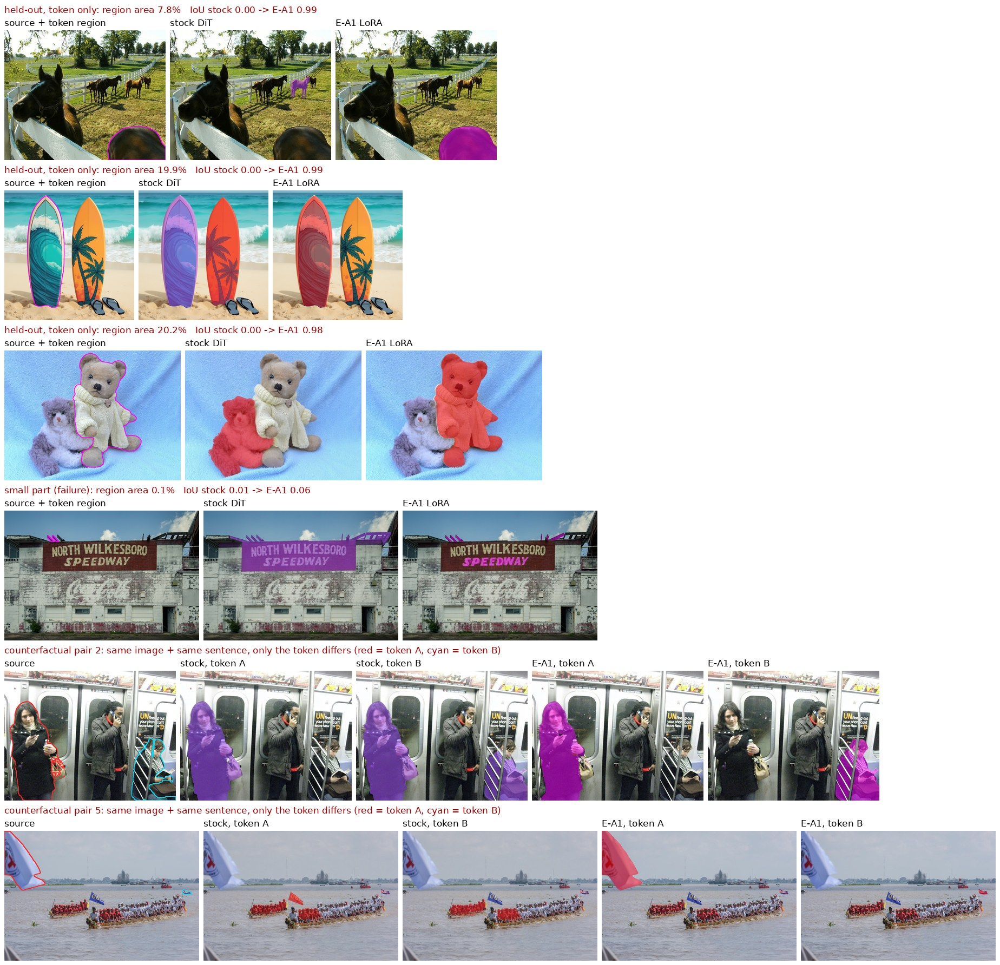
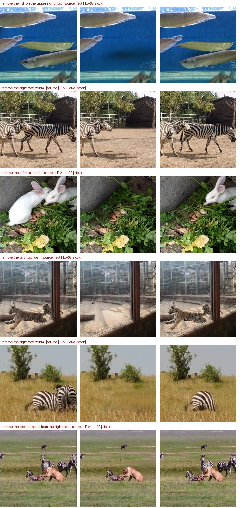
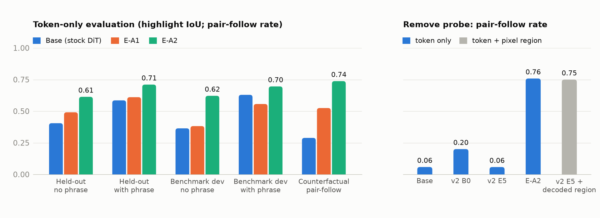
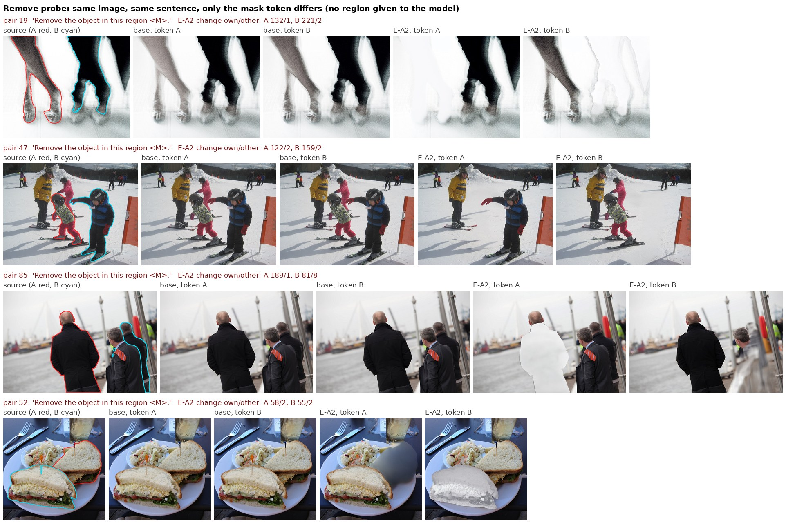
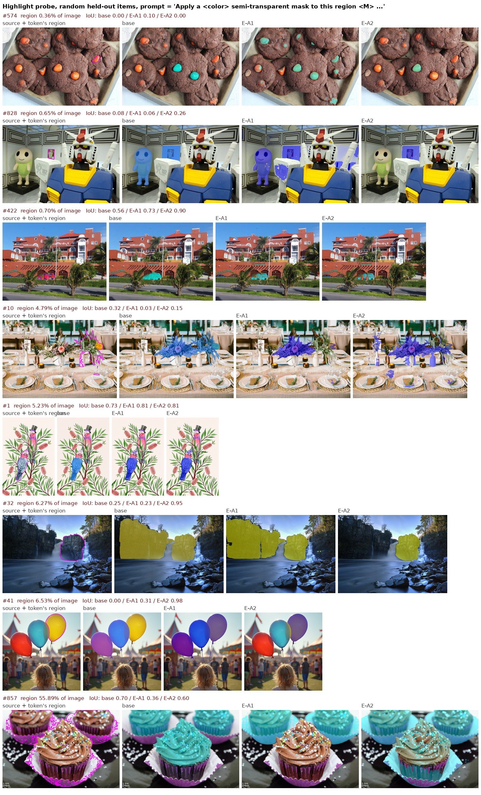
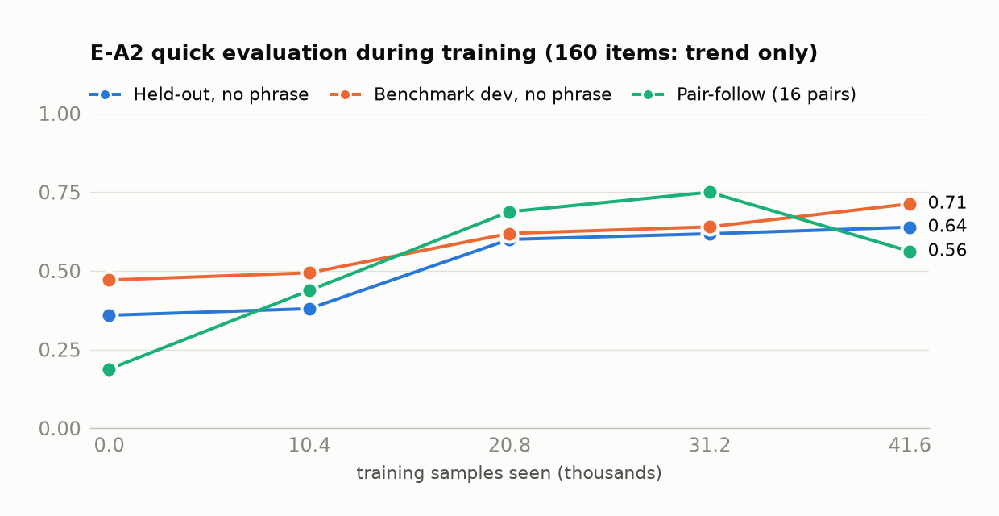

# SAMTokEdit v3：优化计划与进度

- **更新**：2026-10-13。
- **一句话**：创新点保持不变——编辑区域由 SAMTok 编码成 mask token，写进 prompt，和文字一起注入 DiT，推理时不使用任何像素 mask。v3 改的是训练方式：mask 只用作训练监督，让 DiT 学会"这个 token 指的是哪里"。
- **依据**：对 v2 的分析见 [02_SAMTokEdit_Qwen21_v2分析.md](02_SAMTokEdit_Qwen21_v2分析.md)。
- **代码**：分支 `qwen-image-2.1-v3`，本地 `/opt/tiger/tanyue/samtok_edit_qwen-image-2.1-v3`。实现说明见 [01_SAMTokEdit_Qwen21_代码实现说明.md](01_SAMTokEdit_Qwen21_代码实现说明.md)，四机入口见 [05_SAMTokEdit_Qwen21_四机实验运行指南.md](05_SAMTokEdit_Qwen21_四机实验运行指南.md)。
- **实验产物根目录**（下文简称 `V3/`）：`/mnt/bn/strategy-mllm-train/user/tanyue/experiments2/SAMTokEdit/qwen21_v3/`，索引见第 7 节。v2 复核的产物仍在 `REVIEW/` = `/mnt/bn/strategy-mllm-train/user/tanyue/experiments2/SAMTokEdit/qwen21_v2/eval/protocol_v2_001/review_v2_20261011/`。

## 0. 当前状态一览

| 事项 | 状态 | 结论 |
|---|---|---|
| E-A1：指认任务放行实验 | 完成（2026-10-12） | 没过线，但 token 第一次在生成层面起了因果作用：指认 IoU 0.41 → 0.49，成对跟随 0.29 → 0.53。主要错误是选错实例。见 5.1 节 |
| 评测划分的内容泄漏 | 查出并更正（2026-10-12） | 按路径划分时同一张图会以不同路径出现在训练和评测里；改为按图像内容排除。干净子集上结论不变。见 5.2 节 |
| E-A2：直接监督"是哪个实例" | 完成（2026-10-12） | **四条放行线全部通过**：预留集 0.614、dev 0.621、成对跟随 0.738、dev 带物体名 0.696（原版 0.629）。remove 探针的成对跟随 0.06 → **0.76**，与 v2 的 E5 用 codec 解码区域做偏置时的 0.75 持平，而推理时不需要像素 mask。见 5.3 节 |
| 方法代码并入 v3 分支 | 完成（2026-10-13），GPU 回归待跑 | 与 E-A2 脚本逐项核对：函数、注入、路由、损失的数值和梯度逐位一致；评测集和训练数据逐字节复现；分析报告逐数字复现。GPU 上的端到端回归要等 GPU 空出来。见 5.4 节 |
| E-A1 / E-A2 训练脚本的缺陷 | 查出并修正（2026-10-13） | 两个实验里每张卡的 LoRA 随机初始化不一致。已保存的权重和它的评测数字有效，但训练效率被拖低，幅度要靠复跑量化。v3 代码已修正。见 5.5 节 |
| 下一步 | 待跑 | 先用修正后的代码按 E-A2 配方复跑一次（E-A2b），再进入阶段 B（在只给 token 的条件下学编辑）。见第 6 节 |

## 1. 出发点：v2 分析留下的三个事实

1. **v2 的 DiT 生成时不按 mask token 选区域。** 同图同句只换 token、不给外部区域时，E5 的成对跟随只有 0.06，等于随机；完全不用区域偏置训练的 B0 也只有 0.20。现有的区域控制全部来自"codec 把 token 解码成像素区域，再做注意力偏置"这条外部通路（文档 02 §4.2）。
2. **原版模型已经会"精确地改"，缺的是"知道改哪个"。** 不训练的原版加上结构化的区域偏置，attribute 1.00、add 0.82，全面高于 E5（文档 02 §3、§5.5）。
3. **只在编辑对上做 FM 教不会 token 的含义；把 mask 当输入则形成捷径。** 编辑损失只奖励"图对不对"，从不告诉模型某个 ⟨M⟩ 对应哪里；一旦推理时给了解码区域，模型更没有动力去读 token（文档 02 §5.1、§5.2）。

所以 v3 的问题是：**不给像素 mask，只靠 prompt 里的 token，能不能让 DiT 改对地方。** 方案是把 mask 从输入端挪到监督端。

---

## 2. 相关工作与创新点定位

快速检索得到，非完整调研。

| 工作 | 做法 | 和你的区别 |
|---|---|---|
| RePlan（arXiv 2512.16864，ECCV 2026） | VLM 规划器用 CoT 输出区域框和局部提示，免训练地把区域注入 MMDiT 注意力；规划器用 GRPO 训练 | 区域作为**输入**注入，生成器不理解区域引用。v2 当前的实际机制（codec 解码 → 注意力偏置）与它高度重叠 |
| FireEdit（arXiv 2503.19839，CVPR 2025） | 用检测器候选框的 ROI 特征做"区域 token"放进 VLM 指令，引导扩散 | 区域 token 是连续特征，没有精确指代，生成器对 token 也没有可验证的因果跟随 |
| AdaptEdit（arXiv 2604.23763） | 冻结 DiT 上加每层适配器、空间门控和编辑区域预测头，推理时不需要 mask | 区域只从文字推断，复杂场景里文字有歧义时会失效。"区域门控 + 变化像素损失"这一部分不能算你的创新 |
| SAMTok（arXiv 2601.16093） | 把任意 mask 编成 2 个词，用于 MLLM 的理解和分割 | 不涉及生成侧的解引用 |
| TokenCompose（CVPR 2024） | 用分割 mask 监督文生图模型中名词 token 的交叉注意力图 | 是注意力监督的先例，但针对的是文字名词，不是离散的区域 token |
| InstructDiffusion（arXiv 2309.03895，CVPR 2024） | 把指代分割写成指令编辑："给最右边的狗加一层蓝色半透明 mask，其余不变"，目标图是源图叠 0.5 透明度的色块；与编辑、关键点、低层视觉任务联合训练 | **指认任务这个形式的直接先例**。但它指代用的是语言，不是区域 token；目的是做分割，不是教生成器理解 token |
| Emu Edit（arXiv 2311.10089，CVPR 2024） | 16 个任务一起训练，其中检测、分割被写成生成任务；消融显示去掉检测和分割后，区域类编辑变差 | **"感知任务与编辑混合训练能提升局部编辑"的直接证据** |
| Painter、InstructCV | 把分割等感知任务写成图像生成来训练 | 是"在输出端解引用"的更早先例 |
| Appearance Pointers（arXiv 2607.19344）、FOCUS（arXiv 2506.16806） | 把 mask 经 VAE 编成区域 token，或把预测出的分割 mask 作为空间条件喂给扩散解码器 | 都是 mask 作为**输入**，不是离散的语义 token，也没有"换 token 就换结果"的验证 |

**可以主张的创新点（保持"mask token 放进 prompt 注入 DiT"）：**
1. 编辑区域统一编码成离散的 SAMTok mask token，以指令中的词注入 DiT。
2. **mask 只作为训练监督，不作为输入**；生成器在输出端学会解引用 token。
3. **可验证的反事实 token 控制**：换 token 就换被编辑的实例。
4. 诊断性发现：只用编辑对训练的生成器会忽略区域 token（E5 0.06、B0 0.20）。

前提是 第 3 节 的实验能把 3 做出来。

---

---

## 3. 优化方案：保持"mask token 放进 prompt 注入 DiT"，在训练中让模型学会 token 的含义

> **阅读提示。** 3.1–3.6 是 2026-10-11 提出的方案原文，保留下来作为设计依据。到 2026-10-13 为止实际做了哪些、与方案有什么出入，如下表；实验结果在第 5 节。
>
> | 方案里的内容 | 实际情况 |
> |---|---|
> | 3.2 混合条件编码（普通文本用原版 TE，⟨M⟩ 位置用 SAMTok 一侧的表示） | **没有实现。** E-A1、E-A2 整句都用 SAMTok TE 编码。所以换 TE 带来的 add 退化（文档 02 §2.1）还没有处理 |
> | 3.2 码本向量经零初始化投影后加到 ⟨M⟩ 位置 | **E-A2 起实现**（码本向量注入） |
> | 3.2 训练时不给外部区域；区域面积归一的区域内损失 | **实现**（E-A1 起） |
> | 3.2 剔除有缺陷的编辑样本 | **部分实现**：真实编辑只用清洗后保留的 RefEdit / Derived 样本 |
> | 3.3 A1 指认任务 | **实现**，模板是 "Apply a {color} semi-transparent mask to …" 等 4 个；"Keep only ⟨M⟩" 没有做，另加了 5 种程序化局部编辑 |
> | 3.3 A2 实例对比（InfoNCE） | **没有单独实现。** 它的作用由路由损失里"同图其他实例作 3 倍权重负例"和干扰实例项承担 |
> | 3.3 A3 注意力路由监督 | **实现了第一种约束**（目标 token → ⟨M⟩ 的 4 个 token，带权 BCE，6 层）；"⟨M⟩ → 源图"的约束没有做 |
> | 3.4 阶段 B | 没有开始 |

### 3.1 四条原则

1. **推理形式不变。** VLM 或用户 → SAMTok token → 写进指令 → DiT。推理时不解码、不加偏置、不融合。可选的兜底见 3.5 节。
2. **mask 只作监督，不作输入。** 训练时学生也看不到 mask，最多在前 10–20% 的步数里线性退火掉。依据：文档 02 §4.2、文档 02 §5.2。
3. **让 token 成为降低损失的唯一途径。** 去掉短语捷径（用不带物体名的指令 + 同类干扰实例），让损失集中在区域上，并且目标要精确。依据：文档 02 §5.1。
4. **保住原版。** 文本条件与原版一致（混合 TE）；教师用原版；避开有缺陷的数据。依据：文档 02 §2、文档 02 §3。

### 3.2 第 0 步：条件编码与训练设置（前置，改动小）

1. **混合条件编码。**
   - 普通文本用**原版 TE** 编码，与原版逐位一致。
   - ⟨M⟩ 的 4 个位置放 SAMTok 一侧的表示：SAMTok TE 在该位置的输出，加上 SAMTok 码本向量经**零初始化投影**后的结果。
   - 实现：原版 TE 用 4 个占位 token 代替 span 跑一遍，SAMTok TE 跑一遍完整 prompt，再把 span 位置替换进去。token 仍然在 prompt 里原来的位置。
   - 依据：换 TE 导致 add −21%、有结构时成功率 −0.14（文档 02 §2.1）；码本向量在不带物体名时读取 +0.15（文档 02 §4.3）。
2. **训练时不给外部区域**（不加偏置、不融合）。
3. **区域面积归一的 FM 损失**，再按面积归一给区域内加权，保住小部件的梯度。
4. **FM 里剔除或降权**软补丁、几何错位、区外重绘的样本（文档 02 §2.2、文档 02 §2.3、文档 02 §2.5）。

### 3.3 第 1 步，阶段 A：学会 token 的含义（不需要编辑对）

**A1 指认任务（核心）。**
- 指令用独立模板，避免和编辑混淆：
  - "Highlight the region ⟨M⟩."：目标图 = 源图 + 该区域半透明着色和描边；
  - "Keep only ⟨M⟩."：目标图 = 区域外去饱和、压暗。
- 目标用 token 的 codec 解码，也就是 token 的定义本身，保证目标和 token 完全一致。
- 数据：四个标注子集里所有带 SAM3 实例 mask 的图（每张图多个实例，天然构成反事实），再加大规模 mask 数据和部件级 mask（覆盖小部件）。对"同类实例 ≥2"的图加大采样。
- **为什么最可能有效：**
  - 区域外的目标就是源图，所以损失只集中在区域里；
  - 同图有多个实例时，不读 token 就降不下去；
  - 目标逐像素精确；
  - 监督的是整个网络在输出端的行为，而 文档 02 §4.3 的探针只测了窄通路；
  - 数据量不受编辑对限制；
  - 直接给出"生成器读懂 token 没有"的指标，即生成高亮的 IoU。
- 先例：InstructDiffusion 用的就是这个形式（半透明色块叠在源图上），见下面的"先例、数据量与混合方式"。

**A2 实例对比。**
- 在中间层取 span 的状态，和每个实例区域内平均的源图特征做 InfoNCE；负例优先取同图同类实例。
- mask 只用来做平均。
- 依据：TE 表示里线性可读出约 75% 的实例身份（文档 02 §4.3），对比学习针对的正是这一点。

**A3 注意力路由监督。**
- 在少数中间层上加两种约束：
  - 目标 token → 指令子句（含 ⟨M⟩）的注意力，区域内高、区域外低（BCE 或排序损失）；
  - ⟨M⟩ → 源图的注意力集中在区域内（KL 到区域内均匀分布）。
- 依据：v1 的读取损失把读取 IoU 从 0.21 提到 0.49、AUC 从 0.91 提到 0.98（文档 02 §4.1）；TokenCompose 是先例。
- 权重取小，只加在少数层。

**混合比例。** A2、A3 作为同批样本上的辅助损失；A1 与编辑数据的配比和日程见下面的"是否混合编辑任务"（前期指认 60–70%，之后 20–30%）。

**指认任务的先例、数据量与混合方式**（2026-10-11 补充）

*先例。* 任务形式本身有人做过，不能当作创新点：
- InstructDiffusion 把指代分割写成"给某物体加一层指定颜色的半透明 mask，其余不变"，目标图是源图叠 0.5 透明度的色块，和编辑任务联合训练。它在 RefCOCO val 上的 cIoU 是 61.7（专用模型约 73），gRefCOCO 上 67.4（高于专用模型）。
- 它报告的两条经验可以直接照搬：半透明比不透明的分割效果更好；指令要写详细（只写任务名时 COCO-Stuff 41.3，写详细后 53.2）。
- 快速检索没有找到"用它来教生成器理解 prompt 里的离散区域 token"的工作。你的新意在指代对象是 SAMTok token、mask 只作监督、以及反事实换 token 的验证，不在指认任务本身。

*数据量。* 参照点：
- InstructDiffusion 的分割类有效样本约 23.9 万，占总量 95.5 万的 25%（编辑占 45%）。
- Emu Edit 16 个任务共 1000 万样本。
- 我们的窄通路探针在 1.2–1.6 万样本时 IoU 0.50，每翻一倍 +0.04–0.05（文档 02 §4.3）。

建议分三档，用学习曲线决定是否继续加：

| 档位 | 指认样本数 | 用途 | 8 张 H100 的耗时 |
|---|---:|---|---|
| 放行实验（E-A1） | 约 3 万，另加约 1.2 万条干净编辑样本 | 看能否明显超过探针的 0.50 | 训练约 5–6 小时，含数据准备和评测 6–8 小时 |
| 工作规模 | 20–30 万 | 与 InstructDiffusion 的分割数据量相当 | 约 26–40 小时（32 卡约 7–10 小时） |
| 继续扩 | 100 万以上 | 仅当 25k / 50k / 100k / 200k 处的曲线每翻一倍仍涨 ≥ 0.02 | 32 卡约 33 小时 |

- 耗时按 E5 的实际吞吐估算：12.8 万样本、32 张 H100、4 小时 10 分，约 960 样本 / GPU·小时（1024²，TE 在线编码）。
- 比样本数更重要的是**不同图片和不同 mask 的数量**。建议工作规模至少 5–10 万张图、50 万个不同 mask，其中同图同类多实例的图占 30–50%，面积 <1% 的小部件占 20% 以上。
- **现成的数据已经够放行实验和大半个工作规模**：
  - `/mnt/bn/strategy-mllm-train/user/tanyue/datasets/SAMTok_Training_Data/mask_generation_gres209k.json`：209,344 条样本、16,994 张 COCO 图、263,753 个已经编码好的 mask token，带指代短语；几乎每张图都有 6 条以上，天然构成反事实。
  - stage-2 数据里有 69,013 张带 token 的源图。
  - 小部件需要另外补：PACO 类部件标注，或 SAM3 的部件提示。
- 两个注意点：COCO 图分辨率低，要和高分辨率源图混用；训练图必须和 benchmark 的图去重。

*是否混合编辑任务。* 要混合，不建议单独训完指认再训编辑：
- 证据：Emu Edit 的消融里，去掉检测和分割任务后，人工评测在区域类编辑上有约 60% 更偏好完整模型，对自由编辑几乎没影响；多任务模型在每个任务上都优于单任务专家。InstructDiffusion 也观察到联合训练后编辑的定位更准（定性）。
- 对我们还有两条额外理由：读 token 的机制必须和编辑共用同一套权重；只训指认会让 LoRA 偏向"着色"输出。
- 做法：
  - 同一个 LoRA、混合 batch，用指令模板区分任务，可以再加一个可学习的任务嵌入。
  - 前 20–30% 的步数：指认占 60–70%，干净的编辑数据占 30–40%。之后：指认 20–30%，编辑 70–80%。指认始终保留 10–20% 以上，防止遗忘。
  - 成对采样：同一张图、同一个 token，既出现在"高亮 ⟨M⟩"里，也出现在"编辑 ⟨M⟩"里。
  - 指认指令里带物体名和不带物体名各占一半；颜色随机并写进指令。
  - 混进来的编辑数据必须是干净的（教师蒸馏、干净的 remove 对、程序化编辑），否则 文档 02 §2 的退化会回来。
- 放行实验 E-A1 也按"指认 70% + 干净编辑 30%"来跑，这样一次就能同时看到指认 IoU 和有没有着色渗漏。

**放行线**（评测集与 F3/F5 相同）：
- 指认 IoU：全部 ≥ 0.75，小部件 ≥ 0.5。
- 在 337 对上选对实例 ≥ 0.95。
- 对照的是探针上限：0.50 和 75%。
- 非指认指令下，输出与原版的像素差不增加。

### 3.4 第 2 步，阶段 B：在只给 token 的条件下学编辑

**B1 反事实编辑对。**
- 同一张图、同一句话（含糊的或不带物体名），不同 token → 不同目标。
- 现成数据：3,402 张同图多实例源图、24,876 条样本。
- 扩充：用 B2 的教师对同一张图的每个实例各生成一个目标。

**B2 特权教师蒸馏。**
- 教师：原版 TE + 原版 DiT + codec 区域偏置（remove 再加禁止复制）+ 融合。教师能看到 mask，学生只看 token。
- 筛选：用 judge 加像素门槛筛教师结果——区域外不变、无整图漂移、锐度不低于源图同比。
- 只蒸馏教师擅长的类型：attribute、add、replace；remove 只用教师成功的样本。
- 训练方式：在学生自己的采样轨迹上对齐教师的速度场，或离线生成目标图再做 FM。
- 依据：原版 + 偏置 attribute 1.00、add 0.82、Q 3.84（文档 02 §3.1）；文档 02 §2 里那些数据缺陷不会进入目标。

**B3 干扰实例加权。** 同一张图里同类其他实例位置的 FM 损失乘以权重（例如 ×5），直接针对"同类全删"（图 9、图 11）。

**B4 真实数据只补原版缺的能力。**
- remove 的"填背景"先验：用对齐干净、锐度正常的 remove 对（Derived、RefEdit，以及 remove → add 反转）。
- CrispEdit、ScaleEdit 中编辑区锐度比 < 0.85 或几何错位的样本，不进 FM。

**B5 程序化局部编辑（辅助）。** 在 ⟨M⟩ 内改色相、去饱和、调亮、模糊，目标逐像素精确。

A1–A3 的损失在阶段 B 继续保留，只是权重调低，防止忘掉已经学会的读取。

**验收线：**
- 只给 token 时，成对跟随 ≥ 0.7（E5 0.06、B0 0.20、codec 路由 0.75），评测 ≥ 300 对、其中 ≥ 100 对没见过。
- dev+test 715 例 × 2 个 seed：每种类型不低于原版，整体不低于 E5（E5 使用它自己的路由）。
- 整图漂移 0%。
- 新增物体框内面积不低于原版。
- 干扰实例被改动的比例不高于 codec 路由。

### 3.5 推理

- 只给 token。
- 可选兜底一，"自指认融合"：先让模型自己"Highlight ⟨M⟩"得到区域，再用它做 latent 融合。这个区域来自生成器本身，不来自外部分割器。报告结果时同时给出有、无这一步的数字。
- 可选兜底二：如果训练时以 10% 的概率把 token 置空，推理时可以对 token 做无分类器引导，放大它的作用。

### 3.6 风险与备选

| 风险 | 对策 |
|---|---|
| 指认任务的着色风格渗进正常编辑 | 用独立模板、控制比例；监控非指认指令下的像素差 |
| 阶段 A 超不过探针上限，指认 IoU < 0.6 | 说明在 64×64 的 latent 分辨率下，精确范围无法只靠 token 得到。备选：token 只负责身份，用"自指认 + 放大编辑"处理小部件；或者接受解码器参与（对创新性有影响） |
| 小部件 | 部件级数据 + 区域面积归一的损失 + 自指认后放大编辑 |
| 教师的失败模式被学走（remove 重画同类） | 按类型筛选，remove 只用真实数据和教师成功的样本 |
| 不用硬 mask 后区域外漂移 | 教师目标本身是对齐的；用 B3 加区域外的像素门槛筛数据；测整图漂移率 |

---

---

## 4. 实验计划与当前状态

| 编号 | 内容 | 规模 | 评测 | 放行线 | 状态 |
|---|---|---|---|---|---|
| **E-A1** | 原版 DiT + LoRA r32，指认 + 程序化局部编辑 + 干净真实编辑；FM + 区域内项 | 4.2 万样本，8 卡 8.8 小时 | 指认 IoU（预留 1000、dev 244）；343 对成对跟随 | 指认 IoU ≥ 0.65 | **完成，未过线**（0.49）。见 5.1 |
| **E-A2** | E-A1 + 注意力路由损失 + 干扰实例项 + 码本向量注入；加入 GRES 多实例数据 | 4.16 万样本，8 卡 9.6 小时 | 同上，另加 remove 探针、普通编辑的区域内外改动 | 预留集 ≥ 0.60、dev ≥ 0.50、成对跟随 ≥ 0.70、dev 带物体名 ≥ 原版 | **完成，全部通过**。见 5.3 |
| **E-A2b** | 与 E-A2 完全相同的配方和 batch，用修正了初始化的 v3 代码 | 四机：32 卡 × accumulation 1 = batch 32，1300 次更新，约 3–4 小时 | 与 E-A2 相同，逐例配对 | 不低于 E-A2；用来量化 5.5 节缺陷的影响 | **待跑**（入口已就绪，见文档 05） |
| E-B1 | 阶段 B 小规模：以阶段 A 的权重为起点，换成以真实编辑为主的配比，保留三项身份监督 | 1–2 千次更新 | dev 183 judge 与像素指标；成对跟随；remove 填补质量 | 各类型不低于原版；成对跟随 ≥ 0.5；remove 区域内纹理 ≥ 源图同区的 0.85 | 未开始 |
| E-B2 | 全量阶段 B，加 test 532 | 2 个 seed | 715 例 + 成对 | 达到 3.4 节的验收线 | 未开始 |

**论文需要的消融**（训练入口已提供对应开关）：
- mask 当输入（E5 式）对 mask 当监督；
- 去掉注意力路由（`--lambda-route 0`）；去掉干扰实例项（`--lambda-distractor 0`）；去掉码本向量（`--no-code-injector`）；三者都去掉即 E-A1 的方法；
- 去掉指认任务；去掉反事实对；去掉教师（阶段 B）。

---

## 5. 进展记录

### 5.1 E-A1：指认任务放行实验（2026-10-12，未过线）

#### 5.1.1 做法

**模型。** 原版 DiT 加一个新的 LoRA（rank 32，与 E5 相同的配方）；pass-2 直接用 SAMTok TE 的输出。训练和推理都**不加区域偏置、不做融合**，模型只能从 token 知道"在哪里"。

**数据。** 全部来自现有的 stage-2 数据。训练只用 sha256(源图路径) % 10 ≠ 0 的源图，所以评测用的预留集和反事实对都没在训练里出现过。

| 类别 | 数量 | 说明 |
|---|---:|---|
| 指认 | 30,000 | 指令要求给 ⟨M⟩ 加某种颜色的半透明色块；目标图 = 源图在 token 的 codec 解码区域叠 0.5 透明度的该颜色。其中 13,416 条来自同图多实例；带物体名 12,971 条，不带 17,029 条 |
| 程序化局部编辑 | 8,000 | 只在区域内转灰度、调亮、调暗、模糊或反色 |
| 真实编辑 | 4,000 | 清洗判定为保留的 RefEdit / Derived 编辑对 |

**训练。**
- 损失：官方 FM 损失，加一项按区域面积归一的区域内损失。
- lr 1e-4，batch 32，1300 次更新，共 41,600 个样本（约 1 个 epoch）。
- 8 张 H100，用时 8.8 小时，没有样本被跳过。

**与 第 4 节 计划的差别。** 没做混合 TE、没加码本向量，也没加实例对比（A2）。也就是说，这次是"最简版的阶段 A"。

**评测方法。**
- 只给 token，让模型生成"高亮 ⟨M⟩"：20 步，不加偏置、不融合。
- 从输出图反推出着色区域，与 token 的 codec 解码（预留集、反事实对）或用户真值（dev）计算 IoU。
- 这个反推方法在完美叠色图上能达到 0.99（60 个 dev mask 实测），所以测出的 IoU 反映的是模型本身，不受反推误差限制。
- 对照组是未训练的原版（同一个 SAMTok TE），在同一批样本上逐例配对。

#### 5.1.2 结果

| 评测（只给 token） | 原版 | E-A1 | 配对差 |
|---|---:|---:|---:|
| 预留集，不带物体名（607，对 codec） | 0.405 | **0.491** | **+0.086** [+0.060, +0.112] |
| 预留集，带物体名（393） | 0.585 | 0.611 | +0.025 [+0.001, +0.050] |
| 预留集合计（1000） | 0.476 | 0.538 | — |
| dev，不带物体名（122，对用户真值） | 0.364 | 0.382 | +0.018 [−0.026, +0.061] |
| dev，带物体名（122） | 0.629 | 0.557 | **−0.072** [−0.124, −0.022] |
| 反事实对：两个 token 都选对（343 对） | 0.289 | **0.525** | **+0.236** [+0.175, +0.294] |
| 反事实对：单个 token 选对 | 0.596 | 0.746 | — |
| 反事实对严格口径（自己 ≥0.5 且另一个 <0.1）：成对 / 单个 | 0.10 / 0.32 | 0.27 / 0.46 | — |

**按面积分（预留集，不带物体名）：**
- 小 <0.5%：0.13 → 0.17
- 中：0.36 → 0.42
- 大 ≥5%：0.50 → 0.62

**误差分解：**
- 预留集不带物体名：
  - IoU < 0.1（选错或没画）的比例 33% → 23%；
  - IoU ≥ 0.5 的比例 41% → 49%；
  - 只看 IoU ≥ 0.3 的样本，平均 IoU 0.69 → 0.71。
- 反事实对：选对实例的比例 60% → 75%；选对时的区域 IoU 0.58 → 0.66。
- **提升主要来自"选对实例"**。选对之后的范围质量本来就还可以（0.66–0.71）；小部件基本无效。

**训练曲线**（96 条快速评测，第 0 / 325 / 650 / 975 / 1300 次更新）：
- 不带物体名 IoU：0.33 / 0.38 / 0.43 / 0.49 / 0.48，后半段持平。
- 成对跟随：0.25 / 0.25 / 0.38 / 0.50 / 0.56，还在涨（只有 16 对，噪声大）。

**普通编辑指令下的副作用**（48 个 dev 编辑，带物体名 + token，不加偏置）：
- 没有看到半透明着色渗进普通编辑。自动指标标出的 10 例，人工看都是 remove 真的删掉了东西造成的颜色变化（图 2）。
- **但看到一个新问题：** 加 LoRA 后，remove 经常把同类全删（图 2 的 6 例里有 4 例），而原版多数时候根本删不掉。
- 区域外平均改动：LoRA 3.7，原版 6.0；区域内：LoRA 59，原版 46。
- 这说明在真实编辑里，token 对实例的约束还不够，和 B0 的"同类全删"是同一类问题。

**图 1**　E-A1 的指认输出（按"E-A1 对、原版错"挑选的例子，不代表平均水平）。
- 前 3 行：只给 token 时，原版高亮到别的物体，E-A1 高亮到 token 指的那个。
- 第 4 行：小部件，两者都失败。
- 后 2 行：同图同句只换 token，E-A1 跟着 token 换了被高亮的实例；原版两次都高亮同一个。

**图 2**　普通 remove 指令（带 token、不加偏置），列依次是源图、E-A1 LoRA、原版。没有着色渗漏，但 LoRA 常把同类全删。

#### 5.1.3 结论

1. **没有通过放行线。** 放行线是预留集 IoU ≥ 0.65；只给 token 时实际是 0.49 [0.46, 0.52]，与此前窄通路探针的上限（0.50）持平，没有超过。按预先定的规则，这落在"不超过探针 → 停"和"0.5–0.65 → 不确定"的边界上。
2. **但这是第一次在生成层面看到 token 起因果作用。** 同图同句只换 token，成对跟随从 0.29 升到 0.53（严格口径 0.10 → 0.27）；相比之下，E5 在编辑中不给区域时只有 0.06。也就是说，"mask 只作监督"确实能让 DiT 开始按 token 选实例，只是精度离可用还很远。
3. **没有迁移到 benchmark。** dev 不带物体名只 +0.02（不显著），带物体名反而 −0.07。dev 的指代短语多是序数或方位关系（例如"左数第二个"）；LoRA 学到的 token 读取，在这类情况下覆盖了原版按短语定位的能力。
4. **小部件无效**（0.17）。
5. **在真实编辑里，token 对实例的约束还不够**（remove 同类全删）。

#### 5.1.4 当时的下一步建议（已由 E-A2 落实）

主要错误是**选错实例**（约 25%），而不是范围不准；"只靠输出端监督、3 万条数据"的最简版阶段 A 不够。建议再跑一轮 **E-A2**：
- 数据、更新次数、评测都与 E-A1 相同，便于逐例配对比较。
- 只加三样直接针对"实例身份"的东西：
  1. **注意力路由损失**：对目标 token，要求它对 ⟨M⟩ 的注意力 logit 区域内高于区域外。用排序损失，不需要 softmax 分母，开销很小。
  2. **实例对比**：span 状态和各实例区域内平均的特征做对比，负例取同图其他实例。
  3. **码本向量**：零初始化投影后加到 span 的嵌入上。
- 数据上同时补两点：
  - 加入 benchmark 风格的同图多实例样本：`datasets/SAMTok_Training_Data/mix_gres8k_ver4k_train.parquet` 有 12,337 条，图片已内嵌。
  - 加入"序数短语 + 同类干扰"的指认样本，防止削弱原版按短语定位的能力。
- 训练中途也评 dev，而不只评预留集。
- 评测里加一项 remove 的反事实测试（同 文档 02 §4.2 做法），直接看 token 是否约束真实编辑。

**放行线：**
- 预留集不带物体名 ≥ 0.60；
- dev 不带物体名 ≥ 0.50；
- 成对跟随 ≥ 0.70；
- dev 带物体名不低于原版。

达不到就停止"只靠 token 推理"这条路，改走 3.6 节 的备选：让冻结的 SAMTok 解码器在推理时参与（会影响创新性的表述）。成本与 E-A1 相同，8 卡约 9 小时，加上评测约 1.5 小时。

#### 5.1.5 产物

| 内容 | 路径（相对 `V3/`） |
|---|---|
| 训练清单与评测清单 | `data/stageA_ea1_20261011/train.jsonl`（42,000 行）、`eval.json`（预留 1000 + dev 244 + 反事实 686）、`eval_quick.json`（96）、`data_stats.json` |
| 最终 LoRA | `runs/ea1_local8_001/train/adapter_1300/`（第 325 / 650 / 975 次更新的中间权重没有保留） |
| 训练记录与快速评测 | `runs/ea1_local8_001/train/train_metrics.jsonl`、`train_log.jsonl`、`quick_*.json`、`quick_summary.jsonl`、`quick_images/` |
| 完整评测（逐例结果、生成图、反推区域、副作用检查） | `runs/ea1_local8_001/eval/` |
| 原版基线的评测（E-A1、E-A2 共用） | `baselines/stock_highlight_eval/` |
| 汇总 | `runs/ea1_local8_001/results/analysis.txt` |
| 当时运行的脚本（留档） | `legacy_code/ea1/` |
| 图 | 仓库 `docs/assets/v3_progress/fig_ea1_examples.jpg`、`fig_ea1_leak_check.jpg` |

`legacy_code/ea1/` 是当时实际运行的脚本，只作留档；同一方法现在由仓库代码实现（`samtok-edit ground-train --lambda-route 0 --lambda-distractor 0 --no-code-injector`）。

#### 5.1.6 可视化检查（`V3/runs/ea1_local8_001/vis/`，用浏览器打开 `index.html` 可以一页看完）

**每行的内容：** 源图 + token 区域（品红描边）、原版输出、E-A1 输出、E-A1 输出反推出的区域（白）与真实区域（品红）。

| 文件 | 内容 |
|---|---|
| `00_scatter.png` | 逐样本散点，横轴原版、纵轴 E-A1，按预留 / dev、带 / 不带物体名分 4 张 |
| `01_random_heldout_noref_{1,2,3}.jpg` | 预留集只给 token，随机 24 例（固定种子，按面积从小到大排） |
| `02_random_heldout_ref_{1,2}.jpg` | 预留集带物体名，随机 12 例 |
| `03_random_dev_noref_{1,2}.jpg`、`04_random_dev_ref_{1,2}.jpg` | benchmark dev，随机各 16 例 |
| `05_dev_ref_regressions_{1,2}.jpg` | dev 带物体名时比原版差得最多的 12 例 |
| `06_random_pairs_{1,2}.jpg` | 随机 16 个反事实对（同图同句只换 token） |
| `07_random_small_parts.jpg` | 随机 8 个小部件（面积 < 0.5%） |
| `08_heldout_biggest_wins.jpg`、`08_heldout_biggest_losses.jpg` | 预留集提升最大、下降最大各 8 例 |
| `09_ordinary_edits_{1..4}.jpg` | 48 个普通编辑指令下 E-A1 与原版的对比 |
| `10_training_progress_{1,2}.jpg` | 同一批 16 例在第 0 / 325 / 650 / 975 / 1300 次更新时的输出 |

**结果分布**（IoU ≥ 0.5 记为成功）：

| 集合 | 两者都成功 | 只有 E-A1 成功 | 只有原版成功 | 都失败 |
|---|---:|---:|---:|---:|
| 预留集，不带物体名（607） | 32% | 17% | 9% | 42% |
| 预留集，带物体名（393） | 53% | 10% | 8% | 29% |
| dev，不带物体名（122） | 23% | 8% | 8% | 61% |
| dev，带物体名（122） | 46% | 8% | 12% | 34% |

**从图里看到的：**
1. **学会的部分**：目标较大、或同图实例差别较明显时，E-A1 能按 token 选到对的实例，例如泰迪熊、冲浪板、人群里的某个人；第 94 号反事实对的两个 token 分别高亮到了右边的男士和中间的女士。训练过程中，区域在逐步对准（建筑加钟塔、长桌）。
2. **失败模式一：同类全选。** 把同类全部高亮，例如麻雀、乌龟、大雁，以及反事实对里的长颈鹿、大象。这和 B0、E5"同类全删"是同一个问题。训练数据里有一个 token 覆盖多个实例的样本（例如"三个人"），可能强化了这种倾向。
3. **失败模式二：选到相邻或同类的另一个实例。** 例如三把伞里，token 指左边那把，模型改的是中间和右边两把；羊、鸭也有类似情况。
4. **失败模式三：部件扩成整体。** "中间那个人的帽子"高亮了整个人；苍鹭的嘴高亮了整只鸟。
5. **失败模式四：小部件基本失败**，例如标牌上的箭头、鞋子。
6. **失败模式五：带物体名时被 token 带偏。** dev 上"最左边的人"被高亮成了路灯杆；"左数第二辆车"没有被正确高亮。这是 dev 带物体名下降 0.07 的主要来源。
7. **渲染偏差（指标层面）**：有时模型把物体直接改成别的颜色，而不是叠半透明色块（例如汽车被改暗），反推就会判成 0。所以 IoU 对"选对实例"的比例有一定低估。
8. **普通编辑（48 例）**：没有色块渗漏。E-A1 能删掉一些原版删不掉的东西（兔子、车、猴子），但常常删多（鱼、鸭全删），也有漏删。

生成脚本：`V3/legacy_code/ea1/ea1_vis.py`。

### 5.2 数据泄漏检查与更正（2026-10-12）

**问题。** 预留集是按"源图路径的 sha256 % 10"划分的，F1/F3/F5 和 E-A1 都用这个划分。但同一张图可能以不同路径出现多次：同一张源图对应多条编辑指令，或者 Derived 数据的 `remove/` 和 `multitype/` 两个目录各存了一份。

**检查方法。** 用 16×16 均值哈希比对图像内容。评测用的 1,160 张预留和反事实对图片中，有 363 张以另一个路径出现在 E-A1 的训练集里。按评测项算，E-A1 的预留集有 220 项受影响，343 个反事实对中有 255 对受影响。benchmark dev 的图与训练集没有重叠。

**对 E-A1 结论的影响。** 只在不受影响的干净子集上重算，结论不变：

| | 干净子集 | 受泄漏影响的子集 |
|---|---|---|
| 预留集不带物体名，E-A1 − 原版 | **+0.073** [+0.045, +0.103]（486 项） | +0.138 |
| 反事实成对跟随，E-A1 − 原版 | **+0.24** [+0.11, +0.35]（88 对） | 255 对，+0.235 |

F1/F3/F5 读出头的预留集数值可能也有类似的轻微高估，但各种读法之间的相对比较不受影响。

**E-A2 的处理。** 训练端按图像内容排除了所有与评测图相同的训练源，排除后为 0。分析时同时报告全集和干净子集。这一步现在是数据构建命令的一部分（`samtok-edit ground-data train`，实现在 `src/samtok_edit21/preparation/grounding_data.py`）：构建时自动排除，排除后如果仍有重合就报错。

### 5.3 E-A2：直接监督"是哪个实例"（2026-10-12，四条放行线全部通过）

#### 5.3.1 设计

E-A1 的主要错误是选错实例。E-A2 在 E-A1 的基础上加了三样东西：

1. **注意力路由损失**：在 DiT 的第 6/10/14/18/22/26 层，要求区域内的目标 token 对 ⟨M⟩ 的注意力 logit 高于区域外；同图其他实例作为 3 倍权重的负例。
2. **干扰实例项**：同图其他实例位置的生成误差加大权重。
3. **码本向量注入**：⟨M⟩ 的 SAMTok 码本向量经零初始化投影后加到 TE 输出上，训练和推理都加。

**数据和规模：**
- 每轮 8.2 万行，2 轮。指认 6.2 万（其中 GRES 多实例 1.2 万），程序化编辑 1.2 万，干净真实编辑 0.8 万；2.76 万行带同图干扰实例。
- 原计划四机 32 卡、batch 128 × 1300 次更新（16.6 万样本）。实际四机在排队，改在本机 8 卡按 E-A1 的预算运行，见下。

**评测：** 与 E-A1 同一批评测项，原版基线直接复用 E-A1 的评测结果。新增 remove 反事实测试和普通编辑检查。

**放行线：** 预留集不带物体名 ≥ 0.60、dev 不带物体名 ≥ 0.50、成对跟随 ≥ 0.70、dev 带物体名不低于原版。

四机在排队，先在本机 8 卡跑。配置保持与 E-A1 完全一致（batch 32 × 1300 次更新 = 41,600 样本），所以这是和 E-A1 严格配对的对照：数据量、batch、步数都相同，差别只有身份监督（注意力路由损失、干扰实例项）、码本向量注入和新增的数据池。

运行：`V3/runs/ea2_local8_001/`，9.6 小时跑完（训练 9.5 小时 + 评测 0.5 小时），全程无跳过样本。

#### 5.3.2 放行线：四条全部通过

只给 token 的指认 IoU（不解码区域、不加偏置、不融合）：

| 评测集 | 原版 | E-A1 | **E-A2** | E-A2 − 原版 | E-A2 − E-A1 |
|---|---:|---:|---:|---:|---:|
| 预留集，不带物体名（607） | 0.405 | 0.491 | **0.614** | +0.209 [+0.180, +0.237] | +0.122 [+0.100, +0.144] |
| 　其中无泄漏子集（486） | 0.411 | 0.484 | 0.606 | +0.195 [+0.163, +0.226] | +0.121 [+0.096, +0.145] |
| 预留集，带物体名（393） | 0.585 | 0.611 | **0.710** | +0.125 [+0.098, +0.153] | +0.100 [+0.074, +0.127] |
| dev，不带物体名（122） | 0.364 | 0.382 | **0.621** | +0.257 [+0.190, +0.322] | +0.240 [+0.187, +0.293] |
| dev，带物体名（122） | 0.629 | 0.557 | **0.696** | +0.067 [+0.024, +0.110] | +0.139 [+0.090, +0.190] |
| 反事实成对跟随（343 对） | 0.289 | 0.525 | **0.738** | +0.449 [+0.385, +0.507] | — |
| 　其中无泄漏子集（88 对） | 0.318 | 0.557 | 0.693 | +0.375 [+0.261, +0.489] | — |

| 放行线 | 要求 | 实际 | |
|---|---|---|---|
| 预留集不带物体名 | ≥ 0.60 | 0.614 | 通过 |
| dev 不带物体名 | ≥ 0.50 | 0.621 | 通过 |
| 反事实成对跟随 | ≥ 0.70 | 0.738 | 通过 |
| dev 带物体名 | ≥ 原版 0.629 | 0.696 | 通过 |

按区域面积（预留集，不带物体名）：小 <0.5% 0.133 → 0.172 → **0.245**；中 0.5–5% 0.358 → 0.419 → **0.574**；大 ≥5% 0.503 → 0.620 → **0.728**。小部件仍然最弱，但也涨了 84%。

E-A1 在 dev 上几乎没有提升、带物体名还退了 0.07；E-A2 在 dev 两项上都明显提升。这说明之前的判断是对的：E-A1 的瓶颈是"选错实例"，三项身份监督直接补上了这一块，而且没有压过原版按短语定位的能力。

**图 3**：左，只给 token 的评测，原版、E-A1、E-A2 在五项指标上的对比（数值见上表）。右，remove 探针的成对跟随率：蓝色是只给 token 的推理，灰色是 v2 的 E5 在推理时额外使用 codec 解码出的像素区域。

#### 5.3.3 关键结果：token 第一次真正约束了编辑

remove 反事实测试——同一张图、同一句 "Remove the object in this region ⟨M⟩."，只换 token，不给任何区域、不加偏置、不融合，看改动落在哪个实例上：

| 模型 | 成对跟随 | 单 token 选对 | 选择性（区内 − 另一实例的改动） | 区域外改动 |
|---|---:|---:|---:|---:|
| 原版 | 0.058 [0.017, 0.100] | 0.508 | 1.5 | 7.9 |
| **E-A2** | **0.758** [0.683, 0.833] | **0.879** | **47.2** | **3.5** |
| 参照：E5 不给区域（文档 02 §4.2） | 0.06 | 0.50 | ≈0 | — |
| 参照：B0 不给区域 | 0.20 | 0.59 | 9.1 | — |
| 参照：E5 + codec 解码区域 | 0.75 | 0.88 | 42.3 | — |

**只给 token 的 E-A2，达到了 E5 用 codec 解码区域做注意力偏置时的水平（0.758 对 0.75）。** 这正是本项目一开始要回答的问题：mask token 能不能真正约束 DiT 只编辑对应区域。在 E5 上答案是不能（0.06，等于随机）；加上身份监督之后答案是能，而且推理时不需要任何像素 mask。

普通编辑指令（48 个 dev 例，带物体名 + token，不加偏置不融合）的区域内外改动量：

| | 区域内 | 区域外 |
|---|---:|---:|
| 原版 | 45.7 | 6.02 |
| E-A1 | 59.5 | 3.72 |
| **E-A2** | 56.3 | **2.54** |

E-A2 在区域内改得比原版多、区域外改得比原版少 58%，方向正确。

**图 4**：remove 探针的例子。同一张图、同一句 "Remove the object in this region ⟨M⟩."，只换 token，不给模型任何区域。原版的两个输出几乎一样；E-A2 的改动落在各自 token 所指的实例上。也能看到遗留问题：被删的位置常常是一块发白的剪影，而不是补回的背景。

#### 5.3.4 仍然存在的问题

1. **remove 的填补质量差。** 反事实测试只衡量"改动落在哪个实例"，不衡量"改得对不对"。实际看图，E-A2 经常把物体涂成一块发白、无纹理的剪影，而不是填回背景：4% 近乎纯白块，11% 发白且无纹理，区域内纹理标准差 30.7，源图同区是 44.3。这是预料之中的——E-A2 是"阶段 A：学 token 的含义"，8.2 万训练行里只有 8 千行是真实编辑，模型学到的是"在 token 指的区域里做出明显改动"，对 remove 就退化成涂白。补这一块正是阶段 B（3.4 节）要做的事。
2. **小部件仍弱**（0.245）。需要部件级数据。
3. **学习曲线在后段放缓。** 快速评测上，第 325 → 650 次更新涨幅很大（不带物体名 +0.22，成对跟随 +0.25），第 650 → 1300 次只有 +0.04 和 +0.05。说明本机这个预算（4.16 万样本）已接近当前配置的上限，四机单纯把样本量放大 4 倍的收益可能有限，更值得调的是路由损失系数、负例权重和数据配比。**更正（2026-10-13）**：这条推断要打折扣。5.5 节查出各卡的 LoRA 初始化不一致，学习曲线的形状可能受它影响，要等 E-A2b 复跑后再判断。

#### 5.3.5 真实编辑指令下的逐例对比（2026-10-13）

在更多数据、更多编辑类型上，把训练后模型和原版放在**完全相同的输入**下逐例对照。

**输入方式**（两个模型唯一的差别是权重）：只给源图和一句含 mask token 的指令，例如
`remove the second person on the left <|mt_start|><|mt_0097|><|mt_0411|><|mt_end|>`。
token 直接写在指令里，和普通文字一起过文本编码器进 DiT。**不**把 token 解码成像素 mask，**不**加注意力区域偏置，**不**做 latent 融合，**不**放大编辑。采样 40 步，CFG 1，seed 0。

404 组对比（每组两张输出，共 808 张）：

| 分组 | 类型 | 例数 | 区域外改动 原版 → E-A2 | 区域内改动 原版 → E-A2 |
|---|---|---:|---:|---:|
| benchmark dev | remove | 162 | 19.8 → **3.0** | 30 → 49 |
| benchmark dev | attribute | 64 | 7.6 → **3.1** | 40 → 29 |
| benchmark dev | replace | 16 | 9.3 → **2.5** | 42 → 54 |
| 预留集 | remove | 30 | 8.2 → 5.7 | 46 → 62 |
| 预留集 | attribute | 30 | 11.1 → **4.1** | 43 → 34 |
| 预留集 | replace | 30 | 11.5 → **5.2** | 62 → 66 |
| 预留集 | action | 30 | 9.2 → 5.4 | 32 → 42 |
| 预留集 | text | 30 | 8.7 → **3.3** | 47 → 44 |
| dev | add（框 token，未训练） | 10 | 6.4 → 2.0 | 14 → **6** |

（改动 = 输出与源图的平均像素差，0–255。dev 的 remove/attribute 等例数是 122 例 × 带/不带物体名两种写法。）

- **整体（不含 add）：区域外改动 13.5 → 3.7，降低 73%；97% 的例子区域外改动变小。区域内改动 38 → 46。** 方向完全正确：改动被约束进了 token 指的区域。
- **remove、replace、action 的区域内改动变大**，说明不只是"少改"，而是在该改的地方改得更多。
- **attribute 的区域内改动变小**（dev 40 → 29，预留集 43 → 34）。看图确认存在**漏改**：例如"把右上角的小番茄变色"，原版改了，E-A2 几乎没动。属性类编辑偏弱，是阶段 B 要补的第二个点（第一个是 remove 的填补质量）。
- **add 用的是框 token，E-A2 训练时排除了这类样本**，区域内改动从 14 掉到 6，即基本不加东西。属于预期的能力范围之外，列出来是为了说明边界。

**图 6**：指认任务的随机样本（预留集，不带物体名）。每行依次是源图加 token 所指区域（粉色轮廓，仅供查看）、原版、E-A1、E-A2 的输出。

**对比页**：`V3/runs/ea2_local8_001/gallery/index.html`（需连同 `img/` 一起拷贝）和 `V3/runs/ea2_local8_001/gallery/single_file.html`（图片内嵌，可单独下载）。440 组卡片，可按分组和编辑类型筛选；每组列出字面指令原文、源图加区域轮廓、数据集标准答案（预留集有）、原版输出、E-A2 输出和区域内外改动数值，最后一节是指认任务的对比。由 `samtok-edit ground-gallery generate / html` 生成。

#### 5.3.6 产物

| 内容 | 路径（相对 `V3/`） |
|---|---|
| 训练数据 | `data/stageA_ea2_20261012/`：`epoch_rows.jsonl`（每轮 82,000 行）、`schedule.json`（2 轮共 164,000 条的顺序）、`eval.json`（1930 条评测项，带 `leaky_ea1` 标记）、`eval_quick_idx.json`（160）、`gres_images/`（6,962 张）、`data_stats.json` |
| 最终权重 | `runs/ea2_local8_001/train/adapter_1300/`：`adapter.safetensors` + `adapter.json`（DiT LoRA）、`code_injector.safetensors` + `code_injector.json`（码本投影）。`ea2_extra.pt` 是当时的原始保存格式，留档 |
| 中间权重 | `runs/ea2_local8_001/train/adapter_{325,650,975}/` |
| 训练记录与快速评测 | `runs/ea2_local8_001/train/train_metrics.jsonl`、`quick_summary.jsonl`、`quick_*.json`、`quick_images/` |
| 完整评测 | `runs/ea2_local8_001/eval/`：`eval.json`、`images/`（指认）、`remove_pairs/{trained,base}/`（remove 探针）、`edits/trained/`（普通编辑）。`eval.as_run.json` 是迁移标签前的原文件 |
| 汇总 | `runs/ea2_local8_001/analysis.txt`（当时生成）；用仓库代码可逐数字复现 |
| 图 | `runs/ea2_local8_001/vis/`：`fig_ea2_results.png`、`fig_ea2_training.png`、`fig_ea2_remove_probe.jpg`、`fig_ea2_highlight.jpg`，生成脚本 `make_figures.py` |
| 对比页 | `runs/ea2_local8_001/gallery/`：`index.html`、`single_file.html`、`records.json`、`img/` |
| 运行日志 | `runs/ea2_local8_001/bootstrap/`、`logs/`、`nodes/`、`SUCCESS.json` |
| 当时运行的脚本（留档） | `legacy_code/ea2/` |

### 5.4 代码并入 v3 分支与正确性验证（2026-10-13）

E-A1、E-A2 当时是用仓库外的实验脚本跑的（留档在 `V3/legacy_code/`）。现在同一套方法已经写进仓库分支 `qwen-image-2.1-v3`，按模块拆开并补了测试；实现细节见文档 01。并入时逐项核对了新代码与当时脚本的等价性：

| 核对内容 | 方法 | 结果 |
|---|---|---|
| 图像与文本函数：区域缩放、着色、程序化编辑、读回区域、选色、画布、导出、IoU、指令模板、短语规范化（6 万条真实标注）、GRES 解析、划分哈希、均值哈希 | 随机输入下与旧脚本逐一比较 | 逐位一致 |
| 码本向量注入 | 随机码本和随机权重下比较输出；检查零初始化、三个投影各自的位置、梯度 | 逐位一致；未训练时输出恒为 0 |
| 注意力路由损失 | 用真实 DiT 类的小号实例（4 层），比较损失值和对全部参数的梯度 | 逐位一致 |
| 路由损失读到的量确实是模型自己的注意力 logit | 截获 block 内部真正送进注意力的 query / key，独立计算后比较 | 一致（差 0） |
| 梯度检查点下路由损失的梯度 | 开、关检查点各算一次 | 一致 |
| 损失函数（FM + 区域内项 + 干扰实例项 + 路由项） | 相同随机种子下比较损失、各分量和梯度，含空区域等边界情况 | 逐位一致 |
| 评测集构建 | 用仓库命令重建 | 与原 `eval.json` 逐字节相同（sha256 `88a17d13…`） |
| 训练数据构建 | 用仓库命令重建 82,000 行、调度、评测标记、快速评测索引 | 四个文件全部逐字节相同（GRES 图片路径改成相对路径后） |
| 分析报告 | 用仓库命令在 E-A2 的评测结果上重算 | 每个均值和置信区间都与原 `analysis.txt` 相同 |
| 单元测试 | `tests/test_grounding.py` 16 项，加上原有测试共 102 项 | 全部通过 |
| GPU 端到端回归 | 见下 | **待跑**（整理期间 8 张卡被数据侧任务占用） |

**待跑的 GPU 回归**（GPU 空出来后执行，结果会补记在这里）：
1. 用 `--unsynced-init` 按 E-A2 的种子和数据训练前 20 次更新，损失应与 E-A2 当时的记录一致（第 10 次更新：loss 0.2068、mse 0.0654、route 0.9023）。这一步验证模型构建顺序、随机数使用和训练循环的移植。
2. 用仓库的评测命令加载 `adapter_1300`，在抽样评测项上逐例复现原 `eval.json` 的 IoU。这一步验证推理路径和权重加载。
3. 默认模式（同步初始化）训练冒烟，并检查各卡权重一致性校验。
4. 用四机入口脚本以单节点模式从 GitHub 上的固定 commit 完整跑通：clone、装环境、训练、评测、出报告。

CPU 上的核对脚本留在 `V3/legacy_code/verify_equivalence.py`。

### 5.5 发现并修正的实现缺陷：各卡的 LoRA 初始化不一致（2026-10-13）

**现象。** 并入代码时发现，E-A1 和 E-A2 的训练脚本在创建 LoRA **之前**就按卡号设了不同的随机种子（`torch.manual_seed(2000 + rank)`）。LoRA 的 A 矩阵是随机初始化的，于是 8 张卡各自拿到了一套不同的 A；B 矩阵初始为 0，各卡相同。v2 的训练引擎不存在这个问题，它先用同一个种子创建 LoRA，之后才按卡号设种子。

**证据。**
- 脚本：`V3/legacy_code/ea2/ea2_train.py` 第 28–32 行，`V3/legacy_code/ea1/ea1_train.py` 第 19–23 行。
- 机制复核：同样的建 LoRA 代码在种子 2000 和 2001 下，A 矩阵完全不同（相对差 1.43，即两个独立随机矩阵），B 都是 0。
- 对照：v2 引擎 `src/samtok_edit21/training/engine.py` 里是 `set_seed(args.seed)  # same adapter initialization on every rank`。

**影响。**
1. **已保存的权重和它的评测数字是有效的。** 保存的是 0 号卡的权重，最终评测时所有卡加载的都是这一份，所以 5.1、5.3 节的最终数字如实反映了这个权重的表现。
2. **训练效率被拖低。** 各卡梯度取平均后，每张卡做相同的更新，所以各卡的 A 始终相差一个固定的初始值。别的卡算出的 B 的梯度是针对"它自己的 A"的，用到 0 号卡的模型上有一部分就成了噪声。等效于 8 个 A 不同的模型在共用 B 和更新量，优化比设计的更难。
3. **训练中的快速评测是 8 个略有差异的模型的平均**，不是单一模型的数字；最终评测不受影响。
4. **E-A1 与 E-A2 的对比仍然公平**：两者有同样的问题、同样的卡数。
5. **影响的大小目前不知道。** 方向上是不利的，所以修正后同样的配方应当不差于、很可能好于 E-A2；要靠 E-A2b 复跑来量化。E-A2 的学习曲线前 1 万样本几乎不动、之后突然上升（图 5），可能与此有关，也可能是任务本身的学习过程，现在不能区分。
6. **四机会更严重。** 卡数越多，每张卡自己的有效信号占比越小。之前准备的四机入口（现留档在 `V3/legacy_code/ea2/launch_arnold_ea2.sh`）用的正是这份有缺陷的脚本，**请不要再用它**（它依赖的目录已经迁走，即使排到也会在启动检查处退出）。

**图 5**：E-A2 训练过程中的快速评测（160 条，样本少，只看趋势）。

**没有受影响的部分**：v2 的 E5、B0（v2 引擎，初始化一致）；文档 02 的全部探针实验，包括训练过 LoRA 的 F3（所有卡用同一个种子）。

**修正。** v3 的训练入口（`src/samtok_edit21/training/grounding_engine.py`）在模型建好之后，把 0 号卡的全部可训练参数广播给所有卡，并在开始时和每次保存权重时核对各卡参数是否一致，不一致就报错停下。为了能逐数字回归 E-A2 的训练记录，保留了一个只用于回归的开关 `--unsynced-init`，正式实验不要用。E-A1、E-A2 权重目录里的 `adapter.json` 已注明 `"synced_init": false`。

---

## 6. 下一步

1. **GPU 回归**（5.4 节的四项）。GPU 空出来后先做，约 1 小时。
2. **E-A2b：用修正后的代码按 E-A2 配方复跑。** 四机 32 卡、`--accumulation 1`、1300 次更新。这样每次更新用到的 32 条样本与 E-A2 完全相同，差别只有初始化是否一致（以及噪声种子），约 3–4 小时。它回答两个问题：缺陷拖累了多少；阶段 B 应该以哪份权重为起点。入口和参数见文档 05。
3. **阶段 B（E-B1）：在只给 token 的条件下学编辑。** E-A2 已经让改动落在对的实例上，但改的质量不够：
   - remove 经常把物体涂成一块发白、无纹理的剪影，而不是补回背景（4% 近乎纯白，11% 发白无纹理，区域内纹理是源图同区的 0.69）；
   - attribute 存在漏改（区域内改动 dev 40 → 29）；
   - 小部件仍弱（0.245）。

   做法：以阶段 A 的权重为起点（训练入口的 `--init-adapter`），把数据配比换成以真实编辑为主（反事实编辑对、特权教师蒸馏、干净的 remove 对），保留 10–20% 的指认任务防止遗忘，三项身份监督全部保留。验收换成编辑指标：dev 和 test 上各类型不低于原版、整图漂移 0%、remove 区域内纹理不低于源图同区的 0.85。
4. **数据协议切换。** 数据侧正在把清洗后的 46,482 对适配到指令协议 1.0（文档 04）。阶段 B 的训练数据应当用适配后的数据来建；评测同时切到 benchmark v2。E-A2b 仍用现有数据，以便与 E-A2 配对比较。
5. **可以顺带验证的改进点**（都还没有证据，按优先级排）：
   - 很小的区域在 64×64 的 token 网格上可能没有一个 token 的覆盖率超过 0.5，此时路由损失没有正例。可以改成软标签或取覆盖率最高的若干 token。先统计训练数据里这种样本的比例再决定。
   - 路由损失系数、干扰实例权重、路由层的选择目前都只试过一组值。

---

## 7. 产物索引

`V3/` = `/mnt/bn/strategy-mllm-train/user/tanyue/experiments2/SAMTokEdit/qwen21_v3/`

| 路径 | 内容 |
|---|---|
| `README.md` | 目录说明 |
| `data/stageA_ea1_20261011/` | E-A1 的训练清单和评测清单 |
| `data/stageA_ea2_20261012/` | E-A2 的训练数据（也是 E-A2b 的数据） |
| `runs/ea1_local8_001/` | E-A1：`train/`（权重、记录）、`eval/`、`results/analysis.txt`、`vis/` |
| `runs/ea2_local8_001/` | E-A2：`train/`（四个权重、记录）、`eval/`、`analysis.txt`、`vis/`、`gallery/`、运行日志 |
| `runs/<新的 run id>/` | 之后的实验，由四机入口脚本创建 |
| `baselines/stock_highlight_eval/` | 原版模型在同一评测集上的结果，所有配对比较的基线 |
| `legacy_code/ea1/`、`legacy_code/ea2/` | E-A1、E-A2 当时实际运行的脚本，只作留档，不再使用 |
| `legacy_code/verify_equivalence.py` | 新代码与旧脚本的等价核对脚本 |
| `MOVED_20261013.tsv` | 2026-10-13 整理时的迁移记录（旧路径 → 新路径） |

反事实实例对的定义文件仍在 v2 复核目录：`REVIEW/results/f2c/f2c_pairs.json`（建评测集时用）。

文档里的图在仓库 `docs/assets/v3_progress/`。
