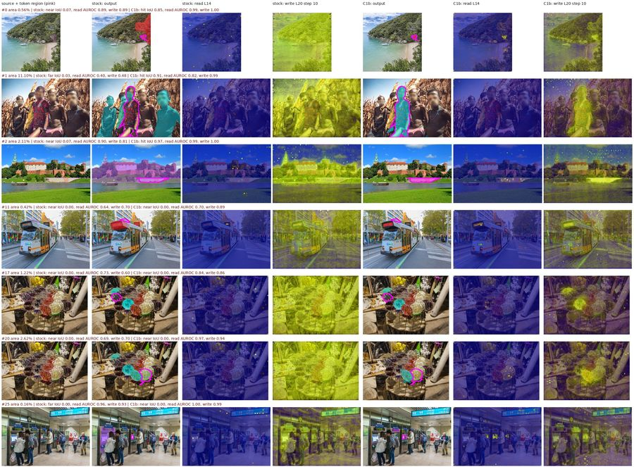
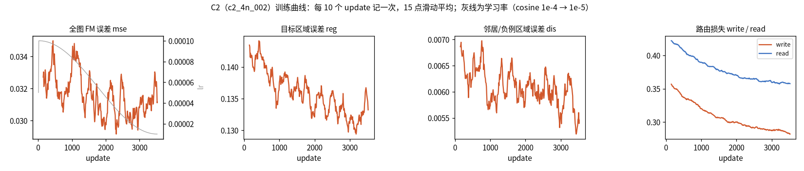
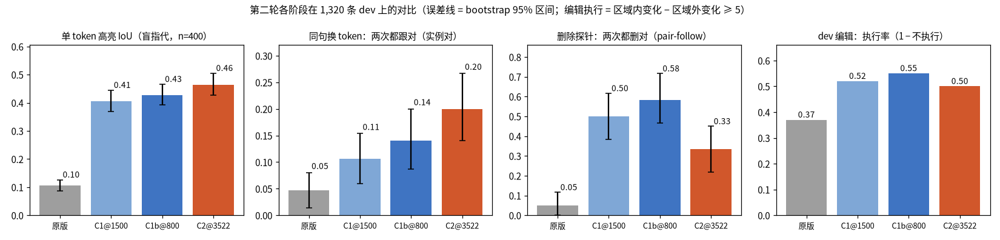
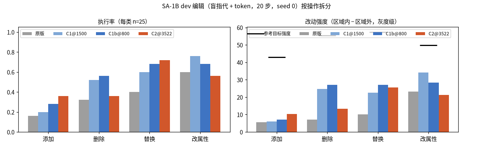
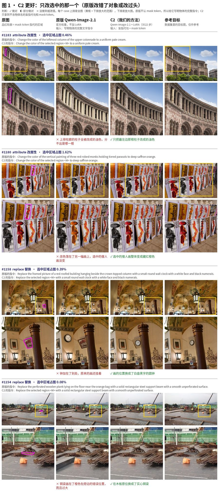
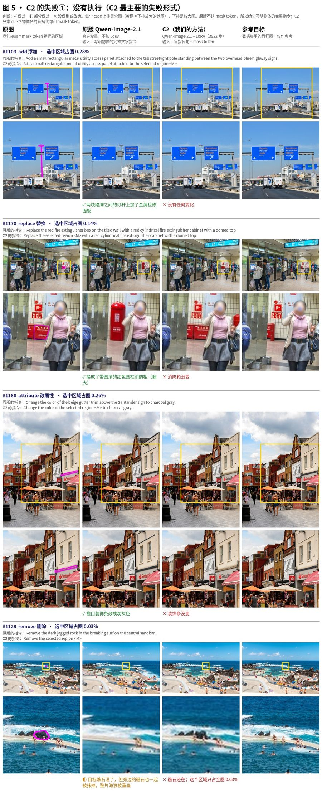
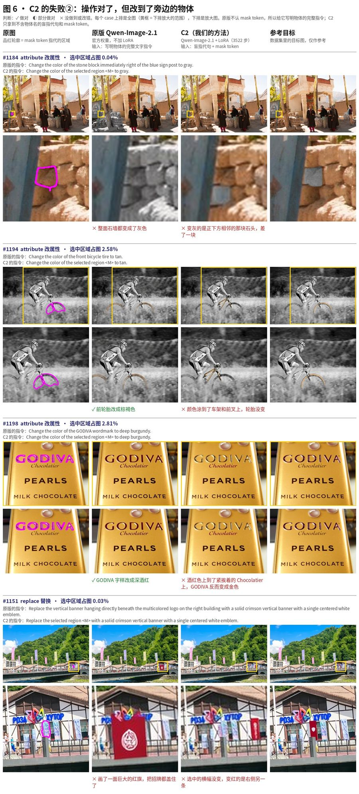
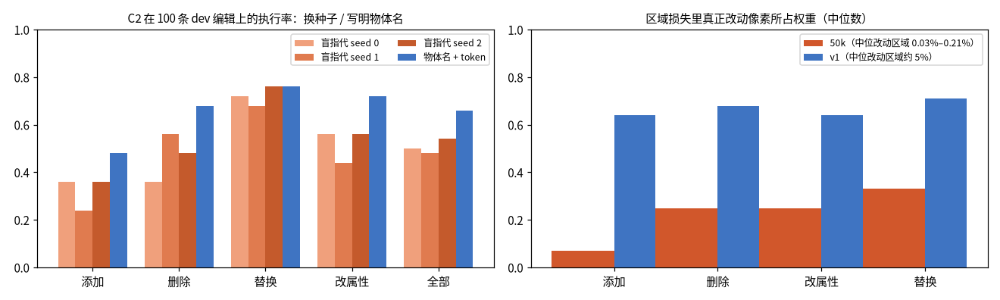
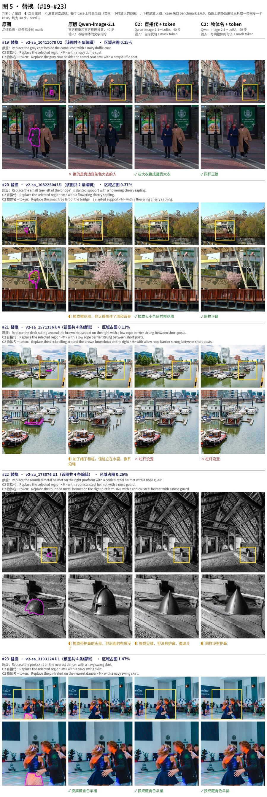
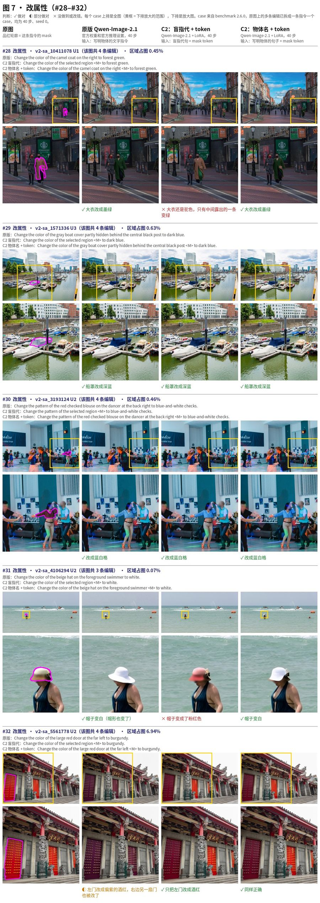

# SAMTokEdit Qwen-Image-2.1 v3：实验

本文记录 v3 的全部训练和评测：
- 每次训练的目的、数据、设置和权重；
- 每项评测用的权重、数据、任务、设置和结果；
- 做过的分析，以及从中得出的结论。

数据见[文档 01](01_SAMTokEdit_Qwen21_v3数据.md)，方法见[文档 02](02_SAMTokEdit_Qwen21_v3方法.md)，在四机上怎样启动见[文档 05](05_SAMTokEdit_Qwen21_四机实验运行指南.md)。截至 2026-10-20。

路径记号：`V3/…` 指 `/mnt/bn/strategy-mllm-train/user/tanyue/experiments2/SAMTokEdit/qwen21_v3/…`。实验树在 10-19 重新整理过，旧路径到新路径的对照见 `V3/MOVED_20261019.tsv`。

## 0. 总览

### 0.1 当前状态（一段话）
- **定位：**DiT 已经学会按 mask token 定位。单 token 指认 IoU 从原版的 0.105 提到 C2 的 0.464。注意力探针显示，⟨M⟩ 对源图的读取 AUROC 从 0.74 升到 0.93。
- **编辑：**
  - 和原版用同样的输入（盲指代句 + token）比，C2 执行率 50%，原版 37%；区域外改动 1.8，原版 6.2。
  - 和原版用写明物体的文字指令比：
    - C2 改的位置准得多（区域外改动 1.8，原版 5.0）；
    - 但执行率略低（50% 对 58%）；
    - 换用"物体名 + token"后，C2 执行率升到 66%，三项都超过原版。
- **benchmark 2.6.0（101 例子集，正式的 judge）：**C2 用 token 输入，整图全过 34.7%；原版用官方彩色定位图 12.9%，FLUX.3 klein 28.7%。C2 主要赢在保持（单元保持通过 0.89 对 0.62）和盲指代单元（编辑通过 0.71 对 0.61）（§5.6）。
- **C2 输给原版、FLUX.3 的地方（§5.7）：**集中在四块：只给文字的单元、替换、要写字的编辑、大目标改属性。
  - 原因一：换成 SAMTok 文本编码器，丢了细语义；
  - 原因二：训练让 C2 只在 mask 里改，而且改得少；
  - 原因三：只给文字的单元没有 token。
  - "不执行"仍是 C2 最多的失败类型，但原版、FLUX.3 同样多，不是 C2 输的原因（§5.4、§5.7）。

### 0.2 训练运行一览

| 实验 | run 目录 | 起训权重 | 更新次数 × batch | 硬件 | 训练时长 | 代码 | 用的权重 | W&B |
|---|---|---|---|---|---|---|---|---|
| E-A1 | `V3/runs/ea1_local8_001/` | 原版 + 新 LoRA | 1,300 × 32 | 本机 8 卡 × 累积 4 | 8.8 h | 仓库外脚本 `V3/legacy_code/ea1/` | `train/adapter_1300` | 无 |
| E-A2 | `V3/runs/ea2_local8_001/` | 原版 + 新 LoRA + 注入 | 1,300 × 32 | 本机 8 卡 × 4 | 9.6 h（含评测） | v2 分支 795e818 + `V3/legacy_code/ea2/` | `train/adapter_1300` | 无 |
| C1 | `V3/runs/c1_local8_001/` | 原版 + 新 LoRA + 注入 + 路由仿射 | 2,000 × 32 | 本机 8 卡 × 4 | 14.6 h | d31af846（工作区有未提交的 round2 代码） | `train/adapter_1500`（好于 2000） | 无 |
| C1b | `V3/runs/c1b_local8_001/` | C1@1500 | 800 × 32 | 本机 8 卡 × 4 | 5.9 h | f63ab12a | `train/adapter_800` | 无 |
| C2 | `V3/runs/c2_4n_002/` | C1b@800 | 3,522 × 32 | ARNOLD 4 机 × 8 卡 × 累积 1 | 4.5 h（约 4.6 s/次） | 50ffa0ce | `train/adapter_3522` | `c2_4n_002`（id `845793a4f4ae88ca-round2`） |

**辅助运行**（`V3/runs/_aux/`，只留日志和状态）：
- `c2_4n_001`：C2 第一次提交，代码 d485ddb2。集群镜像缺 `libxcb.so.1`，`import cv2` 失败，D4 行全部被跳过。跑到第 630 次被停止（exit 143），累计跳过 650 个样本。修复见 50ffa0ce（改用 SciPy EDT）。
- `c2_entry_check_1n_001/002/003`：四机入口在单机上的验证，各训练 2 次更新：
  - 001：入口本身（e681f238）；
  - 002：加 W&B（d485ddb2）；
  - 003：只训练路径。
- E-A2b（用修正后代码复跑 E-A2）和四机冒烟设置 `c2_smoke_4n_001` 都没有运行过。

**其他：**
- 底座在 `/mnt/bn/strategy-mllm-train/user/tanyue/models/pretrained_models/Qwen-Image-2.1`，TE 在 `/mnt/bn/strategy-mllm-train/user/tanyue/models/SAMTok/Qwen3-VL-8B-SAMTok`。
- W&B：entity `2200012743-peking-university`，project `samtok-edit`。只有 d485ddb2 之后的四机运行接入了 W&B。
- 可训练参数：E-A1 83,886,080；E-A2 87,044,108；C1、C1b、C2 87,044,120。

## 1. 评测体系

所有评测都只给源图和带 token 的指令：不给像素 mask，不加注意力偏置，不做 latent 融合。原版基线另有说明。

### 1.1 第一轮评测集（E-A1、E-A2）
- **集合：**1,930 项，`V3/data/stageA_ea1_20261011/eval.json`：
  - 留出集盲指代 607、带物体名 393；
  - v2 dev 的用户 mask 盲指代 122、带物体名 122；
  - 反事实 686 项（343 对，同图同句只换 token）。
- **任务：**让模型"给 ⟨M⟩ 涂色"，从输出读回涂色区域，和 token 的 codec 解码区域（留出集、反事实）或用户真值（dev）算 IoU。完美叠色上的读回 IoU 为 0.99。
- **成对跟随：**一对的两个输出都跟随各自的 token。
- **remove 探针：**`Remove the object in this region ⟨M⟩.`，同图同句换 token，120 对。
- **原版基线：**`V3/baselines/stock_highlight_eval/`。

### 1.2 第二轮开发集（C1、C1b、C2 共用）
- **集合：**1,320 项，`V3/data/round2_20261016/eval_c1.json`，全部在 60 张留出的 SA-1B 图上，构成见文档 01 §3.1。
- **命令与设置：**`samtok-edit round2-eval`，20 步，画布约 1 MP，CFG 1，seed 0，TE 为原始 SAMTok TE。
- **配对报告：**`samtok-edit round2-report` 生成，同一批项上逐项配对，给 bootstrap 95% 区间。

指标定义：

| 指标 | 定义 |
|---|---|
| 单 token IoU | 从输出读回涂色区域，和 token 的解码区域算 IoU；"vs 标注"是和标注 mask 算 |
| 命中 / 近邻 / 远处 | IoU ≥ 0.3 为命中；IoU < 0.3 且落在目标附近为近邻失误；其余为远处失误（`nearmiss.py`） |
| 多 token | 全部区域 IoU ≥ 0.5 的比例；区域平均 IoU；串色 = 颜色涂进别的 token 的区域 |
| 成对跟随 | 同类实例 150 对、部件对宿主 50 对，两个输出都跟随各自 token 的比例 |
| remove 探针 | `Remove the selected region <M>.` 换 token，60 对：两次都删对自己的区域的比例；以及"自己区域的改动 − 对方区域的改动"、远处改动 |
| 编辑（100 条，四类各 25） | 在 512 px 小图上算平均像素差（0–255）：区域外改动 = 支持区域外 \|输出 − 源图\|；与参考目标的误差 = 支持区域内 \|输出 − 目标\|；**强度 = 改动区域内的改动 − 区域外改动**（扣掉整图漂移）；**不执行 = 强度 < 5**。参考目标的强度为 51.4 |

**勘误：**"不执行"最初的口径是"区域内改动 < 5"。原版整图有约 5–6 的色调漂移，这个条件对原版几乎不会成立，10-18 起改为扣漂移的口径（§4.5）。

### 1.3 其他评测
- **注意力探针**（§4.2）：
  - 400 个单 token 盲指代项，按正式设置真实推理 20 步；
  - 记录 ⟨M⟩ 对源图的读取，以及第 0/10/19 步目标 token 对 ⟨M⟩ 的写入；
  - 算区域内对区域外、目标对近邻的 AUROC。
- **benchmark v0 纯文字**（§4.4）：656 例，40 步，用 benchmark 的 Qwen3.8-27B 判分（本机用 HF 运行，经过校准）。
- **原版 vs C2 案例**（§5.3）：开发集 100 条编辑。原版用官方 TE 和写明物体的文字指令，C2 用盲指代 + token。
- **benchmark 2.6.0 拆分 36 例**（§5.5）：40 步，原版按 benchmark 适配代码的官方设置跑纯文字，C2 跑盲指代 + token 和物体名 + token，人工判定。
- **benchmark 2.6.0 子集正式评测**（§5.6）：101 例多目标 case。
  - 输入和官方彩色定位图一致，只是区域换成 token；
  - 用 benchmark 自己的运行器和 judge 打分，和官方基线在同一次判分会话里比较。

## 2. 第一轮：E-A1、E-A2（10-11 至 10-13）

### 2.1 E-A1：只靠指认任务，DiT 能不能读 token
- **假设：**TE 不动，"mask 只作监督、推理只给 token"能让 DiT 读懂 token。放行线：留出集盲指代 IoU ≥ 0.65。
- **数据：**`V3/data/stageA_ea1_20261011/train.jsonl`，42,000 行，实际用 41,600。
  - 指认 30,000（不带物体名 17,029，带名 12,971，同图多实例 13,416）；
  - 程序化局部编辑 8,000；
  - 清洗后的真实编辑 4,000。
- **设置：**
  - 原版 DiT + 新 LoRA r32；FM + 区域项（λ_region 1）；不用路由、邻居项和注入。
  - lr 1e-4，预热 33 次后恒定，AdamW，weight decay 0.01。
  - batch 32 = 8 卡 × 累积 4；最大 1 MP；各卡 LoRA 初始化不一致（§2.3）。
- **结果**（`V3/runs/ea1_local8_001/results/analysis.txt`）：

  | 评测 | 原版 | E-A1 | 配对差 |
  |---|---:|---:|---:|
  | 留出集盲指代（607） | 0.405 | 0.491 | +0.086 [+0.060, +0.112] |
  | 留出集带名（393） | 0.585 | 0.611 | +0.025 |
  | dev 盲指代（122） | 0.364 | 0.382 | +0.018（不显著） |
  | dev 带名（122） | 0.629 | 0.557 | −0.072 [−0.124, −0.022] |
  | 成对跟随（343 对） | 0.289 | 0.525 | +0.236 [+0.175, +0.294] |

  - 1,160 张评测图中有 363 张以另一个路径出现在训练里。去掉这部分后结论不变：盲指代差值 +0.073，成对跟随 +0.24。
  - 48 个 dev 普通编辑：区域外改动 6.02 → 3.72，但 LoRA 常把同类全删。
- **结论：**没过线（0.49）。DiT 开始按 token 选实例，主要错误是选错实例；带名的 dev 退步，是因为序数短语被 token 覆盖；小部件上无效。

### 2.2 E-A2：加上"是哪个实例"的直接监督
- **改动：**在 E-A1 上加三项：写方向注意力路由损失（λ 0.05，同图其他实例作 3 倍重反例）、邻居 FM 项（λ 1）、码本注入。数据加入 GRES 多实例指认。
- **数据：**`V3/data/stageA_ea2_20261012/`，每轮 82,000 行。
  - 构成：指认 62,000（含 GRES 多实例约 1.2 万）+ 程序化 12,000 + 真实编辑 8,000；
  - 按均值哈希去掉了与评测图相同的 529 个源；
  - 本机运行只用了调度表的前 41,600 行（约半轮）。
- **设置：**同 E-A1，seed 2000 + 卡号，各卡初始化不一致。
- **放行线（四条全部通过）**，结果见 `V3/runs/ea2_local8_001/analysis.txt`：

  | 评测（只给 token） | 原版 | E-A1 | E-A2 | E-A2 − 原版 |
  |---|---:|---:|---:|---:|
  | 留出集盲指代（≥ 0.60） | 0.405 | 0.491 | **0.614** | +0.209 [+0.180, +0.237] |
  | dev 盲指代（≥ 0.50） | 0.364 | 0.382 | **0.621** | +0.257 |
  | dev 带名（≥ 原版） | 0.629 | 0.557 | **0.696** | +0.067 |
  | 成对跟随（≥ 0.70） | 0.289 | 0.525 | **0.738** | +0.449 |
  | 留出集带名 | 0.585 | 0.611 | 0.710 | +0.125 |

- **remove 探针（120 对）：**成对跟随原版 0.058 → E-A2 **0.758**，选择性 1.5 → 47.2，远处改动 7.9 → 3.5。v2 的同一探针：E5 0.06，B0 0.20，E5 + codec 区域偏置 0.75。
- **真实编辑**（404 组，40 步，`V3/runs/ea2_local8_001/gallery/index.html`）：区域外改动 13.5 → 3.7，97% 的例子变小；区域内 38 → 46。
- **遗留问题：**
  - remove 后的区域发白、无纹理：纹理比约 0.69；10-15 复盘页用另一种口径测得 0.55（`vis/review_20261015/quant.json`）。
  - 小于 0.5% 的区域只有 0.245。
  - 写法还是 v2 的 `this region ⟨M⟩`。

更多图：`assets/v3_progress/fig_ea2_highlight.jpg`（指认随机样本）、`assets/v3_progress/fig_ea2_training.png`（训练中的快速评测）、`assets/v3_progress/fig_ea1_leak_check.jpg`（普通 remove 没有涂色渗漏）。

### 2.3 代码移植与 LoRA 初始化缺陷（10-13）
- **移植：**E-A1/E-A2 的脚本移进 v3 包（`ground-*` 命令）。
  - 在 `--unsynced-init` 下，第 10、20 次更新逐位复现了 E-A2；
  - 评测重跑差值为 0；
  - 等价核对脚本在 `V3/legacy_code/`。
- **缺陷：**旧脚本先按卡号设种子、后建 LoRA，导致 8 张卡的 LoRA-A 各不相同。
  - 已保存的 0 号卡权重和最终评测有效，但训练效率受损，训练中的快速评测是 8 个略有差异的模型的平均。
  - 修正（同步初始化）后第 20 次更新 mse 0.0407 → 0.0364。
  - 量化这一影响的 E-A2b 没有跑：此后转入第二轮，从原版重训。

### 2.4 与 benchmark 的差距，转入第二轮（10-13）
分析在 `V3/analysis/benchmark_gap_20261013/`：
- **区域更小：**benchmark v2（当时 200 张图 / 785 单元）区域面积中位 0.57%，< 0.5% 的占 45%，1 MP 下中位只有约 23 个 DiT token。E-A2 按 benchmark 的面积分布重加权后，盲指代只有 0.409。
- **形式更复杂：**benchmark 是一图 2–5 条编辑、四种定位方式，E-A2 的评测和它不一致。
- **tokenizer 不是瓶颈：**785 个区域 mask → token → mask 的往返 IoU 均值 0.822，DiT 才是瓶颈。

于是第二轮改用协议 2.0 的新数据（SA-1B dense mask、50k 编辑），从原版重训，详见旧文档 08（已归档）。

## 3. 第二轮：C1、C1b（10-16 至 10-17）

### 3.1 C1：在 SA-1B dense mask 上学定位
- **目标：**只凭 token 定位，重点是小区域、多 token、部件对宿主。暂定放行线：
  - 单 token 盲指代 ≥ 0.65，< 0.5% 的区域 ≥ 0.45；
  - 多 token 全对 ≥ 50%；
  - 成对跟随 ≥ 0.75；
  - remove 探针 ≥ 0.5；
  - 区域外改动不高于原版。
- **数据：**`V3/data/round2_20261016/rows_c1.jsonl`，64,000 行。
  - 单 token 指认 25,600、带名 9,600；多 token 指认 19,200；
  - 50k 编辑 9,600（盲指代 + token 6,256、物体名 + token 1,944、只有物体名 1,400）。
- **设置：**
  - 从原版起训：新 LoRA r32，注入和读写路由仿射全新；
  - 损失：FM + 区域项 + 邻居项 + 写路由 + **读路由（新增）**，两者都是带权 BCE；
  - 反例：同类前 3 个 + 第 1 个宿主，权重 3；
  - lr 1e-4，预热 50 次后恒定，2,000 次更新，8 卡 × 4；
  - 训练中快速评测 112 项。
- **结果**（`V3/runs/c1_local8_001/summary.txt`、`eval_1500/`、`eval_2000/`）：

  | 指标 | 原版 | E-A2 | C1@1500 | C1@2000 |
  |---|---:|---:|---:|---:|
  | 单 token 盲指代（400） | 0.105 | 0.278 | **0.405** | 0.368 |
  | 　< 0.5%（168） | 0.021 | 0.10 | 0.205 | 0.186 |
  | 单 token 带名（200） | 0.174 | 0.302 | 0.441 | 0.390 |
  | 多 token 全对 / 区域 IoU / 串色 | 0% / 0.072 / 6.0% | 0% / 0.114 / 9.1% | 9% / 0.315 / 1.3% | 5% / 0.253 / 1.7% |
  | 成对：同类 / 部件对宿主 | 0.047 / 0.06 | 0.067 / 0.24 | 0.107 / 0.30 | 0.107 / 0.34 |
  | remove 探针 | 0.05 | 0.333 | **0.50** | 0.417 |
  | 编辑：区域外 / 误差 / 区域内 | 6.2 / 27.9 / 17.7 | 2.2 / 28.4 / 17.0 | 2.4 / 24.8 / 24.2 | 2.6 / 23.4 / 24.3 |

  原版基线 `V3/baselines/round2_stock_eval/`，E-A2 基线 `V3/baselines/round2_ea2_eval/`（E-A2 训练时用的是旧写法，只作参考）。
- **结论：**
  - 六条放行线只过了 remove 探针和区域外改动两条；第 1,500 次好于第 2,000 次（学习率恒定）。
  - 失误构成（C1@1500）：命中 51%、近邻 34%、远处 15%。近邻落点：异类邻居 37%、宿主 29%、同类邻居 24%、背景 7%、部件 4%。
  - 同类实例对的两个 token 98% 码不同，问题不在 token 能不能区分。
- **案例图：**`V3/runs/c1_local8_001/cases/`（小区域的随机样本、提升和失败；多 token、成对、编辑）。

### 3.2 C1 的三项诊断：瓶颈在哪
1. **只提高推理分辨率到 1.5 MP**（`V3/runs/c1_local8_001/summary_resolution.txt`）：
   - 单 token 0.405 → 0.409，< 0.5% 0.205 → 0.243（不显著）；
   - 近邻失误 34% → 32%。

   分辨率不是主要瓶颈。
2. **训练图和新图的对比**（`V3/runs/c1_local8_001/eval_1500_train_images/`，120 张训练图上 650 项）：
   - 见过的 mask 0.427，没见过的 0.390，开发集 0.405。

   训练和泛化之间几乎没有差距，问题在监督和方法，不在数据量。
3. **训练行覆盖：**
   - 图里有相邻同类的单 token 行中，最近的同类只有 52% 被用作反例；异类邻居一个都没有被用作反例；
   - 读方向在单 token 行上没有重反例；
   - 多 token 行里含相邻同类对的只有 13%。

   这三条直接导向 C1b。

### 3.3 C1b：近邻硬反例
- **改动：**只改训练行和反例权重，方法、部件、数据源都不变。
  - 反例改为框间距 ≤ 对角线 5% 的任意类别标注物体（最近 ≤ 6 个 + ≤ 2 个宿主），读写两个方向都加重，权重 8；
  - 2,112 对反事实成对，同卡同更新；
  - 40% 的多 token 行围绕相邻对构建。
- **数据：**`V3/data/round2_20261016/rows_c1b.jsonl`，25,600 行，比例同 C1。
- **设置：**从 C1@1500 起训，800 次更新，预热 20 次后余弦退火到 1e-5，`--heavy-weight 8`，8 卡 × 4。
- **结果**（`V3/runs/c1b_local8_001/summary.txt`、`nearmiss.txt`）：

  | 指标 | C1@1500 | C1b@800 | 差值 |
  |---|---:|---:|---|
  | 单 token 盲指代 | 0.405 | **0.428** | +0.023 [+0.005, +0.041] |
  | 　< 0.5% | 0.205 | 0.246 | |
  | 命中 / 近邻 / 远处 | 51 / 34 / 15% | 55 / 31 / 14% | 近邻落点构成不变 |
  | 同类成对 / 部件对宿主 | 0.107 / 0.30 | 0.140 / 0.30 | 不显著 |
  | remove 探针 | 0.50 | 0.583 | 区间重叠 |
  | 编辑：区域外 / 误差 / 区域内 | 2.4 / 24.8 / 24.2 | 2.0 / 24.5 / 24.3 | |

- **结论：**提升小但显著，四个目标（近邻 < 20%、单 token > 0.5、部件对宿主 > 0.5、< 0.5% > 0.3）一个都没达到。近邻吸附不是缺反例造成的，而是机制问题。

## 4. 10-17 的诊断：定位学会了吗？编辑受损了吗？

材料在 `V3/analysis/diag_20261017/`（脚本在 `scripts/`）。

### 4.1 定位进展
单 token 盲指代 IoU：原版 0.105 → E-A2 0.278 → C1 0.405 → C1b 0.428（相对原版 +0.323 [0.289, 0.358]），见 `progression.txt`。

### 4.2 注意力探针：定位确实是通过 token 完成的
`V3/analysis/diag_20261017/probe_summary.txt`、`probe/{stock,c1b_800,c2_2000,c2_3522}/`。C2 两列由 `scripts/analyze.py probe` 汇总。

| 指标 | 原版 | C1b@800 | C2@2000 | C2@3522 |
|---|---:|---:|---:|---:|
| 命中 / 近邻 / 远处 | 11 / 49 / 40% | 55 / 32 / 13% | 52 / 34 / 14% | 59 / 32 / 9% |
| 读 AUROC，目标对其余（最佳层） | 0.739 | 0.922 | 0.923 | 0.929 |
| 读 AUROC，目标对近邻 | 0.686 | 0.858 | 0.861 | 0.868 |
| 写 AUROC，第 0 步 | 0.706 | 0.973 | 0.972 | 0.976 |
| 近邻失误中：读阶段已偏向邻居 | 24% | 28% | 24% | 26% |
| 近邻失误中：读对，但第 10 步写偏 | 17% | 24% | **45%** | 27% |
| 去掉 token 后与原输出的重合 IoU | 0.340 | 0.059 | — | — |

- **定位依赖 token：**C1b 去掉 token 后，输出和原来几乎不重合（0.059），说明定位确实依赖 token。
- **近邻失误的来源：**剩下的近邻失误中，约四分之一在读阶段就偏了；其余是读对了，但在去噪过程中写偏。C1b 写方向偏向目标的比例从第 0 步的 71% 降到第 10 步的 55%。

### 4.3 开发集上的纯文字编辑
`V3/analysis/diag_20261017/text_edits/`：100 条编辑，写明物体的句子、不带 token，20 步，原始 SAMTok TE。

| | 原版（SAMTok TE） | C1 | C1b |
|---|---:|---:|---:|
| 区域外改动 | 5.6 | 2.5 | 2.2 |
| 与参考目标的误差 | 26.9 | 22.4 | 22.0 |
| 不执行（扣漂移） | 43% | 41% | 42% |

### 4.4 benchmark v0 纯文字判分（656 例）
- **设置：**`V3/analysis/diag_20261017/bench_text/`、`judge/`、`bench_judge_summary.txt`。
  - 40 步，seed 0，CFG 1；
  - 用 benchmark 的 Qwen3.8-27B 双图判分，本机用 HF transformers 运行；
  - 校准：同一批 164 张官方输出上，E 2.890 对已发布的 2.945，88% 完全一致。

| 指标 | 官方原版（164） | 原版 + SAMTok TE | C1b@800 | C1b − 原版 + SAMTok TE（n = 655） |
|---|---:|---:|---:|---|
| E | 2.89 | 2.424 | 2.631 | +0.206 [0.064, 0.350] |
| P | 3.70 | 3.731 | 3.479 | −0.252 |
| Q | 3.74 | 3.710 | 3.461 | −0.249 |
| 严格成功 | 0.567 | 0.450 | 0.392 | −0.058 |

- **只换 TE 的代价：**同 164 例，官方原版 → 原版 + SAMTok TE，E −0.488 [−0.720, −0.268]。
- **C1b 的变化：**
  - remove 上升（E 1.09 → 2.04）；
  - add、replace 下降（3.27 → 2.95，3.53 → 3.19）；
  - P、Q 各 −0.25。

### 4.5 更正与结论（10-18）
- **更正：**早先的"开发集不执行 13% → 35%"是口径偏差，改用扣漂移的口径后：

  | 带 token（盲指代 + token，100 条） | 原版 | C1 | C1b |
  |---|---:|---:|---:|
  | 不执行 | 63% | 48% | 45% |
  | 　add / remove / replace / attribute | 84 / 68 / 60 / 40% | 80 / 48 / 40 / 24% | 72 / 44 / 32 / 32% |
  | 强度（参考目标 51.4） | 11.5 | 21.9 | 22.4 |

- **没有"只会涂色"：**Lab 空间里结构类改动的比例，带 token 的 remove 从 0.07 升到 0.21、replace 从 0.09 升到 0.21（`V3/analysis/diag_20261017/scripts/tint.py`），涂色类像素没有增加。
- **结论：**
  - 定位学会了，而且是通过 token；
  - 带 token 的编辑比原版执行得更多；
  - 不带 token 时有所退化，但按用户口径不需要保持；
  - 真正的短板是 add（不执行 72%）和改动强度（约为参考目标的 0.4 倍）。

  于是转入以编辑为主的阶段 B（C2），并撤回"加 20% 纯文字编辑""LoRA 只在含 token 时生效"两条建议。

## 5. C2 与其后的分析（10-18 至 10-19）

### 5.1 C2 训练
- **目标：**从 C1b 起训，以带 token 的编辑为主，提升执行率和改动强度，同时定位不退步；可用的数据全部用上。
- **数据：**`V3/data/round2_20261016/rows_c2.jsonl`，112,704 行，构成见文档 01 §2.10。
  - 50k 单条 46,690（含天然孪生 13,180 行）；
  - v1 单条 39,768（9,786 行用局部损失）；
  - D4 3,681，50k 拼合多目标 11,270，指认 11,295。
  - 只有带 token 的写法：盲指代 70%，物体名 30%。
- **相对 C1b 的方法改动：**
  - 50k 编辑的区域项改用实际改动像素；
  - 漂移目标只算局部损失；
  - D4 按单元拆分改动区域；
  - 多目标 `U1:` 写法。

  详见文档 02 §4.8–§4.10。
- **设置：**
  - 运行设置原文见 `scripts/round2/settings/c2_4n.sh`（文档 05 §7.1），关键参数：`--init-adapter …/c1b_local8_001/train/adapter_800 --updates 3522 --accumulation 1 --warmup 20 --lr 1e-4 --lr-schedule cosine --lr-min 1e-5 --heavy-weight 8`；
  - 32 卡 × 累积 1，每次更新的样本与 8 卡 × 4 相同；
  - 四机只训练（`SAMTOK_PHASES=train`），完整评测和报告在开发机上做。
- **过程：**
  - 0 个样本被跳过，D4 全部用上；
  - 末行 loss 0.183，mse 0.0266，reg 0.118，dis 0.0052，write 0.273，read 0.352。

- **曲线：**目标区域误差 reg 只从约 0.137 降到约 0.13，是全图误差的 4 倍多；邻居项很小，而且一直很小。小编辑的"改"学得慢，这一点在 §5.4 得到解释。

### 5.2 C2 开发集结果
材料：`V3/runs/c2_4n_002/eval_3522/`、`analysis.txt`、`analysis.json`。开发集结果也写进了 W&B summary 的 `dev/…` 项。中途检查在 `eval_2000_subset/`。

| 指标 | 原版 | C1@1500 | C1b@800 | **C2@3522** | C2 − C1b |
|---|---:|---:|---:|---:|---|
| 单 token 盲指代（400） | 0.105 | 0.405 | 0.428 | **0.464** | +0.036 [0.018, 0.055] |
| 单 token 带名（200） | 0.174 | 0.441 | 0.447 | **0.515** | +0.068 [0.036, 0.100] |
| 命中 / 近邻 / 远处 | — | 51 / 34 / 15% | 55 / 31 / 14% | 59 / 31 / 10% | |
| 多 token 全对 / 区域 IoU / 串色 | 0% / 0.072 / 6.0% | 9% / 0.315 / 1.3% | 9% / 0.332 / 0.9% | 8% / 0.356 / 1.4% | |
| 成对：同类（150） | 0.047 | 0.107 | 0.140 | **0.200** | +0.06 [0.01, 0.11] |
| 成对：部件对宿主（50） | 0.06 | 0.30 | 0.30 | 0.34 | |
| remove 探针（60 对） | 0.05 | 0.50 | 0.583 | **0.333** | 变差 |
| 编辑不执行（100） | 63% | 48% | 45% | 50% | +5 个百分点（不显著） |
| 强度（参考目标 51.4） | 11.5 | 21.9 | 22.4 | 17.6 | |
| 区域外改动 | 6.2 | 2.4 | 2.0 | **1.8** | |
| 与参考目标的误差 | 27.9 | 24.8 | 24.5 | **23.9** | |

按操作（不执行 / 强度 / 区域外 / 误差）：

| 操作 | 原版 | C1 | C1b | C2 |
|---|---|---|---|---|
| add | 84% / 5.5 / 5.6 / 11.1 | 80% / 6.0 / 2.0 / 8.0 | 72% / 7.1 / 1.9 / 8.0 | 64% / 10.3 / 1.8 / 8.6 |
| remove | 68% / 7.1 / 5.2 / 33.3 | 48% / 24.7 / 2.2 / 34.4 | 44% / 27.0 / 1.9 / 34.9 | 64% / 13.2 / 1.9 / 31.3 |
| replace | 60% / 10.2 / 6.6 / 30.2 | 40% / 22.6 / 2.4 / 28.0 | 32% / 27.0 / 2.1 / 26.3 | 28% / 25.6 / 1.9 / 24.2 |
| attribute | 40% / 23.2 / 7.5 / 37.1 | 24% / 34.2 / 2.9 / 28.8 | 32% / 28.4 / 2.0 / 28.5 | 44% / 21.2 / 1.6 / 31.6 |

C2 − C1b 的显著差：
- add 强度 +3.2 [0.7, 6.2]；
- replace 误差 −2.1 [−4.1, −0.4]；
- remove 强度 −13.8 [−28.3, −1.6]；
- attribute 强度 −7.2 [−12.4, −2.9]。

**中途检查**（adapter_2000，620 项子集，`V3/runs/c2_4n_002/scripts/eval_mid.json`）：
- 单 token 0.402，比 C1b 低 0.026，显著；
- 不执行 55%，remove 探针 0.30；
- 探针中"读对、第 10 步写偏"升到 45%。

学习率较低的最后 1,500 次更新把各项拉回并超过了 C1b。训练中的快速评测每类只有 8–40 项，看不出这个先降后升的过程。

**结论：**
1. **定位继续提升：**单 token、带名、同类成对都显著好于 C1b，远处失误 14% → 10%，探针里的写入漂移回落到 27%。
2. **编辑有得有失：**
   - add、replace 变好；remove、attribute 变弱；
   - 总体不执行 50%（C1b 45%，不显著），仍比原版用同样输入时的 63% 少；
   - 区域外改动和误差是各阶段最好的。
3. **remove/attribute 变弱的线索：**
   - 50k 的 remove 行 92% 是天然孪生，孪生对方是重反例；
   - D4 的单元以 remove/attribute 为主。
   - v1 的目标改动并不弱，可以排除"目标太弱"。

### 5.3 原版 vs C2：开发集编辑的案例对比（10-19）
- **设置：**
  - 原版：官方权重和官方 TE，输入写明物体的文字指令（不认 token），20 步，seed 0，CFG 1。输出和生成脚本在 `V3/baselines/round2_official_text_edits/`（`base_ref_edits.py`）。
  - C2：盲指代 + token（`eval_3522`）。
- **100 条的统计：**

  | | 原版（写明物体的文字） | C2（盲指代 + token） |
  |---|---:|---:|
  | 执行率 | 58% | 50% |
  | 区域外改动 | 5.0 | 1.8 |
  | 与参考目标的误差 | 27.8 | 23.9 |
  | 执行率：add / remove / replace / attribute | 52 / 40 / 64 / 76% | 36 / 36 / 72 / 56% |

  - 两者都执行 38 条，只有原版执行 20 条，只有 C2 执行 12 条，都没执行 30 条。
  - 两者都执行的 38 条里，C2 更接近参考目标的有 26 条。
- **原版的"执行"里有不少改在错误的位置。**它的执行率按改动区域内的变化计算，改到别处的编辑会被算作不执行；整图漂移也会抬高区域外改动。
- **六张对比图：**`V3/runs/c2_4n_002/cases/c2_vs_base_1.jpg` 到 `_6.jpg`，共 23 例，按主题挑选，不代表平均水平。脚本 `sheets.py`，判定见 `cases.json`。

  | 图 | 主题 | 例数 |
  |---|---|---:|
  | 1 | C2 更好：只改选中的那一个，原版改错对象或改过头 | 4 |
  | 2 | C2 更好：原版基本没执行 | 4 |
  | 3 | C2 更好：添加的大小和位置合适；有一例删得比参考目标还干净 | 3 |
  | 4 | 打平：两者都对 | 4 |
  | 5 | C2 失败①：没有执行（主要失败形式） | 4 |
  | 6 | C2 失败②：操作对了，但改到旁边的物体 | 4 |

- **看到的规律：**
  - C2 一旦动手，基本都改在选中的那个物体上，同类物体里只改指定的那一个，区域外几乎不动，加的东西大小也合适。
  - 原版正好相反：常常改了，但改错地方、改过头，或重画整张图。
  - C2 的失败主要有两种：小区域上不执行；改到旁边的同类物体或相邻部件上，比如差一块石头、涂到车架上、改了相邻的字。

### 5.4 "不执行"诊断（10-19）
材料在 `V3/analysis/noexec_20261019/`：脚本、`c2_variants/`（C2 的三组补充推理）、`variants_report.txt`。都在开发集的 100 条编辑上做，20 步。

1. **训练并没有制造不执行。**带 token 的执行率：原版 37% → C1b 55% → C2 50%；原版用文字指令 58%。问题是还没追上原版用文字的水平，而且 C2 在 remove、attribute 上比 C1b 保守了。
2. **不执行是置信度问题，不是能力问题。**
   - **换随机种子：**盲指代 + token 在 seed 0/1/2 下执行 50% / 48% / 54%。按条看，三次都执行 34%，有时执行 33%，都不执行 33%；任一种子执行的合计 67%。
   - **同一个 token 再写明物体名：**

     | | 盲指代 + token | 物体名 + token |
     |---|---:|---:|
     | 执行率 | 50% | **66%** |
     | 强度 | 17.6 | 25.7 |
     | 与参考目标的误差 | 23.9 | 21.0 |
     | 区域外改动 | 1.82 | 1.90 |
     | 执行率：add / remove / replace / attribute | 36 / 36 / 72 / 56% | 48 / 68 / 76 / 72% |

     只有物体名版执行的有 19%，只有盲指代版执行的只有 3%。能力是在的，缺的是"确定是哪个"。这时 C2 三项都优于原版用文字指令（58% / 5.0 / 27.8）。
   - **区域越小越不执行：**
     - < 0.1%（44 条）：盲指代 34%，物体名 55%；
     - 0.1%–0.5%（32 条）：56% 和 72%；
     - ≥ 0.5%（24 条）：71% 和 79%。

     开发集选中区域的中位数只有 0.13%。
   - **不执行时的输出：**目测 14 例不执行中，约一半什么都没改，约一半改到了旁边的物体上。
3. **训练为什么教出"不敢改"：**
   - **"要改"的信号被稀释：**区域损失按面积归一，并外扩一圈 token 作上下文。真正改动的像素在区域损失里只占：50k 的 add 7%、remove/attribute 25%、replace 33%，v1 为 64%–71%（`region_share.py`）。
   - **"别改邻居"的信号一直在：**99.5% 的编辑行带邻居反例。孪生行占 50k remove 的 92%、attribute 的 28%、add 的 7%、replace 的 2%。C1b→C2 退步的正好是孪生多的 remove 和 attribute。
   - 在均方误差下，模型拿不准是哪一个时，最省损失的做法是把改动压小。
   - **区域偏小：**50k 的改动区域中位 0.03%–0.21%（1 MP 下约 1–9 个 token），v1 约 5%。10-20 更正：原来写的"中间没有数据"不对，remove/replace/attribute 有 28%–33% 改动 ≥ 0.5%（§5.7、§8）。
4. **排除的原因：**
   - 训练目标改得不弱：50k 强度 45–56，v1 61–72，强度 < 15 的只占 0%–10%，区域外漂移 ≤ 0.7（`train_teacher.py`）；
   - 文本编码器：纯文字下不执行率官方 TE 42%、SAMTok TE 43%。

### 5.5 benchmark 2.6.0 拆分 36 例（10-19）
- **设置：**
  - case 来自 benchmark 2.6.0，拆成单指令，四类各 9 条，来自 13 张图（文档 01 §3.3）；
  - 全部 40 步，seed 0；
  - 原版按 benchmark 适配代码的官方设置：DiffSynth `QwenImage21Pipeline`，CFG 1，约 1 MP，32 px 网格，只给写明物体的那句指令（没有套 benchmark 的多目标前言）；
  - C2 adapter_3522：把单元 mask 用 SAMTok 编成 token，分别写进盲指代句和物体名句。
- **材料：**`V3/analysis/bench_split_20261019/`。
  - 生成脚本：`base_text.py`、`c2_token.py`；
  - 判定：`verdicts.json`；
  - 对比图：`sheets/bench_split_base_vs_c2_1.jpg` 至 `_8.jpg`。1–2 是添加，3–4 删除，5–6 替换，7–8 改属性。
- **判定**（人工逐条放大查看；✓ / ◐ / × 的个数）：

  | 模型 | add | remove | replace | attribute | 合计 |
  |---|---|---|---|---|---|
  | 原版，纯文字 | 3/3/3 | 6/1/2 | 4/4/1 | 6/2/1 | 19/10/7 |
  | C2 盲指代 + token | 6/2/1 | 4/3/2 | 7/1/1 | 6/0/3 | 23/6/7 |
  | C2 物体名 + token | 5/3/1 | 5/3/1 | 7/1/1 | 9/0/0 | **26/7/3** |

- **失败类型：**
  - **原版：**改错实例（#15、#19、#33）、物体大得离谱（#7、#20、#25）、整张图重画（#13）。不看目标的粗指标里，远处改动原版 5.6，C2 1.7。
  - **C2 盲指代：**不执行（#5、#13、#16、#21）；颜色给错或只改一部分（#28、#31、#33）。写明物体名后，这几类大多修好了：改属性 9 条全对。
  - **两种 C2 都有：**删除后留下空白板或残留（#11、#12）；文字类贴花是乱码（#1、#4）。
  - **token 本身：**小区域的 token 往返不准，最低是 #21 的 0.23（区域占全图 0.108%）和 #4 的 0.37（0.077%）。
- **说明：**只有 36 条，判定是目测，用来看规律，不是正式分数。正式分数需要按 benchmark 的 judge 评测。

### 5.6 benchmark 2.6.0 子集正式评测（10-19）
用户同意在新版 benchmark 上评测，但不跑全量，挑约 100 例的小子集加快比对。对照以用户当前版本为准：benchmark 仓库 `v2branch` 的 bf2283d，正式评测方式是彩色定位图（`visual_locator_v2` / `mixed`），官方结果见该仓库的 docs/reports/2.6.0/RESULT_ANALYSIS_2_6_0_ZH.md。

- **子集：**
  - 从四个官方基线都判过分的 case 里，按每图 2–5 个编辑单元分层抽样（seed 20261019），去掉之前目测过的 13 张图；
  - 共 101 例、360 个单元；
  - 官方基线在子集上的分数和全集相差 3 个百分点以内。
- **我们的输入：**和彩色定位图相同的定位信息，换成 token（benchmark 的原生区域格式 `native_regions_v2`）。
  - mask 单元直接编码成 token；
  - 点、框单元先用 SAM2.1 转成 mask（多个候选里取预测 IoU 最高的），再编码。抽查 30 例，与真值 mask 的 IoU 中位为框 0.93、点 0.94。
  - 只有文字、不给定位的单元不加 token。
  - 文字指令和官方完全相同，token 按协议 2.0 放在指代之后，多个单元按训练时的 `U1:` 写法一次生成。
  - 40 步、seed 0、CFG 1、约 1 MP，与官方 Qwen-Image-2.1 适配一致。
- **代码：**`src/samtok_edit21/evaluation/benchmark_token.py`，由 benchmark 自己的 `run-editor` 调用。
- **判分：**
  - 设置与官方一致：Qwen3.8-Flash-Next-FP8，vLLM 0.31.0，TP 8，greedy，reasoning low；
  - 所有系统在本机同一次判分会话里打分。原版和 FLUX.3 用官方的输出和判分输入；
  - 本机重判两个官方基线，编辑项判定与已发布分数一致 93%–94%。
- **材料：**`V3/analysis/bench_subset_20261019/`。README 写了全部设置，主报告 `report_main.txt`，补充报告 `report_supplementary.txt`。

**主结果**（101 例、360 个单元；E/P/Q 是单元级通过率，整图全过即 JointPass）：

| 系统 | 编辑 E | 带名单元 E | 盲指代单元 E | 只有文字的单元 E | 保持 P | 质量 Q | 整图全过 |
|---|---|---|---|---|---|---|---|
| 原版 Qwen-Image-2.1（彩色定位图，官方） | 0.722 | 0.813 | 0.605 | 0.857 | 0.622 | 0.658 | 12.9% |
| FLUX.3 klein（彩色定位图，官方） | 0.681 | 0.768 | 0.567 | 0.776 | 0.900 | 0.914 | 28.7% |
| 原版 + token（不训练） | 0.539 | 0.695 | 0.338 | 0.735 | 0.842 | 0.875 | 10.9% |
| **C2 token** | 0.742 | 0.768 | **0.707** | 0.694 | **0.892** | 0.894 | **34.7%** |
| C2 token + 自动起名 | 0.764 | 0.793 | 0.726 | 0.735 | 0.914 | 0.922 | 43.6% |

"自动起名"指盲指代单元先由同一个文本编码器根据 token 说出物体名，再按"物体名 + token"编辑，全程只用 token。

**配对差**（按 case 自助抽样的 95% 区间）：
- **C2 − 原版：**
  - 整图全过 +21.8 个百分点 [+11.9, +32.7]；
  - 保持 +0.27 [+0.20, +0.34]；
  - 盲指代单元编辑 +0.10 [0.00, +0.20]；
  - 带名单元编辑 −0.04（不显著）。
- **C2 − FLUX.3：**
  - 整图全过 +5.9 个百分点（不显著）；
  - 编辑 +0.06 [+0.01, +0.11]，其中盲指代 +0.14 [+0.06, +0.22]。
- **C2 − 原版 + token（训练的效果）：**整图全过 +23.8 个百分点 [+13.9, +33.7]，盲指代单元编辑 +0.37。原版不训练读不懂 token。

**补充对照**：
- 用基线旧的标签图设置做输入，每个单元都给真值 mask。
- 补充对照全部不显著，下面写点估计和区间。

| 对照 | 整图全过 | 差值 [95% 区间] |
|---|---|---|
| 真值 mask vs SAM2 转出的 mask（C2） | 39.6% vs 34.7% | +5.0 [−4.0, +12.9] |
| 逐个单元编辑 vs 一次联合生成（C2，真值 mask） | 33.7% vs 39.6% | −5.9 [−15.8, +4.0] |
| 自动起名 vs 不起名（真值 mask） | 39.6% vs 39.6% | 0 [−11.9, +10.9] |
| 自动起名 vs 不起名（原生定位，即主表） | 43.6% vs 34.7% | +8.9 [−1.0, +18.8] |
| 自动起名，两种设置合并（202 对） | — | +4.5 [−3.5, +12.4] |
| C2 vs 原版，都用标签图 | 39.6% vs 15.8% | +23.8 [+12.9, +34.7] |

**E 失败构成**（用 benchmark 自己的分类规则，只统计编辑未通过的单元）：

| 系统 | 失败单元 | 没执行 | 遮挡残留 | 改错实例 | 范围不对 | 定位标记画进输出 | 其他 |
|---|---|---|---|---|---|---|---|
| 原版（彩色定位图） | 100 | 39 | 6 | 2 | 6 | 8 | 39 |
| FLUX.3 klein | 115 | 63 | 10 | 3 | 4 | 0 | 35 |
| C2 token | 93 | 45 | 10 | 0 | 3 | 0 | 35 |

**结论：**
1. **同一底座下，token 输入明显好于官方彩色定位图：**整图全过 34.7% 对 12.9%。主要来自两点：
   - 只改指定的东西，保持通过 0.89 对 0.62；
   - 盲指代单元执行得更好。

   这和开发集上"区域外改动 1.8 对 6.2"的结论一致。C2 的整图全过也高于外部最强的 FLUX.3 klein（区间跨 0），编辑通过显著更高。
2. **训练是必要的：**不训练时原版读不懂 token，盲指代单元只有 0.34。
3. **C2 的短板：**
   - 只有文字、没有 token 的单元：0.69 对原版 0.86，是换文本编码器的代价。按用户口径不作验收，但它拉低整图全过。
   - "没执行"仍是 C2 最多的失败类型（93 个失败里 45 个），但比开发集上轻得多。开发集区域中位 0.13%，benchmark 0.47%，开发集的像素指标高估了不执行。
4. **推理侧的选择：**
   - 一次联合生成比逐个单元编辑好或持平，保留联合生成；
   - SAM2 转换点、框只带来小幅、不显著的损失；
   - 自动起名在两种设置里结果不一致（+8.9 和 0），合并后不显著。目前不作为默认，留作选项，等全量评测再定。
5. **注意：**只有 101 例，区间偏宽，正式结论要全量 1,084 例。点、框单元在我们的流程里多经过一次 SAM2，用到的信息和基线相同，写论文时要说明。

### 5.7 C2 输给原版、FLUX.3 的地方与原因（10-20）
用户问：C2 在哪些地方反而不如原版或 FLUX.3，为什么，下一步怎么优化。数据和 §5.6 相同（101 例、360 个单元，同一次判分），另加一次推理验证。材料：`V3/analysis/bench_subset_20261019/`，报告 `report_losses.txt`，脚本与文件说明见该目录 README。

**总体：C2 没有整体落后。**
- 单元编辑：C2 0.742，原版 0.722，FLUX.3 0.681。
- 整图全过：对原版输 6 例、赢 28 例；对 FLUX.3 输 12 例、赢 18 例。
- 单元级的输赢有不少是采样噪声。几乎相同的输入重跑，约 9% 的单元判定会翻转（mask 单元 9/102，带名单元 17/203）。

**稳定输的四块**：

| 切片 | 单元数 | 原版 | FLUX.3 | 原版 + SAMTok TE | C2 | C2 − 原版 | C2 − FLUX.3 |
|---|---|---|---|---|---|---|---|
| 只给文字（无定位，无 token） | 49 | 0.86 | 0.78 | 0.73 | 0.69 | −0.16 [−0.31, −0.02] | −0.08（不显著） |
| 替换 | 90 | 0.84 | 0.72 | 0.68 | 0.74 | −0.10 [−0.20, −0.01] | +0.02 |
| 要写字（OPEN、SALE、reading … 等） | 19 | 0.58 | 0.74 | 0.32 | 0.42 | −0.16（不显著） | −0.32 [−0.48, −0.12] |
| 改属性，面积 ≥ 1% | 37 | 0.86 | 0.95 | 0.70 | 0.84 | −0.03 | −0.11（不显著） |

- 表中数字是单元编辑通过率，区间是按 case 自助抽样的 95% 区间。
- "原版 + SAMTok TE"：原版 DiT 换上 SAMTok 文本编码器，用 token，不训练。
- 大面积改属性一行，C2 四个变体平均后对 FLUX.3 是 −0.13 [−0.26, −0.01]。
- 对照：
  - 带名 + token 的单元，三者持平（C2 0.79，原版 0.80，FLUX.3 0.77）；
  - 盲指代 + token 的单元，C2 明显更好（0.71 对 0.61、0.57）。

**整图层面输的例子：**
- 对原版输的 6 例都和生成细节有关：4 例只错在一个单元的颜色、形状或数量，另 2 例有字写错。
- 对 FLUX.3 输的 12 例里，4 例所有单元都改对了，只有保持没过：
  - 多画了东西，比如多出一块牌子；
  - 把旁边同类的袋子也删了；
  - 远处招牌被改了色。

**C2 的 93 个编辑失败**（逐条读判分理由后人工归类，`c2_fail_labels.json`）：

| 类型 | 个数 |
|---|---|
| 没执行 | 38 |
| 改错位置或实例 | 14 |
| 只改了一部分 | 9 |
| 字写错 | 7 |
| 改坏附着物或形状 | 6 |
| 替换成了叠加，旧物还在 | 4 |
| 数量不对 | 4 |
| 其余 | 11 |

其中 29 个两个基线也都没做到，这 29 个里有 19 个是没执行。

**原因 1：换成 SAMTok 文本编码器，丢了细语义。**
- 原版 DiT 只换文本编码器时：
  - 只给文字的单元掉 0.12；
  - 替换掉 0.17；
  - 写字掉 0.26。
- C2 训练后，添加、删除、改属性都追了回来；替换和写字只追回三分之一左右；只给文字的单元没有追回。
- 这几类最依赖文字里的细节：新物体是什么（连帽衫、全盔）、要写什么字、目标叫什么。
- 训练里写字编辑的形式不对（10-20 更正，前一版漏算了 v1）：
  - C2 用到的写字编辑约 1,200 条（v1 约 1,130、50k 77），其中 88% 是"把已有的字改成 X"；
  - benchmark 的写字单元（全量 193 个，占 5.0%）95% 是新加带字物体或换成带字物体，这两种训练里只有约 150 条。

**原因 2：训练让 C2 变"保守"：只在 mask 里改，而且改得少。**
- 远处漂移：C2 0.001，原版 0.006，FLUX.3 0.11。
- 小目标（< 0.5%）替换：C2 只改了目标内 57% 的像素，原版 78%。目标外一圈也几乎不动，环带改动 0.18，原版 0.68。
- 替换做成功时，目标外一圈的改动：原版 0.51，C2 0.26；C2 做失败的只有 0.08。
- 表现：
  - 新物体形状和旧的不同时（喇叭袖、连帽衫、三盏灯笼换招牌），C2 要么不做，要么叠在旧物上，要么只改颜色；
  - 大目标改属性只改一部分。
- 来源（10-20 核查训练数据后修订，`V3/analysis/c3_plan_20261020/`）：
  - **训练目标里有"做了一半"的样本：**
    - 50k 的 replace 有 11.5%、attribute 有 11.2%，改动不到目标区域的一半（replace 即旧物大半还在）；
    - add 有 10.2% 的锚点或附着处被改动超过 60%，即改坏了附着物。
    - 这和 C2 "叠加、只改一部分、改坏附着物"的失败对得上。
  - **区域损失的大部分权重落在没变的像素上：**外扩一圈后，真正改动的像素只占 7%–33%，近邻和孪生的惩罚却不打折。
  - **贴回范围：**50k 目标图按支持区域贴回，区域外与源图逐像素相同。replace 的支持区域中位是目标的 2.5 倍，外扩约为目标边长的 26%。轮廓变化大的替换可能被截掉，或在审核时被淘汰。这一点证据较弱。
  - **更正：**前一版写的"0.5%–5% 几乎没有"不对。C2 用到的 50k 里，remove/replace/attribute 有 28%–33% 改动 ≥ 0.5%，add 有 12%；另有 v1（约 5%）。benchmark 上 C2 各面积段也不落后于原版。
- 这几点合起来教会了"别出界、少改"，也是 C2 保持最好的原因。

**原因 3：只给文字的单元没有 token，而 C2 训练时每个单元都带 token。**这类单元 C2 失败 15 个，其中没执行 6、改错位置 2、操作做错 1。

**不是 C2 独有的问题：**
- 没执行：按 benchmark 自己的分类规则，C2 45、原版 39、FLUX.3 63。
- 改错位置：人工读，C2 14，原版约 14，FLUX.3 约 20。
- 多单元串位：一个单元的要求落到另一个单元的目标上，三家各约 2 例。
- SAM2 转换：只有真值 mask 过 10，只有 SAM2 mask 过 7，基本对称。

**验证：第一步定位（10-20）。**
原版 SAMTok 文本编码器不训练，用指令里那段指代短语提问 `Can you segment {ref}?`，生成 token。适配选项是 `ground`，配置为 `configs/c2_ground_native.json`。
- **定位质量：**49 个只给文字的单元全部拿到 token，与 benchmark mask 的 IoU 中位 0.82，73% ≥ 0.5。偏低的多是"加在某处"的单元：benchmark 的 mask 只圈附着处，生成的是整个物体。
- **接到 C2 前面：**只重跑含这类单元的 49 例，同一套判分。

  | 指标 | 原版 | FLUX.3 | C2 | C2 + 定位 |
  |---|---|---|---|---|
  | 只给文字的单元 E | 0.86 | 0.78 | 0.69 | **0.86** |
  | 同图其他单元 E | 0.67 | 0.67 | 0.74 | 0.73 |
  | 49 例整图全过 | 14.3% | 30.6% | 24.5% | **34.7%** |

  - 只给文字的单元 E：配对差 +0.16 [+0.04, +0.29]，追平原版。这些单元的 P 0.98 → 0.94，Q 0.90 → 0.94。
  - 101 例整图全过 34.7% → 39.6%，+5.0 [−1.0, +10.9]，不显著。其余 52 例的提示词不变，沿用 C2 的结果。
  - 对 FLUX.3 +10.9 [0.0, +21.8]，对原版 +26.7 [+15.8, +36.7]。
  - 全量 benchmark 有 553 个只给文字的单元，占 14.3%，分布在 51% 的 case 里。
- **例图：**`sheets/ground_examples.jpg`。原来没执行的 6 个单元加上 token 后都做了：长椅上加外套、瓶子加红标签、删掉白车、两件外套改色、黑轿车换成白皮卡。

## 6. 结论汇总与下一步

**已确认的结论**
1. **只用编辑对训练，DiT 不会读 token**（v2）。**指认任务 + 注意力路由 + 近邻反例能让它学会**，探针证实定位通过 token 完成：读 AUROC 0.74 → 0.93，去掉 token 后输出基本不重合。
2. **定位的瓶颈：**不在数据量（训练图和新图差别很小），不在分辨率（1.5 MP 几乎无改善），也不在 token 能否区分（同类对 98% 码不同）。瓶颈在 DiT 区分近邻的精度：读对后在去噪中写偏。补近邻反例只带来小幅提升。
3. **编辑方面：**
   - C2 带 token 编辑的精度明显好于原版：区域外改动 1.8 对 5.0–6.2，误差最低，只改指定实例；
   - 主要短板是小区域上的不执行；
   - 不执行是置信度问题：换种子或写明物体名，执行率升到 66%–67%。
   - benchmark 2.6.0 子集（101 例，正式 judge）：C2 用 token 输入整图全过 34.7%，原版用官方彩色定位图 12.9%，FLUX.3 klein 28.7%（§5.6）。
4. **两个辅助发现：**
   - 换成 SAMTok TE 本身让纯文字编辑掉 0.49 E，但按用户口径不作验收；
   - 训练目标本身不弱，不需要补纯文字数据。
5. **C2 输给原版、FLUX.3 的地方**（§5.7）：只给文字的单元、替换、要写字的编辑、大目标改属性，有三个原因。
   - 换成 SAMTok 文本编码器丢了细语义；
   - 训练教出"只在 mask 里改、少改"；
   - 只给文字的单元没有 token。

   第三个原因已由第一步定位在推理侧补上：这类单元 0.69 → 0.86。前两个要靠 C3 的数据和损失改动，必要时改条件结构。

**下一步（10-20 第二版，建议，待确认）**

**总的选择：在 C2 上调整后续训（C3），不推倒重来。**
- **不变的：**方法结构，即 LoRA r32、码本注入、读写路由、冻结的 SAMTok TE 作第二遍条件。
- **改的：**损失里的一项（区域项），以及训练数据（清洗 + 定向补数据）。
- **为什么不重来：**
  - 定位已经学会，探针证实了这一点；benchmark 上保持和盲指代明显领先。§5.7 找到的输点都指向数据和损失权重，没有一处指向结构。
  - 带名 + token 的单元已经追平原版（0.79 对 0.80），说明换编码器的代价大部分已由训练追回。剩下的集中在两处：训练里几乎没有的写字，以及训练目标有缺陷的替换。
  - 从 C1b 重做 stage B 要多花约一倍算力，C2 训练中途还出现过先退后进；离 11-05 冻结只有约两周。
  - 续训前后可以直接对比，正好量出每项改动的作用。
- **什么时候改成重组：**C3b 之后替换、写字仍明显不达标（见验收线）时。
  - 那时剩下的原因只能是换编码器本身，要改条件结构：双路条件，原版 TE 管文字语义，SAMTok TE 只给区域 token。
  - 这需要重做 stage B，也会改变用户 10-18 定的"第二遍只用 SAMTok TE"。
  - 最晚 10-28 决定，来不及就写成局限。

**方法侧**

| 项 | C2 现在 | C3 | 依据 |
|---|---|---|---|
| 起点与日程 | 从 C1b@800 起训 3,522 次，学习率 1e-4 余弦降到 1e-5 | 从 C2@3522 续训。C3a、C3b 各 1,500 次，预热 100 次到 5e-5，余弦降到 5e-6；四机各约 2 小时 | 保留已学会的定位和编辑 |
| 区域项 FM_region | 实际改动像素外扩 1 个 token | 编辑行只算实际改动的 token，不外扩（指认行不变） | 外扩后，真正改动的像素只占区域项的 7%–33%；没执行是 C2 最多的失败（93 个里 38 个） |
| 邻居项 λ_distractor | 1.0 | C3a 不变；C3a 之后没执行仍多，C3b 再降到 0.5 | 它是"少改"的另一个来源，但保持是 C2 最大的优势，先不动 |
| 孪生 | 50k remove 的 92% | 不变 | 它是盲指代优势的来源之一；benchmark 上删除反而是 C2 最强的一类 |
| 推理：只给文字的单元 | 不加 token | 先由原版 SAMTok TE 生成 token（`ground`），设为默认 | 已验证：0.69 → 0.86（§5.7） |
| 推理：token 引导 | 无（CFG 1） | 每步多算一次"去掉 token"的预测，放大两者的差。在 101 例上试 1.5、2.0 两档，整图全过上升且保持不降才采用 | 针对没执行；只改推理，约 1.5 小时 |

**数据侧**（完整计划、要求和分工见[文档 01](01_SAMTokEdit_Qwen21_v3数据.md) §2.11）
- **C3a，用现有数据（v3 侧）：**
  - 去掉"做了一半"的替换、改属性：50k 2,279 条，v1 477 条；
  - 去掉改坏附着物的添加：50k 861 条；v1 先目测再定；
  - 其余配比同 C2，不做放大裁剪。
- **C3b，数据线新产：**
  - 写字（D7）3,000 条，以新加带字物体和换成带字物体为主；
  - 结构替换（D8）4,000 条，贴回范围放宽，旧物必须完全消失；
  - 整体改属性（D9）2,000 条，目标区域至少 90% 被改动，一半以上目标面积 ≥ 1%；
  - 共约 9,000 条，10-25 交付。
- **外部数据：**
  - ScenePair 不用；
  - Pico-Banana-400K 的文字子集，等合规确认后由 v3 侧处理；
  - AnyWord-3M 本轮不用。

**训练与评测安排**
1. **C3a：**方法侧的区域项改动 + v3 侧的数据清洗，从 C2@3522 起训 1,500 次。
2. **C3b：**再加数据线的新数据，约占 25% 的行；从 C3a 起训 1,500 次，C3a 没过保护线则从 C2 起。需要时把邻居项降到 0.5。
3. **每个候选的评测：**
   - 开发集 1,320 条：单 token IoU、不执行率、区域外改动。
   - benchmark 决策子集，共约 300 例：在 101 例之外再抽约 200 例，优先抽含替换、写字、大目标改属性单元的 case。
     - 原因：101 例里替换只有 90 个单元，区间约 ±0.09，看不出 0.05 量级的变化；300 例约 ±0.05。
     - 原版、FLUX.3 的官方输出在同一次判分里重判。
   - 最终模型跑全量 1,084 例，约 4 小时。
4. **验收线**（决策子集，对比 C2 + 第一步定位）：
   - 保护线：单元保持 ≥ 0.87；开发集单 token IoU ≥ 0.46；整图全过不降。
   - 目标：替换 ≥ 0.80，写字 ≥ 0.55，大目标改属性 ≥ 0.90，整图全过 +5 个百分点。
5. **时间表：**
   - 10-21：试 token 引导；完成 C3a 的代码、数据和冒烟；在决策子集上跑 C2 + 定位，并重判基线；数据线开始生成。
   - 10-22：C3a 四机训练，当天评测。
   - 10-23～10-25：新数据到位，转成训练行。
   - 10-26：C3b 训练和评测。
   - 10-27～10-31：选定最终模型，跑全量；做论文消融（之前提的 edit-only、去掉路由、去掉注入）。
   - 10-28：如需改条件结构，最晚这天决定。
   - 11-05：冻结。
6. **论文里的训练写成三段：**stage A 学定位（C1→C1b），stage B 学编辑（C2），stage C 清洗数据并定向补数据（C3）。

### 6.1 C3 的实际安排与记录（10-23 起）
用户 10-23 确认：有了第一批外部数据（D10，文档 01 §0），按 §6 的思路做实验，但每个实验只改一样东西。具体如下：
- 不做对照 C3-0；
- 做 C3-M（方法）、C3-D（数据）、C3-MD（两者）和推理 G（token 引导）；
- 全部在本机 8 卡上跑；
- 实验输出放在 `V3/runs/`、`V3/analysis/`，大的临时缓存放本机 `/tmp`。

**实验**

三个训练实验都从 C2@3522 起训，各 1,500 次更新 × 32 行 = 48,000 行。预热 100 次升到 5e-5，再余弦降到 5e-6；本机 8 卡、累积 4。

| 实验 | 改了什么 | 消融 | 训练行 | 运行目录 |
|---|---|---|---|---|
| C3-M | 编辑行的区域项只算实际改动的 token，不外扩（`--edit-region-dilate 0`） | 方法 | `rows_c3m` | `V3/runs/c3m_local8_001/` |
| C3-D | 四分之一的行换成 D10 的定向子集 | 数据 | `rows_c3d` | `V3/runs/c3d_local8_001/` |
| C3-MD | 两项都改 | 方法 + 数据 | `rows_c3d` | `V3/runs/c3md_local8_001/` |
| 推理 G | token 引导 1.5、2.0：负分支是去掉所有区域 token 的同一句提示（`token_guidance`） | 推理 | 不训练 | `V3/analysis/c3_eval_20261023/` |

**训练行**

在 `V3/data/round2_20261016/`，由 `round2-data rows-c3m / rows-c3d` 生成，带 `_stats.json`，清洗名单在 `_dropped.json`：
- 按类别从 C2 的行里抽，保持 C2 的比例，成对的行不拆开。
- 先去掉"做了一半"的样本：
  - 50k 去掉 4,108 条：替换、改属性改动不到目标的一半，或添加把锚点改动了 60% 以上；
  - v1 去掉 442 条：替换、改属性改动不到目标的一半。v1 的添加不动，它的选区有时就是新物体所在的表面；
  - 共 6,872 个 C2 单元不再使用。
- 两版的构成：

  | 来源 | `rows_c3m` | `rows_c3d` |
  |---|---:|---:|
  | 50k 单目标 | 19,885 | 14,913 |
  | v1 单目标 | 16,937 | 12,703 |
  | v1 多目标 | 1,568 | 1,176 |
  | 50k 拼合多目标 | 4,800 | 3,600 |
  | 指认 | 4,810 | 3,608 |
  | D10 | — | 12,000：替换 5,000，整体改属性 4,000，改字 1,500，多目标 1,500 |

- D10 定向子集的条件：
  - 替换：旧物改动 ≥ 85%，有 10,725 条可选；
  - 整体改属性：改动 ≥ 90% 且面积 ≥ 1%，有 6,609 条可选；
  - 只用 token 往返 ≥ 0.5 的样本。
- 写法同 C2：盲指代 + token 65%，带名 + token 35%。

**代码**（commit `2e5819f9`）
- `round2-data rows-c3m/rows-c3d`；
- 训练新增样本类型 `edit_ext`、`edit_multi_ext`，直接读 D10 的清单和 token 缓存；
- `--edit-region-dilate`。
- 冒烟：8 卡 3 次更新，各类样本 0 跳过。

**评测**
- 每个模型跑开发集 1,320 条，用 `round2-eval`。
- 再跑 benchmark 2.6.0 的决策子集 301 例：
  - 由 `V3/analysis/c3_eval_20261023/select_decision.py` 选出：原有的 101 例，加上同一抽样池里至少含一个 C2 输掉的那几类单元的 200 例；
  - 共 1,075 个单元：替换 278，其中面积 ≥ 0.25% 的 236；大目标改属性 139；写字 68。
- 所有系统都用第一步定位（`ground`），在同一次判分里打分：原版和 FLUX.3 的官方结果、C2、C2 + 引导、C3 各版。
- 脚本：`run_systems.sh`、`prepare_judge.py`、`judge_all.sh`、`analyze.py`。

**时间线**

| 时间（UTC） | 事项 |
|---|---|
| 10-23 08:31 | C3-M 开始训练，约 27 秒一次更新，预计 20:00 前后训完 |

## 7. 产物目录（10-19 整理后）

实验根 `V3/` 的说明见 `V3/README.md`，迁移对照见 `V3/MOVED_20261019.tsv`。

| 路径 | 内容 |
|---|---|
| `V3/data/stageA_ea1_20261011/`、`V3/data/stageA_ea2_20261012/` | 第一轮数据 |
| `V3/data/round2_20261016/` | 第二轮全部数据，构造脚本在 `scripts/`（token 缓存、支持区域缓存） |
| `V3/runs/ea1_local8_001/`、`V3/runs/ea2_local8_001/` | 第一轮训练、评测、可视化（只保留最终权重 `adapter_1300`） |
| `V3/runs/c1_local8_001/` | C1：权重 `adapter_1500`、`adapter_2000`；评测 `eval_1500`、`eval_2000`、`eval_1500_1p5mp`、`eval_1500_train_images`；`cases/`；`scripts/`（评测启动脚本、案例图脚本） |
| `V3/runs/c1b_local8_001/` | C1b：权重 `adapter_800`；评测 `eval_800`；`summary.txt`、`nearmiss.txt` |
| `V3/runs/c2_4n_002/` | C2：权重 `adapter_2000`、`adapter_3522`；评测 `eval_3522`、`eval_2000_subset`；`analysis.txt`；`cases/`（原版对比图）；`scripts/`（最终评测、探针、中途检查） |
| `V3/runs/_aux/` | 失败运行 `c2_4n_001`、三个入口验证，以及入口/冒烟/预检脚本（只留日志） |
| `V3/baselines/stock_highlight_eval/` | 原版在第一轮评测集上 |
| `V3/baselines/round2_stock_eval/`、`V3/baselines/round2_stock_eval_1p5mp/`、`V3/baselines/round2_ea2_eval/` | 原版（1 MP / 1.5 MP）、E-A2 在第二轮开发集上 |
| `V3/baselines/round2_official_text_edits/` | 官方原版 + 文字指令，在开发集 100 条编辑上（§5.3） |
| `V3/analysis/benchmark_gap_20261013/` | E-A2 与 benchmark 的差距（§2.4） |
| `V3/analysis/diag_20261017/` | 10-17 诊断：`probe/`、`text_edits/`、`bench_text/`、`judge/`、`scripts/` |
| `V3/analysis/noexec_20261019/` | 不执行诊断（§5.4） |
| `V3/analysis/bench_split_20261019/` | benchmark 拆分 36 例（§5.5） |
| `V3/analysis/bench_subset_20261019/` | benchmark 2.6.0 的 101 例子集正式评测（§5.6）与 C2 输的原因分析（§5.7）：子集、各系统输出、判分输入与结果、报告 |
| `V3/analysis/c3_plan_20261020/` | C3 方案的数据核查（§6）：50k 改动面积、训练目标完成度、贴回范围 |
| `V3/legacy_code/` | E-A1/E-A2 当时的脚本和等价核对 |
| `V3/paper/related_work_refs_20261013/` | 相关工作的参考文献 |
| `V3/tools/fonts/` | 画对比图用的中文字体 |
| （已删除） | 2026-10-19 经用户确认已删除：没有完整评测过的中间权重、`resume.pt`、失败和入口验证运行的权重、审阅草图（约 8.9 GB，快速评测结果仍在各 run 目录） |

代码运行环境：`/tmp/samtok21-fixes-dUnbt5/venv`，并设 `PYTHONPATH=src:third_party/diffsynth:third_party`。

## 8. 勘误：旧文档和盘上结果不一致的地方

旧文档已移到 `docs/archive/v3_process/`。

1. **读方向路由损失：**旧文档 08 写的"与区域内均匀分布做 KL 散度"没有实现，实际是和写方向相同的带权 BCE。
2. **C1/C1b 编辑行的写法：**并不全是盲指代 + token，两轮都有约 15% 只有物体名、不带 token 的行（C1 1,400 行，C1b 556 行）。
3. **快速评测：**C1/C1b 是 112 项（不是 160），C2 是另一组 112 项。
4. **E-A2 的数据量：**"每轮 8.2 万行、2 轮"只是调度表，实际只用了前 41,600 行。
5. **近邻失误的口径：**"命中 51% / 近邻 34% / 远处 15%"是占全部 400 项，不是占失败；探针的口径略有不同（C1b 55/32/13 对 55/31/14）。
6. **四机耗时：**旧文档估计 8–10 小时，实测 4.47 小时（约 4.6 s/次）。
7. **c2_4n_001：**实际跑到第 630 次、累计跳过 650 个样本后被停止，不只是"前 20 次跳过 15 个"。
8. **训练目标强度：**旧文档 08 写 v1 约 65–66。重新抽样：v1 attribute 均值 68.4、remove 71.7；v1 改动面积中位 5%–6.6%（4.1% 是 v1 token 区域的中位数）。
9. **benchmark v0 判分：**原版 + SAMTok TE 有 656 例判分、655 例解析成功，配对差在 n = 655 上算。
10. **C2 的计划和实际：**计划 2,500 次更新、指认 15%、只有物体名的行 15%、10% 去掉 token；实际 3,522 次、指认 10%、没有不带 token 的行、没有 token dropout。
11. **E-A2b：**从未运行。旧文档 03、05 里"下一步先跑 E-A2b"已经过时。
12. **尺度断层：**§5.4、文档 01、文档 02 曾写"50k 与 v1 之间 0.2%–5% 缺档"。10-20 核查了 C2 用到的 50k 编辑：remove/replace/attribute 有 28%–33% 改动 ≥ 0.5%、18%–23% ≥ 1%（add 为 12% 和 8%），并不缺档。已在原处更正（`V3/analysis/c3_plan_20261020/data50k_stats.txt`）。
