# SAMTokEdit Qwen-Image-2.1 v4：实验

本文汇总 2026-10-11 至 10-29 的全部训练和评测实验，截至 2026-10-29。
- 每个实验按同一结构写：**目的**、**设置**（初始化、数据与行文件、步数与每步行数、关键超参、硬件与时长）、**评测**、**结果**、**分析与结论**、**图**、**路径**。
- §2–§6 的实验都用 v3 分支（`qwen-image-2.1-v3`）的代码运行。v4 是 v3 第二轮方法的整理版，另加 OPSD 训练器；v4 的代码核对和冒烟见[文档 02](02_SAMTokEdit_Qwen21_v4方法.md)，用 v4 跑的是 10-26 起的两次 OPSD 试训（§7）。
- 数据见[文档 01](01_SAMTokEdit_Qwen21_v4数据.md)，方法见[文档 02](02_SAMTokEdit_Qwen21_v4方法.md)。v3 的原始实验记录是 `qwen-image-2.1-v3:docs/03_SAMTokEdit_Qwen21_v3实验.md`（`分支:路径`，可用 `git show` 读）；本文的数字按盘上的结果文件核对过，两者不一致时以盘上为准，并在原处注明；少数只见于 v3 文档、盘上没有单独结果文件的统计，在原处标"（v3 文档）"。

**路径记号**
- `V3/…` 指 `/mnt/bn/strategy-mllm-train/user/tanyue/experiments2/SAMTokEdit/qwen21_v3/…`。实验树 10-19 整理过，旧路径对照见 `V3/MOVED_20261019.tsv`，目录说明见 `V3/README.md`。
- `datasets/…` 指 `/mnt/bn/strategy-mllm-train/user/tanyue/datasets/…`。
- `src/…`、`scripts/…`、`tests/…` 是 v4 仓库内的路径。
- 实验树和数据集只读。

**术语**
- **原版**：官方 Qwen-Image-2.1，DiT 不加 LoRA。
- **⟨M⟩ / token**：SAMTok 把一个区域 mask 编成的 mask token（4 个特殊 token），直接写进指令。
- **盲指代 + token**：指令里不写物体名，例如 `Change the color of the selected region <M> to ...`；**带名 + token**：写明物体名，再跟 token。
- **只给文字的单元**：benchmark 里没有点、框或 mask 定位的编辑单元。
- **第一步定位**（`ground`）：只给文字的单元先由不训练的 SAMTok 文本编码器按指代短语生成 token（提问 `Can you segment {ref}?`），再按带名 + token 编辑。
- **token 引导**：每步多算一次"同一句、去掉所有区域 token"的预测，按 CFG 的方式放大两者之差；"引导 2.0"即系数为 2。
- **不执行、强度、E / P / Q、整图全过（JointPass）**：定义见 §1。

## 0. 总览

### 0.1 当前结论
- **定位已经学会，而且是通过 token 完成的。**
  - 开发集单 token 盲指代 IoU：原版 0.105 → E-A2 0.278 → C1 0.405 → C1b 0.428 → C2 0.464；C3 三个变体 0.455–0.459，与 C2 的差都不显著。
  - 注意力探针：⟨M⟩ 对源图的读取 AUROC 从原版的 0.739 升到 C2 的 0.929；C1b 去掉 token 后，输出与原输出的重合 IoU 只有 0.059。
- **当前最好的训练权重是 C3-D：**`V3/runs/c3d_local8_001/train/adapter_1500`。
  - 从 C2@3522 续训 1,500 次，四分之一的训练行换成 D10 的定向子集（替换、整体改属性、改字、多目标）。
  - benchmark 决策子集（300 个共同 case）：整图全过 35.0%，比 C2 高 5.0 个点 [+0.3, +9.7]，显著；单元保持 P 0.908，与 C2 持平；替换 0.805、写字 0.574 达到 C3 的目标线。
- **当前最好的系统是 C3-D + token 引导 2.0**（推理时加，不另训练）。
  - 决策子集：整图全过 37.7%（300 个共同 case；301 例上为 37.9%），单元 E 0.788，替换 0.830，写字 0.647，单元 P 0.884。
  - 对 C2：整图全过 +7.7 个点 [+2.0, +13.3]，显著；对 C3-D 单独：+3.0 [−2.3, +8.6]，不显著；在老师测试那次判分里同场复核为 +3.7 [−1.7, +9.0]，结论一致。
  - 第二次 OPSD 试训的判分里再次同场重判：37.2%，高于两次试训的所有学生系统，加引导的也包括在内。
- **和官方基线比**（同一决策子集，基线用官方的彩色定位图输入）：原版 11.7%，FLUX.3 klein 27.7%。
  - 我们的优势主要在保持：单元 P 0.88–0.91，原版 0.618；
  - 以及盲指代单元：C3-D + 引导 0.746，原版 0.533，FLUX.3 0.617。
- **只改方法（C3-M：编辑行的区域项只算实际改动的 token、不外扩）提高执行，但伤保持：**开发集不执行 50% → 32%（显著），决策子集单元 P 0.906 → 0.840，整图全过反降到 27.0%；C3-MD 同样。
- **OPSD 老师上限测试**（C3-D 权重、GT mask 编码的 token，不训练）：
  - T3 = 区域外回填 + 每个单元写物体名 + 引导 2.0：整图全过 45.8%，单元 P 0.953；
  - 比学生 T0（35.9%）高 10.0 个点 [+3.3, +16.3]，比实际部署的 C3-D 高 11.6 个点 [+4.7, +18.3]；
  - 写训练代码的门槛是"+10 个点且单元 P ≥ 0.90"：P 过线，整图全过是 30/301 = 9.97 个点，差 0.03 个点，属于临界。
- **OPSD 试训（§7）：按现在的配方没有带来提升。**
  - P1（一半行做 OPSD）对 P0（同一批行全做普通训练）：决策子集整图全过 −0.7 个点 [−5.3, +4.0]，单元 E、P 都不显著；开发集只有定位略好（盲指代 IoU +0.016，显著），不执行率不变。
  - 加引导 2.0 后，P1@500 整图全过 40.3%，是目前分数最高的学生；对同场的 C3-D + 引导（36.3%）+4.0 [−1.3, +9.3]，第二场对 P0 + 引导 +4.3 [−0.3, +9.0]，都不显著。高出的部分来自保持（单元 P +0.015），不是执行（单元 E +0.006）。
  - 诊断：损失被区域外的"照抄源图"项主导，P1 学会的主要是这一点；老师在训练数据上只比学生好一点（76 条里救回 3 条），优势集中在小区域盲指代上，并且在高噪声段决定。
  - 第 1 步（开发集 100 条 SA-1B 编辑）：小区域盲指代上老师的优势很大，不执行学生 48 → T3 22（可部署的学生 + 引导 35）；超出引导的部分主要来自带名，一半以上在前 8 步（σ ≥ 0.73）决定。OPSD 的前提在 D1 这类数据上成立。
- **第二次 OPSD 试训（10-28 至 10-29，§7.2）：两条判据都没过，按事先写定的判定停掉 OPSD。**
  - 按诊断改了选行（D1 小区域）、损失（A 内外分开归一）和选状态（高噪声段）。
  - 开发集不执行：P1′ 45、P0′ 47、C3-D 48，P1′ − P0′ = −2 [−7, +3] 个点。
  - 决策子集：P1′ + 引导对 P0′ + 引导 +2.7 [−2.7, +7.6]，两者都没超过同场重判的 C3-D + 引导（37.2%）。
  - 原因：训练中区域内的蒸馏误差几乎不降。剩下的不执行集中在改动 < 0.1% 的极小区域（100 条里 49 条，C3-D 不执行 35 条），模型在那里读 token 的 IoU 只有 0.1–0.2。老师在这一档的优势来自物体名和回填，学生从 token 推不出来，所以学不会。
- **还没解决的：**
  - 极小区域的不执行：开发集里改动 < 0.1% 的编辑，C3-D 有 71% 不执行（35/49），两次 OPSD 都没有改善（§7.2）；
  - 大目标改属性（面积 ≥ 1%）没有一个部署系统达到 0.90 的目标线：训练变体最好是 C3-MD 的 0.885，只有老师 T2 到了 0.906；
  - 盲指代单元改错部位或改到旁边的同类物体、替换做成了叠加、写字拼错；
  - 只给文字的单元要靠第一步定位补 token。
- **判分噪声不可忽视：**同一批输出隔开两次判分，逐例的整图全过只有 78% 一致（64 例里 14 例翻转），但两次的总数相同。所以跨判分会话只比较总体比例，逐例比较放在同一次判分里做（§1.6）。

### 0.2 训练运行一览

| 实验 | 日期 | 起训权重 | 训练行 | 更新 × 行/次 | 关键设置 | 硬件与时长 | 结果（一句话） | 路径（用的权重） |
|---|---|---|---|---|---|---|---|---|
| E-A1 | 10-11 | 原版 + 新 LoRA | `V3/data/stageA_ea1_20261011/train.jsonl`（用了前 41,600 行） | 1,300 × 32 | FM + 区域项；无路由、无注入；lr 1e-4 恒定 | 本机 8 卡 × 累积 4，8.8 h | 留出集盲指代 IoU 0.491（原版 0.405），没过线 | `V3/runs/ea1_local8_001/`（`adapter_1300`） |
| E-A2 | 10-12 | 原版 + 新 LoRA + 码本注入 | `V3/data/stageA_ea2_20261012/`（调度表前 41,600 行） | 1,300 × 32 | 加写路由（λ 0.05）、邻居项（λ 1） | 本机 8 卡 × 4，9.6 h | 四条放行线全过（0.614 / 0.621 / 0.696 / 0.738） | `V3/runs/ea2_local8_001/`（`adapter_1300`） |
| C1 | 10-16 | 原版 + 新 LoRA、注入、读写路由仿射 | `rows_c1.jsonl`，64,000 行 | 2,000 × 32 | 加读路由；反例权重 3；lr 1e-4 恒定 | 本机 8 卡 × 4，14.6 h | 单 token 盲指代 0.405（@1500 好于 @2000） | `V3/runs/c1_local8_001/`（`adapter_1500`） |
| C1b | 10-17 | C1@1500 | `rows_c1b.jsonl`，25,600 行 | 800 × 32 | 近邻硬反例，权重 8；余弦 1e-4 → 1e-5 | 本机 8 卡 × 4，5.9 h | 0.428（+0.023，显著），四个目标都没达到 | `V3/runs/c1b_local8_001/`（`adapter_800`） |
| C2 | 10-18 | C1b@800 | `rows_c2.jsonl`，112,704 行 | 3,522 × 32 | 以带 token 的编辑为主；余弦 1e-4 → 1e-5 | ARNOLD 4 机 × 8 卡 × 累积 1，4.5 h | 定位 0.464；benchmark 101 例整图全过 34.7% | `V3/runs/c2_4n_002/`（`adapter_3522`） |
| C3-M | 10-23 | C2@3522 | `rows_c3m.jsonl`，48,000 行 | 1,500 × 32 | 区域项不外扩；余弦 5e-5 → 5e-6 | 本机 8 卡 × 4，11.4 h | 不执行 50% → 32%，但单元 P 0.840、整图全过 27.0% | `V3/runs/c3m_local8_001/`（`adapter_1500`） |
| C3-D | 10-23 至 10-24 | C2@3522 | `rows_c3d.jsonl`，48,000 行（含 D10 12,000 行） | 1,500 × 32 | 只换数据，其余同 C3-M（外扩 1） | 本机 8 卡 × 4，11.3 h | 整图全过 35.0%（+5.0，显著），P 不变；**当前最好的权重** | `V3/runs/c3d_local8_001/`（`adapter_1500`） |
| C3-MD | 10-24 | C2@3522 | `rows_c3d.jsonl` | 1,500 × 32 | 两项都改 | 本机 8 卡 × 4，11.2 h | 整图全过 32.0%，单元 P 0.841 | `V3/runs/c3md_local8_001/`（`adapter_1500`） |
| OPSD 试训 P1 | 10-26 | C3-D@1500 | `rows_opsd_pilot_p1.jsonl`：8,000 行 OPSD + 8,000 行普通 | 500 × 32 | OPSD（冻结 C3-D 作 T3 老师，`λ_opsd = 8`）；余弦 2e-5 → 2e-6；v4 代码 | 本机 8 卡 × 4，9.8 h | 对 P0 整图全过 −0.7（不显著）；加引导 40.3% | `V3/runs/opsd_p1_local8_001/`（`adapter_500`、`adapter_250`） |
| OPSD 试训 P0 | 10-26 至 10-27 | C3-D@1500 | `rows_opsd_pilot_p0.jsonl`：P1 的行，OPSD 行换成普通行 | 500 × 32 | 对照，其余同 P1 | 本机 8 卡 × 4，3.8 h | 整图全过 33.7%，与 C3-D 持平 | `V3/runs/opsd_p0_local8_001/`（`adapter_500`） |
| OPSD 第二次试训 P1′ | 10-28 | C3-D@1500 | `rows_opsd_pilot2_p1.jsonl`：8,000 行 OPSD（D1 小区域）+ 8,000 行普通 | 500 × 32 | 分开归一的损失、高噪声段的状态、`λ_opsd = 2` | 本机 8 卡 × 4，9.8 h | 开发集不执行 45（P0′ 47），机制、部署两条都没过（§7.2） | `V3/runs/opsd2_p1_local8_001/`（`adapter_500`、`adapter_250`） |
| OPSD 第二次试训 P0′ | 10-28 | C3-D@1500 | `rows_opsd_pilot2_p0.jsonl`：P1′ 的行，OPSD 行换成普通行 | 500 × 32 | 对照 | 另一台 8 卡机器 × 4，2.2 h | 开发集不执行 47；决策子集 31.6%（+ 引导 33.2%） | `V3/runs/opsd2_p0_local8_001/`（`adapter_500`） |

- 第二轮的训练行都在 `V3/data/round2_20261016/`。每次更新 32 行：8 卡 × 累积 4，或 32 卡 × 累积 1。
- 共同设置：
  - LoRA r32、α32，作用于 DiT 的 `to_q/to_k/to_v/to_out.0/proj/out/gate_layer`；AdamW，weight decay 0.01，最大约 1 MP；
  - 第二轮 λ_region = λ_distractor = 1，λ_route = λ_read = 0.05，路由层 6/10/14/18/22/26；C1b 起 `--heavy-weight 8`。
- 权重目录 `adapter_<n>/` 里有 LoRA、码本注入和读写路由仿射；`adapter.json` 记着完整的训练配方。
- 辅助运行（`V3/runs/_aux/`，只留日志）：
  - C2 第一次提交 `c2_4n_001`：集群镜像缺 `libxcb.so.1`，`import cv2` 失败，D4 行全部被跳过；跑到第 630 次被停止，累计跳过 650 个样本。改用 SciPy EDT 修复后，重跑即 `c2_4n_002`。
  - 三个单机入口验证 `c2_entry_check_1n_001/002/003`，各训练 2 次更新。
  - E-A2b（修正初始化后复跑 E-A2）从未运行。
- W&B（project `samtok-edit`）：C2、三个 C3 和两次试训的四个训练有记录，链接在各 run 的 `train/wandb.json`。

### 0.3 评测一览

| 评测 | 日期 | 集合与规模 | 比较的系统 | 判定方式 | 结果文件 |
|---|---|---|---|---|---|
| 第一轮评测集 | 10-11 至 10-12 | 1,930 项 | 原版、E-A1、E-A2 | 指认读回 IoU、成对跟随、remove 探针 | `V3/runs/ea2_local8_001/analysis.txt` |
| 第二轮开发集 | 10-16 至 10-24 | 1,320 项，60 张留出的 SA-1B 图 | 原版、E-A2、C1、C1b、C2、C3-M/D/MD | `round2-eval` 的五类探针（§1.3） | 各 run 的 `summary.txt` 或 `analysis.txt` |
| 分辨率、训练图对照 | 10-17 | 开发集 1.5 MP；120 张训练图上 650 项 | 原版、C1@1500 | 同上 | `V3/runs/c1_local8_001/summary_resolution.txt` |
| 注意力探针 | 10-17、10-19 | 400 个单 token 盲指代项 | 原版、C1b、C2@2000、C2@3522 | 读、写方向的 AUROC | `V3/analysis/diag_20261017/probe_summary.txt` |
| 开发集纯文字编辑 | 10-17 | 100 条编辑 | 原版（SAMTok TE）、C1、C1b | 像素指标 | `V3/analysis/diag_20261017/text_edits/` |
| benchmark v0 纯文字 | 10-17 | 656 例 | 官方原版、原版 + SAMTok TE、C1b | benchmark v0 的判分模型（本机 HF） | `V3/analysis/diag_20261017/bench_judge_summary.txt` |
| 原版 vs C2 案例 | 10-19 | 开发集 100 条编辑 | 官方原版（文字指令）、C2 | 像素指标 + 目测 | `V3/runs/c2_4n_002/cases/` |
| 不执行诊断 | 10-19 | 开发集 100 条编辑 | C2 三个种子、带名 + token | 像素指标 | `V3/analysis/noexec_20261019/variants_report.txt` |
| benchmark 拆分 36 例 | 10-19 | 36 条单指令 | 原版纯文字、C2 盲指代 / 带名 | 人工逐条判定 | `V3/analysis/bench_split_20261019/verdicts.json` |
| benchmark 101 例 | 10-19 至 10-20 | 101 例、360 个单元 | 原版、FLUX.3（官方输出）、原版 + token、C2 及推理变体 | 官方判分模型，一次判分 | `V3/analysis/bench_subset_20261019/report_main.txt` |
| C2 输的分析、第一步定位 | 10-20 | 同上；定位重跑 49 例 | 同上，加 C2 + 定位 | 同上 | `V3/analysis/bench_subset_20261019/report_losses.txt` |
| C3 决策子集 | 10-24 至 10-25 | 301 例、1,075 个单元 | 原版、FLUX.3、C2（含引导 1.5、2.0）、C3-M/D/MD | 同上，8 个系统一次判分 | `V3/analysis/c3_eval_20261023/report.txt` |
| 方案 A | 10-25 | 301 例；另重判 C3-D 的 64 例 | C3-D + 引导 2.0 | 同上 | `V3/analysis/c3_eval_20261023/report_a.txt` |
| OPSD 老师上限 | 10-25 至 10-26 | 301 例 | T0–T3；C3-D、C3-D + 引导同场重判 | 同上，6 个系统一次判分 | `V3/analysis/opsd_teacher_20261025/report.txt` |
| OPSD 试训 | 10-27 | 开发集 1,320 项；决策子集 301 例 | P1@250、P1@500、P0@500、P1@500 + 引导；C3-D、C3-D + 引导、T3 同场重判 | 开发集探针；官方判分模型，7 个系统一次判分 | `V3/analysis/opsd_pilot_20261026/report.txt` |
| OPSD 诊断 | 10-27 | 76 条试训没用过的合板记录；决策子集 | C3-D、P0、P1、T3 | 权重变化、损失拆分、接管测试、差距缩小 | `V3/analysis/opsd_pilot_20261026/diagnosis/` |
| 开发集老师差距（第 1 步） | 10-27 | 开发集 100 条 SA-1B 编辑 | C3-D、C3-D + 引导、不带名的老师、T3、两个中途接手 | 开发集编辑指标（`round2-eval` 口径） | `V3/analysis/opsd_pilot_20261026/diagnosis/dev_summary.txt` |
| 第二场：P0 + 引导 | 10-27 | 决策子集 301 例 | P0@500 + 引导、P1@500 + 引导（重判） | 官方判分模型，2 个系统一次判分 | `V3/analysis/opsd_pilot_20261026/report_s2.txt` |
| OPSD 第二次试训 | 10-28 至 10-29 | 开发集 1,320 项（另 100 条编辑加引导）；决策子集 301 例 | P1′、P0′ 及其 + 引导；C3-D + 引导同场重判 | 开发集探针；官方判分模型，5 个系统一次判分；事先写定的判定 | `V3/analysis/opsd_pilot2_20261028/criteria.txt`、`report.txt` |

## 1. 评测体系

### 1.1 共同约定
- **只给 token：**我们的系统在所有评测里只拿到源图和带 token 的指令，不给像素 mask，不加注意力偏置，不做 latent 融合。唯一的例外是 §6 的老师测试：T1–T3 读了 GT mask，只用于测试。
- **模型：**
  - 底座 `/mnt/bn/strategy-mllm-train/user/tanyue/models/pretrained_models/Qwen-Image-2.1`；
  - 文本编码器 `/mnt/bn/strategy-mllm-train/user/tanyue/models/SAMTok/Qwen3-VL-8B-SAMTok`，冻结。
- **原版和 FLUX.3 的设置**在各节单独写明。
- **验收口径（用户 10-18 定）：**只看带 token 的编辑，必须好于原版；不带 token 时比原版差可以接受，因此纯文字的分数不作验收。

### 1.2 第一轮评测集（E-A1、E-A2）
- **集合：**1,930 项，`V3/data/stageA_ea1_20261011/eval.json`。
  - 留出集：盲指代 607、带名 393；
  - 旧 dev 集的用户 mask：盲指代 122、带名 122；
  - 反事实 686 项，即 343 对：同图同句，只换 token。
- **任务：**指认，即让模型"给 ⟨M⟩ 涂色"。从输出读回涂色区域，和 token 的解码区域（留出集、反事实）或用户真值（dev）算 IoU。完美叠色的读回 IoU 为 0.99。
- **成对跟随：**一对的两个输出都跟随各自的 token 的比例。
- **remove 探针：**`Remove the object in this region <M>.`，同图同句只换 token，120 对。
- **设置：**20 步，只给 token，不加路由、不融合。原版基线在 `V3/baselines/stock_highlight_eval/`。

### 1.3 第二轮开发集（C1 起共用）
- **集合：**1,320 项，`V3/data/round2_20261016/eval_c1.json`，全部在 60 张留出的 SA-1B 图上。
  - 单 token 指认 600（盲指代 400、带名 200）；多 token 指认 100；
  - 成对 200 对（同类实例 150、部件对宿主 50）；
  - 编辑 100 条（四类各 25，来自 50k 编辑的开发划分）；remove 探针 60 对。
- **命令：**`samtok-edit round2-eval`，v4 中是 `src/samtok_edit21/evaluation/round2_eval.py`。
  - 20 步，画布约 1 MP，CFG 1，seed 0，文本编码器为原始 SAMTok TE；
  - 8 卡评一个模型约 40 分钟。
- **配对报告：**`samtok-edit round2-report`（`src/samtok_edit21/evaluation/round2_report.py`），同一批项上逐项配对，给 bootstrap 95% 区间。

| 指标 | 定义 |
|---|---|
| 单 token IoU | 指令"给 ⟨M⟩ 涂上半透明颜色"。从输出读回涂色区域，和 token 的解码区域算 IoU。"< 0.5%"是区域面积小于全图 0.5% 的 168 项 |
| 命中 / 近邻 / 远处 | IoU ≥ 0.3 为命中；IoU < 0.3、但涂色的最大块离目标不超过对角线的 5%，为近邻失误；其余为远处失误。比例按全部 400 项算 |
| 多 token | 一句里 2–4 个 token，各涂一色：全部区域 IoU ≥ 0.5 的比例（全对）、区域平均 IoU、串色（颜色涂进别的 token 的区域） |
| 成对跟随 | 同一句盲指代提示先后换成 token A、B，两个输出都跟随各自 token 的比例 |
| remove 探针 | `Remove the selected region <M>.` 依次用一对实例的两个 token，两次都删对自己区域的比例；另记"自己区域的改动 − 对方区域的改动"和远处改动 |
| 编辑（100 条） | 盲指代 + token。在 512 px 宽的图上算平均像素差（0–255）：**区域外改动** = 支持区域外 \|输出 − 源图\|；**与参考目标的误差** = 支持区域内 \|输出 − 目标\|；**强度** = 实际改动像素内的改动 − 区域外改动（扣掉整图漂移）；**不执行** = 强度 < 5。参考目标本身的强度为 51.4 |

- **勘误：**"不执行"最初的口径是"区域内改动 < 5"。原版整图有约 5–6 的色调漂移，这个条件对原版几乎不会成立，10-18 起统一改为扣漂移的口径。
- **训练中的快速评测：**C1、C1b 用一组 112 项，C2 起换成另一组 112 项（`V3/data/round2_20261016/eval_c2_quick_idx.json`）。每类只有 8–40 项，只看趋势，不作结论。

### 1.4 benchmark v2 2.6.0 与官方判分模型
- **benchmark：**用户的 benchmark v2，版本 2.6.0（仓库 `v2branch`，commit bf2283d），数据在 `datasets/samtok_edit_benchmark_v2/`。
  - 全量 1,084 例、3,872 个编辑单元，每图 2–5 个单元；
  - 定位方式有点、框、mask 和只给文字四种，再分带名和盲指代。
- **官方评测方式：**彩色定位图（`visual_locator_v2` / `mixed`）。原版和 FLUX.3 klein 直接用官方的输出和判分输入。
- **我们的输入：**benchmark 的原生区域格式（`native_regions_v2`），和彩色定位图给的是同样的定位信息，只是区域换成 token。
  - mask 单元直接编成 token；
  - 点、框单元先用 SAM2.1 转成 mask（多个候选里取预测 IoU 最高的），再编码。抽查 30 例，与真值 mask 的 IoU 中位：框 0.93，点 0.94；
  - 只给文字的单元：101 例评测时不加 token，C3 起统一用第一步定位；
  - 文字指令与官方相同，token 按协议 2.0 放在指代之后；多个单元按训练时的 `U1:` 写法一次联合生成；
  - 40 步，seed 0，CFG 1（引导除外），约 1 MP，32 px 网格，输出缩放回原图尺寸，与官方 Qwen-Image-2.1 的适配一致。
- **代码：**`src/samtok_edit21/evaluation/benchmark_token.py`，由 benchmark 自己的 `run-editor` 调用；配置项 `ground`、`token_guidance`、`teacher` 分别对应第一步定位、token 引导和 §6 的老师模式。
- **判分：**
  - 设置与官方一致：Qwen3.8-Flash-Next-FP8，vLLM 0.31.0，TP 8，greedy，reasoning low；
  - 要比较的系统放进同一次判分会话；官方基线在本机重判，单元 E 与已发布的判分一致 93.3%（原版）、93.9%（FLUX.3）。

| 指标 | 定义 |
|---|---|
| 单元 E | 这个单元的编辑是否完成（判分模型看该单元的局部放大图） |
| 单元 P | 这个单元周围不该改的内容是否保持 |
| 单元 Q | 这个单元的生成质量 |
| 整图 P、整图 Q | 全图层面的保持与质量 |
| 整图全过（JointPass） | 按 case 计：所有单元的 E、P、Q 都过，且整图 P、Q 都过 |

表里的单元级指标都是通过率。

### 1.5 两个子集
- **101 例子集（10-19）**，`V3/analysis/bench_subset_20261019/`：
  - 抽样池是四个官方基线都判过的 case，去掉 10-19 目测过的 13 张图，共 915 例；
  - 按每图单元数 2/3/4/5 分层抽样（seed 20261019），得 101 例、360 个单元；
  - 区域面积中位 0.43%（池 0.46%），带名单元 56%（池 57%），四种操作各约四分之一；官方基线在子集上的单元 E 和全集相差 3 个百分点以内。
- **301 例决策子集（10-23）**，由 `V3/analysis/c3_eval_20261023/select_decision.py` 选出（seed 20261023）：
  - 原有的 101 例，加上同一抽样池里至少含一个"C2 输掉的那几类单元"的 200 例：替换面积 ≥ 0.25%、改属性面积 ≥ 1%、写字；
  - 扩大的原因：101 例里替换只有 90 个单元，区间约 ±0.09，看不出 0.05 量级的变化。

| 决策子集 | 添加 | 删除 | 替换（其中面积 ≥ 0.25%） | 改属性（其中面积 ≥ 1%） | 写字 | 合计 |
|---|---:|---:|---:|---:|---:|---:|
| 单元数 | 268 | 249 | 278（236） | 280（139） | 68 | 1,075 |

### 1.6 统计方法与判分噪声
- **配对差：**benchmark 按 case 自助抽样 4,000 次（seed 0）取 95% 区间；开发集由 `round2-report` 按项（成对跟随按对）自助抽样 2,000 次（seed 0）。区间不含 0 记为显著。
- **跨会话的判分一致性**（10-25，`V3/analysis/c3_eval_20261023/report_a.txt`）：同样的 C3-D 输出，隔开两次判分，重判 64 例。

  | 判定 | 一致率 |
  |---|---:|
  | 单元 E、单元 P | 92.2%（202/219） |
  | 单元 Q | 93.2% |
  | 整图 P | 81.2% |
  | 整图 Q | 96.9% |
  | 整图全过 | 78.1%（64 例里 14 例翻转） |

  两次的整图全过总数相同，都是 20/64。
- **同场重判：**老师测试那次判分把 C3-D 的 301 例全部重判，整图全过 34.2%，原会话 34.9%；C3-D + 引导两次都是 37.9%。总体比例稳定。
- **单次采样噪声：**几乎相同的输入重跑，约 9% 的单元 E 判定会翻转（mask 单元 9/102，带名单元 17/203，见 `V3/analysis/bench_subset_20261019/report_losses.txt` 第 4 节）。
- **做法：**系统间比较放在同一次判分里；跨会话只比较总体比例。

## 2. 第一轮：E-A1、E-A2（10-11 至 10-13）

### 2.1 E-A1：只靠指认任务，DiT 能不能读 token
- **目的：**TE 不动，"mask 只作监督、推理只给 token"，单靠指认任务能否让 DiT 读懂 token。放行线：留出集盲指代 IoU ≥ 0.65（v3 文档）。
- **设置：**
  - 初始化：原版 DiT + 新 LoRA r32；没有码本注入、路由和邻居项。
  - 数据：`V3/data/stageA_ea1_20261011/train.jsonl`，42,000 行，实际用了 41,600 行。
    - 指认 30,000：盲指代 17,029、带名 12,971，其中同图多实例 13,416；
    - 程序化局部编辑 8,000，清洗后的真实编辑 4,000。
  - 损失：FM + 区域项（λ_region 1）。
  - 1,300 次更新 × 32 行；lr 1e-4，预热 33 次后恒定；seed 1000。
  - 各卡的 LoRA-A 初始化不一致（§2.3）。
  - 硬件与时长：本机 8 卡 × 累积 4，8.8 h；仓库外脚本 `V3/legacy_code/ea1/`。
- **评测：**第一轮评测集 1,930 项（§1.2）。
- **结果**（`V3/runs/ea1_local8_001/results/analysis.txt`）：

  | 评测（只给 token） | 原版 | E-A1 | 配对差 [95% 区间] |
  |---|---:|---:|---|
  | 留出集盲指代（607） | 0.405 | 0.491 | +0.086 [+0.060, +0.112] |
  | 　面积 < 0.5%（69） | 0.133 | 0.172 | |
  | 留出集带名（393） | 0.585 | 0.611 | +0.025 [+0.001, +0.050] |
  | dev 盲指代（122） | 0.364 | 0.382 | +0.018 [−0.026, +0.061] |
  | dev 带名（122） | 0.629 | 0.557 | −0.072 [−0.124, −0.022] |
  | 成对跟随（343 对） | 0.289 | 0.525 | +0.236 [+0.175, +0.294] |

- **分析与结论：**
  1. 没过线：留出集盲指代 0.491。
  2. DiT 开始按 token 选实例：成对跟随 +0.236，显著。去掉与训练图重复的评测项后结论不变（盲指代 +0.073，成对跟随 +0.24）。
  3. 主要错误是选错实例。小区域（< 0.5%）几乎无效；dev 带名退步 0.072，原因是序数短语被 token 覆盖。
  4. 48 条 dev 普通编辑：区域外改动 6.02 → 3.72，但 LoRA 常把同类物体全删。
- **路径：**`V3/runs/ea1_local8_001/`：`train/adapter_1300`、`results/analysis.txt`、`vis/`。

### 2.2 E-A2：加上"是哪个实例"的直接监督
- **目的：**在 E-A1 上直接监督"是哪个实例"，让 token 指认过线。
- **设置：**
  - 初始化：原版 + 新 LoRA r32 + 码本注入。
  - 相对 E-A1 加三项：
    - 写方向注意力路由损失：λ 0.05，层 6/10/14/18/22/26，同图其他实例作 3 倍重反例；
    - 邻居 FM 项：λ 1；
    - 码本注入。
  - 数据：`V3/data/stageA_ea2_20261012/`，每轮 82,000 行。
    - 指认 62,000（盲指代 35,576、带名 26,424），加入 GRES 的多实例指认；程序化 12,000；真实编辑 8,000；
    - 按均值哈希去掉了与评测图相同的 529 个源；
    - 调度表排了 2 轮共 164,000 行，本机运行只用了前 41,600 行，约半轮。
  - 1,300 次更新 × 32 行；lr、预热同 E-A1；seed 2000；可训练参数 87,044,108；各卡初始化同样不一致。
  - 硬件与时长：本机 8 卡 × 累积 4，训练 9.6 h（34,410 s）。
- **评测：**
  - 第一轮评测集 1,930 项；
  - remove 探针 120 对；
  - 真实编辑 394 组，40 步，原版对 E-A2 的对比页 `V3/runs/ea2_local8_001/gallery/index.html`。页面另有 10 组框 token 的添加，只作对照，不计入。
- **结果**（`V3/runs/ea2_local8_001/analysis.txt`）：

  | 评测（只给 token） | 放行线 | 原版 | E-A1 | E-A2 | E-A2 − 原版 |
  |---|---|---:|---:|---:|---|
  | 留出集盲指代（607） | ≥ 0.60 | 0.405 | 0.491 | **0.614** | +0.209 [+0.180, +0.237] |
  | dev 盲指代（122） | ≥ 0.50 | 0.364 | 0.382 | **0.621** | +0.257 [+0.190, +0.322] |
  | dev 带名（122） | ≥ 原版 | 0.629 | 0.557 | **0.696** | +0.067 [+0.024, +0.110] |
  | 成对跟随（343 对） | ≥ 0.70 | 0.289 | 0.525 | **0.738** | +0.449 [+0.385, +0.507] |
  | 留出集带名（393） | — | 0.585 | 0.611 | 0.710 | +0.125 [+0.098, +0.153] |
  | 留出集盲指代，面积 < 0.5%（69） | — | 0.133 | 0.172 | 0.245 | |

  | 其他评测 | 原版 | E-A2 |
  |---|---:|---:|
  | remove 探针成对跟随（120 对） | 0.058 | **0.758** |
  | remove 探针选择性（自己区域的改动 − 对方区域的改动） | 1.5 | 47.2 |
  | remove 探针远处改动 | 7.9 | 3.5 |
  | 真实编辑区域外改动（394 组） | 13.5 | 3.7 |
  | 真实编辑区域内改动（394 组） | 38 | 46 |

- **分析与结论：**
  1. 四条放行线全过。去掉与训练图重复的项后，留出集盲指代仍是 0.606（+0.195 [+0.163, +0.226]）。
  2. remove 探针从 0.058 升到 0.758，与 v2 推理时额外给像素区域偏置的做法（0.75）相当；而 E-A2 只给 token。v2 只给 token 时是 0.06（E5）和 0.20（B0）。
  3. 真实编辑的区域外改动 13.5 → 3.7，97% 的例子变小；区域内改动 38 → 46。
  4. 遗留问题：
     - remove 后区域发白、缺纹理：纹理比 0.55，原版 1.07（`V3/runs/ea2_local8_001/vis/review_20261015/quant.json`）；
     - 小于 0.5% 的区域只有 0.245；
     - 写法还是 v2 的 `this region <M>`。
- **图：**

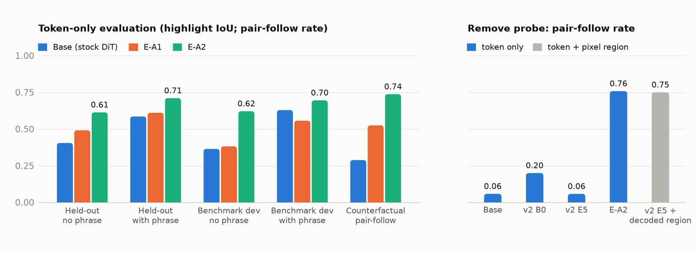

图 1　左：只给 token 的指认 IoU 和成对跟随，原版、E-A1、E-A2；右：remove 探针的成对跟随，含 v2 的对照。原图：`V3/runs/ea2_local8_001/vis/fig_ea2_results.png`

- **路径：**`V3/runs/ea2_local8_001/`：`train/adapter_1300`、`analysis.txt`、`gallery/`、`vis/`（另有指认随机样本 `vis/fig_ea2_highlight.jpg`、remove 探针例图 `vis/fig_ea2_remove_probe.jpg`、训练中快速评测 `vis/fig_ea2_training.png`）。

### 2.3 代码移植与 LoRA 初始化缺陷（10-13）
- **移植：**E-A1、E-A2 的脚本移进 v3 包。在 `--unsynced-init` 下第 10、20 次更新逐位复现了 E-A2，评测重跑差值为 0；核对脚本 `V3/legacy_code/verify_equivalence.py`。
- **缺陷：**旧脚本先按卡号设种子、后建 LoRA，8 张卡的 LoRA-A 各不相同。
  - 保存的 0 号卡权重和最终评测有效，但训练效率受损，训练中的快速评测是 8 个略有差异的模型的平均；
  - 同步初始化后，第 20 次更新的 mse 0.0407 → 0.0364（`V3/legacy_code/gpu_regression_20261013/`）；
  - 量化这一影响的 E-A2b 没有跑，之后转入第二轮、从原版重训。C1 起所有训练都是同步初始化。

### 2.4 与 benchmark 的差距，转入第二轮（10-13）
- **材料：**`V3/analysis/benchmark_gap_20261013/gap_stats.txt`。
- **区域更小：**benchmark v2（当时 200 张图、785 个单元）区域面积中位 0.57%，< 0.5% 的占 45.4%；1 MP 下中位只有约 23 个 DiT token。E-A2 的盲指代按 benchmark 的面积分布重加权后只有 0.409。
- **形式更复杂：**benchmark 一图 2–5 条编辑、四种定位方式，E-A2 的评测和它不一致。
- **tokenizer 不是瓶颈：**785 个区域 mask → token → mask 的往返 IoU 均值 0.822，中位 0.852；瓶颈在 DiT。
- **决定：**第二轮改用协议 2.0 的新数据（SA-1B dense mask、50k 编辑），从原版重训。

## 3. 第二轮定位：C1、C1b 与 10-17 诊断

### 3.1 C1：在 SA-1B dense mask 上学定位（10-16）
- **目的：**只凭 token 定位，重点是小区域、多 token、部件对宿主。暂定放行线：
  - 单 token 盲指代 ≥ 0.65，其中 < 0.5% 的 ≥ 0.45；
  - 多 token 全对 ≥ 50%；成对跟随 ≥ 0.75；remove 探针 ≥ 0.5；
  - 区域外改动不高于原版。
- **设置：**
  - 初始化：从原版起训，新 LoRA r32，码本注入和读写路由仿射都是新的。
  - 数据：`V3/data/round2_20261016/rows_c1.jsonl`，64,000 行，训练图 1,072 张，开发集 60 张图留出。
    - 单 token 指认 25,600、带名 9,600，多 token 指认 19,200；
    - 50k 编辑 9,600：盲指代 + token 6,256、带名 + token 1,944、只有物体名 1,400。
  - 损失：FM + 区域项 + 邻居项 + 写路由 + **读路由（新增）**，两个路由都是带权 BCE。反例：同类前 3 个加第 1 个宿主，权重 3。
  - 2,000 次更新 × 32 行；lr 1e-4，预热 50 次后恒定；seed 2000。
  - 硬件与时长：本机 8 卡 × 累积 4，14.6 h；代码 d31af846（工作区另有未提交的第二轮代码）。
- **评测：**开发集 1,320 项。原版基线 `V3/baselines/round2_stock_eval/`；E-A2 基线 `V3/baselines/round2_ea2_eval/`（E-A2 训练时用旧写法，只作参考）。
- **结果**（`V3/runs/c1_local8_001/summary.txt`）：

  | 指标 | 原版 | E-A2 | C1@1500 | C1@2000 |
  |---|---:|---:|---:|---:|
  | 单 token 盲指代（400） | 0.105 | 0.278 | **0.405** | 0.368 |
  | 　面积 < 0.5%（168） | 0.021 | 0.10 | 0.205 | 0.186 |
  | 单 token 带名（200） | 0.174 | 0.302 | 0.441 | 0.390 |
  | 多 token 全对 / 区域 IoU / 串色 | 0% / 0.072 / 6.0% | 0% / 0.114 / 9.1% | 9% / 0.315 / 1.3% | 5% / 0.253 / 1.7% |
  | 成对跟随：同类 / 部件对宿主 | 0.047 / 0.06 | 0.067 / 0.24 | 0.107 / 0.30 | 0.107 / 0.34 |
  | remove 探针 | 0.05 | 0.333 | **0.50** | 0.417 |
  | 编辑：区域外 / 误差 / 区域内 | 6.2 / 27.9 / 17.7 | 2.2 / 28.4 / 17.0 | 2.4 / 24.8 / 24.2 | 2.6 / 23.4 / 24.3 |

- **分析与结论：**
  1. 六条放行线只过了 remove 探针和区域外改动两条。
  2. 第 1,500 次好于第 2,000 次：学习率恒定，后段退步。C1b 从 @1500 起训。
  3. 失误构成（C1@1500，占全部 400 项）：命中 51%、近邻 34%、远处 15%。近邻失误落在：异类邻居 37%、宿主 29%、同类邻居 24%、背景 7%、部件 4%（`V3/runs/c1b_local8_001/nearmiss.txt`）。
  4. 同类实例对的两个 token 98% 码不同（v3 文档），问题不在 token 能不能区分。
- **路径：**`V3/runs/c1_local8_001/`：`train/adapter_1500`、`adapter_2000`；`eval_1500`、`eval_2000`；`summary.txt`；案例图 `cases/`（小区域的随机样本、提升与失败，多 token、成对、编辑）。

### 3.2 C1 的三项诊断：瓶颈在哪
- **目的：**判断 C1 的瓶颈是分辨率、数据量还是监督方式。
- **结果与结论：**
  1. **只把推理分辨率提到 1.5 MP**（`V3/runs/c1_local8_001/summary_resolution.txt`）：单 token 0.405 → 0.409，< 0.5% 0.205 → 0.243（不显著），近邻失误 34% → 32%。分辨率不是主要瓶颈。
  2. **训练图对新图**（`V3/runs/c1_local8_001/eval_1500_train_images/`，120 张训练图上 650 项）：见过的 mask 0.427，没见过的 0.390，开发集 0.405。训练和泛化之间几乎没有差距，问题在监督和方法，不在数据量。
  3. **训练行的覆盖**（v3 文档）：
     - 图里有相邻同类的单 token 行中，最近的同类只有 52% 被用作反例；异类邻居从没被用作反例；
     - 读方向在单 token 行上没有重反例；
     - 多 token 行里含相邻同类对的只有 13%。

     这三条直接导向 C1b。

### 3.3 C1b：近邻硬反例（10-17）
- **目的：**只改训练行和反例权重，看近邻失误是否来自缺反例。
- **设置：**
  - 初始化：C1@1500。
  - 数据：`V3/data/round2_20261016/rows_c1b.jsonl`，25,600 行，各类比例同 C1。
    - 反例改为框间距 ≤ 对角线 5% 的任意类别标注物体：最近的至多 6 个，加至多 2 个宿主；读、写两个方向都加重；每个单 token 行平均 5.93 个反例；
    - 2,112 对反事实成对（相邻 1,712、部件对宿主 400），同卡同一次更新；
    - 40% 的多 token 行围绕相邻对构建。
  - 800 次更新 × 32 行；预热 20 次后余弦退火到 1e-5；`--heavy-weight 8`。
  - 硬件与时长：本机 8 卡 × 累积 4，5.9 h；代码 f63ab12a。
- **评测：**开发集 1,320 项。
- **结果**（`V3/runs/c1b_local8_001/summary.txt`、`nearmiss.txt`）：

  | 指标 | C1@1500 | C1b@800 | 差值 |
  |---|---:|---:|---|
  | 单 token 盲指代（400） | 0.405 | **0.428** | +0.023 [+0.005, +0.041] |
  | 　面积 < 0.5%（168） | 0.205 | 0.246 | |
  | 单 token 带名（200） | 0.441 | 0.447 | +0.006 [−0.028, +0.042] |
  | 命中 / 近邻 / 远处 | 51 / 34 / 15% | 55 / 31 / 14% | 近邻落点的构成不变 |
  | 成对：同类 / 部件对宿主 | 0.107 / 0.30 | 0.140 / 0.30 | 不显著 |
  | remove 探针 | 0.50 | 0.583 | 区间重叠 |
  | 编辑：区域外 / 误差 / 区域内 | 2.4 / 24.8 / 24.2 | 2.0 / 24.5 / 24.3 | |

- **分析与结论：**
  1. 提升小但显著。四个目标（近邻 < 20%、单 token > 0.5、部件对宿主 > 0.5、< 0.5% 的 > 0.3）一个都没达到。
  2. 近邻吸附不是缺反例造成的，而是机制问题，见 §3.4 的探针。
- **路径：**`V3/runs/c1b_local8_001/`：`train/adapter_800`、`eval_800`、`summary.txt`、`nearmiss.txt`、`run_c1b.sh`。

### 3.4 10-17 诊断：定位学会了吗？编辑受损了吗？
- **目的：**C1b 之后决定下一阶段的方向：定位是否真的通过 token 完成，编辑能力是否受损。
- **材料：**`V3/analysis/diag_20261017/`，脚本在 `V3/analysis/diag_20261017/scripts/`。

**① 定位进展**（`V3/analysis/diag_20261017/progression.txt`）：单 token 盲指代 IoU 原版 0.105 → E-A2 0.278 → C1 0.405 → C1b 0.428，C1b 相对原版 +0.323 [+0.289, +0.358]。

**② 注意力探针**（`V3/analysis/diag_20261017/probe_summary.txt` 和 `probe/` 目录；C2 两列由 `V3/analysis/diag_20261017/scripts/analyze.py` 的 `probe` 子命令汇总）
- **设置：**400 个单 token 盲指代项，按正式设置真实推理 20 步；记录 ⟨M⟩ 对源图的读取，以及第 0/10/19 步目标位置对 ⟨M⟩ 的写入；算区域内对区域外、目标对近邻的 AUROC。

| 指标 | 原版 | C1b@800 | C2@2000 | C2@3522 |
|---|---:|---:|---:|---:|
| 命中 / 近邻 / 远处 | 11 / 49 / 40% | 55 / 32 / 13% | 52 / 34 / 14% | 59 / 32 / 9% |
| 读 AUROC，目标对其余（最佳层） | 0.739 | 0.922 | 0.923 | 0.929 |
| 读 AUROC，目标对近邻 | 0.686 | 0.858 | 0.861 | 0.868 |
| 写 AUROC，第 0 步 | 0.706 | 0.973 | 0.972 | 0.976 |
| 近邻失误中：读阶段已偏向邻居 | 24% | 28% | 24% | 26% |
| 近邻失误中：读对，但第 10 步写偏 | 17% | 24% | **45%** | 27% |
| 去掉 token 后与原输出的重合 IoU | 0.340 | 0.059 | — | — |

- **结论：**
  1. 定位依赖 token：C1b 去掉 token 后，输出和原来几乎不重合（0.059）；原版去不去 token 输出差不多（0.340）。
  2. 剩下的近邻失误约四分之一在读阶段就偏了，其余是读对了、在去噪过程中写偏：C1b 写方向偏向目标的比例从第 0 步的 71% 降到第 10 步的 55%。

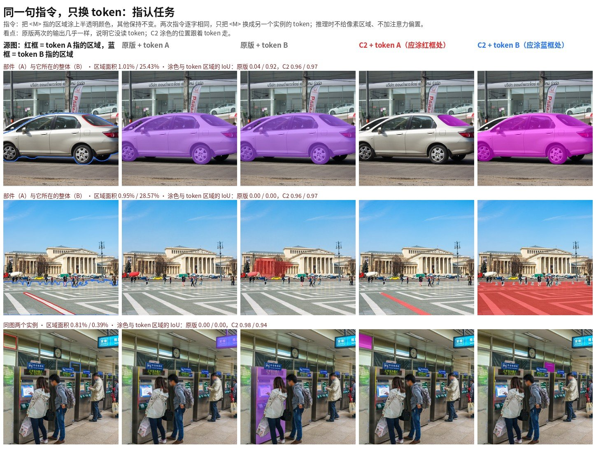

图 2　同一句指令只换 token（红框 = token A，蓝框 = token B）：原版两次输出几乎一样，说明它不读 token；C2 涂色的位置跟着 token 走（部件对整体、同图两个实例）。原图：`V3/reports/progress_20261020/figs/fig3a_token_swap_highlight.jpg`

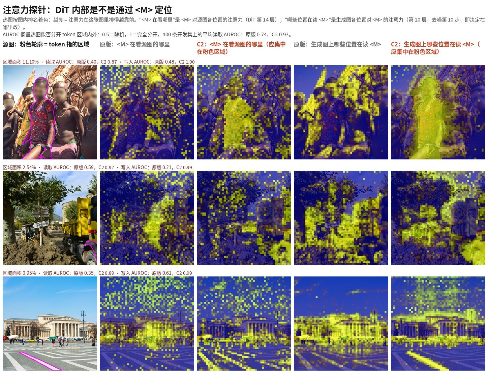

图 3　注意力探针：⟨M⟩ 在源图上看哪里（第 14 层）、生成图上哪些位置在读 ⟨M⟩（第 20 层、去噪第 10 步），原版对 C2@3522；C2 的热区集中在粉色轮廓内。原图：`V3/reports/progress_20261020/figs/fig3c_attention_probe.jpg`

**③ 开发集上的纯文字编辑**（`V3/analysis/diag_20261017/text_edits/`）
- **设置：**100 条编辑，写明物体的句子、不带 token，20 步，原始 SAMTok TE。

| | 原版（SAMTok TE） | C1 | C1b |
|---|---:|---:|---:|
| 区域外改动 | 5.6 | 2.5 | 2.2 |
| 与参考目标的误差 | 26.9 | 22.4 | 22.0 |
| 不执行（扣漂移） | 43% | 41% | 42% |

**④ benchmark v0 纯文字判分**（`V3/analysis/diag_20261017/bench_judge_summary.txt`、`bench_text/`、`judge/`）
- **设置：**656 例，40 步，seed 0，CFG 1；用 benchmark v0 的 Qwen3.8-27B 双图判分，本机以 HF transformers 运行。
- **校准：**同一批 164 张官方输出，本机 E 2.890，已发布 2.945，88% 完全一致。

| 指标 | 官方原版（164 例） | 原版 + SAMTok TE | C1b@800 | C1b − 原版 + SAMTok TE（n = 655） |
|---|---:|---:|---:|---|
| E | 2.89 | 2.424 | 2.631 | +0.206 [+0.064, +0.350] |
| P | 3.70 | 3.731 | 3.479 | −0.252 [−0.324, −0.179] |
| Q | 3.74 | 3.710 | 3.461 | −0.249 [−0.302, −0.197] |
| 严格成功 | 0.567 | 0.450 | 0.392 | −0.058 [−0.105, −0.011] |

- 只换文本编码器的代价：同 164 例，官方原版 → 原版 + SAMTok TE，E −0.488 [−0.720, −0.268]。
- C1b 的变化：remove 上升（E 1.09 → 2.04），add、replace 下降（3.27 → 2.95，3.53 → 3.19），P、Q 各降约 0.25。

**⑤ 更正与综合（10-18）**
- 早先"开发集不执行 13% → 35%"是口径偏差。改用扣漂移的口径后，带 token 的编辑（盲指代 + token，100 条）：

  | | 原版 | C1 | C1b |
  |---|---:|---:|---:|
  | 不执行 | 63% | 48% | 45% |
  | 　add / remove / replace / attribute | 84 / 68 / 60 / 40% | 80 / 48 / 40 / 24% | 72 / 44 / 32 / 32% |
  | 强度（参考目标 51.4） | 11.5 | 21.9 | 22.4 |

- 没有"只会涂色"：Lab 空间里结构类改动的比例，带 token 的 remove 从 0.07 升到 0.21、replace 从 0.09 升到 0.21，涂色类像素没有增加（v3 文档；脚本 `V3/analysis/diag_20261017/scripts/tint.py`）。
- **结论：**
  1. 定位学会了，而且是通过 token；
  2. 带 token 的编辑比原版执行得更多；
  3. 不带 token 时有所退化，按用户口径不需要保持；
  4. 真正的短板是 add（不执行 72%）和改动强度（约为参考目标的 0.4 倍）。

  于是转入以编辑为主的阶段 B（C2），并撤回"加 20% 纯文字编辑""LoRA 只在含 token 时生效"两条建议。

## 4. C2 及其分析（10-18 至 10-20）

### 4.1 C2 训练
- **目的：**从 C1b 起训，以带 token 的编辑为主，提高执行率和改动强度，同时定位不退步；可用的数据全部用上。
- **设置：**
  - 初始化：C1b@800。
  - 数据：`V3/data/round2_20261016/rows_c2.jsonl`，112,704 行，构成见文档 01：
    - 50k 单条 46,690 行，其中天然孪生 13,180 行（6,590 对）；
    - v1 单条 39,768 行，其中 9,786 行用局部损失；
    - D4 多目标 3,681 行（1,576 行用局部损失）；50k 拼合多目标 11,270 行；指认 11,295 行；
    - 只有带 token 的写法：单目标行盲指代 70%、带名 30%；99.5% 的编辑行带邻居反例。
  - 相对 C1b 的方法改动（详见文档 02）：
    - 50k 编辑的区域项改用实际改动像素，外扩 1 个 token；
    - 目标图有整图漂移的行只算局部损失；
    - D4 按单元拆分改动区域；
    - 多目标用 `U1:` 写法。
  - 3,522 次更新 × 32 行；预热 20 次，lr 1e-4 余弦降到 1e-5；`--heavy-weight 8`。
  - 运行设置原文见 `scripts/round2/settings/c2_4n.sh`（v4 仓库保留）。
  - 硬件与时长：ARNOLD 4 机 × 8 卡 × 累积 1（每次更新的行数与 8 卡 × 4 相同），只训练；4.5 h，约 4.6 s 一次更新；代码 50ffa0ce。完整评测在开发机上做。
- **过程：**0 个样本被跳过，D4 全部用上；最后一次更新 loss 0.183、mse 0.0266、reg 0.118、dis 0.0052、write 0.273、read 0.352。
- **计划与实际的出入：**计划 2,500 次更新、指认 15%、只有物体名的行 15%、10% 去掉 token；实际 3,522 次、指认约 10%、没有不带 token 的行、没有 token dropout。

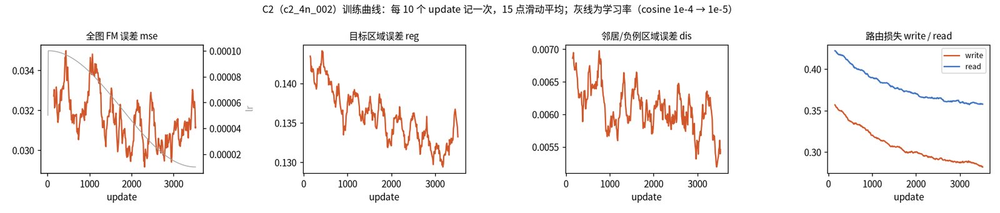

图 4　C2 训练曲线（每 10 次更新记一次，15 点滑动平均）：全图误差 mse、目标区域误差 reg、邻居误差 dis、读写路由损失；灰线为学习率。原图：`qwen-image-2.1-v3:docs/assets/v3_round2/fig_r2_c2_training.png`

- **曲线的含义：**
  - 目标区域误差 reg 从前 10% 更新的均值 0.142 只降到后 10% 的 0.133，是全图误差 mse（约 0.031）的 4 倍多；
  - 邻居项一直很小；
  - 小编辑的"改"学得慢，原因见 §4.4。
- **中途检查**（`adapter_2000`，开发集 620 项子集 `V3/runs/c2_4n_002/scripts/eval_mid.json`，脚本 `V3/runs/c2_4n_002/scripts/mid_analyze.py`）：
  - 单 token 盲指代 0.402，比 C1b 低 0.026 [−0.046, −0.006]，显著；
  - 不执行 55%，比 C1b 多 10 个百分点 [+2, +18]，显著；remove 探针 0.30；
  - 探针中"读对、第 10 步写偏"升到 45%。
  - 学习率较低的最后 1,500 次更新把这些拉回并超过 C1b。训练中的快速评测每类只有 8–40 项，看不出这个先降后升的过程。

### 4.2 C2 开发集结果
- **评测：**开发集 1,320 项，`V3/runs/c2_4n_002/eval_3522/`；报告 `V3/runs/c2_4n_002/analysis.txt`，同时写进 W&B summary 的 `dev/…` 项。
- **结果：**

| 指标 | 原版 | C1@1500 | C1b@800 | **C2@3522** | C2 − C1b |
|---|---:|---:|---:|---:|---|
| 单 token 盲指代（400） | 0.105 | 0.405 | 0.428 | **0.464** | +0.036 [+0.018, +0.055] |
| 单 token 带名（200） | 0.174 | 0.441 | 0.447 | **0.515** | +0.068 [+0.036, +0.100] |
| 命中 / 近邻 / 远处 | 11 / 48 / 41% | 51 / 34 / 15% | 55 / 31 / 14% | 59 / 31 / 10% | |
| 多 token 全对 / 区域 IoU / 串色 | 0% / 0.072 / 6.0% | 9% / 0.315 / 1.3% | 9% / 0.332 / 0.9% | 8% / 0.356 / 1.4% | |
| 成对：同类（150 对） | 0.047 | 0.107 | 0.140 | **0.200** | +0.06 [+0.01, +0.11] |
| 成对：部件对宿主（50 对） | 0.06 | 0.30 | 0.30 | 0.34 | |
| remove 探针（60 对） | 0.05 | 0.50 | 0.583 | 0.333 | 变差 |
| 编辑不执行（100） | 63% | 48% | 45% | 50% | +5 个百分点 [−3, +13] |
| 强度（参考目标 51.4） | 11.5 | 21.9 | 22.4 | 17.6 | |
| 区域外改动 | 6.2 | 2.4 | 2.0 | **1.8** | |
| 与参考目标的误差 | 27.9 | 24.8 | 24.5 | **23.9** | |

注：命中 / 近邻 / 远处由 `V3/analysis/diag_20261017/scripts/nearmiss.py` 在各评测目录上算出，原版和 C2 两列是本文补算的；探针（§3.4）用的口径略有不同。

按操作（不执行 / 强度 / 区域外 / 误差）：

| 操作 | 原版 | C1 | C1b | C2 |
|---|---|---|---|---|
| add | 84% / 5.5 / 5.6 / 11.1 | 80% / 6.0 / 2.0 / 8.0 | 72% / 7.1 / 1.9 / 8.0 | 64% / 10.3 / 1.8 / 8.6 |
| remove | 68% / 7.1 / 5.2 / 33.3 | 48% / 24.7 / 2.2 / 34.4 | 44% / 27.0 / 1.9 / 34.9 | 64% / 13.2 / 1.9 / 31.3 |
| replace | 60% / 10.2 / 6.6 / 30.2 | 40% / 22.6 / 2.4 / 28.0 | 32% / 27.0 / 2.1 / 26.3 | 28% / 25.6 / 1.9 / 24.2 |
| attribute | 40% / 23.2 / 7.5 / 37.1 | 24% / 34.2 / 2.9 / 28.8 | 32% / 28.4 / 2.0 / 28.5 | 44% / 21.2 / 1.6 / 31.6 |

C2 − C1b 按操作的显著差（4,000 次自助抽样）：add 强度 +3.2 [+0.7, +6.2]；replace 误差 −2.1 [−4.1, −0.3]；remove 强度 −13.8 [−28.3, −1.6]；attribute 强度 −7.2 [−12.4, −2.9]。

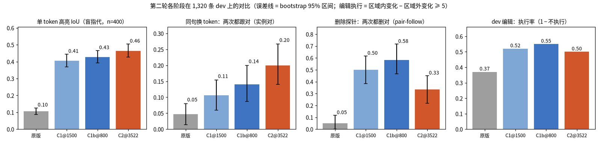

图 5　第二轮各阶段在开发集上的对比：单 token 盲指代 IoU、同类成对跟随、remove 探针、编辑执行率（误差线为 bootstrap 95% 区间）。原图：`V3/reports/progress_20261020/figs/fig0_dev_progression.png`

- **分析与结论：**
  1. **定位继续提升：**单 token、带名、同类成对都显著好于 C1b；远处失误 14% → 10%；探针里的写入漂移回落到 27%。
  2. **编辑有得有失：**
     - add、replace 变好，remove、attribute 变弱；
     - 总体不执行 50%（C1b 45%，差异不显著），仍少于原版用同样输入时的 63%（−13 个百分点 [−24, −3]）；
     - 区域外改动和误差是各阶段最好的。
  3. **remove、attribute 变弱的线索：**
     - 50k 的 remove 行 92% 是天然孪生，孪生的对方是重反例；
     - D4 的单元以 remove、attribute 为主；
     - v1 的目标改动并不弱，可以排除"目标太弱"。
- **路径：**`V3/runs/c2_4n_002/`：`train/adapter_3522`（最终）、`adapter_2000`（中途）；`eval_3522`、`eval_2000_subset`；`analysis.txt`、`analysis.json`；最终评测、探针和中途检查的脚本在 `V3/runs/c2_4n_002/scripts/`。

### 4.3 原版 vs C2：开发集编辑的案例对比（10-19）
- **目的：**原版不认 token，给它写明物体的完整文字指令，看 C2 用盲指代 + token 是否已经好过原版的常规用法。
- **设置：**
  - 原版：官方权重和官方 TE，写明物体的文字指令，20 步，seed 0，CFG 1；输出与脚本在 `V3/baselines/round2_official_text_edits/`。
  - C2：盲指代 + token（`eval_3522`）。
- **结果**（100 条）：

  | | 原版（写明物体的文字） | C2（盲指代 + token） |
  |---|---:|---:|
  | 执行率 | 58% | 50% |
  | 区域外改动 | 5.0 | 1.8 |
  | 与参考目标的误差 | 27.8 | 23.9 |
  | 执行率：add / remove / replace / attribute | 52 / 40 / 64 / 76% | 36 / 36 / 72 / 56% |

  - 两者都执行 38 条，只有原版执行 20 条，只有 C2 执行 12 条，都没执行 30 条；
  - 两者都执行的 38 条里，C2 更接近参考目标的有 26 条。
- **分析与结论：**
  1. C2 一旦动手，基本都改在选中的那个物体上：同类物体里只改指定的那一个，区域外几乎不动，加的东西大小合适。
  2. 原版正好相反：常常改了，但改错地方、改过头，或重画整张图。它的"执行"按改动区域内的变化计，改到别处的编辑会被算成不执行，整图漂移也抬高了它的区域外改动。
  3. C2 的失败主要有两种：小区域上不执行；改到旁边的同类物体或相邻部件上。
- **图：**六张对比图 `V3/runs/c2_4n_002/cases/c2_vs_base_1.jpg` 到 `_6.jpg`，共 23 例，按主题挑选，不代表平均水平；判定见 `V3/runs/c2_4n_002/cases/cases.json`。图 1–3 是 C2 更好，图 4 打平，图 5 是 C2 没执行，图 6 是 C2 改到旁边。

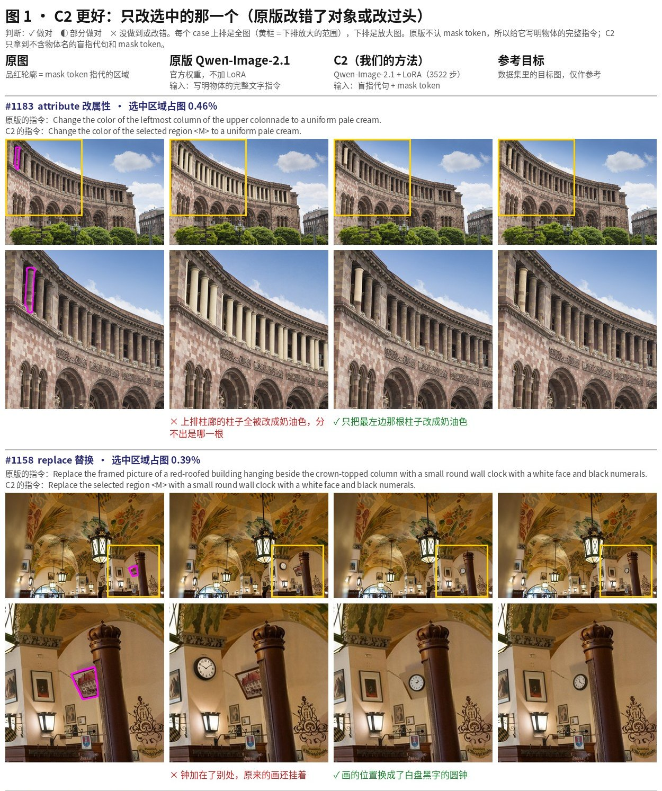

图 6　C2 只改选中的那一个，原版改错对象或改错位置（对比图 1 的第 1、3 例；列：原图、原版、C2、参考目标）。原图：`V3/runs/c2_4n_002/cases/c2_vs_base_1.jpg`

### 4.4 "不执行"诊断（10-19）
- **目的：**弄清 C2 为什么在开发集上有一半不执行：是能力不够，还是训练教出了"不敢改"。
- **设置：**开发集 100 条编辑，20 步；C2 另跑 seed 1、2 和"物体名 + token"（`V3/analysis/noexec_20261019/c2_variants/`）。
- **结果**（`V3/analysis/noexec_20261019/variants_report.txt`）：

  | | 盲指代 + token（seed 0） | 物体名 + token（seed 0） | 原版，写明物体的文字 |
  |---|---:|---:|---:|
  | 执行率 | 50% | **66%** | 58% |
  | 强度 | 17.6 | 25.7 | — |
  | 与参考目标的误差 | 23.9 | 21.0 | 27.8 |
  | 区域外改动 | 1.82 | 1.90 | 5.0 |
  | 执行率：add / remove / replace / attribute | 36 / 36 / 72 / 56% | 48 / 68 / 76 / 72% | 52 / 40 / 64 / 76% |

  - 换种子：盲指代 + token 在 seed 0/1/2 下执行 50% / 48% / 54%。按条看，三次都执行 34%，有时执行 33%，都不执行 33%；任一种子执行的合计 67%。
  - 只有物体名版执行的 19%，只有盲指代版执行的 3%。
  - 按区域面积的执行率（盲指代 / 物体名）：< 0.1%（44 条）34% / 55%；0.1%–0.5%（32 条）56% / 72%；≥ 0.5%（24 条）71% / 79%。开发集选中区域的中位只有 0.13%。
- **分析与结论：**
  1. **训练没有制造不执行：**带 token 的执行率原版 37% → C1b 55% → C2 50%；原版用文字指令 58%。问题是还没追上原版用文字的水平，且 C2 在 remove、attribute 上比 C1b 保守。
  2. **不执行是置信度问题，不是能力问题：**换种子或写明物体名，执行率升到 66%–67%；写明物体名时 C2 的三项指标都优于原版用文字。目测 14 例不执行，约一半什么都没改，约一半改到了旁边的物体上（v3 文档）。
  3. **训练为什么教出"不敢改"：**
     - "要改"的信号被稀释：区域损失按面积归一并外扩一圈 token，真正改动的像素在区域损失里只占：50k 的 add 7%、remove 和 attribute 25%、replace 33%，v1 为 64%–71%（`V3/analysis/noexec_20261019/region_share.py`）；
     - "别改邻居"的信号一直在：99.5% 的编辑行带邻居反例；孪生行占 50k remove 的 92%、attribute 的 28%、add 的 7%、replace 的 2%，C1b → C2 退步的正好是孪生多的 remove 和 attribute；
     - 均方误差下，模型拿不准是哪一个时，最省损失的做法是把改动压小。
  4. **排除的原因：**
     - 训练目标改得不弱：50k 强度 45–56，v1 61–72，强度 < 15 的只占 0%–10%，区域外漂移 ≤ 0.7（v3 文档；脚本 `V3/analysis/noexec_20261019/train_teacher.py`）；
     - 文本编码器：纯文字下不执行率官方 TE 42%、SAMTok TE 43%。

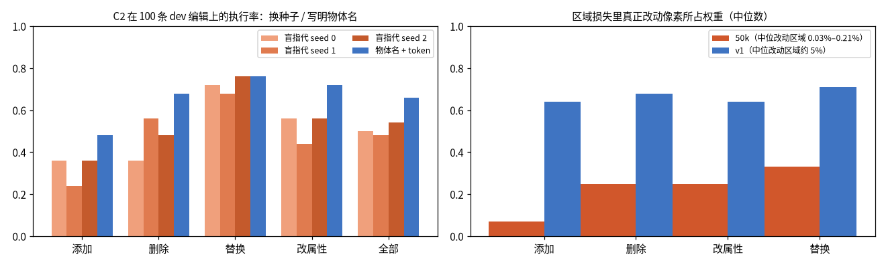

图 7　左：C2 在 100 条开发集编辑上的执行率，换种子与写明物体名；右：区域损失里真正改动的像素所占的权重（中位数），50k 对 v1。原图：`qwen-image-2.1-v3:docs/assets/v3_round2/fig_r2_noexec.png`

### 4.5 benchmark 2.6.0 拆分 36 例（10-19）
- **目的：**在正式判分之前，先在 benchmark 风格的 case 上目测 C2 与原版的规律。
- **设置：**
  - benchmark 2.6.0 的 case 拆成单指令，四类各 9 条，来自 13 张图；全部 40 步、seed 0；
  - 原版按 benchmark 适配代码的官方设置：DiffSynth `QwenImage21Pipeline`，CFG 1，约 1 MP，32 px 网格，只给写明物体的那句指令；
  - C2@3522：把单元 mask 编成 token，分别写进盲指代句和物体名句。
- **结果**（人工逐条放大查看；✓ / ◐ / × 的个数，`V3/analysis/bench_split_20261019/verdicts.json`）：

  | 模型 | add | remove | replace | attribute | 合计 |
  |---|---|---|---|---|---|
  | 原版，纯文字 | 3/3/3 | 6/1/2 | 4/4/1 | 6/2/1 | 19/10/7 |
  | C2 盲指代 + token | 6/2/1 | 4/3/2 | 7/1/1 | 6/0/3 | 23/6/7 |
  | C2 物体名 + token | 5/3/1 | 5/3/1 | 7/1/1 | 9/0/0 | **26/7/3** |

- **分析与结论：**
  1. 原版的失败：改错实例（#15、#19、#33）、物体大得离谱（#7、#20、#25）、整张图重画（#13）。
  2. C2 盲指代的失败：不执行（#5、#13、#16、#21）、颜色给错或只改一部分（#28、#31、#33）；写明物体名后大多修好，改属性 9 条全对。
  3. 两种 C2 都有的失败：删除后留下空白板或残留（#11、#12）；文字类贴花是乱码（#1、#4）。
  4. 小区域的 token 往返不准：最低是 #21 的 0.23（区域占全图 0.108%）和 #4 的 0.37（0.077%）。
  5. 只有 36 条、靠目测，用来看规律，不是正式分数。
- **路径：**`V3/analysis/bench_split_20261019/`：生成脚本 `base_text.py`、`c2_token.py`；对比图 `sheets/bench_split_base_vs_c2_1.jpg` 到 `_8.jpg`（1–2 添加，3–4 删除，5–6 替换，7–8 改属性）。

### 4.6 benchmark 2.6.0 的 101 例正式评测（10-19）
- **目的：**用 benchmark 自己的运行器和判分模型，和官方基线在同一次判分里比较 C2 的 token 输入。用户同意先跑约 100 例的子集，不跑全量。
- **设置：**101 例、360 个单元（§1.5）；输入、生成和判分见 §1.4；只给文字的单元不加 token。对比的系统：

  | 系统 | 权重 | 输入 |
  |---|---|---|
  | 原版（官方） | 原版 | 彩色定位图，官方输出 |
  | FLUX.3 klein（官方） | FLUX.3 klein | 彩色定位图，官方输出；主表最强的外部模型 |
  | 原版 + token | 原版 DiT + SAMTok TE，不训练 | 原生区域 → token，下界 |
  | C2 token | C2@3522 | 原生区域 → token，主结果 |
  | C2 token + 自动起名 | C2@3522 | 盲指代单元先由同一个文本编码器根据 token 说出物体名，再按"物体名 + token"编辑，全程只用 token |

- **结果**（`V3/analysis/bench_subset_20261019/report_main.txt`）：

  | 系统 | 单元 E | 带名单元 E | 盲指代单元 E | 只给文字的单元 E | 单元 P | 单元 Q | 整图全过 |
  |---|---:|---:|---:|---:|---:|---:|---:|
  | 原版（彩色定位图，官方） | 0.722 | 0.813 | 0.605 | 0.857 | 0.622 | 0.658 | 12.9% |
  | FLUX.3 klein（彩色定位图，官方） | 0.681 | 0.768 | 0.567 | 0.776 | 0.900 | 0.914 | 28.7% |
  | 原版 + token（不训练） | 0.539 | 0.695 | 0.338 | 0.735 | 0.842 | 0.875 | 10.9% |
  | **C2 token** | 0.742 | 0.768 | **0.707** | 0.694 | **0.892** | 0.894 | **34.7%** |
  | C2 token + 自动起名 | 0.764 | 0.793 | 0.726 | 0.735 | 0.914 | 0.922 | 43.6% |

  配对差（按 case 自助抽样）：
  - C2 − 原版：整图全过 +21.8 个点 [+11.9, +32.7]；单元 P +0.27 [+0.20, +0.34]；盲指代单元 E +0.10 [0.00, +0.20]；带名单元 E −0.04（不显著）；单元 E 全部 +0.02（不显著）。
  - C2 − FLUX.3：整图全过 +5.9 个点 [−5.0, +15.8]，不显著；单元 E +0.06 [+0.01, +0.11]，其中盲指代 +0.14 [+0.06, +0.22]。
  - C2 − 原版 + token（训练的作用）：整图全过 +23.8 个点 [+13.9, +33.7]，盲指代单元 E +0.37 [+0.28, +0.46]。

  补充对照（都不显著）：

  | 对照 | 整图全过 | 差值 [95% 区间] |
  |---|---|---|
  | 真值 mask 对 SAM2 转出的 mask（C2，联合生成） | 39.6% 对 34.7% | +5.0 [−4.0, +12.9] |
  | 逐个单元编辑对一次联合生成（C2，真值 mask） | 33.7% 对 39.6% | −5.9 [−15.8, +4.0] |
  | 自动起名对不起名（真值 mask） | 39.6% 对 39.6% | 0 [−10.9, +10.9] |
  | 自动起名对不起名（原生定位，即主表） | 43.6% 对 34.7% | +8.9 [−1.0, +19.8] |
  | 自动起名，两种设置合并（202 对） | — | +4.5 [−3.5, +12.4] |
  | C2 对原版，都用旧的标签图（真值 mask） | 39.6% 对 15.8% | +23.8 [+12.9, +34.7] |

  注：补充对照的区间按 `judged/` 里的判分记录重算；v3 文档把第 3 行写作 [−11.9, +10.9]、第 4 行写作 [−1.0, +18.8]，盘上 `report_main.txt` 的第 4 行是 [−1.0, +19.8]。

  E 失败构成（benchmark 自己的分类规则，只统计 E 未通过的单元）：

  | 系统 | 失败单元 | 没执行 | 遮挡残留 | 改错实例 | 范围不对 | 定位标记画进输出 | 其他 |
  |---|---:|---:|---:|---:|---:|---:|---:|
  | 原版（彩色定位图） | 100 | 39 | 6 | 2 | 6 | 8 | 39 |
  | FLUX.3 klein | 115 | 63 | 10 | 3 | 4 | 0 | 35 |
  | C2 token | 93 | 45 | 10 | 0 | 3 | 0 | 35 |

- **分析与结论：**
  1. **同一底座下，token 输入明显好于官方彩色定位图：**整图全过 34.7% 对 12.9%。主要来自只改指定的东西（单元 P 0.89 对 0.62）和盲指代单元执行得更好，与开发集上"区域外改动 1.8 对 6.2"一致。C2 的整图全过也高于 FLUX.3 klein（区间跨 0），单元 E 显著更高。
  2. **训练是必要的：**不训练时原版读不懂 token，盲指代单元只有 0.338。
  3. **C2 的短板：**
     - 只给文字、没有 token 的单元：0.694 对原版 0.857，是换文本编码器的代价。按用户口径不作验收，但它拉低整图全过；
     - "没执行"仍是 C2 最多的失败类型（93 个里 45 个），但比开发集上轻得多：开发集区域中位 0.13%，benchmark 0.47%，开发集的像素指标高估了不执行。
  4. **推理侧的选择：**一次联合生成好于或持平逐个单元编辑，保留联合生成；SAM2 转换点、框只带来小幅、不显著的损失；自动起名两种设置下结果不一致（+8.9 与 0），合并后不显著，不作默认。
  5. 只有 101 例，区间偏宽；正式结论要全量 1,084 例。点、框单元在我们的流程里多经过一次 SAM2，用到的信息与基线相同，写论文时要说明。

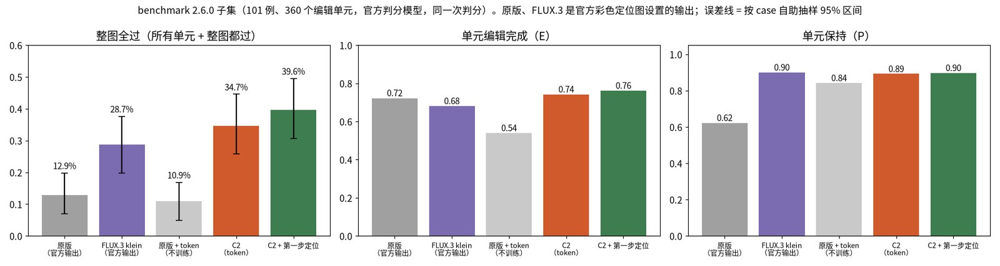

图 8　benchmark 2.6.0 的 101 例子集（360 个单元，同一次判分）：整图全过、单元 E、单元 P；误差线为按 case 自助抽样的 95% 区间。最后一组"C2 + 第一步定位"见 §4.7。原图：`V3/reports/progress_20261020/figs/fig1_benchmark.png`

- **路径：**`V3/analysis/bench_subset_20261019/`：设置说明 `README.md`、选例 `select_subset.py`、各系统的配置 `configs/` 与输出 `runs/`、判分 `judged/`、报告 `report_main.txt`、`report_supplementary.txt`；对比图 `sheets/bench_subset_cases_1.jpg` 到 `_3.jpg`。

### 4.7 C2 输在哪里、为什么，以及第一步定位的验证（10-20）
- **目的：**用户问 C2 在哪些地方不如原版或 FLUX.3、为什么、怎么优化。
- **设置：**数据同 §4.6（101 例、360 个单元，同一次判分），另做一次推理验证；报告 `V3/analysis/bench_subset_20261019/report_losses.txt`。
- **总体：C2 没有整体落后。**单元 E：C2 0.742，原版 0.722，FLUX.3 0.681。整图全过：对原版输 6 例、赢 28 例；对 FLUX.3 输 12 例、赢 18 例。
- **稳定输的四块**（单元 E，区间按 case 自助抽样）：

  | 切片 | 单元数 | 原版 | FLUX.3 | 原版 + SAMTok TE | C2 | C2 − 原版 | C2 − FLUX.3 |
  |---|---:|---:|---:|---:|---:|---|---|
  | 只给文字（无定位、无 token） | 49 | 0.86 | 0.78 | 0.73 | 0.69 | −0.16 [−0.31, −0.02] | −0.08（不显著） |
  | 替换 | 90 | 0.84 | 0.72 | 0.68 | 0.74 | −0.10 [−0.20, −0.01] | +0.02 |
  | 要写字 | 19 | 0.58 | 0.74 | 0.32 | 0.42 | −0.16（不显著） | −0.32 [−0.48, −0.12] |
  | 改属性，面积 ≥ 1% | 37 | 0.86 | 0.95 | 0.70 | 0.84 | −0.03 | −0.11（不显著） |

  - "原版 + SAMTok TE"即原版 DiT 换上 SAMTok 文本编码器、用 token、不训练。
  - 对照：带名 + token 的单元三者持平（C2 0.79，原版 0.80，FLUX.3 0.77）；盲指代 + token 的单元 C2 明显更好（0.71 对 0.61、0.57）。
- **C2 的 93 个编辑失败**（逐条读判分理由后人工归类，`V3/analysis/bench_subset_20261019/c2_fail_labels.json`）：没执行 38，改错位置或实例 14，只改了一部分 9，字写错 7，改坏附着物或形状 6，替换成叠加（旧物还在）4，数量不对 4，其余 11。其中 29 个两个基线也都没做到，这 29 个里 19 个是没执行。
- **原因：**
  1. **换成 SAMTok 文本编码器，丢了细语义。**原版 DiT 只换文本编码器时，只给文字的单元掉 0.12，替换掉 0.17，写字掉 0.26。C2 训练后，添加、删除、改属性都追了回来；替换和写字只追回约三分之一；只给文字的单元没有追回。另外训练里的写字编辑形式不对：C2 用到约 1,200 条（v1 约 1,130、50k 77），88% 是"把已有的字改成 X"；benchmark 的写字单元（全量 193 个，占 5.0%）95% 是新加或换成带字的物体，这两种训练里只有约 150 条（v3 文档）。
  2. **训练让 C2 变保守：只在 mask 里改，而且改得少。**
     - 远处漂移中位：C2 0.001，原版 0.006，FLUX.3 0.112；
     - 小目标（< 0.5%）替换：C2 只改了目标内 57% 的像素，原版 78%；目标外一圈的改动 C2 0.18，原版 0.68；
     - 替换做成功时目标外一圈的改动：原版 0.51，C2 0.26；
     - 来源（`V3/analysis/c3_plan_20261020/data50k_stats.txt`）：训练目标里有"做了一半"的样本：50k 的 replace 11.5%、attribute 11.2% 改动不到目标的一半，add 10.2% 把锚点或附着处改动了 60% 以上；外扩后区域损失的大部分权重落在没变的像素上，近邻和孪生的惩罚却不打折；
     - 这几点合起来教会了"别出界、少改"，也是 C2 保持最好的原因。
  3. **只给文字的单元没有 token，而 C2 训练时每个单元都带 token。**这类单元 C2 失败 15 个，其中没执行 6。
- **不是 C2 独有的问题：**没执行按 benchmark 规则 C2 45、原版 39、FLUX.3 63；多单元串位（一个单元的要求落到另一个单元的目标上）三家各约 2 例（v3 文档）。
- **更正（10-20）：**此前"50k 与 v1 之间 0.5%–5% 几乎没有数据"的说法不对。C2 用到的 50k 里 remove、replace、attribute 有 28%–33% 改动 ≥ 0.5%、18%–23% ≥ 1%；add 为 12% 和 8%。
- **验证：第一步定位。**
  - 设置：原版 SAMTok 文本编码器不训练，用指令里的指代短语提问 `Can you segment {ref}?` 生成 token（配置 `V3/analysis/bench_subset_20261019/configs/c2_ground_native.json`）；只重跑含这类单元的 49 例，其余 52 例沿用 C2 的结果，同一套判分。
  - 定位质量：49 个只给文字的单元全部拿到 token，与 benchmark mask 的 IoU 中位 0.82，73% ≥ 0.5；偏低的多是"加在某处"的单元（benchmark 的 mask 只圈附着处，生成的是整个物体）。

  | 指标 | 原版 | FLUX.3 | C2 | C2 + 定位 |
  |---|---:|---:|---:|---:|
  | 只给文字的单元 E | 0.86 | 0.78 | 0.69 | **0.86** |
  | 同图其他单元 E | 0.67 | 0.67 | 0.74 | 0.73 |
  | 49 例整图全过 | 14.3% | 30.6% | 24.5% | **34.7%** |

  - 只给文字的单元 E：+0.16 [+0.04, +0.29]，追平原版；这些单元的 P 0.98 → 0.94，Q 0.90 → 0.94。
  - 101 例整图全过 34.7% → 39.6%，+5.0 [−1.0, +10.9]，不显著。全量 benchmark 有 553 个只给文字的单元，占 14.3%，分布在 51% 的 case 里。
  - 结论：第一步定位补上了原因 3，C3 起设为默认。例图 `V3/analysis/bench_subset_20261019/sheets/ground_examples.jpg`。

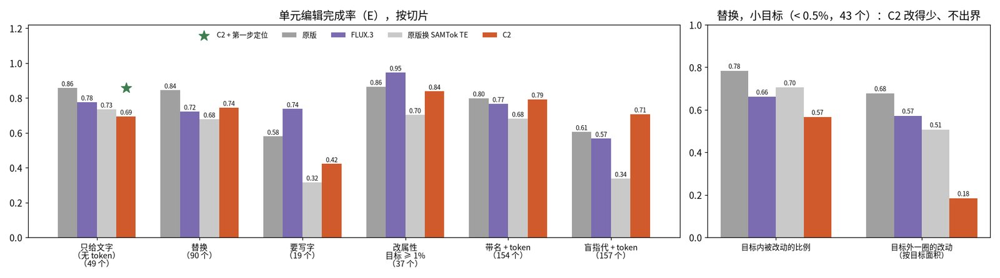

图 9　左：101 例子集上按切片的单元 E，星号是 C2 + 第一步定位；右：小目标（< 0.5%）替换中目标内被改动的比例和目标外一圈的改动，C2 改得少、不出界。原图：`V3/reports/progress_20261020/figs/fig2_where_c2_loses.png`

## 5. C3 消融与 token 引导（含方案 A）（10-23 至 10-26）

### 5.1 设置
- **目的：**针对 §4.7 的输点，每个实验只改一样东西（用户 10-23 确认）：
  - C3-M 只改方法：编辑行的区域项只算实际改动的 token，不外扩（`--edit-region-dilate 0`）；
  - C3-D 只改数据：四分之一的行换成 D10 的定向子集；
  - C3-MD 两项都改；
  - 推理 G：token 引导 1.5、2.0，不训练；
  - 不做对照 C3-0，全部在本机 8 卡上跑。
- **初始化与日程：**三个训练都从 C2@3522 起训，各 1,500 次更新 × 32 行 = 48,000 行；预热 100 次升到 5e-5，再余弦降到 5e-6；`--heavy-weight 8`；本机 8 卡 × 累积 4。
- **训练行**（`V3/data/round2_20261016/`，由 `round2-data rows-c3m`、`rows-c3d` 生成，统计 `rows_c3d_stats.json`，清洗名单 `rows_c3d_dropped.json`）：
  - 按类别从 C2 的行里抽，保持 C2 的比例，成对的行不拆开；
  - 先去掉"做了一半"的样本：50k 去掉 4,108 条（替换、改属性改动不到目标的一半，或添加把锚点改动了 60% 以上）；v1 去掉 442 条（替换、改属性改动不到一半；v1 的添加不动，它的选区有时就是新物体所在的表面）；共 6,872 个 C2 单元不再使用；
  - 写法：单目标行盲指代 + token 约 70%、带名 + token 约 30%，多目标单元 65% / 35%，与 C2 相同（v3 文档写的"65% / 35%"只是多目标单元的比例）。

  | 来源 | `rows_c3m`（C3-M） | `rows_c3d`（C3-D、C3-MD） |
  |---|---:|---:|
  | 50k 单目标 | 19,885 | 14,913 |
  | v1 单目标 | 16,937 | 12,703 |
  | v1 多目标（D4） | 1,568 | 1,176 |
  | 50k 拼合多目标 | 4,800 | 3,600 |
  | 指认 | 4,810 | 3,608 |
  | D10 定向子集 | — | 12,000：替换 5,000，整体改属性 4,000，改字 1,500，多目标 1,500 |

  - D10 即 `datasets/ExtEdit_Protocol2_20261021/`（文档 01）。定向子集的条件：替换要求旧物改动 ≥ 85%（可选 10,725 条）；整体改属性要求改动 ≥ 90% 且面积 ≥ 1%（可选 6,609 条）；只用 token 往返 ≥ 0.5 的样本。
- **代码：**v3 提交 2e5819f9 加了 `rows-c3m`、`rows-c3d`、样本类型 `edit_ext`、`edit_multi_ext` 和 `--edit-region-dilate`（冒烟：8 卡 3 次更新，各类样本 0 跳过）；C3-D、C3-MD 记录的提交是 f8719f47、f9740404，训练代码相同。token 引导在 f8719f47 加入 benchmark 适配器。
- **硬件与时长：**C3-M 11.4 h（约 27 s 一次更新），C3-D 11.3 h，C3-MD 11.2 h，都是 0 个样本跳过；每个开发集评测约 40 分钟。
- **评测：**
  - 开发集 1,320 项（`round2-eval`）；
  - 决策子集 301 例（§1.5）。所有系统都用第一步定位，引导的负分支是去掉所有区域 token 的同一句；每个系统生成 23–38 分钟；
  - 8 个系统一次判分：原版和 FLUX.3 的官方结果、C2、C2 + 引导 1.5、C2 + 引导 2.0、C3-M、C3-D、C3-MD。加载约 17 分钟，每个系统约 37 分钟；
  - 判分程序以退出码 2 结束：引导 2.0 有 1 例判分输出解析失败（`judge.py` 遇到解析失败就返回 2）。8 个系统都已评完，比较用 300 个共同 case。
- **验收线**（10-20 定）：保护线是单元 P ≥ 0.87、整图全过不低于 C2；目标是替换 ≥ 0.80、大目标改属性 ≥ 0.90、写字 ≥ 0.55。

### 5.2 开发集结果
各 run 目录的 `analysis.txt`，1,320 项，区间为 95% 自助区间：

| 指标 | C2@3522 | C3-M | C3-D | C3-MD |
|---|---:|---:|---:|---:|
| 单 token 盲指代（400） | 0.464 | 0.457 | 0.455 | 0.459 |
| 单 token 带名（200） | 0.515 | 0.507 | 0.498 | 0.509 |
| 多 token 全对 / 区域 IoU / 串色 | 8% / 0.356 / 1.4% | 9% / 0.343 / 2.0% | 9% / 0.347 / 1.7% | 8% / 0.354 / 1.9% |
| 成对：同类（150）/ 部件对宿主（50） | 0.200 / 0.34 | 0.167 / 0.32 | 0.153 / 0.36 | 0.193 / 0.34 |
| remove 探针（60 对） | 0.333 | 0.450 | 0.383 | 0.467 |
| 编辑不执行（100） | 50% | **32%** | 48% | 35% |
| 不执行之差（对 C2） | | −0.18 [−0.26, −0.10] | −0.02 [−0.06, +0.02] | −0.15 [−0.23, −0.08] |
| 强度（参考目标 51.4） | 17.6 | 27.0 | 19.5 | 24.9 |
| 区域外改动 | 1.8 | 2.0 | 1.8 | 2.0 |
| 与参考目标的误差 | 23.9 | 23.4 | 24.6 | 24.9 |

按操作（不执行 / 强度 / 区域外 / 误差）：

| 操作 | C2 | C3-M | C3-D | C3-MD |
|---|---|---|---|---|
| add | 64% / 10.3 / 1.8 / 8.6 | 40% / 14.9 / 1.9 / 10.4 | 60% / 10.8 / 1.8 / 9.0 | 40% / 14.5 / 1.9 / 10.4 |
| remove | 64% / 13.2 / 1.9 / 31.3 | 40% / 31.1 / 2.0 / 27.9 | 68% / 14.4 / 1.9 / 31.7 | 48% / 26.6 / 2.2 / 31.1 |
| replace | 28% / 25.6 / 1.9 / 24.2 | 16% / 32.2 / 2.0 / 26.0 | 24% / 27.9 / 1.9 / 24.6 | 20% / 31.3 / 2.0 / 27.8 |
| attribute | 44% / 21.2 / 1.6 / 31.6 | 32% / 29.8 / 1.8 / 29.3 | 40% / 24.8 / 1.7 / 33.0 | 32% / 27.3 / 1.9 / 30.3 |

- **分析与结论：**
  1. **改方法按预期起作用：**区域项只算实际改动的 token 后，"不执行"50% → 32%，显著；四种操作都降了，强度 17.6 → 27.0。C3-MD 同样（35%）。
  2. **定位基本不变：**单 token 指认的差都不显著，最大是 C3-D 带名 −0.017 [−0.038, +0.003]。C3-M 的单 token 盲指代 0.457，比保护线 0.46 低 0.003。
  3. **开发集上的代价看起来很小：**区域外改动 1.8 → 2.0，仍远低于原版的 6.2；add、replace 的误差略升。
  4. **只改数据在开发集上几乎没有变化**（不执行 48%）。这在预期之内：开发集测的是 SA-1B 编辑，测不到 D10 针对的替换、整体改属性和改字。最终以决策子集判定。

### 5.3 决策子集结果
`V3/analysis/c3_eval_20261023/report.txt`，8 个系统同一次判分，300 个共同 case。整图 P 一列由本文按各系统的 `judged/<系统>/scores.jsonl` 补算。

| 系统 | 单元 E | 带名 | 盲指代 | 添加 | 删除 | 替换 | 改属性 | 大目标改属性 | 写字 | 单元 P | 整图 P | 整图全过 |
|---|---:|---:|---:|---:|---:|---:|---:|---:|---:|---:|---:|---:|
| 原版（官方彩色定位图） | 0.675 | 0.783 | 0.533 | 0.537 | 0.582 | 0.830 | 0.735 | 0.741 | 0.574 | 0.618 | 0.240 | 11.7% |
| FLUX.3 klein（官方） | 0.695 | 0.755 | 0.617 | 0.675 | 0.566 | 0.740 | 0.785 | 0.885 | 0.706 | 0.902 | 0.713 | 27.7% |
| C2 | 0.725 | 0.808 | 0.617 | 0.660 | 0.691 | 0.736 | 0.806 | 0.813 | 0.485 | 0.906 | 0.777 | 30.0% |
| C2 + 引导 1.5 | 0.766 | 0.809 | 0.710 | 0.705 | 0.759 | 0.780 | 0.817 | 0.842 | 0.574 | 0.896 | 0.713 | 36.0% |
| C2 + 引导 2.0 | 0.780 | 0.811 | 0.740 | 0.735 | 0.783 | 0.769 | 0.832 | 0.863 | 0.603 | 0.891 | 0.710 | 36.0% |
| C3-M | 0.774 | 0.832 | 0.697 | 0.653 | 0.763 | 0.812 | 0.860 | 0.863 | 0.544 | 0.840 | 0.627 | 27.0% |
| **C3-D** | 0.757 | 0.826 | 0.667 | 0.657 | 0.727 | 0.805 | 0.832 | 0.835 | 0.574 | **0.908** | 0.780 | **35.0%** |
| C3-MD | 0.770 | 0.837 | 0.682 | 0.653 | 0.751 | 0.798 | 0.871 | 0.885 | 0.441 | 0.841 | 0.630 | 32.0% |

对 C2 的配对差（按 case 自助抽样的 95% 区间）：

| 系统 | 单元 E | 单元 P | 替换 | 大目标改属性 | 写字 | 整图全过 |
|---|---|---|---|---|---|---|
| 原版（官方） | −0.050 [−0.084, −0.017] | −0.288 [−0.324, −0.254] | +0.094 [+0.040, +0.149] | −0.072 [−0.152, +0.007] | +0.088 [−0.072, +0.242] | −0.183 [−0.240, −0.127] |
| FLUX.3（官方） | −0.030 [−0.065, +0.005] | −0.004 [−0.029, +0.021] | +0.004 [−0.061, +0.069] | +0.072 [−0.007, +0.152] | +0.221 [+0.074, +0.362] | −0.023 [−0.090, +0.040] |
| 引导 1.5 | +0.041 [+0.019, +0.062] | −0.010 [−0.028, +0.007] | +0.043 [+0.000, +0.088] | +0.029 [+0.000, +0.065] | +0.088 [−0.016, +0.203] | +0.060 [+0.010, +0.110] |
| 引导 2.0 | +0.055 [+0.031, +0.080] | −0.015 [−0.034, +0.004] | +0.032 [−0.014, +0.080] | +0.050 [+0.007, +0.095] | +0.118 [−0.014, +0.246] | +0.060 [+0.003, +0.113] |
| C3-M | +0.048 [+0.025, +0.070] | −0.066 [−0.088, −0.045] | +0.076 [+0.036, +0.117] | +0.050 [−0.007, +0.109] | +0.059 [−0.069, +0.183] | −0.030 [−0.080, +0.017] |
| C3-D | +0.032 [+0.010, +0.053] | +0.002 [−0.016, +0.020] | +0.069 [+0.029, +0.109] | +0.022 [−0.015, +0.065] | +0.088 [−0.029, +0.214] | +0.050 [+0.003, +0.097] |
| C3-MD | +0.045 [+0.020, +0.070] | −0.065 [−0.088, −0.043] | +0.061 [+0.022, +0.101] | +0.072 [+0.022, +0.124] | −0.044 [−0.177, +0.092] | +0.020 [−0.033, +0.073] |

验收：

| 系统 | 保护线（单元 P ≥ 0.87、整图全过不低于 C2） | 替换 ≥ 0.80 | 大目标改属性 ≥ 0.90 | 写字 ≥ 0.55 |
|---|---|---|---|---|
| 引导 1.5 | 过 | 0.780 未达 | 0.842 未达 | 0.574 达标 |
| 引导 2.0 | 过 | 0.769 未达 | 0.863 未达 | 0.603 达标 |
| C3-M | 没过（P 0.840） | 0.812 达标 | 0.863 未达 | 0.544 未达 |
| **C3-D** | **过** | 0.805 达标 | 0.835 未达 | 0.574 达标 |
| C3-MD | 没过（P 0.841） | 0.798 未达 | 0.885 未达 | 0.441 未达 |

### 5.4 分析与结论
- **改方法后保持为什么变差：**
  - 单元 P 与 C2 逐单元比（300 个共同 case）：C3-M 丢 99 个、多过 28 个，净 −71，丢的里面添加 51、改属性 18、替换 15、删除 15；C3-MD 净 −70；C3-D 净 +2；引导 2.0 净 −16。
  - 判分理由几乎都是这几类：改动溢出目标边界；改到旁边的同类物体；在附近多加了没要求的东西；添加时把承载的物体也改了，例如浅盘变成深锅。
  - 原因：C2 的区域项外扩一圈，圈里的 token 目标是保持不变，等于顺带加重了目标周围的保持。C3-M 去掉外扩、只算真正改动的 token，执行更积极，但周围的保持不再被加重。
  - 开发集的区域外改动是整张图的平均，只从 1.8 升到 2.0；benchmark 逐个看目标周围，整图 P 从 0.777 降到 0.627，差别明显。
- **结论：**
  1. **C3-D（改数据）是唯一过保护线、又有提升的训练变体：**单元 E +0.032、整图全过 +5.0 个点，都显著；单元 P 和整图 P 不变；替换（0.805）和写字（0.574）达标。
  2. **改方法（C3-M）提高执行但伤保持：**单元 E +0.048，单元 P −0.066，整图全过不升反降。C3-MD 同样；它的大目标改属性最好（+0.072，显著），写字最差。
  3. **token 引导不用训练，是这一轮最划算的改动：**提高执行的幅度与改方法相当（单元 E +0.041、+0.055），单元 P 只略降（不显著），整图全过 +6.0 个点（显著）。代价是整图 P 0.777 → 0.710，所以整图全过的增幅小于单元 E 的增幅。
  4. **和官方基线：**原版的替换（0.830）仍显著好于 C2，FLUX.3 的写字（0.706）显著好于 C2；整图全过 C2 对 FLUX.3 不显著（30.0% 对 27.7%）。
  5. **还没解决的：**大目标改属性没有一个到 0.90；剩下的主要失败是盲指代单元改错部位或改到旁边的同类物体、替换做成了叠加、写字拼错（C3 对比图 5，路径见下）。
- **图**（版式同 §4.6 的对比图：每例第一排是全图，下面每个编辑单元一排放大图，与判分模型看的局部相同，格子下标出判分模型的 E/P/Q；8 列：原图 + 定位、原版、FLUX.3、C2、C2 + 引导 2.0、C3-M、C3-D、C3-MD）：

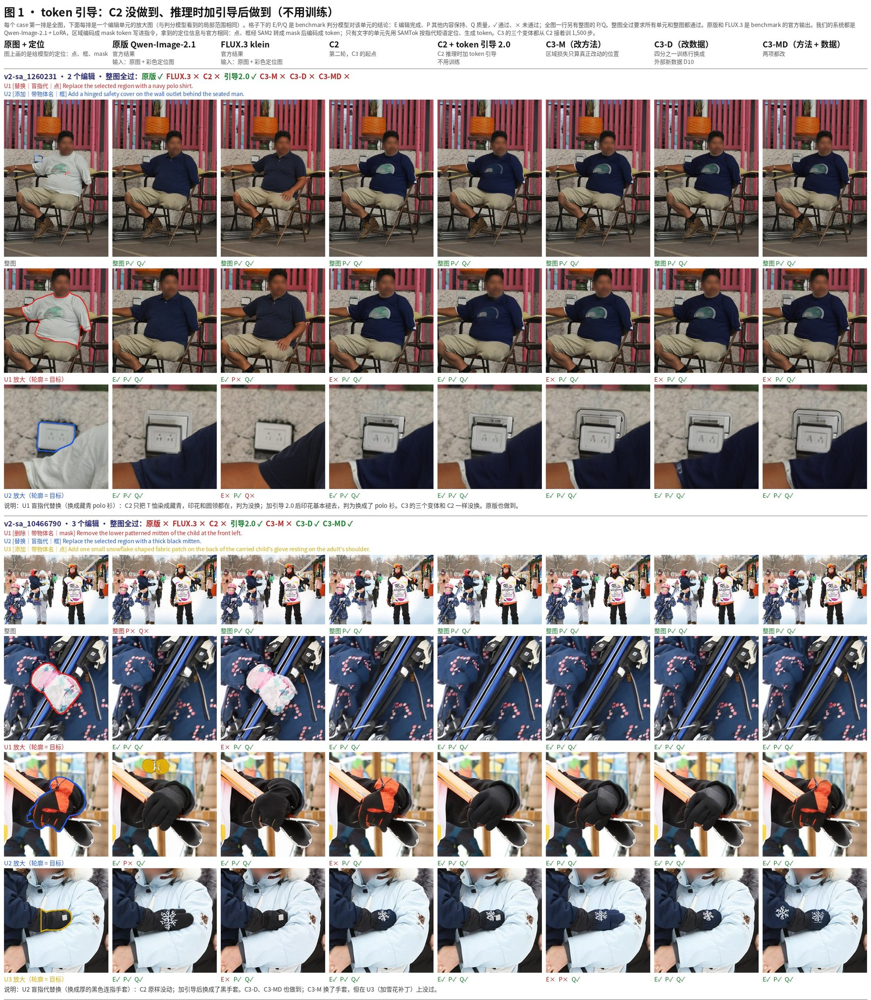

图 10　token 引导：C2 没做到、推理时加引导 2.0 后做到（换 polo 衫、换黑色连指手套），不用训练（C3 对比图 1 的前 2 例）。原图：`V3/analysis/c3_eval_20261023/sheets/c3_cases_1.jpg`

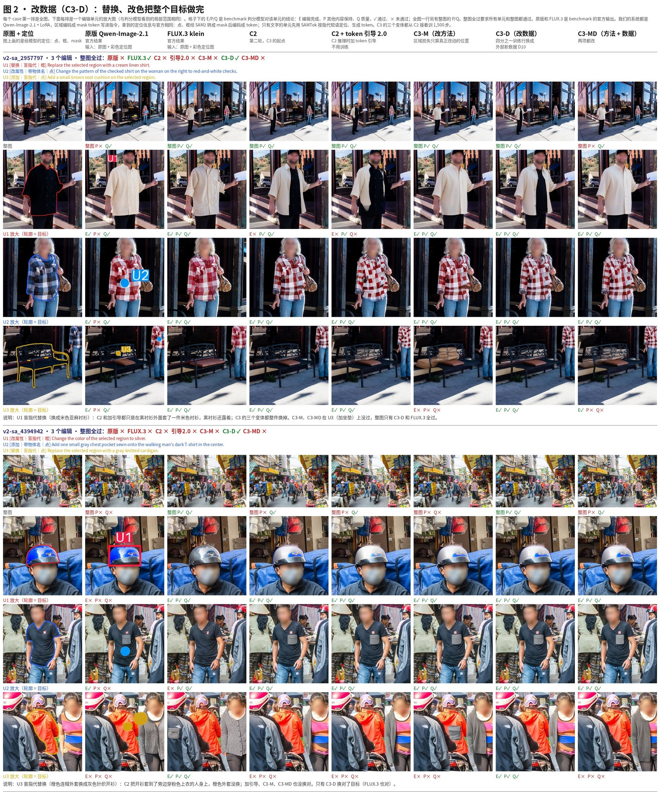

图 11　改数据（C3-D）把替换做完：C2 和加引导只是在黑衬衫外面套了一件米色衬衫，C3 三个变体整件换掉；另一例只有 C3-D 换对了目标（C3 对比图 2 的前 2 例）。原图：`V3/analysis/c3_eval_20261023/sheets/c3_cases_2.jpg`

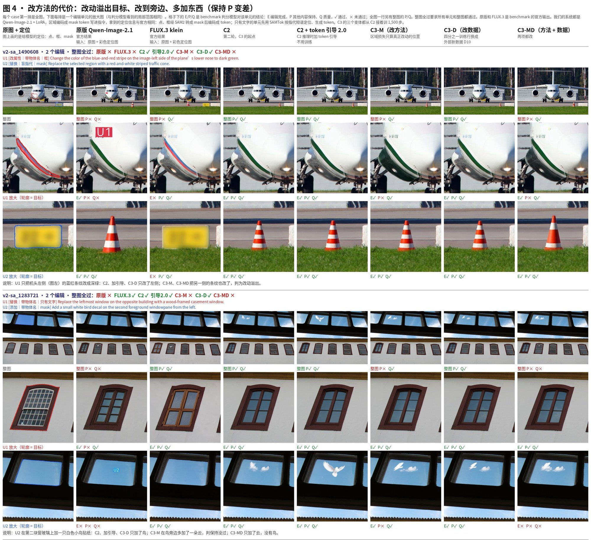

图 12　改方法的代价：C3-M、C3-MD 把机头另一侧的条纹也改了（溢出，P 没过）；贴小鸟时 C3-M 在旁边多加了一朵云（P 没过），C3-MD 只加了云、没有鸟；C2、C3-D 没有这些问题（C3 对比图 4 的前 2 例）。原图：`V3/analysis/c3_eval_20261023/sheets/c3_cases_4.jpg`

另两张未收入本文：对比图 3（改方法后，C2 和 C3-D 原样没动的做了）`V3/analysis/c3_eval_20261023/sheets/c3_cases_3.jpg`；对比图 5（原版或 FLUX.3 做到、我们都没做到）`V3/analysis/c3_eval_20261023/sheets/c3_cases_5.jpg`。各例说明在 `V3/analysis/c3_eval_20261023/sheets_spec.json`。

### 5.5 方案 A：C3-D + token 引导（10-25）
- **目的：**看改数据和 token 引导能否叠加（用户在 C3 结果后选的下一步 A）。
- **设置：**C3-D@1500 加引导 2.0，在同样的 301 例上生成（16:06–16:45 UTC，配置 `V3/analysis/c3_eval_20261023/configs/c3d_ground_g20.json`），单独开一次判分（16:52–18:24 UTC，无解析失败）；同一次判分里重判 C3-D 的 64 例，检验两次判分的一致性（§1.6）。
- **结果**（`V3/analysis/c3_eval_20261023/report_a.txt`，官方基线和 C2 系列取自主判分会话，300 个共同 case）：

  | 系统 | 单元 E | 盲指代 E | 添加 | 删除 | 替换 | 改属性 | 大目标改属性 | 写字 | 单元 P | 整图 P | 整图全过 |
  |---|---:|---:|---:|---:|---:|---:|---:|---:|---:|---:|---:|
  | C2 | 0.725 | 0.617 | 0.660 | 0.691 | 0.736 | 0.806 | 0.813 | 0.485 | 0.906 | 0.777 | 30.0% |
  | C2 + 引导 2.0 | 0.780 | 0.740 | 0.735 | 0.783 | 0.769 | 0.832 | 0.863 | 0.603 | 0.891 | 0.710 | 36.0% |
  | C3-D | 0.757 | 0.667 | 0.657 | 0.727 | 0.805 | 0.832 | 0.835 | 0.574 | 0.908 | 0.780 | 35.0% |
  | **C3-D + 引导 2.0** | **0.788** | **0.746** | 0.672 | 0.775 | **0.830** | **0.867** | 0.863 | **0.647** | 0.884 | 0.713 | **37.7%** |

  配对差：
  - 对 C2：整图全过 +7.7 [+2.0, +13.3]，单元 E +0.062 [+0.036, +0.087]，替换 +0.094 [+0.047, +0.140]，写字 +0.162 [+0.030, +0.299]，都显著；单元 P −0.022 [−0.042, −0.003]，也显著。
  - 对 C3-D（301 例，C3-D 34.9%、C3-D + 引导 37.9%）：单元 E +0.032 [+0.006, +0.058]，单元 P −0.024 [−0.043, −0.006]，整图全过 +3.0 [−2.3, +8.6]，不显著。
  - 对 C2 + 引导 2.0：只有替换 +0.061 [+0.014, +0.108] 显著，整图全过 +1.7 [−3.7, +7.0]。
  - 同场复核（老师测试那次判分，§6）：C3-D + 引导对 C3-D，单元 E +0.044 [+0.018, +0.068]，单元 P −0.026 [−0.045, −0.007]，整图全过 +3.7 [−1.7, +9.0]，与跨场结论一致。
- **分析与结论：**
  1. 两项能叠加，但叠加的收益不显著；引导稳定地用一点保持换执行（单元 P 约 −0.02，整图 P 约 −0.07）。
  2. C3-D + 引导 2.0 是目前整体最好的系统：整图全过、单元 E、替换、写字都最高，单元 P 仍在保护线 0.87 以上。
  3. 大目标改属性仍未到 0.90（0.863）。
  4. 引导帮 C3-D 做到和做坏的例子见 `V3/analysis/opsd_teacher_20261025/sheets/teacher_cases_5.jpg`：帮助是少加多余的东西、写出了 OPEN；代价是改色连腰带也改了、多加一只瓢虫、删除处留下涂抹。
- **路径（§5 全部）：**
  - 训练：`V3/runs/c3m_local8_001/`、`V3/runs/c3d_local8_001/`、`V3/runs/c3md_local8_001/`，各含 `command.txt`、`train/adapter_1500`、`eval_1500`、`analysis.txt`；
  - 评测：`V3/analysis/c3_eval_20261023/`，含说明 `README.md`、选例 `select_decision.py`、系统配置 `configs/`、输出 `runs/`、判分 `judged/`、报告 `report.txt` 与 `report_a.txt`、自动流程状态 `status.txt` 与 `status_a.txt`、对比图 `sheets/`。

## 6. OPSD 老师上限测试（10-25 至 10-26）
- **背景：**用户 10-25 提出在方法上加 OPSD（on-policy self-distillation，在线自蒸馏）：
  - 老师和学生共用同一个 DiT；
  - 训练时老师用 GT mask 等特权信息尽量做对，学生只看区域 token，在自己采样的轨迹上逼近老师；
  - 推理只走区域 token 通路。
- **调研与方案：**`V3/analysis/opsd_plan_20261025/README.md`，内容包括 OPSD 原文和扩散版的要点、老师的三种机制（区域外回到原图、mask 内引导、带名指令）、训练细节、代价和风险，以及开源实现调研。
- **目的：**OPSD 只有在老师拿到特权信息后明显强于学生时才有用。用户确认先测老师上限，不训练，只改推理。
- **设置：**
  - case 与 C3 决策子集相同（301 例）；权重全部用 C3-D@1500，即 OPSD 打算起训的模型；生成设置同 C3 评测（所有单元一次生成、40 步、seed 0、约 1 MP）。
  - 四个系统的 token 都由 benchmark 的 GT mask 编码，与训练时学生拿到的 token 一致；彼此只差老师的特权机制。

  | 系统 | 配置 | 含义 |
  |---|---|---|
  | T0 学生 | `configs/t0_gt.json` | C3-D，token 由 GT mask 编码；盲指代单元仍是盲指代 |
  | T1 | `configs/t1_blend.json` | T0 + 区域外回填 |
  | T2 | `configs/t2_blend_ref.json` | T1 + 带名指令：每个单元都写成"物体名 + token"，盲指代单元也一样 |
  | T3 | `configs/t3_blend_ref_g20.json` | T2 + token 引导 2.0（负分支去掉 token） |

  - 区域外回填：允许改动的范围是各单元 GT mask 的并集，添加单元另把它的框向每边扩大框尺寸的一半（新物体可能伸出依附的位置）；在 16 像素的潜变量格子上外扩 2 格、羽化 1 格；范围外每一步都换回加噪后的原图（管线已有的 latent blending）。
  - 实现：`src/samtok_edit21/evaluation/benchmark_token.py` 的 `teacher` 配置项（v3 提交 e93f3f05 加入）。读了 GT，只用于本测试，不是 benchmark 提交。
  - 同场对照：同一次判分里重判 C3-D（定位器给的 token）和 C3-D + 引导 2.0。
  - 运行：生成 10-25 18:49–20:34 UTC，四个系统各 301 例全部成功；判分 21:02 至 10-26 00:37 UTC，6 个系统，没有解析失败。
- **继续写训练代码的门槛**（方案第 5 节）：老师的整图全过比 T0 高 10 个点以上，单元 P ≥ 0.90。
- **结果**（`V3/analysis/opsd_teacher_20261025/report.txt`，301 例，同一次判分）：

  | 系统 | 单元 E | 盲指代 E | 添加 | 删除 | 替换 | 改属性 | 大目标改属性 | 写字 | 单元 P | 整图 P | 整图全过 |
  |---|---:|---:|---:|---:|---:|---:|---:|---:|---:|---:|---:|
  | C3-D（定位器 token，重判） | 0.753 | 0.673 | 0.664 | 0.723 | 0.788 | 0.829 | 0.835 | 0.515 | 0.904 | 0.757 | 34.2% |
  | C3-D + 引导 2.0（重判） | 0.796 | 0.753 | 0.713 | 0.763 | 0.831 | 0.871 | 0.871 | 0.662 | 0.878 | 0.691 | 37.9% |
  | T0 学生（GT token） | 0.759 | 0.690 | 0.616 | 0.795 | 0.788 | 0.836 | 0.863 | 0.456 | 0.898 | 0.774 | 35.9% |
  | T1 = T0 + 回填 | 0.734 | 0.656 | 0.631 | 0.707 | 0.755 | 0.836 | 0.863 | 0.456 | 0.927 | 0.884 | 32.2% |
  | T2 = T1 + 带名指令 | 0.788 | 0.796 | 0.716 | 0.775 | 0.770 | 0.886 | **0.906** | 0.588 | 0.949 | 0.887 | 42.5% |
  | **T3 = T2 + 引导 2.0** | **0.823** | **0.806** | **0.724** | **0.847** | **0.831** | **0.889** | 0.892 | **0.662** | **0.953** | **0.917** | **45.8%** |

  对 T0 的配对差（95% 区间）：

  | 系统 | 单元 E | 单元 P | 写字 | 整图全过 |
  |---|---|---|---|---|
  | T1 | −0.025 [−0.046, −0.004] | +0.029 [+0.010, +0.049] | +0.000 [−0.079, +0.077] | −3.7 [−8.0, +0.3] |
  | T2 | +0.029 [+0.001, +0.056] | +0.051 [+0.031, +0.073] | +0.132 [+0.000, +0.258] | +6.6 [+0.7, +12.6] |
  | T3 | +0.064 [+0.036, +0.092] | +0.055 [+0.035, +0.077] | +0.206 [+0.072, +0.333] | **+10.0 [+3.3, +16.3]** |
  | C3-D（定位器 token） | −0.007 [−0.029, +0.016] | +0.007 [−0.012, +0.025] | +0.059 [−0.015, +0.143] | −1.7 [−6.3, +3.0] |

  - T3 对 C3-D（定位器 token，同场）：整图全过 +11.6 [+4.7, +18.3]，单元 E +0.071，单元 P +0.048，都显著。
  - 门槛：T3 比 T0 高 30/301 = 9.97 个点，离门槛只差 0.03 个点；单元 P 0.953 过线；对实际部署的 C3-D 是 +11.6 个点。
- **分析与结论：**
  1. **区域外回填（T1）管保持：**单元 P +0.029，整图 P 0.774 → 0.884，挡住了加错位置和改到旁边。但删除、替换的完成变差（删除 E 0.795 → 0.707）：benchmark 的 GT mask 贴得紧，物体伸出 mask 的部分和阴影删不掉，留下残留和残影。T1 比 T0 丢了 73 个单元的 E（删除 29、替换 19、添加 16、改属性 9），多过 46 个。
  2. **带名指令（T2）贡献最大：**整图全过 32.2% → 42.5%，盲指代 E 0.656 → 0.796。说明学生的主要弱点是只看 token 时认不清是哪个物体、该怎么改。
  3. **token 引导（T3）和回填互补：**在回填下加引导，单元 E 再 +0.035，单元 P 不降（0.949 → 0.953）；而 C3-D 不回填直接加引导时，单元 P −0.026，整图 P 0.757 → 0.691。
  4. **老师的提升集中在学生的弱项：**盲指代 +0.116，添加 +0.108，写字 +0.206（T3 对 T0）。
  5. **GT token 和定位器 token 差别不大：**T0 对 C3-D +1.7 个点，不显著。
  6. **老师还没做到的**（`V3/analysis/opsd_teacher_20261025/sheets/teacher_cases_4.jpg`）：mask 边缘改色不完整（一簇花只改了一部分、旗子留黄边）；改字仍是乱码；替换时改到了邻居。T3 仍没过的单元 E：添加 74、替换 47、删除 38、改属性 31（共 1,075 个单元）。
  7. **对 OPSD 的含义：**带特权的老师同时提高了编辑完成和保持，正是学生欠缺的；训练时老师的允许区域应按数据里的实际改动区域（`edited_region` ∪ 执行区域）放宽，避免 T1 那样的残留。benchmark 只有贴得紧的 GT mask，这里测出的回填副作用偏大。是否写训练代码由用户决定（v4 已实现训练器，见 §8；试训见 §7）。
- **图**（7 列：原图 + 定位、C3-D、C3-D + 引导（都是本场重判）、T0、T1、T2、T3，所有判定来自同一次判分）：

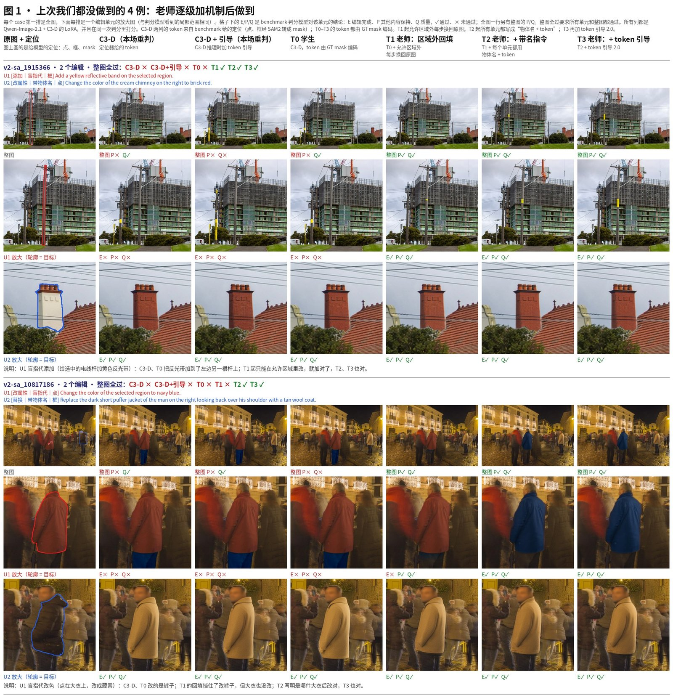

图 13　上次我们都没做到的例子，老师逐级加机制后做到：反光带 C3-D、T0 加到了另一根杆上，T1 起只能在允许区域里改，加对了；改大衣颜色 C3-D、T0 改成了裤子，T1 挡住了改裤子但大衣也没改，T2 写明物体名后改对（老师测试对比图 1 的前 2 例）。原图：`V3/analysis/opsd_teacher_20261025/sheets/teacher_cases_1.jpg`

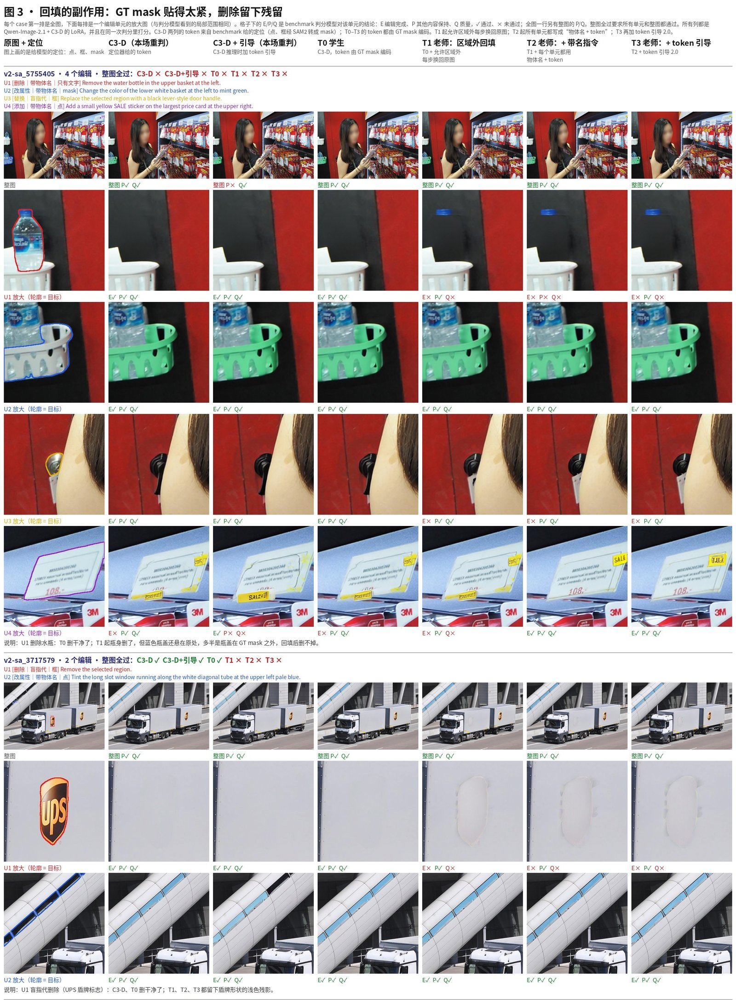

图 14　回填的副作用：GT mask 贴得太紧，删除留下残留，蓝色瓶盖悬在原处、UPS 标志留下盾牌形状的残影；T0 都删干净了（老师测试对比图 3 的前 2 例）。原图：`V3/analysis/opsd_teacher_20261025/sheets/teacher_cases_3.jpg`

- **路径：**`V3/analysis/opsd_teacher_20261025/`：说明 `README.md`、配置 `configs/`、输出 `runs/`、判分 `judged/`、报告 `report.txt`、状态 `status.txt`、对比图 `sheets/teacher_cases_1.jpg` 到 `_5.jpg`（说明见 `sheets_spec.json`）。

## 7. OPSD 试训（10-26 至 10-29）

### 7.1 第一次试训（10-26 至 10-27）
- **目的：**看 OPSD 能否在 C3-D 之上带来提升（用户 10-26 同意）；确认两阶段训练有效后再扩大各阶段的数据。
- **设置：**
  - P1（OPSD）与 P0（对照）都从 C3-D@1500 起训 500 次更新 × 32 行（本机 8 卡 × 累积 4），学习率预热 20 次到 2e-5、余弦退火到 2e-6。两者只差一处：同一批 8,000 条记录在 P1 做 OPSD，在 P0 做普通训练。
  - 数据：合板数据 10-26 重建版（文档 01）。
    - OPSD 行：多目标 2,400、D1 1,600、D11 添加 1,600、D10/D11 替换与改属性各 800、D10 改字 600、D11 写字 200，盲指代 85%；
    - 另一半是普通行，按 C3-D 的类别比例抽；
    - 行文件 `V3/data/round2_20261016/rows_opsd_pilot_p1.jsonl`、`rows_opsd_pilot_p0.jsonl`（P0 把 OPSD 行换成同一条记录的普通行，D1 行补近邻负例，位置不变）。
  - OPSD：冻结的 C3-D 作老师，加 T3 的特权：
    - 允许区域 = 选区 ∪ 执行区域 ∪ 改动像素，外扩 2、羽化 1；
    - 每个单元带名；引导 2.0；
    - 学生采样 16 步，每条轨迹 2 个状态（σ ≥ 0.1）；`λ_opsd = 8`（文档 02 §5.9）。
  - 代码：v4 提交 `4eacba78`，训练和生成都用 v4。
  - 时长：P1 9.8 h（每次更新约 71 s），P0 3.8 h，都没有跳过的样本。
- **评测：**
  - 开发集（§1.3）：P0@500、P1@250、P1@500。
  - 决策子集 301 例，同一次判分：P1@500、P1@250、P0@500、P1@500 + 引导 2.0；C3-D、C3-D + 引导、T3 老师同场重判。比较用 7 个系统都有分数的 300 例。
  - 判定：P1 对 P0 的整图全过配对差 95% 区间下界 > 0，且单元 P ≥ 0.87。
  - 第二场：P0@500 + 引导与 P1@500 + 引导同场判分（301 例），用来区分 OPSD 的作用和多训 500 次的作用。判分中途为第 1 步暂停了 34 分钟，从逐例缓存接着做。
- **结果**（`V3/analysis/opsd_pilot_20261026/report.txt`；配对区间按 case 自助抽样 20,000 次，`diagnosis/an/ci.txt`）：

  | 系统 | 单元 E | 盲指代 E | 替换 | 大目标改属性 | 写字 | 单元 P | 整图全过 |
  |---|---:|---:|---:|---:|---:|---:|---:|
  | C3-D（起点，重判） | 0.751 | 0.661 | 0.776 | 0.849 | 0.515 | 0.901 | 34.7% |
  | P0@500（对照） | 0.761 | 0.676 | 0.780 | 0.842 | 0.544 | 0.888 | 33.7% |
  | P1@250（OPSD） | 0.775 | 0.680 | 0.794 | 0.871 | 0.588 | 0.900 | 35.0% |
  | P1@500（OPSD） | 0.758 | 0.672 | 0.776 | 0.871 | 0.471 | 0.896 | 33.0% |
  | C3-D + 引导 2.0（重判） | 0.788 | 0.739 | 0.819 | 0.849 | 0.676 | 0.879 | 36.3% |
  | **P1@500 + 引导 2.0** | **0.806** | **0.745** | **0.834** | **0.885** | 0.618 | 0.896 | **40.3%** |
  | T3 老师（读 GT，上限参考，重判） | 0.824 | 0.814 | 0.838 | 0.906 | 0.706 | 0.957 | 47.3% |

  | 比较 | 整图全过（百分点） | 单元 E | 单元 P | 盲指代 E |
  |---|---|---|---|---|
  | P1@500 对 P0@500（OPSD 的作用） | −0.7 [−5.3, +4.0] | −0.003 [−0.022, +0.016] | +0.008 [−0.011, +0.028] | −0.004 [−0.037, +0.028] |
  | P1@250 对 P0@500 | +1.3 [−3.3, +6.0] | +0.014 [−0.005, +0.033] | +0.012 [−0.007, +0.032] | +0.004 [−0.029, +0.038] |
  | P1@500 + 引导 对 C3-D + 引导 | +4.0 [−1.3, +9.3] | +0.018 [−0.003, +0.039] | +0.017 [+0.000, +0.035] | +0.006 [−0.024, +0.037] |
  | P1@500 + 引导 对 P0@500 | +6.7 [+0.7, +12.7] | +0.045 [+0.022, +0.068] | +0.008 [−0.011, +0.029] | +0.069 [+0.032, +0.107] |
  | P1@500 + 引导 对 P0@500 + 引导（第二场，301 例） | +4.3 [−0.3, +9.0] | +0.006 [−0.014, +0.026] | +0.015 [−0.004, +0.033] | −0.026 [−0.056, +0.004] |
  | C3-D + 引导 对 C3-D（引导本身） | +1.7 [−4.0, +7.7] | +0.036 [+0.011, +0.062] | −0.021 [−0.042, −0.001] | +0.078 [+0.039, +0.117] |
  | T3 老师 对 C3-D（老师的上限） | +12.7 [+6.0, +19.3] | +0.073 [+0.044, +0.102] | +0.056 [+0.036, +0.076] | +0.153 [+0.106, +0.202] |

  - 开发集（1,320 项）：

    | | 单 token 盲指代 IoU | 带名 IoU | 多 token 区域 IoU | remove 探针跟随 | SA-1B 编辑不执行 |
    |---|---:|---:|---:|---:|---:|
    | C3-D | 0.455 | 0.498 | 0.347 | 0.383 | 48% |
    | P0@500 | 0.447 | 0.509 | 0.348 | 0.367 | 46% |
    | P1@250 | 0.461 | 0.509 | 0.359 | 0.433 | 47% |
    | P1@500 | 0.463 | 0.517 | 0.361 | 0.450 | 46% |

    P1@500 对 P0@500：盲指代 IoU +0.016 [+0.004, +0.029]，显著；不执行 0.000 [−0.030, +0.030]；remove 探针 60 对，区间重叠。
  - **判定：**P1@500、P1@250 都没过。P1@500 + 引导按判定口径（对 P0@500）算过，但它同时加了引导；第二场对 P0 + 引导 +4.3 [−0.3, +9.0]，不显著。第二场里 P0 + 引导 34.6%、P1 + 引导 38.9%（同一份 P1 + 引导的输出在第一场是 40.3%，跨场差 1.4 个点）。
- **诊断**（脚本和原始结果在 `V3/analysis/opsd_pilot_20261026/diagnosis/`，做法见该目录 `README.md` 的"诊断"一节）：
  - A 权重：比较 LoRA 的等效更新 B·A 和码本注入。
  - B 损失拆分：76 条试训没用过的合板记录（D1 16、添加 12、替换 12、改属性 12、多目标 12、改字 8、写字 4，盲指代 85%）。C3-D、P0、P1 各自采样 16 步，在全部 15 个 σ ≥ 0.1 的状态上算到 T3 老师目标的误差，分区域内、外；C3-D 另把梯度拆成区域内、外两部分。
  - C 接管测试：同样 76 条，C3-D 先走 k 步，再交给 T3 老师走完（k = 0 全由老师，k = 16 全由学生）；"不执行"的口径同开发集编辑。
  - D 差距缩小：决策子集上老师过、P0 不过的 case，P1 能过多少。

  1. **损失被区域外主导，而区域外的目标与老师无关。**
     - 允许区域 A 占 latent 格子的中位比例：D1 1.6%、改字 4.9%、添加 31%。
     - 在起点 C3-D 上，区域内只占损失的 7%–18%；梯度里区域内那部分占 7%–26%（小区域高噪声 26%，大区域中噪声 7%）。
     - 区域外的目标 `(1−m)·x_src` 就是源图 latent，所以这一项实际上是一个很强的"照抄源图"保持损失。
  2. **P1 学到的正是区域外照抄源图：**
     - 区域外误差（×1e-3，σ 0.70–1.00）：C3-D 10.70、P0 8.38、P1 2.47，P1 − P0 = −5.92 [−9.27, −3.40]；各个噪声段都降到 P0 的约 1/4。
     - 区域内在 σ 0.70–1.00 没有变化：6.34 / 6.70 / 6.49，P1 − P0 = −0.21 [−0.84, +0.46]。
     - 区域内只在中低噪声段变近（−0.76、−0.92，显著），但那里学生和老师的改动幅度本来就一致（改动量之比 0.98–1.00），只是细节。
     - 这解释了 P1 加引导后保持不掉。
  3. **在这批训练数据上，老师本来就只比学生好一点。**接管测试：
     - 不执行：全由老师 5/76，全由学生 8/76。老师只救回 3 条（2 条 D1、1 条 D11 添加），没有一条变坏。改字、替换、改属性、多目标、写字的不执行两边都是 0。
     - 老师的输出离 GT 目标并不更近：执行区域内的误差 38.3 对 39.0 灰度，逐条差的中位数 −0.11。
     - 对比 benchmark：同场里 T3 比 C3-D 高 12.7 个点，盲指代 E 高 0.153。老师的特权（主要是带名）在小区域、同类多实例、一图多改的盲指代上才起作用。这批合板记录大多是显著的大目标，学生已经做得到；只有小区域的 D1 记录上差距看得见（不执行 4/16 对 6/16）。
  4. **结果在高噪声段就定了，而 P1 在那一段没有向老师靠近。**两条被救回的 D1 记录，老师在 σ 0.743（第 6 步）接手还能救回，从 σ 0.565（第 9 步）起就救不回；那条添加记录，老师要从第一步就接手。开发集上的结论相近：一半以上的差距在 σ ≥ 0.73 定了（见下面第 1 步）。
  5. **更新小，而且以噪声为主。**
     - 等效 LoRA 相对 C3-D 变化 5.4%（P0）、6.4%（P1@500），两者方向几乎正交（cos 0.088），尽管一半的行完全相同。
     - 老师过、P0 不过的 73 例里，P1@500 过 23.3%，C3-D 过 21.9%（同一个起点，即噪声水平）；P1@500 + 引导 35.6%，C3-D + 引导 27.4%。
     - P1 与 P0 逐例整图全过不一致 52 例（17%），C3-D 与 P0 之间 51 例。
     - 300 例上整图全过的配对区间约 ±5 个点，更小的效应测不出来。
  - 注意事项：
    - 76 条中有 9 条在 C3-D 的训练行里（D1 7、改属性 1、多目标 1），只看其余 67 条，不执行仍是 2 对 5；
    - 接管测试按整条记录算，多目标记录里漏做一个单元不一定测得出；
    - 诊断用 16 步，benchmark 生成用 40 步。
- **分析与结论：**
  1. **按现在的配方，OPSD 不提升执行，试训判定没过。**开发集上定位略好（+0.016），但编辑的不执行率没变。
  2. **这次 OPSD 教会学生的主要是区域外照抄源图。**这件事不需要老师，用一个保持损失就能教。
  3. **老师真正的优势是带名后认对物体，但这在这批训练行上几乎不出现。**即使出现，也是在高噪声段决定的，而在那一段，梯度里区域内那部分也只占 14%–26%。所以 OPSD 能传的信号很少。
  4. **P1 + 引导是目前分数最高的学生**（第一场 40.3%），对 C3-D + 引导 +4.0、对 P0 + 引导 +4.3（第二场），两次都不显著。高出的部分来自保持（单元 P +0.015），不是执行（单元 E +0.006，盲指代 E −0.026），与第 2 条一致：引导把改动推强时，照抄源图的本事挡住了溢出。按试训前定的口径，不换默认系统。
  5. **建议不按现在的配方扩大数据。**改进方向（待用户定）：
     - 先在开发集的 SA-1B 编辑上测老师和学生的差距（接管 k = 0 对 k = 16，8 卡约 15 分钟），确认差距存在于小区域盲指代上；
     - 按"老师比学生好"选 OPSD 行，以小区域、同类多实例的 D1 和多单元拼合为主；
     - 损失：区域内按面积归一，区域外单独一项、降权（或换成不需要老师的保持损失），两项分开记录；
     - 状态集中在 σ ≥ 0.56（16 步的前 10 步）；
     - 补归因对照：离线目标（老师目标算在加噪的 GT 状态上）、去掉带名只留回填和引导的老师。
- **第 1 步：开发集上老师与学生的差距（10-27，用户同意）：**
  - 目的：试训诊断显示，在试训用的合板记录上老师只比学生好一点；这一步在学生最常失败的小区域盲指代上测老师的优势。
  - 设置：开发集的 100 条 SA-1B 编辑（四类各 25 条，盲指代 + token，改动面积中位 0.11%），生成与指标同 `round2-eval`（20 步，种子 0）；老师用试训 OPSD 的构造。"全由学生"一组与已有的 C3-D 开发集评测相比，100 条的不执行判定全部一致。
  - 结果（`V3/analysis/opsd_pilot_20261026/diagnosis/dev_summary.txt`；配对区间按编辑自助抽样）：

    | 设置 | 不执行 | 删除 | 添加 | 改属性 | 替换 | 离 GT 目标的误差 |
    |---|---:|---:|---:|---:|---:|---:|
    | C3-D 学生（盲指代） | 48 | 17 | 15 | 10 | 6 | 24.6 |
    | + token 引导 2.0（可直接部署） | 35 | 10 | 12 | 7 | 6 | 24.7 |
    | + 区域外回填（老师，不带名） | 31 | 10 | 12 | 4 | 5 | 23.8 |
    | + 每个单元带名（T3 老师） | 22 | 4 | 8 | 5 | 5 | 20.2 |
    | 学生走前 8 步（到 σ 0.73）再交给 T3 | 36 | 13 | 10 | 7 | 6 | 23.3 |
    | 学生走前 11 步（到 σ 0.59）再交给 T3 | 37 | 15 | 10 | 7 | 5 | 23.9 |

  - 结论：
    1. **小区域盲指代上老师的优势很大：**T3 对学生不执行 −26 个点 [−36, −17]，离 GT 目标 −4.4 灰度 [−7.5, −1.4]；救回 28 条，只有 2 条变坏。差距几乎都在改动面积 < 0.5% 的编辑上（77 条里 44 → 21）；删除最大（17 → 4），替换几乎没有（6 → 5）。
    2. **能直接部署的引导拿到一半**（48 → 35），但离 GT 目标并不更近（+0.1）。
    3. **T3 对学生 + 引导还少 13 个点 [−21, −5]、近 4.5 灰度 [−8.0, −1.4]，这是 OPSD 能多给的部分。**其中带名 −9 [−17, −2]（显著），回填 −4 [−10, +2]（不显著）。
    4. **一半以上的差距在前 8 步（σ ≥ 0.73）就定了：**学生先走 8 步，老师只追回 26 个点里的 12 个；σ 0.73 到 0.59 之间几乎不变；σ 0.59 以后接手还能追回 11 个点。
    5. **试训的问题在选行和损失，不在前提：**开发集编辑与 D1 训练行同源，操作比例和面积相近；试训的 8,000 行 OPSD 里 D1 只占 1,600 行，而 D1 的 A 中位只占格子的 1.6%，在整个 latent 上取平均的损失里几乎没有权重。
- **图：**

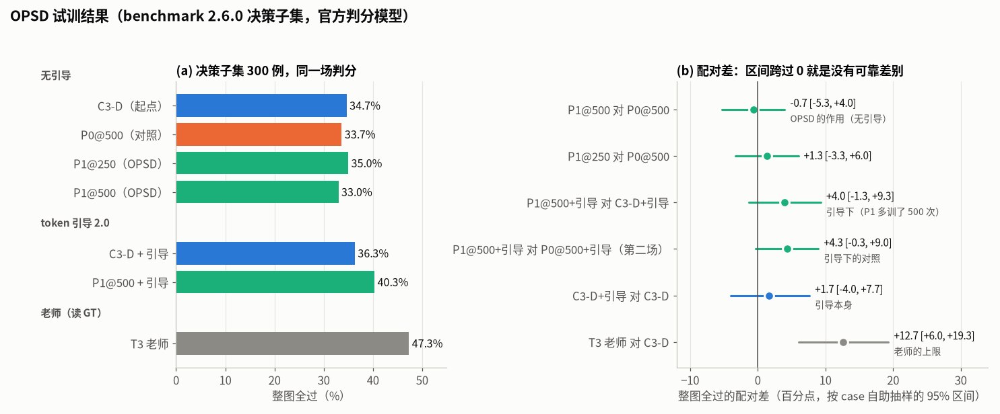

图 15　OPSD 试训结果（决策子集 300 例，同一次判分；(b) 第四行是第二场）：(a) 各系统的整图全过；(b) 配对差和 95% 区间。不加引导时 P1 与 P0 没有差别；加引导后 P1 最高，但对 C3-D + 引导、对 P0 + 引导都不显著。原图：`V3/analysis/opsd_pilot_20261026/figs/opsd_pilot_results.png`

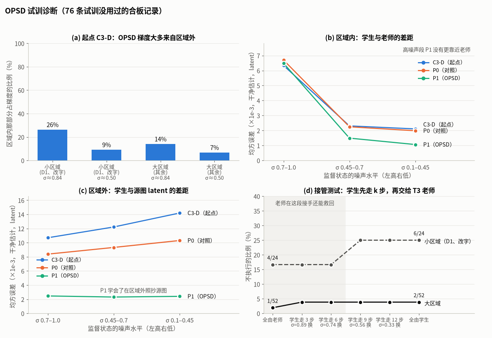

图 16　OPSD 试训诊断（76 条试训没用过的合板记录）：(a) 起点 C3-D 上，梯度里区域内那部分只占 7%–26%；(b) 区域内到老师目标的误差，P1 只在中低噪声段变小；(c) 区域外到源图 latent 的误差，P1 降到约 1/4；(d) 接管测试，老师在 σ ≥ 0.74 时接手还能救回小区域记录，但在这批数据上能救回的很少。原图：`V3/analysis/opsd_pilot_20261026/figs/opsd_pilot_diagnosis.png`

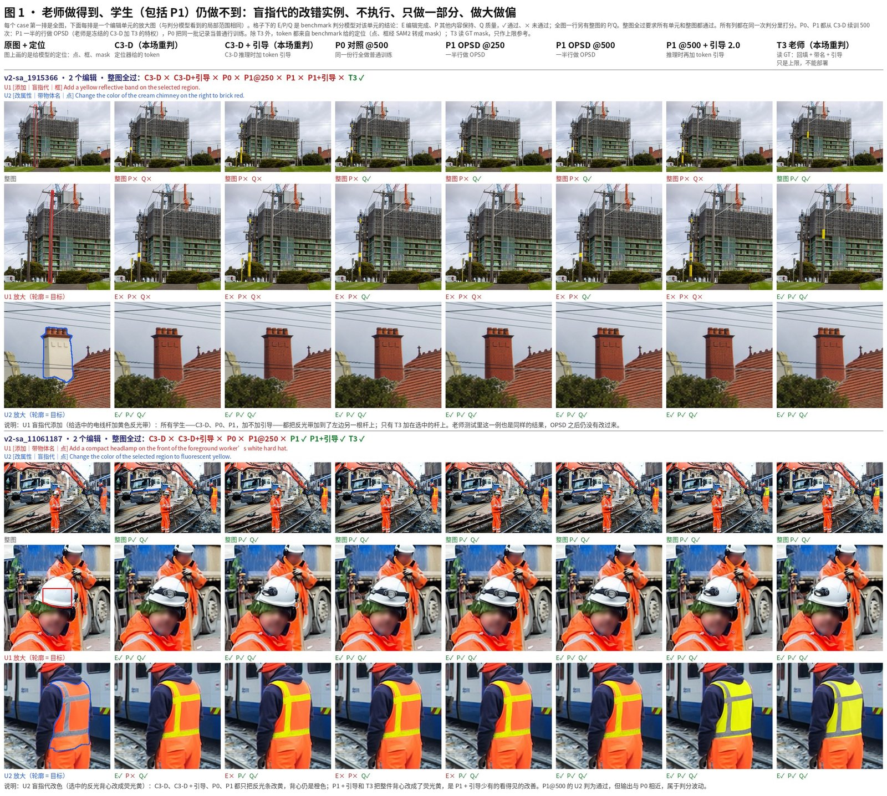

图 17　老师做得到、学生（包括 P1）仍做不到的盲指代：反光带所有学生都加到了另一根杆上，只有 T3 加对；反光背心只有 P1 + 引导和 T3 改成了荧光黄，是 P1 + 引导少有的看得见的改善（试训对比图 1 的第 1、5 例）。原图：`V3/analysis/opsd_pilot_20261026/sheets/pilot_cases_1.jpg`

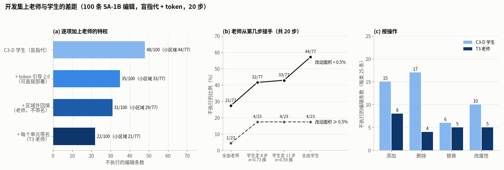

图 18　第 1 步，开发集 100 条 SA-1B 编辑：(a) 逐项加上老师的特权，不执行 48 → 35（引导）→ 31（回填）→ 22（带名）；(b) 老师从第几步接手，学生先走 8 步就丢掉一半以上的差距；(c) 按操作，删除差距最大，替换几乎没有。原图：`V3/analysis/opsd_pilot_20261026/figs/dev_teacher_gap.png`

- **路径：**
  - `V3/analysis/opsd_pilot_20261026/`：说明 `README.md`、取行配置 `spec_p1.json`、串联脚本 `run_all.sh`、第二场 `run_s2.sh`、生成配置 `configs/`、输出 `runs/`、判分 `judged/`、结果 `report.txt`（第二场 `report_s2.txt`）、诊断 `diagnosis/`、图 `figs/`、对比图 `sheets/pilot_cases_1.jpg`（说明见 `sheets_spec.json`）；
  - 训练：`V3/runs/opsd_p1_local8_001/`、`V3/runs/opsd_p0_local8_001/`（权重 P1 `adapter_250/500`、P0 `adapter_500`，开发集评测 `eval_*`，`analysis_*.txt`）。

### 7.2 第二次试训（10-28 至 10-29）
- **目的：**按 §7.1 的诊断修了 OPSD 的三处，看它能不能把老师在小区域盲指代上的优势传给学生（用户 10-28 同意）。用户在打标的新数据（多目标、孪生）等用户通知后另做。
- **改了什么**（相对第一次试训，文档 02 §5.4、§5.5、§5.11）：
  - **选行：**8,000 行 OPSD 全部取 D1 小区域（改动 ≤ 0.5%）：删除 3,200、添加 2,400、改属性 2,400，盲指代 85%。第 1 步里老师的优势在这几类，替换上没有。诊断用的 76 条留出行排除在外。
  - **损失：**A 内外分开归一，A 外的权重 0.1（`--opsd-loss split --opsd-outside-weight 0.1`）。
  - **选状态：**监督状态平均 75% 取自 σ ≥ 0.73（`--opsd-high-sigma 0.73 --opsd-high-share 0.75`）。
  - **λ_opsd = 2：**按单行梯度的中位数重新标定（文档 02 §5.9）。标定时发现，同样的 D1 行用原来的损失，梯度只有普通行的 1/56，第一次试训里这类 OPSD 行几乎没有起作用。
- **其余照旧：**
  - P1′ 与 P0′（同一批行全做普通训练，D1 行补近邻负例）都从 C3-D@1500 起，500 次更新 × 32 行，学习率同第一次；
  - 另一半是普通行，8,000 行，按 C3-D 的类别比例抽；
  - 行文件 `V3/data/round2_20261016/rows_opsd_pilot2_p1.jsonl`、`rows_opsd_pilot2_p0.jsonl`；
  - 代码：v4 提交 `eb018c6f`。
- **评测：**
  - 开发集：P0′@500、P1′@250、P1′@500；
  - 开发集 100 条 SA-1B 编辑另跑一遍加引导的（`dev_guidance.py`）；
  - 决策子集同一次判分：P1′@500、P0′@500、两者 + 引导，C3-D + 引导同场重判。
- **判定**（跑之前写定，`criteria.py`）：
  1. **机制（主判据）：**开发集 100 条 SA-1B 编辑上，P1′@500 的不执行比 P0′@500 少，配对 95% 区间的上界 < 0。
  2. **部署：**决策子集上 P1′ + 引导对 P0′ + 引导，整图全过或盲指代单元 E 的区间下界 > 0；单元 P ≥ 0.87，且没有显著变差。
  3. **结论的走向：**两条都过，P1′ + 引导成为默认系统的候选，再用新数据（孪生、多目标）扩大 OPSD；只过第 1 条，扩大 OPSD 行之后再测；第 1 条没过，停掉 OPSD。
  - 用同一套判定检查第一次试训，结论是"机制没过"（不执行 46 对 46），与 §7.1 一致。
- **运行**（多机，`V3/analysis/opsd_pilot2_20261028/README.md` 的"多机运行"一节）：
  - 用户 10-28 提出：每个实验写好单机入口，由他另开机器加速。改成多机后，本机训练 P1′ 并判分；另一台 8 卡机器训练 P0′，做全部决策子集生成、开发集评测和开发集编辑加引导。
  - 那台机器用 `entry.sh` 自动克隆代码、建环境、领任务。各任务通过 NAS 上的认领和心跳分工，结果写回原来的路径，与在哪台机器上做无关。
  - 判分在 P1′ 训完后立刻开始，按判定需要的顺序逐个系统判，不等全部生成完。
  - 全程 13.2 小时，原单机串联估计约 24 小时。其中 P1′ 9.8 h，P0′ 2.2 h，判分 5 个系统约 3.3 h，没有解析错误。
  - 新机器第一次建环境失败：`scripts/round2/setup_env.sh` 最后的 CUDA 检查调用了 v4 已删掉的模块（§9 下一步第 7 条）。`entry.sh` 改为照它的步骤建环境、直接用检查脚本自带的探测，之后正常。新环境的 torch、cuBLAS、cuDNN 等版本与本机一致。
- **结果：两条判据都没过，按判定停掉 OPSD**（`criteria.txt`；配对区间按编辑或按 case 自助抽样 20,000 次）。
  - **机制：没过。**开发集 100 条 SA-1B 编辑（盲指代 + token，20 步）：

    | | 不执行 | 加引导 2.0 后不执行 |
    |---|---:|---:|
    | C3-D | 48 | 35 |
    | P0′@500 | 47 | 38 |
    | P1′@250 | 46 | — |
    | P1′@500 | 45 | 37 |

    - 配对差：P1′ − P0′ 为 −2.0 [−7.0, +3.0] 个点；P1′ − C3-D 为 −3.0 [−8.0, +1.0]；加引导后 P1′ − P0′ 为 −1.0 [−7.0, +5.0]。
    - 相对 P0′ 只变了 6 条：改好 4 条（添加 2、删除 2），变坏 2 条（都是改属性）。改动强度（区域内减区域外的变化）−0.1 [−1.8, +2.0] 灰度，其中删除 +3.5、改属性 −3.8。
    - 其他探针（`V3/runs/opsd2_p1_local8_001/analysis_500.txt`）：单 token 盲指代 IoU 0.472，对 P0′ +0.011 [+0.001, +0.022]，小而显著；带名、多 token、token 互换、删除探针与 P0′ 没有显著差别。
  - **部署：没过。**决策子集 301 例，同一次判分（`report.txt`）：

    | 系统 | 整图全过 | 单元 E | 盲指代 E | 删除 | 写字 | 单元 P |
    |---|---:|---:|---:|---:|---:|---:|
    | P1′@500 | 33.2% | 0.752 | 0.662 | 0.743 | 0.456 | 0.893 |
    | P0′@500（对照） | 31.6% | 0.742 | 0.669 | 0.703 | 0.544 | 0.898 |
    | P1′@500 + 引导 2.0 | 35.9% | 0.794 | 0.742 | 0.819 | 0.632 | 0.881 |
    | P0′@500 + 引导 2.0 | 33.2% | 0.782 | 0.723 | 0.767 | 0.618 | 0.883 |
    | C3-D + 引导 2.0（同场重判） | 37.2% | 0.789 | 0.733 | 0.783 | 0.618 | 0.887 |

    - 判定用的一对：P1′ + 引导 − P0′ + 引导，整图全过 +2.7 [−2.7, +7.6] 个点，盲指代 E +0.019 [−0.013, +0.052]，单元 P −0.002 [−0.020, +0.017]。保持没有变差，但没有显著提升。
    - 只报告的：
      - 不加引导，P1′ − P0′ 为 +1.7 [−2.7, +5.6]；
      - 对同场重判的 C3-D + 引导：P1′ + 引导 −1.3 [−6.6, +4.0]，P0′ + 引导 −4.0 [−9.0, +1.0]。这 500 次更新，不管做不做 OPSD，都没有让部署系统好过 C3-D + 引导；
      - 删除上 P1′ 高一些（0.743 对 0.703，加引导 0.819 对 0.767，没有算区间），与开发集删除的改动强度 +3.5 一致；
      - 写字上，不加引导时 P1′ 低 0.088 [−0.191, +0.015]，不显著。
- **诊断：**
  - **学生在训练行上也没有靠近老师。**
    - 区域内的蒸馏误差 `opsd_in`，按 100 次更新分段：0.0082、0.0073、0.0071、0.0068、0.0078；线性趋势每 100 次更新 −1.6%。
    - 每个 OPSD 行只用一次，所以这一项量的是学生在新的训练行上离老师多远。
    - 第一次试训的 OPSD 损失每 100 次降 8.4%，但那主要是区域外照抄源图的那一项（§7.1）。
  - **不执行集中在极小区域，老师的优势也集中在这里。**按 GT 改动面积分档，老师两列来自 §7.1 第 1 步（`V3/analysis/opsd_pilot_20261026/diagnosis/dev_takeover/`），老师本身带引导 2.0：

    | 改动面积 | 条数 | C3-D | P0′ | P1′ | C3-D + 引导 | P0′ + 引导 | P1′ + 引导 | 不带名的老师 | T3 |
    |---|---:|---:|---:|---:|---:|---:|---:|---:|---:|
    | < 0.1% | 49 | 35 | 34 | 32 | 25 | 26 | 27 | 23 | 17 |
    | 0.1%–0.5% | 28 | 9 | 9 | 9 | 8 | 8 | 7 | 6 | 4 |
    | ≥ 0.5% | 23 | 4 | 4 | 4 | 2 | 4 | 3 | 2 | 1 |

    - T3 比 C3-D 少 26 条不执行，其中 18 条在 < 0.1% 这一档；P1′ 在这一档只比 P0′ 少 2 条，加引导后反而多 1 条。
    - 这一档的 token 读得很差：同一开发集上，C3-D 的单 token 盲指代 IoU 在区域占 0.05%–0.10% 时 0.091，0.10%–0.25% 时 0.220，≥ 5% 时 0.800。
    - token 本身的往返 IoU（SAMTok 编码再解码）也随面积下降：改动 ≥ 0.5% 的编辑中位 0.92，< 0.1% 的 0.68。比起模型读 token 的 0.1–0.2，这不是主要损失。
  - **解读：**
    - 极小区域上，学生凭 token 定位不准；老师靠物体名（和回填）绕过了读 token 这一步。
    - 所以老师的目标里有学生从自己的输入推不出来的信息。这部分学不会，区域内误差降不下来，不执行也不变。
    - 要减少这类不执行，得提高模型在极小区域上读 token 的能力（数据、表示），蒸馏补不了。
- **结论：**
  - 按事先写定的判定停掉 OPSD。两次试训的权重都不换上去，默认系统仍是 C3-D + 第一步定位 + 引导 2.0。
  - 剩下的不执行主要是极小区域上读不准 token，下一步从定位能力上解决（§9）。
- **路径：**
  - `V3/analysis/opsd_pilot2_20261028/`：
    - 说明与结果 `README.md`、取行配置 `spec_p2.json`、梯度标定 `grad_scale.py`；
    - 多机运行 `entry.sh`、`worker.sh`、`tasks.sh`、`judge_session.py`（原单机串联 `run_all_single.sh` 留作记录）；
    - 判定 `criteria.py` 与结果 `criteria.txt`、决策子集分析 `report.txt`、进度 `status.txt`；
  - 训练：`V3/runs/opsd2_p1_local8_001/`、`V3/runs/opsd2_p0_local8_001/`，开发集报告在各自的 `analysis_500.txt`。

## 8. 代码验证（见文档 02）
v4 的代码核对写在[文档 02](02_SAMTokEdit_Qwen21_v4方法.md)，本文不重复。核对分两类：一是重构等价，即 v4 与 v3 的训练损失与梯度、benchmark 适配器输出（token、引导、老师模式）、开发集探针逐位一致，升级 DiffSynth 后又复核了一遍；二是 OPSD 训练器（`src/samtok_edit21/training/opsd.py`，测试 `tests/test_opsd.py`）的正确性检查和 8 卡冒烟。本文 §2–§6 的实验全部用 v3 代码运行，§7 的试训用 v4 代码；用 v4 继续实验时，训练入口是 `src/samtok_edit21/training/round2_engine.py`，C3 用到的命令行参数在 v4 中都保留。

## 9. 结论汇总与下一步

**已确认的结论**
1. **只用编辑对训练，DiT 不会读 token**（v2）；**指认任务 + 注意力路由 + 近邻反例能让它学会。**探针证实定位通过 token 完成：读 AUROC 0.74 → 0.93，去掉 token 后输出基本不重合。
2. **定位的瓶颈：**不在数据量（训练图与新图差 0.04），不在分辨率（1.5 MP 几乎无改善），也不在 token 能否区分（同类对 98% 码不同）；在 DiT 区分近邻的精度，读对后在去噪中写偏。补近邻反例只带来小幅提升（+0.023）。
3. **编辑：**带 token 的编辑比原版准得多（开发集区域外改动 1.8 对 5.0–6.2，benchmark 单元 P 0.89–0.91 对 0.62）。主要短板是小区域上的不执行，而不执行是置信度问题：换种子或写明物体名，执行率升到 66%–67%。
4. **benchmark：**C2 用 token 输入，101 例整图全过 34.7%，原版用官方彩色定位图 12.9%，FLUX.3 klein 28.7%；C3-D + 引导在 301 例上 37.7%，原版 11.7%，FLUX.3 27.7%。
5. **C2 输的四块**（只给文字的单元、替换、写字、大目标改属性）有三个原因：换 SAMTok 文本编码器丢了细语义；训练教出"只在 mask 里改、少改"；只给文字的单元没有 token。第三个已由第一步定位补上（0.69 → 0.86）；第二个由 C3-D 的数据清洗和定向数据部分缓解（替换 0.736 → 0.805）。
6. **三条改进路线的效果：**
   - 改数据（C3-D）有效且不伤保持；
   - 改区域项（C3-M）提高执行但伤保持，不能单独用；
   - token 引导不用训练、效果与改方法相当，以少量保持换执行；与 C3-D 能叠加，但叠加收益不显著。
7. **老师上限：**GT mask 回填 + 带名指令 + 引导的老师比学生高 10.0 个点、保持也更好，OPSD 的前提基本成立（临界）；提升主要来自带名指令。
8. **评测上的教训：**判分模型跨会话的逐例一致率只有 78%，3 个点左右的差在 301 例上仍不显著；系统比较要放在同一次判分里，小差异要靠全量 1,084 例。
9. **OPSD：两次试训都没有把老师的优势传给学生，已停掉（§7）。**
   - 第一次的损失被区域外照抄源图的那一项主导。
   - 第二次修了选行、损失和选状态，开发集不执行仍只从 47 降到 45，不显著；区域内的蒸馏误差在训练中几乎不降。
   - 老师的优势集中在改动 < 0.1% 的极小区域，来自物体名和回填，学生只凭 token 推不出来。
10. **剩下的不执行主要是极小区域上读不准 token。**
    - 开发集改动 < 0.1% 的 49 条里，C3-D 35 条不执行；0.1% 以上的 51 条里只有 13 条。
    - 同一开发集上，这么小的区域单 token 盲指代 IoU 只有 0.09–0.22。
    - token 本身的往返 IoU 也降到 0.68，但主要损失在模型读 token 这一步（§7.2）。

**还没解决的问题**
- 大目标改属性（≥ 1%）：部署系统最好 0.885（C3-MD）、0.863（C3-D + 引导），没到 0.90。
- 极小区域（改动 < 0.1%）的不执行：C3-D 71%（35/49），加引导 51%（25/49）；模型在这么小的区域上读不准 token（§7.2）。
- 盲指代单元：改错部位或改到旁边的同类物体仍是主要失败；老师测试显示，写明物体名能解决大部分，但学生在推理时拿不到物体名，两次 OPSD 试训都没有把这一点传给学生（§7）。
- 写字：C3-D + 引导 0.647，仍低于 FLUX.3 的 0.706；老师 T3 也是 0.662，OPSD 在写字上拿不到多少信号。
- 替换做成叠加：替换的旧物完全消失还不稳定。

**下一步（建议，待用户决定）**
1. **OPSD 停掉**（两次试训，§7）。第二次的诊断指向极小区域上读 token 的能力，不是蒸馏的配方。
2. **默认系统不变：**"C3-D + 第一步定位 + token 引导 2.0"。
   - 第二次试训的判分里同场复核为 37.2%，两次试训的模型都没有超过它。
   - 最终模型跑全量 1,084 例（约 4 小时生成，另加判分）。
3. **极小区域的定位（新）：**剩下的不执行大多在改动 < 0.1% 的区域。
   - 新数据（多目标、孪生）抽检时按改动面积分层，统计极小区域的占比；
   - C4 续训时提高极小区域、同类多实例行的比重（编辑和高亮两类），开发集按面积分档报告；
   - 是否另做专门的小区域定位数据，待用户定。
4. **保住改方法的执行收益又不伤保持：**区域项只算改动处，同时给外圈单独加一项保持（或外扩但降权）；需要一次约 11 小时的训练。OPSD 诊断显示，区域外的照抄源图项本身就是一个很强的保持损失（§7），可以直接拿来用。
5. **条件结构（备选）：**如果替换、写字在加入新数据之后仍明显不达标，再考虑双路条件（原版 TE 管文字语义、SAMTok TE 只给区域 token）；这要重做 stage B，也会改变用户 10-18 定的"第二遍只用 SAMTok TE"。
6. **论文消融：**之前提的 edit-only、去掉路由、去掉注入还没跑，在选定最终模型后补。
7. **仓库修复（待用户同意）：**
   - `scripts/round2/setup_env.sh` 最后一步调用 `scripts/round2/cuda_readiness.py`，而它的探测仍按 v3 的模块名 `samtok_edit21.distributed.cuda_readiness` 启动。v4 精简代码时删掉了这个模块，所以新机器建环境必然失败：10-28 两台新机器都在这一步失败，`run_arnold.sh` 也受影响。
   - 第二次试训的 `entry.sh` 绕开了它（§7.2）。

## 10. 产物路径总表

| 路径 | 内容 |
|---|---|
| `V3/README.md` | 实验树的目录说明；迁移对照 `V3/MOVED_20261019.tsv` |
| `V3/data/stageA_ea1_20261011/`、`V3/data/stageA_ea2_20261012/` | 第一轮训练数据与 1,930 项评测集 |
| `V3/data/round2_20261016/` | 第二轮全部数据：开发划分、区域池、token 缓存、`rows_c1/c1b/c2/c3m/c3d.jsonl`、两次试训的 `rows_opsd_pilot_p1/p0.jsonl`、`rows_opsd_pilot2_p1/p0.jsonl` 与统计、开发集 `eval_c1.json`、快速评测子集 |
| `V3/runs/ea1_local8_001/`、`V3/runs/ea2_local8_001/` | 第一轮训练、评测、可视化；E-A2 的对比页 `gallery/` |
| `V3/runs/c1_local8_001/` | C1：权重 `adapter_1500`、`adapter_2000`；评测 `eval_1500`、`eval_2000`、`eval_1500_1p5mp`、`eval_1500_train_images`；`summary*.txt`；`cases/` |
| `V3/runs/c1b_local8_001/` | C1b：权重 `adapter_800`；评测 `eval_800`；`summary.txt`、`nearmiss.txt` |
| `V3/runs/c2_4n_002/` | C2：权重 `adapter_3522`、`adapter_2000`；评测 `eval_3522`、`eval_2000_subset`；`analysis.txt`；原版对比图 `cases/`；评测与探针脚本 `V3/runs/c2_4n_002/scripts/` |
| `V3/runs/c3m_local8_001/`、`V3/runs/c3d_local8_001/`、`V3/runs/c3md_local8_001/` | C3 三个训练：权重 `adapter_1500`（第 500、1000 次的中间权重和 `resume.pt` 于 10-29 经用户同意删除，快速评测结果仍在）；开发集评测 `eval_1500`；`analysis.txt`；`command.txt`；训练脚本如 `V3/runs/c3d_local8_001/scripts/train.sh`（另两个同名） |
| `V3/runs/c3d_local8_001/train/adapter_1500` | **当前最好的训练权重（C3-D）** |
| `V3/runs/_aux/` | 失败运行 `c2_4n_001`、三个入口验证、入口与冒烟脚本（只留日志） |
| `V3/baselines/` | 原版在第一轮评测集上（`stock_highlight_eval/`）；原版 1 MP / 1.5 MP 与 E-A2 在开发集上；官方原版 + 文字指令（`round2_official_text_edits/`） |
| `V3/analysis/benchmark_gap_20261013/` | E-A2 与 benchmark 的差距（§2.4） |
| `V3/analysis/diag_20261017/` | 10-17 诊断：`probe/`、`text_edits/`、`bench_text/`、`judge/` 和分析脚本（§3.4） |
| `V3/analysis/noexec_20261019/` | 不执行诊断（§4.4） |
| `V3/analysis/bench_split_20261019/` | benchmark 拆分 36 例：输出、`verdicts.json`、`sheets/`（§4.5） |
| `V3/analysis/bench_subset_20261019/` | 101 例正式评测、C2 输的分析、第一步定位验证：`report_main.txt`、`report_supplementary.txt`、`report_losses.txt`、`sheets/`（§4.6、§4.7） |
| `V3/analysis/c3_plan_20261020/` | C3 方案的数据核查：50k 改动面积、训练目标完成度、贴回范围 |
| `V3/analysis/c3_eval_20261023/` | C3 决策子集与方案 A：选例、各系统输出、判分、`report.txt`、`report_a.txt`、`status.txt`、对比图 `sheets/c3_cases_1.jpg` 到 `_5.jpg`（§5） |
| `V3/analysis/opsd_plan_20261025/README.md` | OPSD 的调研与方案（§6） |
| `V3/analysis/opsd_teacher_20261025/` | OPSD 老师上限测试：配置、输出、判分、`report.txt`、对比图 `sheets/teacher_cases_1.jpg` 到 `_5.jpg`（§6） |
| `V3/analysis/v4_code_checks_20261026/` | v4 开发时的代码核对：v3 与 v4 等价、OPSD 正确性检查与 8 卡冒烟、合板重建核对、文档统计脚本（原 `/tmp/claude_v4/`，10-28 搬来） |
| `V3/analysis/opsd_pilot_20261026/` | OPSD 试训：说明 `README.md`、配置、生成、判分、`report.txt`、`report_s2.txt`、诊断 `diagnosis/`、图 `figs/`、对比图 `sheets/`（§7） |
| `V3/runs/opsd_p1_local8_001/`、`V3/runs/opsd_p0_local8_001/` | 试训的两次训练：权重 P1 `adapter_250/500`、P0 `adapter_500`、开发集评测、`analysis_*.txt` |
| `V3/analysis/opsd_pilot2_20261028/` | OPSD 第二次试训：说明 `README.md`（含结果）、取行配置、梯度标定、多机运行脚本（`entry.sh`、`worker.sh`、`tasks.sh`、`judge_session.py`）、判定 `criteria.py` 与结果 `criteria.txt`、决策子集分析 `report.txt`、各系统输出与判分、进度 `status.txt`（§7.2） |
| `V3/runs/opsd2_p1_local8_001/`、`V3/runs/opsd2_p0_local8_001/` | 第二次试训的两次训练：权重 P1′ `adapter_250/500`、P0′ `adapter_500`、开发集评测 `eval_500`（P1′ 另有 `eval_250`）、`analysis_*.txt` |
| `V3/reports/progress_20261020/` | 10.20 进度汇报的草稿和图（图 2、3、5、8、9 的原图） |
| `V3/legacy_code/` | E-A1、E-A2 当时的脚本、等价核对与 GPU 回归（只作留档，不要再运行） |
| `datasets/samtok_edit_benchmark_v2/benchmark/cases.jsonl` | benchmark v2 2.6.0 的 1,084 例清单 |
| `datasets/SAMTokEdit_Merged_20261029/` | 合板训练数据的 10-29 版：加入 D12–D15（孪生、多目标、附带单目标、单目标 v2.1），旧记录不变（文档 01 §2.7）。两次 OPSD 试训用的 10-26 版是它的子集，10-29 已删 |
| `experiments2/SAMTokEdit/cleanup_20261029/` | 10-29 经用户同意的清理：删掉的文件清单（`*.tsv.gz`）、日志、删除脚本。包括各决策子集评测判分输入里的裁图 `judge_inputs/*/details/`（判分结果、`judge_jobs.jsonl` 都在，要重判时用各目录的 `prepare_judge.py` 重新生成）、7 个 `resume.pt`、没用到的中间权重、合板 10-26 版 |
| `docs/assets/v4/` | 本文的 18 张图（缩小、节选版） |

- 运行环境：按仓库 README 用 `requirements.txt`（验证过的版本见 `constraints-tested.txt`）建环境，在仓库根目录设 `PYTHONPATH=src:third_party/diffsynth:third_party`。原来的本机环境 `/tmp/samtok21-fixes-dUnbt5/venv` 已随机器回收，依赖清单和判分环境的记录在 `experiments2/SAMTokEdit/handoff_20261028/envs/`。
- v4 开发时的代码核对（v3 与 v4 等价、OPSD 正确性、合板重建核对等）的脚本和结果：`V3/analysis/v4_code_checks_20261026/`（见其 `README.md`）。
- 交接说明：仓库根目录的 `HANDOFF.md`（NAS 上的副本 `experiments2/SAMTokEdit/handoff_20261028/HANDOFF.md`）。
- 2026-10-19 经用户确认，删除过没有完整评测过的中间权重、失败与入口验证运行的权重和审阅草图（约 8.9 GB）；快速评测结果仍在各 run 目录。
