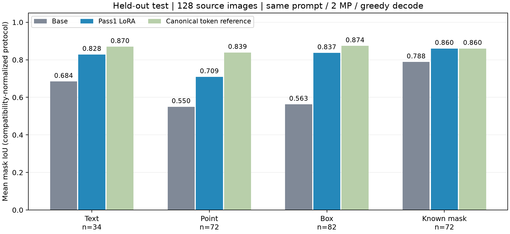
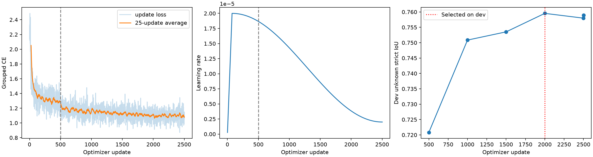
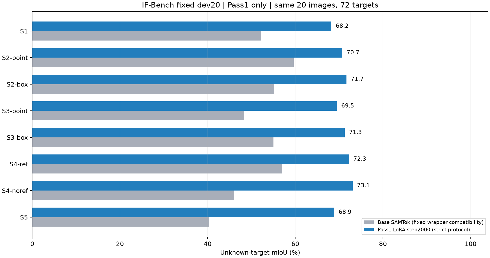
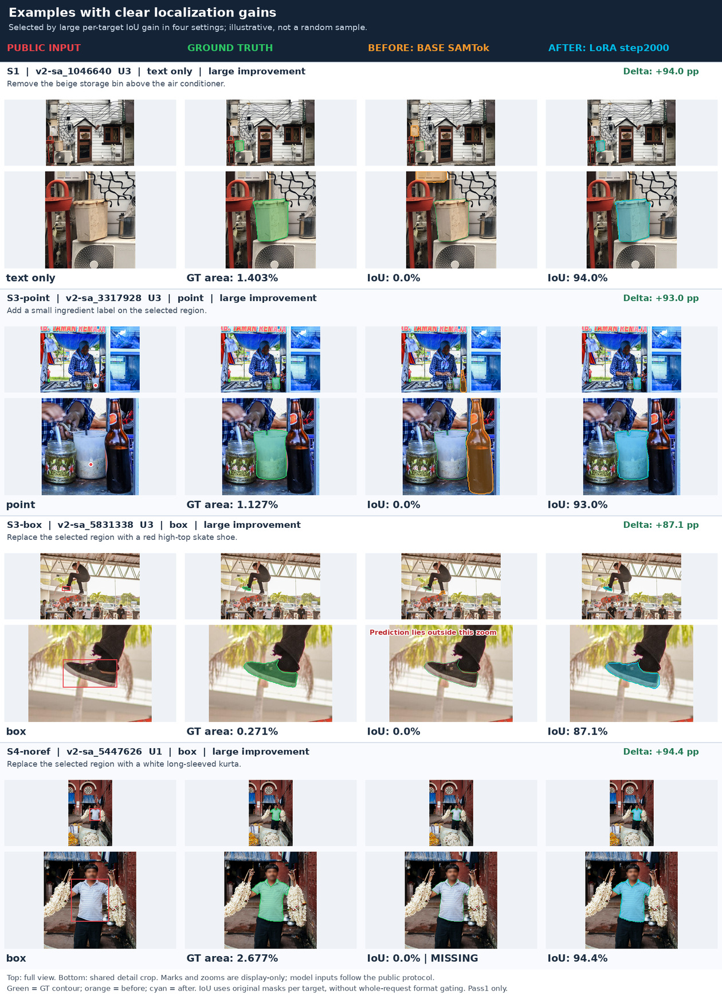
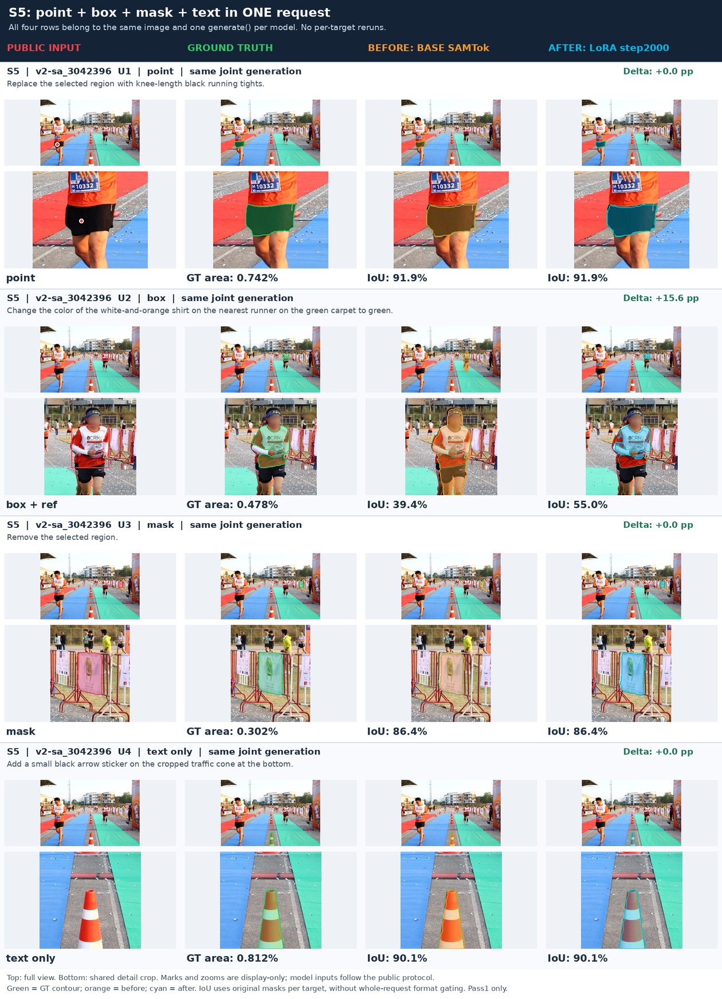
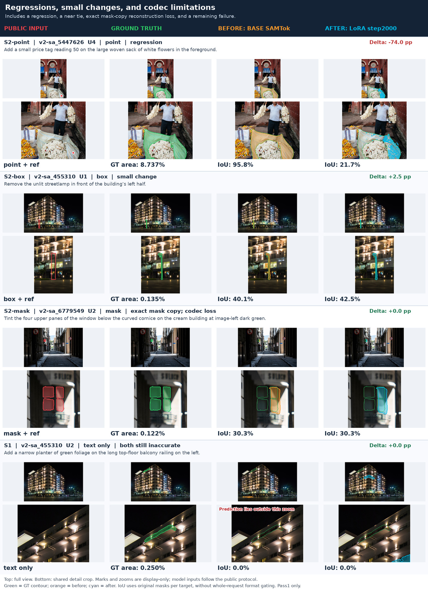

# Pass1 实验结果与可视化

本页区分历史试训、正式训练固定 test、IF-Bench dev20 三种评估。全部只衡量定位与协议，不含 DiT 编辑分数。GPU 结果来自冻结的原实验；本次整理仅搬入代码、统计和图片，没有重新训练。原图路径与 SHA256 见 [图片清单](assets/pass1/manifest.json)。

## 1. 试训：验证这条路线能学习

8,192 请求、2,048 张 train 图，64 张 dev、128 张 test；128 updates。dev 从 64/128 中选 128。该测试集的点经过 S 与 canonical 解码交集筛选，分布较容易。

| pilot 固定 test 指标 | 基座 | pilot step128 |
|---|---:|---:|
| 未知目标 compatible mIoU | 57.98% | 78.63% |
| 严格格式 | 0.00% | 100.00% |
| 给定 mask 原始精确复制 | 91.67% | 100.00% |
| Point compatible mIoU | 54.98% | 70.91% |
| Box compatible mIoU | 56.27% | 83.69% |

未知目标增益按源图 bootstrap 95% CI 为 [+14.72, +26.57] 个百分点。结论是 LM LoRA 能学习协议和定位；当时 K=4/5 与困难点击覆盖有限，不能外推到最终 benchmark。

## 2. 正式训练与 checkpoint 选择

实际 159,861 请求、74,881 张训练图；warmup 500 + main 2002 updates。8×H100、有效 batch64、r64/alpha128/dropout0.05、252 个 LM 模块；BF16 基座/FP32 adapter，assistant-only grouped NTP，LR2e-5，3%全局 warmup 后连续 cosine。阶段边界不重置 optimizer/LR；数据配置与实际数量见 [正式数据](pass1_formal_data.md)。

| update | dev unknown strict mIoU | strict 格式 |
|---|---:|---:|
| 500 | 72.08% | 97.00% |
| 1000 | 75.08% | 99.60% |
| 1500 | 75.35% | 99.60% |
| 2000 | 75.95% | 99.80% |
| 2500 | 75.80% | 99.80% |
| 2502 | 75.90% | 99.90% |

**按 dev 选择 step2000**，然后才跑固定 test。最后约 500 updates 的 dev 指标基本持平，未据 benchmark 重选 checkpoint。

横轴为全局 optimizer update，虚线标记第500步的 curriculum 切换。训练按 dev 节点暂停/恢复，墙钟图中的空白不代表用插值补了 loss；图中使用实际记录的更新。绿色/橙色等可视化配色以各图图注为准。

### 正式固定 test：999 张图，3,547 个目标

其中未知目标 2,535、给定 mask 1,012。表中的 pilot 是重新在这个相同 test 上评估的旧 adapter，不能与上一节的 pilot test 混用。

| 指标 | Base | Pilot step128 | Formal step2000 |
|---|---:|---:|---:|
| 严格协议 | 0.00% | 96.40% | 99.80% |
| 兼容协议 | 78.18% | 96.40% | 99.80% |
| 未知目标 strict mIoU | 0.00% | 68.66% | 76.89% |
| 未知目标 compatible mIoU | 42.70% | 68.66% | 76.89% |
| 给定 mask 原始精确复制 | 91.40% | 98.62% | 100.00% |
| 整条请求所有目标 strict IoU≥0.5 | 0.00% | 63.96% | 76.38% |

Base 大量输出 Markdown fence，strict 将这类格式错误计为整请求0；compatible 仅移除允许的外层包装后仍要求全部 ID/schema 正确。正式 adapter 相对 pilot 的未知目标 strict 增益为 +8.22 pp，按源图95% CI [+6.82,+9.65]。与 Base 比较定位时应同时读 compatible 的 42.70%→76.89%，不能把 strict 的 0→76.89% 全部归为定位收益。

所有正式训练段冻结参数哈希与 adapter-off logits/pre-norm probe 通过；真实共享 TE 关闭 LoRA 后 pre-norm/norm 逐元素相同。两步恢复可用，但独立连续/恢复训练的严格逐位权重对照未通过，GPU 反向存在数值非确定性。

## 3. 官方 IF-Bench 十种 setting：固定 dev20

Benchmark release2.6.0、fairness v2.1，代码提交 b6ea7e4。20 张图、72 个独立目标，K=2/3/4/5 的图数为 3/4/11/2。每模型200次联合请求、720个目标输出；其中509次未知目标、211次给定mask。这些是在不同 setting 下重复评测，不能称为720个独立目标。

step2000 预先由正式 dev 选定；与训练图 SHA/SA 身份无交集。此 benchmark 运行没有读取 test 的评分资产，没有编辑图生成。相同 seed42、greedy、512输出上限、2MP；原始输入最大2637 tokens，LoRA输出最大79 tokens，无截断。

| Setting | 输入形式 | 未知输出数 | Base compatible mIoU | Formal strict mIoU | Formal 全部目标 mIoU |
|---|---|---:|---:|---:|---:|
| S1 | 全部纯文本指代 | 72 | 52.17% | 68.24% | 68.24% |
| S2-point | 文字指代 + point | 72 | 59.66% | 70.71% | 70.71% |
| S2-box | 文字指代 + box | 72 | 55.22% | 71.66% | 71.66% |
| S2-mask | 文字指代 + 给定 mask | 0 | — | — | 74.44% |
| S3-point | 无指代 point | 72 | 48.36% | 69.49% | 69.49% |
| S3-box | 无指代 box | 72 | 55.01% | 71.27% | 71.27% |
| S3-mask | 无指代给定 mask | 0 | — | — | 74.44% |
| S4-ref | point/box/mask 混合，含指代 | 49 | 56.98% | 72.26% | 72.26% |
| S4-noref | 相同几何混合，去掉指代 | 49 | 46.06% | 73.09% | 72.82% |
| S5 | 文字/point/box/mask 与 ref/no-ref 混合 | 51 | 40.38% | 68.90% | 70.45% |

**S2/S3-mask 的未知目标指标为不适用，不是缺测。** 它们已经提供全部 mask；需要检查复制与 codec 重建。LoRA 合计原始复制211/211，GT→codec→decode 的72目标参考均值74.44%，所以已给mask仍可能只有较低像素IoU。

未知目标总体：Base compatible 52.22% → Formal strict 70.60%；LoRA格式200/200，Base兼容格式197/200。point命中204/208=98.1%。所有目标的LoRA平均IoU为71.58%。S5的未知目标增益+28.52pp，按源图95% CI [+17.01,+40.74]。

### 前后对比：收益、联合请求与失败都展示

以下拼图直接复制自已完成评估。列为公开输入、GT绿色、Base橙色、LoRA青色；每例上方全图、下方相同局部放大。数字是按固定ID计算的原始目标IoU；展示crop仅为阅读，不作为模型输入，也没有按GT重新匹配预测。选例记录见 [gallery selection](assets/pass1/benchmark_gallery_selection.json)。

第一组展示不同输入形式的提升，不代表随机样本均值；整体结论以完整表格为准。

第二组展示完整S5联合请求：一张图同时出现point、box、mask及纯文字目标，每模型每例只有一次generate。给定mask的正确复制不应算成新定位成功。

第三组含袋子point定位退化、路灯小幅变化、四块窗玻璃的codec损失、顶层栏杆定位仍错。袋子面积8.74%，不能只归因于极小目标；窗玻璃token复制正确但解码不完整，不能归因于JSON或ID。

## 4. 分析与当前结论

- 协议和联合混合输出已明显改善。相同图/目标/自身提示配对后，S5混合68.90%、对应同类setting68.68%，在这20图上未显示明显混合额外损失；双方仍为多目标，未证明独立单目标与联合推理等价。
- 主要剩余错误是指代关系、部件/整体范围、add覆盖和codec重建。模型点覆盖很高但IoU不高，说明包含点击不足以保证范围正确。
- 训练已包含混合、小目标和反事实，下一轮应审计其语义/粒度与实际配额。单一token交叉熵没有直接约束几何质量；几何排序/教师修复/4MP均尚未实施。
- 当前只验证Pass1。基座预训练是否包含这些图未被排除；dev20样本少、目标在setting间重复，不作为论文完整test结论。

具体失败与证据见 [根因分析及建议](pass1_analysis.md)。机器可读数据见 [正式test](assets/pass1/formal_test_metrics.json)、[benchmark](assets/pass1/benchmark_metrics.json)、[checkpoint选择](assets/pass1/checkpoint_selection.json)；原始运行位置见 [artifacts.json](../configs/pass1/artifacts.json)。
