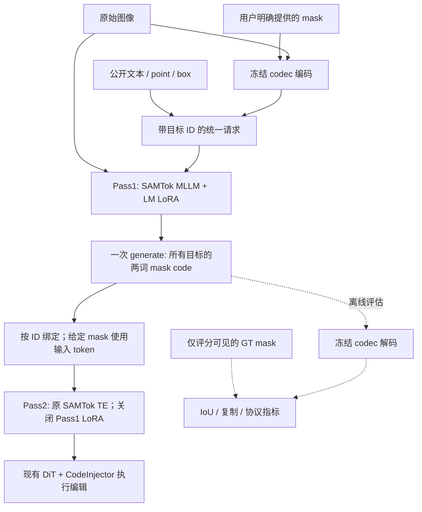

# Pass1：一次生成混合目标的 mask token

本分支 `pass1` 在冻结的 Qwen3-VL-8B-SAMTok 上训练一套独立的语言模型 LoRA。目标是一张源图中，多个编辑目标各自使用纯文本、point、box 或给定 mask，MLLM **一次自回归生成全部目标的 mask token**。Pass2 关闭该 LoRA，继续使用原 SAMTok TE 和已有 DiT 编辑方法。

当前已完成 8k 请求试训、159,861 请求正式训练，以及官方 IF-Bench 固定 dev20 的十种 setting 定位评测。选中 checkpoint 为正式训练 step 2000。这里报告 Pass1 定位，不报告 DiT 编辑质量。

| 阅读入口 | 内容 |
|---|---|
| 本文 | 方法、输入输出协议、NTP 监督和两轮推理边界 |
| [代码实现](pass1_implementation.md) | 目录分层、关键函数、自动同步的源码块 |
| [正式数据](pass1_formal_data.md) | 数据来源、实际选数/物化、隔离、几何与反事实 |
| [实验结果](pass1_experiments.md) | 试训、正式训练、benchmark，指标和可视化 |
| [问题分析](pass1_analysis.md) | 具体失败、训练覆盖、codec 误差、后续待验证方案 |
| [运行与复现](pass1_reproduction.md) | 安装、CLI、训练/恢复、评测、产物索引 |

## 1. 方法和两轮边界



text/point/box 直接作为 MLLM 输入，不经 SAM 先生成 mask。给定 mask 才允许 codec 编码；这个 codec 内部仍含 SAM2 模块。生成 token 后用于评分的解码属于离线评估，不是 point/box 的分割前处理。

一个 mask span 包含四个特殊 token：`<|mt_start|>`、两个离散 code、`<|mt_end|>`。两词 code 的合法 ID 范围分别为 0–255 和 256–511。图像与 token 共同决定解码区域，token 不代表跨图固定的类别或坐标。

## 2. 公开请求协议

协议固定为 `samtok_pass1_v2`。以下仅展示格式，坐标和 token 为示意值，不是一条新增评测结果：

```json
{
  "protocol": "samtok_pass1_v2",
  "coordinate_system": "normalized_0_1000",
  "targets": [
    {"label": "U1", "instruction": "Remove the red car on the left.", "has_ref": true, "locator": "none"},
    {"label": "U2", "instruction": "Change the selected region to blue.", "has_ref": false, "locator": "point", "region": {"point": [420, 610]}},
    {"label": "U3", "instruction": "Replace the chair with a wooden stool.", "has_ref": true, "locator": "box", "region": {"box": [100, 200, 350, 700]}},
    {"label": "U4", "instruction": "Remove the selected region.", "has_ref": false, "locator": "mask", "region": {"mask_2d": "<|mt_start|><|mt_0034|><|mt_0488|><|mt_end|>"}}
  ]
}
```

| 字段 | 含义与约束 |
|---|---|
| `targets` | 本图请求的目标列表；顺序是回答顺序，训练覆盖 K=1–5 |
| `label` | 输入输出绑定的唯一 ID，不是类别名称；不能遗漏、重复或换序 |
| `instruction` | 用户可见的完整编辑要求；保留动作与内容，不只提取类别 |
| `has_ref` | 指令是否含对象/区域的文字指代；false 时定位依靠提供的几何信息 |
| `locator=none` | 纯文字定位，必须 has_ref=true，不能附带 region |
| `locator=point` | 一个正点击，`region.point=[x,y]` |
| `locator=box` | 一个框，`region.box=[x1,y1,x2,y2]` |
| `locator=mask` | 用户提供区域经 codec 得到的 `region.mask_2d` |

坐标为 0–1000 整数。原图像素 point 使用 `round(1000*x/W)`、`round(1000*y/H)`，回投后检查有效性；box 原始像素使用半开区间 `[x1,y1,x2,y2)`，左上向下取整、右下向上取整归一化。实现统一在 `protocol.py`，不在 prompt 中自行混用像素和归一化坐标。

七种合法组合为 ref-only、ref/no-ref point、ref/no-ref box、ref/no-ref mask。无 ref 的 none 不合法。请求不接受私有 `scope/category/answer/GT mask` 等额外字段；给定 mask 的 token 只通过 mask locator 公开。

### 输出

回答为纯 JSON 数组，每个输入目标恰好一个 span。这里展示四目标示例的格式：

```json
[
  {"label": "U1", "mask_2d": "<|mt_start|><|mt_0001|><|mt_0257|><|mt_end|>"},
  {"label": "U2", "mask_2d": "<|mt_start|><|mt_0002|><|mt_0258|><|mt_end|>"},
  {"label": "U3", "mask_2d": "<|mt_start|><|mt_0003|><|mt_0259|><|mt_end|>"},
  {"label": "U4", "mask_2d": "<|mt_start|><|mt_0034|><|mt_0488|><|mt_end|>"}
]
```

默认 greedy、512 最大输出 token，无多次采样或 GT 候选选优。已给 mask 的目标也保留在联合回答中，模型学习原样复制；部署绑定可确定性保留输入 mask token，但指标始终在这一绑定之前计算。

## 3. 训练标签与损失

训练输入是原图和公开请求；标准答案来自该源图 selection **S** 的 canonical codec 两词编码。这里没有额外教师 MLLM。“教师 token”仅指这个监督标签。S 是需要定位的源图区域；add 对应源图 anchor/support，不是新增物体的编辑后轮廓，也不是 edited diff。

当前损失是 **assistant-only next-token prediction 交叉熵**，三组分别平均，再按存在组的权重归一化：

| token 组 | 权重 |
|---|---:|
| text/point/box 未知目标的两个 code | 1.0 |
| 给定 mask 的两个复制 code | 0.25 |
| JSON、label、开始/结束标记及 EOS | 0.25 |

没有 IoU/Dice loss，也没有几何偏好/RL 损失。反事实对在同一 global batch 中各做 NTP，不等于加入了对比学习。IoU 用于数据质量筛选、离线评估与 dev checkpoint 选择；[代码实现](pass1_implementation.md)直接引用真实 loss 函数。

## 4. 当前状态和结论边界

正式固定 test 的未知目标 strict mIoU 为 76.89%；官方 dev20 的十种 setting 合计未知目标 mIoU 为 70.60%，格式 200/200、给定 mask 原始复制 211/211。两个测试分布不同，不能直接横向解释为性能变化。

剩余问题主要是复杂指代/部件范围、add 定位覆盖、极小区域和 codec 重建误差。几何排序、更高分辨率、改善 token 监督标签都属于后续建议，当前 checkpoint 没有使用这些训练。所有数量、分母、对照和局限见 [实验](pass1_experiments.md) 与 [分析](pass1_analysis.md)。
